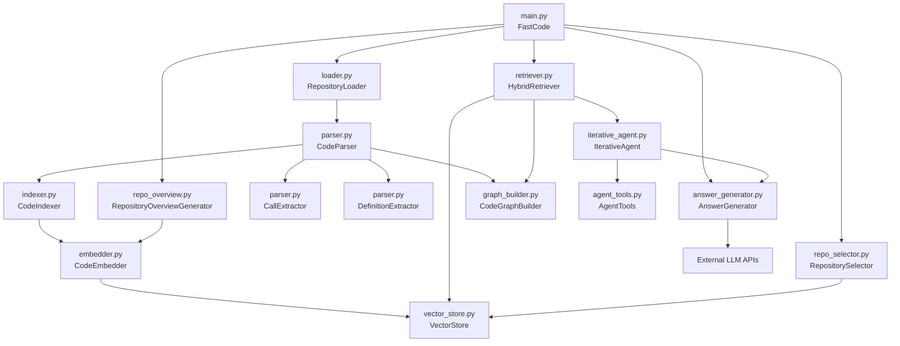
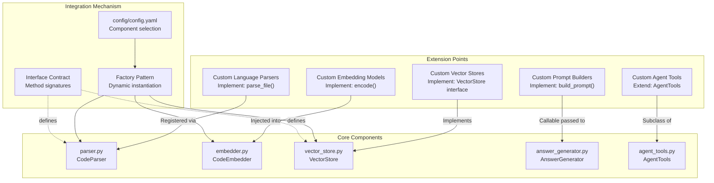
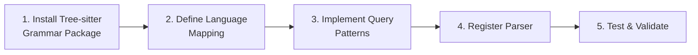

<!-- source: DeepWiki mcp.deepwiki.com · repo HKUDS/FastCode · page 10 Development Guide · fetched 2026-11-09 -->

# Development Guide

<details>
<summary>Relevant source files</summary>

The following files were used as context for generating this wiki page:

- [README.md](README.md)
- [requirements.txt](requirements.txt)

</details>


## Purpose and Scope

This guide provides technical documentation for developers who want to contribute to FastCode or extend its capabilities. It covers setting up a development environment, understanding the codebase structure, implementing custom extensions, and adding support for new programming languages.

For information about deploying FastCode in production environments, see [Deployment](#7). For configuration options, see [Configuration](#8). For advanced feature usage, see [Advanced Features](#9).

---

## Overview

FastCode is designed with extensibility in mind. The system provides well-defined extension points for:
- Custom language parsers via Tree-sitter grammars
- Custom embedding models (SentenceTransformer-compatible)
- Custom vector storage backends
- Custom prompt builders for answer generation
- Custom agent tools for code exploration

The codebase follows a modular architecture where each major component is implemented as a separate module with clear interfaces.

**Sources:** [fastcode/__init__.py:1-43]()

---

## 10.1 Development Environment Setup

### Prerequisites

- Python 3.8 or higher
- Git for version control
- Docker (optional, for containerized development)
- CUDA-capable GPU (optional, for accelerated embedding generation)

### Local Development Setup

Clone the repository and set up a Python virtual environment:

```bash
git clone https://github.com/HKUDS/FastCode.git
cd FastCode

# Create virtual environment
python -m venv venv
source venv/bin/activate  # On Windows: venv\Scripts\activate

# Install dependencies
pip install -r requirements.txt

# Install in development mode
pip install -e .
```

### Editor Configuration

FastCode includes an `.editorconfig` file that defines consistent coding standards across different editors:

| Setting | Value | Purpose |
|---------|-------|---------|
| `charset` | utf-8 | Consistent character encoding |
| `end_of_line` | lf | Unix-style line endings (crlf for .bat/.cmd) |
| `insert_final_newline` | true | Ensure files end with newline |
| `trim_trailing_whitespace` | true | Clean whitespace |

Most modern IDEs (VS Code, IntelliJ IDEA, PyCharm) automatically respect these settings.

**Sources:** [.editorconfig:1-13]()

### Environment Variables

Create a `.env` file in the project root with your API keys and model configuration:

```bash
# LLM Provider Configuration
OPENAI_API_KEY=your_openai_key_here
MODEL=gpt-4-turbo
BASE_URL=https://api.openai.com/v1

# For OpenRouter
# MODEL=google/gemini-2.0-flash-exp:free
# BASE_URL=https://openrouter.ai/api/v1

# For local Ollama
# MODEL=ollama
# BASE_URL=http://localhost:11434
```

### Git Ignore Configuration

The `.gitignore` file prevents committing sensitive or generated files:

| Category | Patterns | Purpose |
|----------|----------|---------|
| Python artifacts | `__pycache__/`, `*.pyc`, `*.egg-info/` | Compiled bytecode and package metadata |
| Virtual environments | `venv/`, `env/`, `.venv` | Python virtual environments |
| IDE files | `.vscode/`, `.idea/`, `*.swp` | Editor-specific configuration |
| Sensitive data | `.env`, `.env.local` | API keys and credentials |
| Generated data | `data/`, `repos/`, `logs/` | Runtime-generated files and caches |
| Model cache | `.cache/`, `models/` | Downloaded model files |

**Sources:** [.gitignore:1-90]()

### Verification

Test your setup by running a simple query:

```bash
python main.py --repo_path ./test_repo --query "What does this repository do?"
```

---

## 10.2 Project Structure

### Top-Level Directory Structure

```mermaid
graph TB
    Root["FastCode Project Root"]
    
    Root --> FastcodeModule["fastcode/<br/>(Core Python Package)"]
    Root --> Config["config/<br/>(Configuration Files)"]
    Root --> Data["data/<br/>(Runtime Storage)"]
    Root --> Repos["repos/<br/>(Cloned Repositories)"]
    Root --> Logs["logs/<br/>(Application Logs)"]
    Root --> Docker["Docker Files"]
    Root --> EntryPoints["Entry Point Scripts"]
    
    FastcodeModule --> MainModule["__init__.py<br/>Version 2.0.0"]
    FastcodeModule --> CoreModules["Core Modules"]
    
    CoreModules --> Loader["loader.py<br/>RepositoryLoader"]
    CoreModules --> Parser["parser.py<br/>CodeParser"]
    CoreModules --> Indexer["indexer.py<br/>CodeIndexer"]
    CoreModules --> Embedder["embedder.py<br/>CodeEmbedder"]
    CoreModules --> VectorStore["vector_store.py<br/>VectorStore"]
    CoreModules --> Retriever["retriever.py<br/>HybridRetriever"]
    CoreModules --> Generator["answer_generator.py<br/>AnswerGenerator"]
    
    CoreModules --> Agent["iterative_agent.py<br/>IterativeAgent"]
    CoreModules --> Tools["agent_tools.py<br/>AgentTools"]
    CoreModules --> RepoOverview["repo_overview.py<br/>RepositoryOverviewGenerator"]
    CoreModules --> RepoSelector["repo_selector.py<br/>RepositorySelector"]
    
    CoreModules --> MainClass["main.py<br/>FastCode orchestrator"]
    
    EntryPoints --> CLI["main.py<br/>(CLI entry point)"]
    EntryPoints --> WebUI["web_app.py<br/>(Flask app :5000)"]
    EntryPoints --> API["api.py<br/>(FastAPI :8001)"]
    
    Docker --> Dockerfile["Dockerfile<br/>(FastCode container)"]
    Docker --> Compose["docker-compose.yml<br/>(Multi-service orchestration)"]
    Docker --> Nanobot["Dockerfile.nanobot<br/>(Bot gateway)"]
    
    Config --> ConfigYAML["config.yaml<br/>(System configuration)"]
    
    Data --> Cache["cache/<br/>(Disk cache)"]
    Data --> Vectors["vectors/<br/>(Vector indexes)"]
    Data --> Sessions["sessions/<br/>(Dialogue history)"]
```



**Diagram: FastCode Project Structure and Module Organization**

### Core Module Responsibilities

| Module | Primary Classes | Purpose |
|--------|----------------|---------|
| `fastcode/loader.py` | `RepositoryLoader` | Clone repositories, load from local paths, handle ZIP uploads |
| `fastcode/parser.py` | `CodeParser`, `CallExtractor`, `DefinitionExtractor` | AST-based parsing for 8 languages, extract functions, classes, calls |
| `fastcode/indexer.py` | `CodeIndexer` | Build 4-level hierarchical index (file, class, function, doc) |
| `fastcode/embedder.py` | `CodeEmbedder` | Generate semantic embeddings using SentenceTransformer |
| `fastcode/vector_store.py` | `VectorStore`, `FAISSVectorStore`, `ChromaDBVectorStore`, `QdrantVectorStore` | Store and search code embeddings with HNSW indexing |
| `fastcode/retriever.py` | `HybridRetriever` | Hybrid search (semantic + keyword + graph) with filtering |
| `fastcode/answer_generator.py` | `AnswerGenerator` | LLM integration for answer generation with token management |
| `fastcode/iterative_agent.py` | `IterativeAgent` | Multi-round retrieval with confidence thresholds and stopping conditions |
| `fastcode/agent_tools.py` | `AgentTools` | Read-only file exploration tools for agent-based navigation |
| `fastcode/repo_overview.py` | `RepositoryOverviewGenerator` | Generate repository summaries for multi-repo selection |
| `fastcode/repo_selector.py` | `RepositorySelector` | Select relevant repositories via LLM or embedding-based methods |
| `fastcode/main.py` | `FastCode` | Main orchestrator coordinating all components |

### Module Dependencies



**Diagram: Core Module Dependencies and Data Flow**

**Sources:** [fastcode/__init__.py:15-41]()

---

## 10.3 Extension Points

FastCode provides five major extension points for customizing behavior without modifying core code.

### Extension Point Architecture



**Diagram: Extension Points and Integration Mechanisms**

### 1. Custom Language Parsers

FastCode uses Tree-sitter for language parsing. To add support for a new language:

**Interface Contract:**
```python
class CustomLanguageParser:
    def parse_file(self, file_path: str, content: str) -> Dict[str, Any]:
        """Parse file and return structured information.
        
        Returns:
            {
                'functions': List[FunctionInfo],
                'classes': List[ClassInfo],
                'imports': List[ImportInfo],
                'calls': List[CallInfo],
                'comments': List[str],
                'docstrings': List[str]
            }
        """
        pass
```

**Registration:** Add to `CodeParser.LANGUAGE_PARSERS` mapping in [fastcode/parser.py]().

See section [10.4 Adding Language Support](#10.4) for detailed instructions.

### 2. Custom Embedding Models

Replace or augment the default SentenceTransformer model:

**Interface Contract:**
```python
class CustomEmbedder:
    def encode(self, texts: List[str], batch_size: int = 32) -> np.ndarray:
        """Generate embeddings for text batch.
        
        Args:
            texts: List of text strings to embed
            batch_size: Batch size for processing
            
        Returns:
            np.ndarray of shape (len(texts), embedding_dim)
        """
        pass
```

**Integration:** Pass custom embedder to `CodeIndexer` during initialization:
```python
custom_embedder = CustomEmbedder()
indexer = CodeIndexer(config, embedder=custom_embedder)
```

**Configuration:** Specify model in [config/config.yaml]():
```yaml
embedding:
  model: "custom/model-name"
  device: "cuda"
  batch_size: 32
```

### 3. Custom Vector Stores

Implement alternative vector storage backends:

**Interface Contract:**
```python
class VectorStore(ABC):
    @abstractmethod
    def add(self, embeddings: np.ndarray, metadata: List[Dict]) -> List[str]:
        """Add embeddings with metadata. Returns IDs."""
        pass
    
    @abstractmethod
    def search(self, query_embedding: np.ndarray, k: int = 5, 
               filter_dict: Optional[Dict] = None) -> List[Tuple[str, float, Dict]]:
        """Search for similar embeddings. Returns (id, score, metadata)."""
        pass
    
    @abstractmethod
    def delete(self, ids: List[str]) -> None:
        """Delete embeddings by ID."""
        pass
    
    @abstractmethod
    def persist(self) -> None:
        """Save index to disk."""
        pass
```

**Implementation Pattern:**
```python
from fastcode.vector_store import VectorStore

class CustomVectorStore(VectorStore):
    def __init__(self, config: Dict[str, Any]):
        self.config = config
        # Initialize your backend
        
    def add(self, embeddings, metadata):
        # Implementation
        return ids
    
    def search(self, query_embedding, k=5, filter_dict=None):
        # Implementation
        return results
    
    # Implement other methods...
```

**Registration:** Modify [fastcode/vector_store.py]() factory method or pass instance directly to `HybridRetriever`.

### 4. Custom Prompt Builders

Customize how prompts are constructed for answer generation:

**Interface Contract:**
```python
from typing import Callable

PromptBuilder = Callable[[str, List[Dict], Optional[List[Dict]]], str]

def custom_prompt_builder(query: str, 
                         retrieved_elements: List[Dict],
                         dialogue_history: Optional[List[Dict]] = None) -> str:
    """Build custom prompt for LLM.
    
    Args:
        query: User's question
        retrieved_elements: Retrieved code elements with metadata
        dialogue_history: Previous conversation turns
        
    Returns:
        Formatted prompt string
    """
    # Custom prompt construction logic
    return prompt
```

**Integration:** Pass to `AnswerGenerator`:
```python
generator = AnswerGenerator(config, prompt_builder=custom_prompt_builder)
```

### 5. Custom Agent Tools

Extend agent capabilities with new exploration tools:

**Implementation Pattern:**
```python
from fastcode.agent_tools import AgentTools

class CustomAgentTools(AgentTools):
    def __init__(self, repo_path: str, config: Dict):
        super().__init__(repo_path, config)
    
    def custom_tool(self, param: str) -> Dict[str, Any]:
        """New tool for specialized code analysis.
        
        Returns:
            {
                'success': bool,
                'result': Any,
                'error': Optional[str]
            }
        """
        # Implementation
        return result
```

**Integration:** Pass to `IterativeAgent`:
```python
custom_tools = CustomAgentTools(repo_path, config)
agent = IterativeAgent(config, retriever, answer_generator, agent_tools=custom_tools)
```

**Sources:** [fastcode/__init__.py:29-41]()

---

## 10.4 Adding Language Support

FastCode uses Tree-sitter for language parsing, which provides unified AST parsing across multiple languages. Adding support for a new language requires three steps:

### Language Addition Workflow



**Diagram: Process for Adding New Language Support**

### Step 1: Install Tree-sitter Grammar

Install the Tree-sitter grammar package for your target language:

```bash
pip install tree-sitter-yourlanguage
```

Available grammars include:
- `tree-sitter-python`
- `tree-sitter-javascript`
- `tree-sitter-java`
- `tree-sitter-go`
- `tree-sitter-rust`
- `tree-sitter-c`
- `tree-sitter-cpp`
- `tree-sitter-c-sharp`

For languages without published packages, you may need to build the grammar from source.

### Step 2: Define Language Mapping

In [fastcode/parser.py](), add language file extension mapping:

```python
LANGUAGE_EXTENSIONS = {
    '.py': 'python',
    '.js': 'javascript',
    '.ts': 'typescript',
    '.java': 'java',
    '.go': 'go',
    '.rs': 'rust',
    '.c': 'c',
    '.cpp': 'cpp',
    '.cs': 'csharp',
    # Add your language
    '.rb': 'ruby',
}
```

Update configuration in [config/config.yaml]():

```yaml
repository:
  supported_extensions:
    - .py
    - .js
    - .ts
    - .java
    - .go
    - .rs
    - .c
    - .cpp
    - .cs
    # Add your extension
    - .rb
```

### Step 3: Implement Query Patterns

Define Tree-sitter query patterns for extracting code constructs:

```python
class RubyParser:
    """Parser for Ruby using Tree-sitter."""
    
    FUNCTION_QUERY = """
    (method
        name: (identifier) @function.name
        parameters: (method_parameters)? @function.params
        body: (_)* @function.body
    ) @function.def
    """
    
    CLASS_QUERY = """
    (class
        name: (constant) @class.name
        superclass: (superclass (constant) @class.superclass)?
        body: (_)* @class.body
    ) @class.def
    """
    
    CALL_QUERY = """
    (call
        method: (identifier) @call.function
        arguments: (argument_list)? @call.args
    ) @call
    """
    
    def __init__(self):
        import tree_sitter_ruby as ts_ruby
        self.parser = Parser()
        self.parser.set_language(Language(ts_ruby.language()))
    
    def parse_file(self, file_path: str, content: str) -> Dict:
        tree = self.parser.parse(bytes(content, 'utf8'))
        
        return {
            'functions': self._extract_functions(tree.root_node, content),
            'classes': self._extract_classes(tree.root_node, content),
            'calls': self._extract_calls(tree.root_node, content),
            'imports': self._extract_imports(tree.root_node, content),
        }
    
    def _extract_functions(self, node, content):
        # Implementation using FUNCTION_QUERY
        pass
    
    def _extract_classes(self, node, content):
        # Implementation using CLASS_QUERY
        pass
```

### Step 4: Register Parser

Register the parser in [fastcode/parser.py]():

```python
class CodeParser:
    LANGUAGE_PARSERS = {
        'python': PythonParser,
        'javascript': JavaScriptParser,
        'typescript': TypeScriptParser,
        'java': JavaParser,
        'go': GoParser,
        'rust': RustParser,
        'c': CParser,
        'cpp': CppParser,
        'csharp': CSharpParser,
        # Add your parser
        'ruby': RubyParser,
    }
    
    def get_parser_for_language(self, language: str):
        parser_class = self.LANGUAGE_PARSERS.get(language)
        if parser_class:
            return parser_class()
        return None
```

### Step 5: Test and Validate

Create test files to validate parsing:

```python
import pytest
from fastcode.parser import CodeParser

def test_ruby_parsing():
    parser = CodeParser(config={})
    
    ruby_code = """
    class Calculator
      def add(a, b)
        a + b
      end
    end
    """
    
    result = parser.parse_file('test.rb', ruby_code)
    
    assert len(result['classes']) == 1
    assert result['classes'][0]['name'] == 'Calculator'
    assert len(result['functions']) == 1
    assert result['functions'][0]['name'] == 'add'
```

Run tests:
```bash
pytest tests/test_ruby_parser.py -v
```

### Language-Specific Considerations

| Language Feature | Implementation Strategy |
|------------------|-------------------------|
| Docstrings | Query language-specific documentation patterns (e.g., YARD for Ruby, JSDoc for JavaScript) |
| Type annotations | Extract from Tree-sitter type nodes |
| Decorators/Attributes | Query modifier nodes before function/class definitions |
| Nested definitions | Recursively traverse AST tree |
| Multiple inheritance | Extract all superclass nodes |
| Import variants | Handle different import syntaxes (require, import, use, etc.) |

---

## Development Workflow

### Making Changes

1. **Create a feature branch:**
   ```bash
   git checkout -b feature/your-feature-name
   ```

2. **Make changes following conventions:**
   - Follow PEP 8 for Python code style
   - Use type hints for function signatures
   - Add docstrings for public APIs
   - Update tests for modified behavior

3. **Test your changes:**
   ```bash
   pytest tests/ -v
   ```

4. **Commit with descriptive messages:**
   ```bash
   git commit -m "feat: add Ruby language support"
   ```

### Code Quality Tools

Run linters and formatters before committing:

```bash
# Format code
black fastcode/

# Check type hints
mypy fastcode/

# Lint code
pylint fastcode/
```

### Building Documentation

If you add new features or change APIs, update documentation:

```bash
# Build wiki pages (if using wiki generation)
python scripts/generate_wiki.py

# Or update markdown files directly
vim docs/development-guide.md
```

### Debugging Tips

| Scenario | Solution |
|----------|----------|
| Parsing errors | Enable debug logging: `logging.basicConfig(level=logging.DEBUG)` |
| Embedding issues | Check model device (CPU vs CUDA) and available memory |
| Retrieval problems | Inspect vector store contents, check similarity thresholds |
| Agent loops | Set `max_iterations=1` to disable iterative refinement |
| LLM timeouts | Reduce `max_context_tokens` or use faster models |

Enable verbose logging in [config/config.yaml]():
```yaml
logging:
  level: DEBUG
  file: logs/fastcode_debug.log
```

---

## Contributing Guidelines

### Pull Request Process

1. Ensure all tests pass
2. Update documentation for API changes
3. Add tests for new features
4. Follow commit message conventions
5. Request review from maintainers

### Code Review Checklist

- [ ] Code follows project style guidelines
- [ ] Tests added/updated for changes
- [ ] Documentation updated
- [ ] No breaking changes to public APIs
- [ ] Performance impact considered
- [ ] Security implications reviewed

---

## Related Pages

- [Installation](#2.1) - Initial setup instructions
- [Configuration](#8) - All configuration options
- [System Architecture](#3) - Internal architecture details
- [Extension Points Diagram](#10.3) - Visual guide to customization
- [API Reference](#12.2) - Complete API documentation

**Sources:** [.editorconfig:1-13](), [.gitignore:1-90](), [fastcode/__init__.py:1-43]()

---

