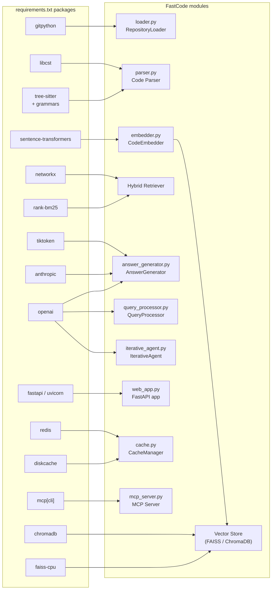
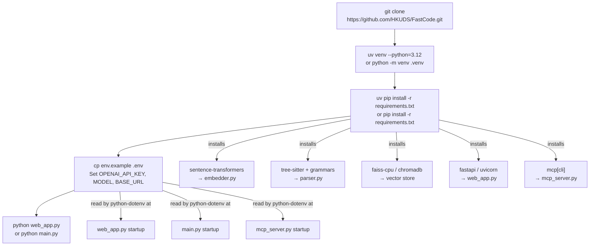

<!-- source: DeepWiki mcp.deepwiki.com · repo HKUDS/FastCode · page 10.1 Development Environment Setup · fetched 2026-11-09 -->

# Development Environment Setup

<details>
<summary>Relevant source files</summary>

The following files were used as context for generating this wiki page:

- [README.md](README.md)
- [requirements.txt](requirements.txt)

</details>


This page covers the steps required to set up a local development environment for FastCode: cloning the repository, creating a Python virtual environment, installing all dependencies, and configuring environment variables so the application can run.

This page focuses on getting a working local installation for development purposes. For production deployment options, see [Docker Deployment](#7.1) and [Docker Compose Setup](#7.2). For a description of the repository layout and module dependencies, see [Project Structure](#10.2). For a complete reference of all recognized environment variables, see [Environment Variables](#12.3).

---

## Prerequisites

| Requirement | Minimum Version | Notes |
|---|---|---|
| Python | 3.12 | Required; see badge in [README.md:11]() |
| Git | Any recent | Required for cloning and for `gitpython` functionality |
| `uv` (optional) | Any | Recommended for faster dependency resolution |

---

## Step 1: Clone the Repository

```
git clone https://github.com/HKUDS/FastCode.git
cd FastCode
```

Sources: [README.md:147-149]()

---

## Step 2: Create a Python Virtual Environment

Two options are supported. `uv` is recommended because the dependency set is large and includes packages with native extensions (FAISS, tree-sitter grammars, PyTorch).

**Option A — `uv` (recommended)**

```
pip install uv
uv venv --python=3.12
source .venv/bin/activate          # Linux / macOS
# .venv\Scripts\activate           # Windows
uv pip install -r requirements.txt
```

**Option B — standard `pip`**

```
python -m venv .venv
source .venv/bin/activate          # Linux / macOS
# .venv\Scripts\activate           # Windows
pip install -r requirements.txt
```

Sources: [README.md:188-227](), [README.md:560-567]()

---

## Step 3: Understand the Dependency Groups

`requirements.txt` groups dependencies by function. The table below maps each group to the FastCode components that consume it.

| Group | Key Packages | Consumed By |
|---|---|---|
| Core | `python-dotenv`, `pyyaml`, `click` | All modules; config loading, CLI entry points |
| Repository Management | `gitpython` | `RepositoryLoader` (`loader.py`) |
| Code Parsing | `tree-sitter`, language grammars, `libcst` | Code parser (`parser.py`) |
| Embeddings & Vector Store | `sentence-transformers`, `faiss-cpu`, `chromadb` | `CodeEmbedder` (`embedder.py`), vector store |
| Search & Retrieval | `rank-bm25`, `networkx` | Hybrid retriever, graph builder |
| LLM Integration | `openai`, `anthropic`, `tiktoken` | `AnswerGenerator`, `QueryProcessor`, `IterativeAgent` |
| API | `fastapi`, `uvicorn`, `pydantic`, `flask`, `flask-cors`, `python-multipart` | `web_app.py` |
| Caching | `diskcache`, `redis` | `CacheManager` (`cache.py`) |
| MCP Server | `mcp[cli]` | `mcp_server.py` |
| Testing | `pytest`, `pytest-asyncio`, `pytest-cov` | Test suite |

Sources: [requirements.txt:1-62]()

---

### Dependency-to-Module Diagram

The following diagram traces key `requirements.txt` packages to the FastCode modules that import them.



Sources: [requirements.txt:1-62]()

---

## Step 4: Configure Environment Variables

FastCode reads credentials and model settings from a `.env` file at the project root. The repository ships an `env.example` template.

```
cp env.example .env
# then edit .env with your preferred editor
```

The three variables required to run any LLM-backed feature are:

| Variable | Example Value | Purpose |
|---|---|---|
| `OPENAI_API_KEY` | `sk-...` | API key for the configured provider |
| `MODEL` | `gpt-4o` | Model identifier sent in every LLM request |
| `BASE_URL` | `https://api.openai.com/v1` | Endpoint URL; override for OpenRouter, Ollama, etc. |

Additional optional variables (Redis URL, per-component model overrides) are documented in [Environment Variables](#12.3). All variables are loaded by `python-dotenv` at startup.

Sources: [README.md:205-216](), [README.md:680-715]()

---

### LLM Provider Configuration Examples

| Provider | `OPENAI_API_KEY` | `MODEL` | `BASE_URL` |
|---|---|---|---|
| OpenAI | `sk-...` | `gpt-4o` | `https://api.openai.com/v1` |
| OpenRouter | `sk-or-...` | `google/gemini-flash-1.5` | `https://openrouter.ai/api/v1` |
| Ollama (local) | `ollama` | `qwen3-coder-30b_fastcode` | `http://localhost:11434/v1` |

Sources: [README.md:678-715]()

---

## Step 5: Verify the Installation

After completing the above steps, start the web server to confirm all imports resolve correctly and the API is reachable.

```
python web_app.py --host 0.0.0.0 --port 5000
```

Expected output includes Uvicorn startup logs followed by the FastCode service becoming available. Open `http://localhost:5000` to confirm the web interface loads.

For a non-interactive smoke-test, run:

```
python main.py --repo /path/to/any/repo --query "What does this repo do?"
```

Sources: [README.md:219-225](), [README.md:381-389]()

---

## Platform-Specific Notes

### macOS (Apple Silicon — M1/M2/M3)

All packages in `requirements.txt` are compatible with ARM. The `CodeEmbedder` class in `embedder.py` uses MPS (Apple Metal) automatically when `torch` detects an Apple Silicon GPU. No extra configuration is needed.

Sources: [README.md:285-286]()

### Windows

| Issue | Resolution |
|---|---|
| SSL errors during `pip install` | `pip install --upgrade certifi` |
| Permission errors | Run Command Prompt as Administrator |
| `faiss-cpu` install failure | `pip install faiss-cpu --no-cache-dir` |
| Running `.sh` scripts | Use Git Bash or WSL; keep `.sh` files in LF line endings |

Sources: [README.md:345-349]()

---

## Setup Flow Diagram

The following diagram maps each setup step to the files and constructs it touches.



Sources: [README.md:145-162](), [requirements.txt:1-62]()

---

## Running Tests

The test suite uses `pytest`. After completing the environment setup:

```
pytest tests/
```

Optional coverage report:

```
pytest tests/ --cov=. --cov-report=term-missing
```

`pytest`, `pytest-asyncio`, and `pytest-cov` are included in `requirements.txt` [requirements.txt:57-59]() and will be present in the virtual environment after Step 3.

---

## Next Steps

| Goal | Page |
|---|---|
| Understand the repository layout and module dependency graph | [Project Structure](#10.2) |
| Configure `config/config.yaml` for development tuning | [Configuration](#8) |
| Add support for a new programming language | [Adding Language Support](#10.4) |
| Extend FastCode with custom backends or strategies | [Extension Points](#10.3) |

---

