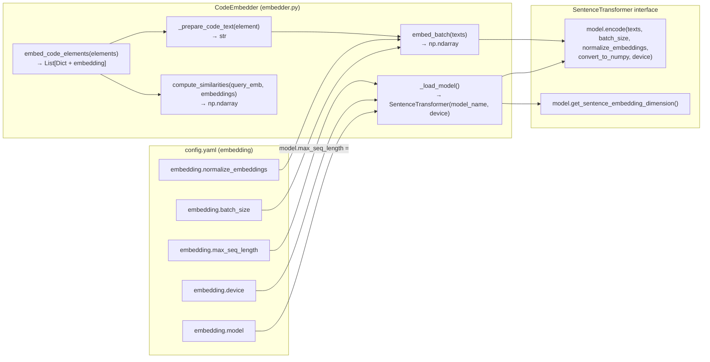
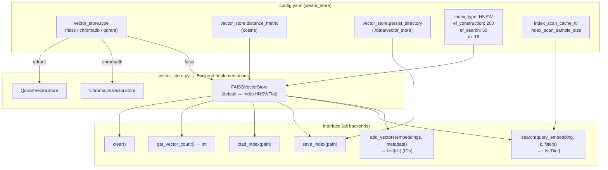
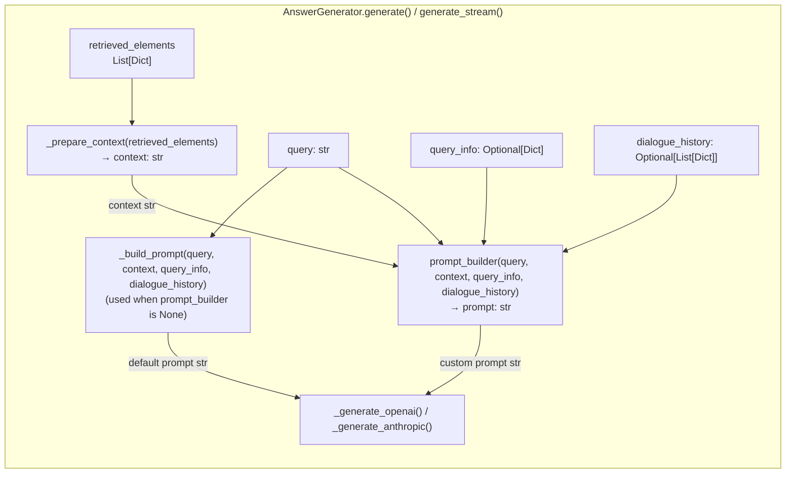
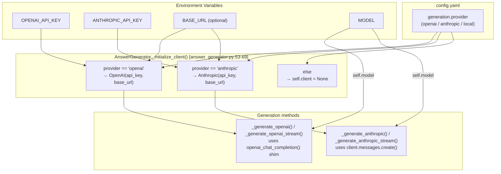

<!-- source: DeepWiki mcp.deepwiki.com · repo HKUDS/FastCode · page 10.3 Extension Points · fetched 2026-11-09 -->

# Extension Points

<details>
<summary>Relevant source files</summary>

The following files were used as context for generating this wiki page:

- [config/config.yaml](config/config.yaml)
- [fastcode/answer_generator.py](fastcode/answer_generator.py)
- [fastcode/embedder.py](fastcode/embedder.py)
- [fastcode/query_processor.py](fastcode/query_processor.py)

</details>


This document describes the extension mechanisms provided by FastCode for customizing and extending its functionality.

For development environment setup, see page 10.1. For adding support for new programming languages specifically, see page 10.4.

## Overview

FastCode provides the following primary extension points:

| Extension Point | Mechanism | Key Config / Code |
|----------------|-----------|-------------------|
| Alternative LLM providers | `generation.provider` + env vars | `AnswerGenerator._initialize_client()` |
| Custom prompt builder | `prompt_builder` callable arg | `AnswerGenerator.generate()` / `generate_stream()` |
| Custom vector store backend | `vector_store.type` | `vector_store.py` |
| Custom embedding model | `embedding.model` | `CodeEmbedder._load_model()` |
| Custom agent tools | Subclass `AgentTools` | `agent_tools.py` |
| New language parser | Tree-sitter grammar + config | `repository.supported_extensions` (see page 10.4) |

The diagram below maps each extension point to its code location.

**Extension points mapped to code entities**

```mermaid
graph TB
    subgraph "config.yaml"
        GenProvider["generation.provider\n(openai / anthropic / local)"]
        EmbedModel["embedding.model\n(SentenceTransformer name)"]
        VSType["vector_store.type\n(faiss / chromadb / qdrant)"]
        SupportedExts["repository.supported_extensions"]
    end

    subgraph "Environment Variables"
        EnvModel["MODEL"]
        EnvBaseURL["BASE_URL"]
        EnvOAIKey["OPENAI_API_KEY"]
        EnvAnthKey["ANTHROPIC_API_KEY"]
    end

    subgraph "answer_generator.py"
        InitClient["AnswerGenerator._initialize_client()"]
        GenMethod["AnswerGenerator.generate(prompt_builder=...)"]
        StreamMethod["AnswerGenerator.generate_stream(prompt_builder=...)"]
        BuildPrompt["AnswerGenerator._build_prompt()"]
    end

    subgraph "embedder.py"
        LoadModel["CodeEmbedder._load_model()"]
    end

    subgraph "vector_store.py"
        VSBackend["VectorStore backend selection"]
    end

    subgraph "agent_tools.py"
        AgentTools["AgentTools (base class)"]
    end

    GenProvider --> InitClient
    EnvModel --> InitClient
    EnvBaseURL --> InitClient
    EnvOAIKey --> InitClient
    EnvAnthKey --> InitClient

    GenMethod -->|"uses prompt_builder if provided,\nelse _build_prompt()"| BuildPrompt
    StreamMethod -->|"same logic"| BuildPrompt

    EmbedModel --> LoadModel
    VSType --> VSBackend
    SupportedExts -->|"see page 10.4"| AgentTools
```



Sources: [fastcode/answer_generator.py:53-69](), [fastcode/embedder.py:36-40](), [config/config.yaml:59-96](), [config/config.yaml:143-160]()

## New Language Parsers

Adding a new language to the parser is covered in full in page 10.4. The short version: install the appropriate `tree-sitter-*` grammar package and add the file extension to `repository.supported_extensions` in [config/config.yaml:22-48]().

Sources: [config/config.yaml:22-48](), [config/config.yaml:51-56]()

## Custom Embedding Models

`CodeEmbedder` in [fastcode/embedder.py:13-40]() loads any model whose name is passed to `SentenceTransformer()`. The model is selected entirely by the `embedding.model` config key — no code changes are required.

**CodeEmbedder._load_model() and text preparation pipeline**



### Model Requirements

Any model passed to `SentenceTransformer()` works as long as it supports:

| Interface | Used by |
|-----------|---------|
| `encode(texts, **kwargs)` | `embed_batch()` [fastcode/embedder.py:54-81]() |
| `get_sentence_embedding_dimension()` | `__init__` to set `self.embedding_dim` [fastcode/embedder.py:33]() |
| `max_seq_length` (writable attribute) | Set at load time [fastcode/embedder.py:39]() |

The `encode()` call passes `batch_size`, `normalize_embeddings`, `convert_to_numpy`, `show_progress_bar`, and `device` as keyword args. On macOS, `pool=None` is additionally set [fastcode/embedder.py:76-78]().

### Text Preparation

`_prepare_code_text()` [fastcode/embedder.py:112-148]() builds the string that is actually embedded, combining (in order):

1. `type` field
2. `name` field
3. `signature` (functions)
4. `docstring`
5. `summary`
6. `code` (truncated to 10,000 characters)

### Configuration

Set in [config/config.yaml:59-66]():

| Key | Default | Notes |
|-----|---------|-------|
| `embedding.model` | `sentence-transformers/paraphrase-multilingual-MiniLM-L12-v2` | Any HuggingFace SentenceTransformer name |
| `embedding.device` | `auto` | `auto` selects CUDA → MPS → CPU |
| `embedding.batch_size` | `32` | Increase for GPU |
| `embedding.max_seq_length` | `512` | Tokens per element |
| `embedding.normalize_embeddings` | `true` | Enables dot-product similarity |

Commonly used alternatives:
- `sentence-transformers/all-MiniLM-L6-v2` — faster, English-only (90 MB)
- `BAAI/bge-large-en-v1.5` — higher quality, larger

Sources: [fastcode/embedder.py:13-81](), [fastcode/embedder.py:112-148](), [config/config.yaml:59-66]()

## Custom Vector Store Backends

Three backends are available out of the box — `faiss`, `chromadb`, and `qdrant` — selected by `vector_store.type` in [config/config.yaml:83-96]().

**vector_store.type config key → backend selection**



### Required Interface

A custom vector store backend must implement the following:

| Method | Parameters | Returns | Description |
|--------|-----------|---------|-------------|
| `add_vectors` | `embeddings: np.ndarray`, `metadata: List[Dict]` | `List[str]` | Add vectors and return assigned IDs |
| `search` | `query_embedding: np.ndarray`, `k: int`, `filters: Optional[Dict]` | `List[Dict]` | k-nearest-neighbor search with optional metadata filters |
| `delete_vectors` | `ids: List[str]` | `bool` | Remove vectors by ID |
| `save_index` | `path: str` | `bool` | Persist to disk |
| `load_index` | `path: str` | `bool` | Load from disk |
| `get_vector_count` | — | `int` | Number of stored vectors |
| `clear` | — | `None` | Remove all vectors |

### Metadata Requirements

The retriever relies on per-vector metadata for filtering multi-repository results. Required metadata fields per vector:

| Field | Description |
|-------|-------------|
| `repo_name` | Repository identifier |
| `file_path` | Source file path |
| `element_type` | `"function"`, `"class"`, or `"documentation"` |
| `element_name` | Code element identifier |
| `line_start`, `line_end` | Source location |

### FAISS HNSW Parameters

The default FAISS backend uses `IndexHNSWFlat`. Relevant config keys from [config/config.yaml:83-96]():

| Key | Default | Effect |
|-----|---------|--------|
| `index_type` | `HNSW` | Index structure |
| `ef_construction` | `200` | Build-time accuracy/speed tradeoff |
| `ef_search` | `50` | Query-time accuracy/speed tradeoff |
| `m` | `16` | Graph connections per node |
| `distance_metric` | `cosine` | Similarity measure |
| `index_scan_cache_ttl` | `30` | Seconds to cache scan results (0 = off) |

Sources: [config/config.yaml:83-96]()

## Custom Prompt Builders

`AnswerGenerator.generate()` and `generate_stream()` both accept an optional `prompt_builder` callable. When provided, it replaces the default `_build_prompt()` method entirely.

### How It Works

The call path in `generate()` [fastcode/answer_generator.py:95-98]() is:

```
if prompt_builder:
    prompt = prompt_builder(query, context, query_info, dialogue_history)
else:
    prompt = self._build_prompt(query, context, query_info, dialogue_history)
```

`context` here is the string already produced by `_prepare_context(retrieved_elements)` [fastcode/answer_generator.py:447-515]() — it is fully formatted markdown before being passed to the builder.

**prompt_builder callable — argument flow**



### Callable Signature

The `prompt_builder` must match this exact signature (from [fastcode/answer_generator.py:74]() type hint):

```
Callable[[str, str, Optional[Dict[str, Any]], Optional[List[Dict[str, Any]]]], str]
```

Positional arguments (in order):

| Position | Name | Type | Description |
|----------|------|------|-------------|
| 1 | `query` | `str` | The current user query |
| 2 | `context` | `str` | Pre-formatted markdown from `_prepare_context()` |
| 3 | `query_info` | `Optional[Dict]` | Query processing metadata (intent, keywords, etc.) |
| 4 | `dialogue_history` | `Optional[List[Dict]]` | Previous turns for multi-turn sessions |

Returns: a `str` that is sent directly to the LLM.

### Context String Format

The `context` argument is the output of `_prepare_context()` [fastcode/answer_generator.py:447-515](). Each retrieved element is formatted as a markdown block containing:

- `## Relevant Code Snippet N`
- `**Repository**: repo_name`
- `**File**: repo_name/relative_path`
- `**Type**: function|class|...`
- `**Name**: identifier`
- `**Lines**: start-end`
- `**Code**: \`\`\`language ... \`\`\``
- Optional `**Metadata**: Complexity: N`

Blocks are separated by `\n\n---\n\n`.

The fields included depend on `include_file_paths` and `include_line_numbers` settings [config/config.yaml:154-156]().

### Dialogue History Format

When `enable_multi_turn: true` [config/config.yaml:159](), `dialogue_history` contains one dict per previous turn:

| Key | Type | Description |
|-----|------|-------------|
| `turn_number` | `int` | Turn index |
| `query` | `str` | Previous user query |
| `summary` | `str` | `<SUMMARY>` block extracted from that turn's answer |

The default `_build_prompt()` includes the last `context_rounds` turns [fastcode/answer_generator.py:584-597]().

### Token Budget

After calling `prompt_builder`, `generate()` checks token count and truncates the context string if `prompt_tokens > max_context_tokens - max_tokens - reserve_tokens_for_response`. If truncation is needed, it calls `prompt_builder` again with the shortened context [fastcode/answer_generator.py:109-141](). A custom builder should therefore be stateless and repeatable with shorter context.

Sources: [fastcode/answer_generator.py:71-141](), [fastcode/answer_generator.py:196-256](), [fastcode/answer_generator.py:447-515](), [config/config.yaml:143-160]()

## Alternative LLM Providers

Both `AnswerGenerator` and `QueryProcessor` initialize their LLM client from `generation.provider` in config plus environment variables. Switching providers requires only config + env var changes.

**LLM provider selection in AnswerGenerator._initialize_client()**



### Supported Providers

| `generation.provider` | Client class | Required env var | Optional env vars |
|-----------------------|-------------|-----------------|-------------------|
| `openai` | `openai.OpenAI` | `OPENAI_API_KEY` | `BASE_URL`, `MODEL` |
| `anthropic` | `anthropic.Anthropic` | `ANTHROPIC_API_KEY` | `BASE_URL`, `MODEL` |
| `local` | none (logs warning) | — | `BASE_URL`, `MODEL` |

The `openai` provider also supports OpenAI-compatible endpoints (e.g., Ollama, vLLM, OpenRouter) by setting `BASE_URL` to the custom endpoint. The `openai_chat_completion` shim in [fastcode/llm_utils.py]() handles models that use `max_completion_tokens` instead of `max_tokens`.

### QueryProcessor Provider

`QueryProcessor` in [fastcode/query_processor.py:105-127]() follows the same pattern, initializing either an `OpenAI` or `Anthropic` client for query enhancement. It reads `generation.provider`, `OPENAI_API_KEY`, `ANTHROPIC_API_KEY`, `BASE_URL`, and `MODEL` from the same sources.

Setting `query.use_llm_enhancement: false` or `query.llm_enhancement_mode: "off"` in [config/config.yaml:132-133]() skips LLM client initialization entirely in `QueryProcessor`.

Sources: [fastcode/answer_generator.py:43-69](), [fastcode/query_processor.py:62-127](), [config/config.yaml:143-147]()

## Custom Agent Tools

`AgentTools` (in `fastcode/agent_tools.py`) provides read-only file exploration for `IterativeAgent`. Subclass it to add new tools.

### Default Tools

| Method | Signature | Returns | Description |
|--------|-----------|---------|-------------|
| `search_codebase` | `(query, file_types=None)` | `List[Dict]` | Full-text search across codebase |
| `list_directory` | `(path, recursive=False)` | `List[Dict]` | List files and directories |
| `get_file_structure_summary` | `(file_path)` | `str` | Extract classes/functions without full content |

### Extension Pattern

Subclass `AgentTools` and add methods. The `IterativeAgent` selects tools based on their names and docstrings, so clear naming is important. Tool methods must:

- Be read-only (no writes or system calls)
- Respect `max_total_lines: 12000` across all calls [config/config.yaml:176]()
- Stay within `max_elements: 100` after filtering [config/config.yaml:179]()

Sources: [config/config.yaml:169-180]()

## Configuration-Driven Initialization

All component selection (LLM provider, vector store backend, embedding model) is resolved at startup from `config.yaml` and environment variables. No code changes are needed to switch between supported variants.

**Component initialization — config keys and env vars that drive selection**

```mermaid
flowchart TD
    subgraph "config.yaml"
        CfgEmbedModel["embedding.model"]
        CfgVSType["vector_store.type"]
        CfgProvider["generation.provider"]
        CfgSupportedExts["repository.supported_extensions"]
        CfgAgentSettings["agent.iterative.*"]
    end

    subgraph "Environment Variables"
        EnvOAI["OPENAI_API_KEY"]
        EnvAnth["ANTHROPIC_API_KEY"]
        EnvModel["MODEL"]
        EnvBase["BASE_URL"]
    end

    subgraph "Component Constructors"
        CodeEmbedder["CodeEmbedder(config)\nembedder.py"]
        VectorStore["VectorStore(config)\nvector_store.py"]
        AnswerGenerator["AnswerGenerator(config)\nanswer_generator.py"]
        QueryProcessor["QueryProcessor(config)\nquery_processor.py"]
        CodeParser["CodeParser(config)\nparser.py"]
        IterativeAgent["IterativeAgent(config)\niterative_agent.py"]
        AgentTools["AgentTools(config)\nagent_tools.py"]
    end

    CfgEmbedModel --> CodeEmbedder
    CfgVSType --> VectorStore
    CfgProvider --> AnswerGenerator
    CfgProvider --> QueryProcessor
    EnvOAI --> AnswerGenerator
    EnvOAI --> QueryProcessor
    EnvAnth --> AnswerGenerator
    EnvAnth --> QueryProcessor
    EnvModel --> AnswerGenerator
    EnvModel --> QueryProcessor
    EnvBase --> AnswerGenerator
    EnvBase --> QueryProcessor
    CfgSupportedExts --> CodeParser
    CfgAgentSettings --> IterativeAgent
    CfgAgentSettings --> AgentTools
```



### Summary of Extension Points

| Extension Point | Config Key / Mechanism | Code Location | Notes |
|----------------|----------------------|---------------|-------|
| LLM provider | `generation.provider` + env vars | `AnswerGenerator._initialize_client()` [fastcode/answer_generator.py:53-69]() | Also applies to `QueryProcessor` |
| Custom prompt builder | `prompt_builder=` arg at call site | `AnswerGenerator.generate()` [fastcode/answer_generator.py:71-74]() | Replaces `_build_prompt()` |
| Vector store backend | `vector_store.type` | `vector_store.py` | `faiss` / `chromadb` / `qdrant` |
| Embedding model | `embedding.model` | `CodeEmbedder._load_model()` [fastcode/embedder.py:36-40]() | Any SentenceTransformer name |
| Agent tools | Subclass `AgentTools` | `agent_tools.py` | Inject into `IterativeAgent` |
| Language parser | `repository.supported_extensions` + tree-sitter pkg | `parser.py` | See page 10.4 |

Sources: [fastcode/answer_generator.py:43-69](), [fastcode/embedder.py:13-40](), [config/config.yaml:59-96](), [config/config.yaml:143-160](), [config/config.yaml:169-180]()

## Summary

FastCode's extension system provides five key integration points:

| Extension Point | Interface Type | Configuration | Use Case |
|----------------|---------------|---------------|----------|
| Language Parsers | Tree-sitter grammar | `repository.supported_extensions` | Add new programming language support |
| Embedding Models | SentenceTransformer | `embedding.model` | Use alternative semantic models |
| Vector Stores | Storage interface | `vector_store.type` | Implement custom search backends |
| Prompt Builders | Callable function | `generation.*` | Customize LLM prompts |
| Agent Tools | AgentTools class | `agent.iterative.*` | Extend agent exploration capabilities |

All extensions integrate through the configuration system, enabling customization without modifying core code. The modular architecture allows selective extension of specific subsystems while maintaining compatibility with the rest of the framework.

For language-specific extension details, see [Adding Language Support](#10.4). For development environment setup, see [Development Environment Setup](#10.1).

---

