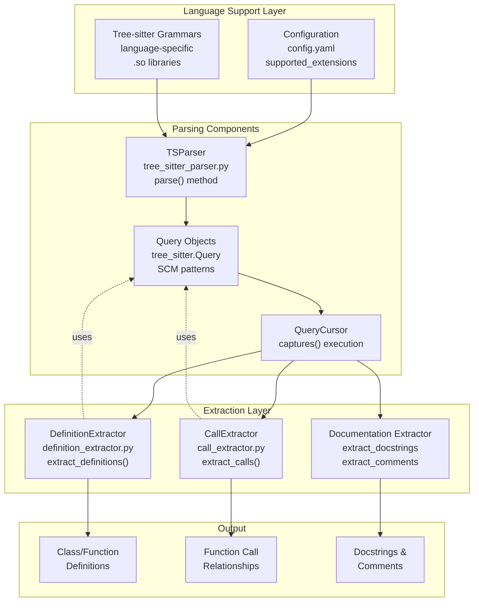
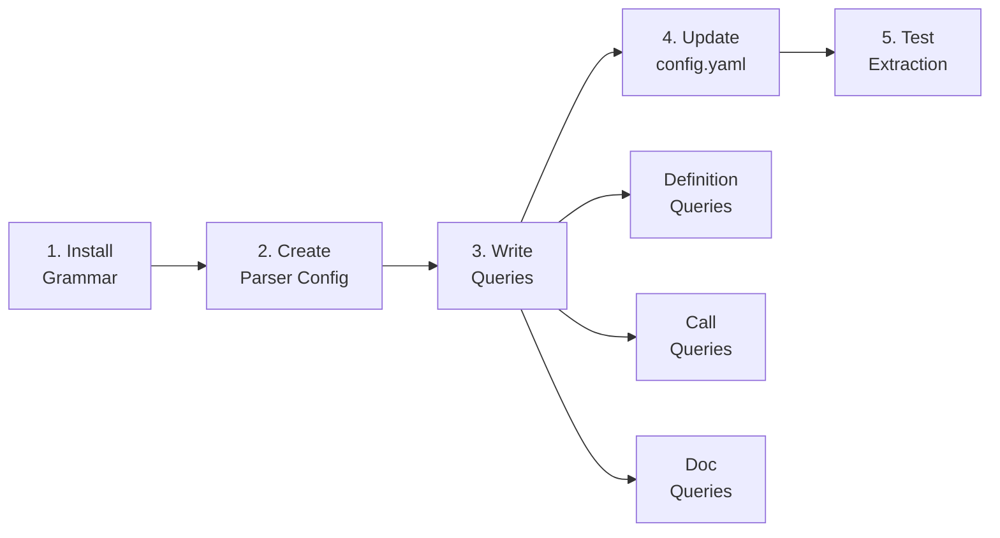
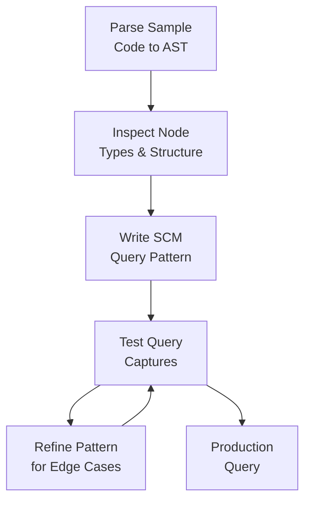
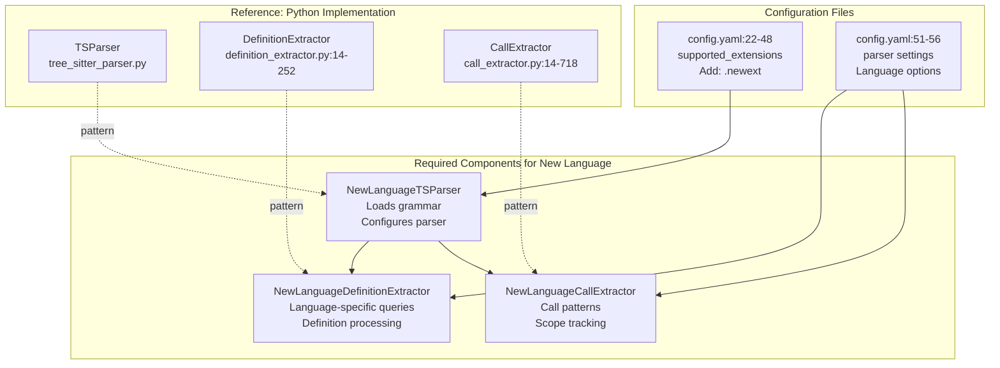

<!-- source: DeepWiki mcp.deepwiki.com · repo HKUDS/FastCode · page 10.4 Adding Language Support · fetched 2026-11-09 -->

# Adding Language Support

<details>
<summary>Relevant source files</summary>

The following files were used as context for generating this wiki page:

- [config/config.yaml](config/config.yaml)
- [fastcode/embedder.py](fastcode/embedder.py)
- [requirements.txt](requirements.txt)

</details>


This document provides a comprehensive guide for adding support for new programming languages to FastCode. FastCode currently supports 8 languages through Tree-sitter-based parsing. This guide explains the architecture, required components, and step-by-step process for extending language support.

For information about other extension mechanisms, see [Extension Points](#10.3). For general development setup, see [Development Environment Setup](#10.1).

---

## Current Language Support

FastCode uses Tree-sitter, a parser generator tool that builds concrete syntax trees for source files. The system currently supports the following languages through AST-based parsing:

| Language | Extensions | Parser Component |
|----------|-----------|------------------|
| Python | `.py`, `.pyx` | `tree_sitter_parser.TSParser` |
| JavaScript/TypeScript | `.js`, `.ts`, `.jsx`, `.tsx` | Language-specific grammar |
| Java | `.java` | Language-specific grammar |
| Go | `.go` | Language-specific grammar |
| C/C++ | `.c`, `.cpp`, `.h` | Language-specific grammar |
| Rust | `.rs` | Language-specific grammar |
| C# | `.cs` | Language-specific grammar |
| Ruby | `.rb` | Language-specific grammar |

The supported extensions are configured in [config/config.yaml:22-48]().

**Sources:** [config/config.yaml:22-48]()

---

## Tree-sitter Architecture in FastCode

### Parser Integration Flow



**Diagram: Tree-sitter Integration Architecture**

The parsing flow follows this pattern:
1. **Language Detection**: File extensions map to Tree-sitter grammars
2. **AST Generation**: `TSParser` creates concrete syntax trees
3. **Query Execution**: SCM patterns extract specific node types
4. **Information Extraction**: Specialized extractors process query results

**Sources:** [fastcode/call_extractor.py:1-46](), [fastcode/definition_extractor.py:1-34]()

---

## Core Components for Language Support

### TSParser - The Foundation

The `TSParser` class (referenced in [fastcode/call_extractor.py:30-36]() and [fastcode/definition_extractor.py:26-33]()) serves as the base parser wrapper. Each extractor receives or creates a `TSParser` instance:

```python
# Dependency injection pattern used throughout
def __init__(self, parser: Optional[TSParser] = None):
    if parser is not None:
        self.parser = parser
    else:
        self.parser = TSParser()
```

The parser provides:
- `parse(code: str)` - Generates syntax tree
- `get_language()` - Returns Tree-sitter language object
- `is_healthy()` - Validates parser state

**Sources:** [fastcode/call_extractor.py:23-36](), [fastcode/definition_extractor.py:26-33]()

### Query System

Tree-sitter queries use S-expression patterns to match AST nodes. FastCode defines queries in SCM format and executes them via `Query` and `QueryCursor` objects.

#### Definition Query Example

```scm
(function_definition) @function.def
(class_definition) @class.def
```

This simple query captures all function and class definition nodes. The `@capture.name` syntax assigns labels to matched nodes for later processing.

**Sources:** [fastcode/definition_extractor.py:20-24]()

#### Call Extraction Query Example

```scm
(call
    function: (_) @function_name
) @call
```

This pattern matches function call expressions and captures the function being called. More complex patterns can capture method calls with object context:

**Sources:** [fastcode/call_extractor.py:87-91]()

### Query Execution Pattern

Both extractors follow the same query execution pattern with version compatibility handling:

```python
cursor = QueryCursor(self.query)
captures = cursor.captures(root_node)

# Handle both API versions
if isinstance(captures, dict):
    # Tree-sitter < 0.25: Dict[str, List[Node]]
    for capture_name, nodes in captures.items():
        for node in nodes:
            process_node(node, capture_name)
else:
    # Tree-sitter >= 0.25: List[Tuple[Node, str]]
    for node, capture_name in captures:
        process_node(node, capture_name)
```

**Sources:** [fastcode/definition_extractor.py:53-77](), [fastcode/call_extractor.py:189-219]()

---

## Steps to Add a New Language



**Diagram: Language Addition Workflow**

**Sources:** General architecture from [fastcode/call_extractor.py](), [fastcode/definition_extractor.py]()

### Step 1: Install Tree-sitter Grammar

Tree-sitter grammars are language-specific parser libraries. They must be compiled to shared libraries (`.so` on Linux, `.dylib` on macOS, `.dll` on Windows).

**Installation methods:**

1. **Via tree-sitter CLI:**
   ```bash
   # Install tree-sitter CLI
   npm install -g tree-sitter-cli
   
   # Clone grammar repository
   git clone https://github.com/tree-sitter/tree-sitter-<language>
   cd tree-sitter-<language>
   
   # Generate parser
   tree-sitter generate
   
   # Build shared library
   tree-sitter build-wasm  # or tree-sitter build
   ```

2. **Via Python bindings:**
   ```bash
   pip install tree-sitter-<language>
   ```

**Sources:** Architecture understanding from Tree-sitter integration pattern

### Step 2: Create Language Parser Configuration

The `TSParser` class needs to be configured to load the new language grammar. This typically involves:

1. **Grammar Loading**: Load the compiled grammar library
2. **Language Registration**: Register the language with Tree-sitter
3. **Parser Creation**: Set the parser language

Example pattern (following the structure in [fastcode/call_extractor.py:23-46]()):

```python
from tree_sitter import Language, Parser

# Load language
LANGUAGE = Language('path/to/grammar.so', 'language_name')

# Create parser
parser = Parser()
parser.set_language(LANGUAGE)
```

**Sources:** [fastcode/call_extractor.py:23-46]()

### Step 3: Define Extraction Queries

This is the most language-specific step. You need to write Tree-sitter query patterns for each type of information to extract.

#### Query Development Process



**Diagram: Query Pattern Development**

**Sources:** Process derived from existing query patterns

#### Required Query Types

**1. Definition Queries**

Extract function and class definitions with their structure:

```scm
; Functions (adapt node types to your language)
(function_declaration
    name: (identifier) @func_name
) @function.def

; Classes
(class_declaration
    name: (identifier) @class_name
) @class.def

; Methods (if different from functions)
(method_declaration
    name: (identifier) @method_name
) @method.def
```

The query must capture:
- Definition node itself (`@function.def`)
- Name identifier (`@func_name`)
- Position information (automatic in Tree-sitter nodes)

**Sources:** [fastcode/definition_extractor.py:20-24]()

**2. Call Extraction Queries**

Extract function/method invocations with caller context:

```scm
; Simple calls: func()
(call_expression
    function: (identifier) @function_name
) @call

; Method calls: obj.method()
(call_expression
    function: (member_expression
        object: (_) @object
        property: (identifier) @method_name
    )
) @call
```

The query should identify:
- Call site (`@call`)
- Function/method being called (`@function_name`, `@method_name`)
- Object context for method calls (`@object`)

**Sources:** [fastcode/call_extractor.py:87-101]()

**3. Scope Tracking Queries**

Identify scopes to determine where calls occur:

```scm
(function_declaration
    name: (identifier) @func_name
) @func_def

(class_declaration
    name: (identifier) @class_name
) @class_def
```

This enables call graph construction by tracking which function contains each call.

**Sources:** [fastcode/call_extractor.py:93-101]()

**4. Type Inference Queries (Optional)**

For statically-typed languages or type annotations:

```scm
; Variable type declarations
(variable_declaration
    name: (identifier) @var_name
    type: (type_identifier) @type_name
) @var_decl

; Constructor calls
(variable_declaration
    name: (identifier) @var_name
    value: (call_expression
        function: (identifier) @class_name
    )
) @constructor_assign
```

**Sources:** [fastcode/call_extractor.py:104-145]()

### Step 4: Update Configuration

Add the new language to `config/config.yaml`:

**File Extension Registration:**

```yaml
repository:
  supported_extensions:
    - .py
    - .js
    # Add new extensions
    - .kt  # Kotlin
    - .scala  # Scala
```

**Parser Configuration:**

```yaml
parser:
  extract_docstrings: true
  extract_comments: true
  extract_imports: true
  compute_complexity: true
  max_function_lines: 3000
  
  # Language-specific settings
  languages:
    kotlin:
      extract_annotations: true
      handle_coroutines: true
```

**Sources:** [config/config.yaml:22-56]()

### Step 5: Implement Extractor Classes

Create language-specific extractor classes following the pattern established in existing extractors.

#### Definition Extractor Template

```python
class NewLanguageDefinitionExtractor:
    """Extract definitions for NewLanguage."""
    
    DEFINITION_QUERY_SCM = """
    ; Your query patterns here
    (function_declaration) @function.def
    (class_declaration) @class.def
    """
    
    def __init__(self, parser: Optional[TSParser] = None):
        self.logger = logging.getLogger(__name__)
        self.ts_parser = parser or TSParser()
        
        if not self.ts_parser.is_healthy():
            raise RuntimeError("TSParser initialization failed")
        
        self.query = Query(
            self.ts_parser.language,
            self.DEFINITION_QUERY_SCM
        )
    
    def extract_definitions(
        self, 
        code: str, 
        file_path: str
    ) -> List[Dict[str, Any]]:
        """Extract all definitions from code."""
        tree = self.ts_parser.parse(code)
        if not tree:
            return []
        
        root_node = tree.root_node
        definitions = []
        
        cursor = QueryCursor(self.query)
        captures = cursor.captures(root_node)
        
        # Process captures (handle API versions)
        if isinstance(captures, dict):
            for capture_name, nodes in captures.items():
                for node in nodes:
                    definition = self._process_node(
                        node, capture_name, code, file_path
                    )
                    if definition:
                        definitions.append(definition)
        else:
            for node, capture_name in captures:
                definition = self._process_node(
                    node, capture_name, code, file_path
                )
                if definition:
                    definitions.append(definition)
        
        return definitions
    
    def _process_node(
        self,
        node: Node,
        capture_name: str,
        code: str,
        file_path: str
    ) -> Optional[Dict[str, Any]]:
        """Process individual definition node."""
        # Extract name
        name_node = node.child_by_field_name('name')
        if not name_node:
            return None
        
        name = code[name_node.start_byte:name_node.end_byte]
        
        # Determine type
        def_type = self._determine_type(node, capture_name)
        
        # Extract parent scope
        parent = self._find_parent_scope(node, code)
        
        # Build unique ID
        relative_path = os.path.relpath(file_path)
        unique_id = (
            f"{relative_path}::{parent}::{name}" 
            if parent 
            else f"{relative_path}::{name}"
        )
        
        return {
            "id": unique_id,
            "name": name,
            "type": def_type,
            "range": {
                "start_byte": node.start_byte,
                "end_byte": node.end_byte,
                "start_point": (
                    node.start_point.row,
                    node.start_point.column
                ),
                "end_point": (
                    node.end_point.row,
                    node.end_point.column
                )
            },
            "parent": parent,
            "file_path": file_path
        }
```

**Sources:** Pattern derived from [fastcode/definition_extractor.py:14-134]()

#### Call Extractor Template

```python
class NewLanguageCallExtractor:
    """Extract function calls for NewLanguage."""
    
    def __init__(self, parser: Optional[TSParser] = None):
        self.logger = logging.getLogger(__name__)
        self.parser = parser or TSParser()
        
        self._call_query = None
        self._scope_query = None
        self._init_queries()
    
    def _init_queries(self):
        """Initialize Tree-sitter queries."""
        if not self.parser.is_healthy():
            return
        
        language = self.parser.get_language()
        if language is None:
            return
        
        try:
            self._call_query = Query(language, """
                (call_expression
                    function: (_) @function_name
                ) @call
            """)
            
            self._scope_query = Query(language, """
                (function_declaration
                    name: (identifier) @func_name
                ) @func_def
                
                (class_declaration
                    name: (identifier) @class_name
                ) @class_def
            """)
        except Exception as e:
            self.logger.error(f"Query initialization failed: {e}")
    
    def extract_calls(
        self, 
        code: str, 
        file_path: str
    ) -> List[Dict[str, Any]]:
        """Extract function calls with scope tracking."""
        if not self.parser.is_healthy():
            return []
        
        tree = self.parser.parse(code)
        if tree is None:
            return []
        
        # Extract scopes first
        scopes = self._extract_scopes(tree)
        
        # Extract calls with scope context
        calls = self._extract_calls_with_scopes(
            tree, scopes, file_path
        )
        
        return calls
```

**Sources:** Pattern derived from [fastcode/call_extractor.py:14-187]()

---

## Language-Specific Considerations

### Handling Language Features

Different languages require different handling strategies:

**Async/Coroutine Functions:**

Python's async detection uses text-based checking (see [fastcode/definition_extractor.py:135-153]()):

```python
def _is_async_function(self, node: Node, code: str) -> bool:
    """Check if function is async."""
    # Check function header
    limit = min(node.end_byte, node.start_byte + 50)
    header_text = code[node.start_byte:limit]
    if re.match(r'^async\b', header_text):
        return True
    
    # Check preceding context
    search_start = max(0, node.start_byte - 100)
    preceding = code[search_start:node.start_byte]
    return bool(re.search(r'\basync\b\s*$', preceding.strip()))
```

For other languages (Kotlin coroutines, JavaScript async/await, C# async), adapt this pattern to match the language's syntax.

**Sources:** [fastcode/definition_extractor.py:135-153]()

**Inheritance and Base Classes:**

Python's base class extraction (see [fastcode/definition_extractor.py:219-251]()):

```python
def _extract_class_bases(
    self, 
    class_node: Node, 
    code: str
) -> List[str]:
    """Extract base class names."""
    bases = []
    
    for child in class_node.children:
        if child.type == 'argument_list':
            for base_child in child.children:
                if base_child.type == 'identifier':
                    base_name = code[
                        base_child.start_byte:
                        base_child.end_byte
                    ]
                    bases.append(base_name)
    
    return bases
```

Adapt this for language-specific inheritance syntax (Java `extends`, C# `:`, Kotlin `:`).

**Sources:** [fastcode/definition_extractor.py:219-251]()

**Type System Integration:**

For statically-typed languages, extract type information to improve call graph accuracy. The pattern in [fastcode/call_extractor.py:475-536]() shows type inference:

```python
def extract_instance_types(
    self, 
    code: str
) -> Dict[str, Dict[str, List[str]]]:
    """Extract type information from code."""
    # Use queries to find:
    # 1. Type declarations
    # 2. Constructor calls
    # 3. Type annotations
    
    scoped_types = {}
    captures = self._execute_query(
        self._init_type_query, 
        tree.root_node
    )
    
    for node, tag in captures:
        scope_id = self._find_scope_for_call(node, scopes)
        if scope_id not in scoped_types:
            scoped_types[scope_id] = {}
        
        # Process based on pattern type
        if tag == 'constructor_assign':
            self._process_constructor_assignment(
                node, scoped_types[scope_id]
            )
```

**Sources:** [fastcode/call_extractor.py:475-536]()

### Scope Tracking Strategy

Accurate scope tracking is critical for call graphs. The algorithm uses upward traversal (see [fastcode/definition_extractor.py:155-176]()):

```python
def _find_parent_scope(
    self, 
    node: Node, 
    code: str
) -> Optional[str]:
    """Find containing class/function scope."""
    current = node.parent
    
    while current and current.type != 'module':
        if current.type == 'class_definition':
            name_node = current.child_by_field_name('name')
            if name_node:
                return code[
                    name_node.start_byte:
                    name_node.end_byte
                ]
        current = current.parent
    
    return None
```

Adapt the node type checks for your language's AST structure.

**Sources:** [fastcode/definition_extractor.py:155-176]()

---

## Query Pattern Reference

### Common Tree-sitter Node Types by Language

| Concept | Python | JavaScript | Java | Go |
|---------|--------|------------|------|-----|
| Function | `function_definition` | `function_declaration` | `method_declaration` | `function_declaration` |
| Class | `class_definition` | `class_declaration` | `class_declaration` | `type_declaration` |
| Call | `call` | `call_expression` | `method_invocation` | `call_expression` |
| Import | `import_statement` | `import_statement` | `import_declaration` | `import_declaration` |
| Comment | `comment` | `comment` | `comment` | `comment` |

### Query Testing Commands

Use Tree-sitter CLI to inspect AST structure:

```bash
# Parse file and show AST
tree-sitter parse path/to/file.ext

# Test query pattern
tree-sitter query path/to/grammar.so query.scm path/to/file.ext
```

**Sources:** General Tree-sitter documentation patterns

---

## Testing Implementation

### Test Coverage Requirements

1. **Definition Extraction Tests:**
   - Functions (regular, async, generic)
   - Classes (with/without bases)
   - Nested definitions
   - Edge cases (decorators, annotations, etc.)

2. **Call Extraction Tests:**
   - Simple function calls
   - Method calls with objects
   - Nested calls
   - Calls in different scopes

3. **Scope Tracking Tests:**
   - Module-level code
   - Function-level code
   - Class-level code
   - Nested scopes

4. **Type Inference Tests (if applicable):**
   - Constructor assignments
   - Type declarations
   - Generic types
   - Union/intersection types

### Sample Test Structure

```python
def test_new_language_function_extraction():
    """Test function definition extraction."""
    code = """
    // Language-specific function syntax
    func myFunction(param: Type) -> ReturnType {
        // Body
    }
    """
    
    extractor = NewLanguageDefinitionExtractor()
    definitions = extractor.extract_definitions(
        code, 
        "test_file.ext"
    )
    
    assert len(definitions) == 1
    assert definitions[0]['name'] == 'myFunction'
    assert definitions[0]['type'] == 'function'
```

**Sources:** Test pattern understanding from extractor architecture

---

## Integration Checklist

Before submitting language support:

- [ ] Tree-sitter grammar installed and loadable
- [ ] Parser configuration created
- [ ] Definition extraction queries written
- [ ] Call extraction queries written
- [ ] Scope tracking implemented
- [ ] Configuration updated (`config.yaml`)
- [ ] File extensions registered
- [ ] Unit tests written and passing
- [ ] Integration tests with full pipeline
- [ ] Documentation updated
- [ ] Example queries provided
- [ ] Edge cases handled (async, generics, etc.)
- [ ] Performance tested with large files

**Sources:** Derived from understanding of system requirements

---

## Reference Implementation Map



**Diagram: Implementation Component Mapping**

**Key implementation files to study:**
- Parser foundation: [fastcode/call_extractor.py:23-46]()
- Query initialization: [fastcode/call_extractor.py:74-153]()
- Definition extraction: [fastcode/definition_extractor.py:35-79]()
- Call extraction: [fastcode/call_extractor.py:155-187]()
- Scope tracking: [fastcode/definition_extractor.py:155-176]()
- Node processing: [fastcode/definition_extractor.py:81-133]()

**Sources:** [fastcode/call_extractor.py](), [fastcode/definition_extractor.py](), [config/config.yaml]()

---

## Additional Resources

**Tree-sitter Resources:**
- Grammar repositories: `github.com/tree-sitter/tree-sitter-<language>`
- Query syntax documentation: Tree-sitter query documentation
- AST playground: `tree-sitter.github.io/tree-sitter/playground`

**FastCode References:**
- Parser configuration: [Extension Points](#10.3)
- System architecture: [Architecture Overview](#1.2)
- Code parser component: [Code Parser](#4.2)

**Sources:** General reference compilation

---

