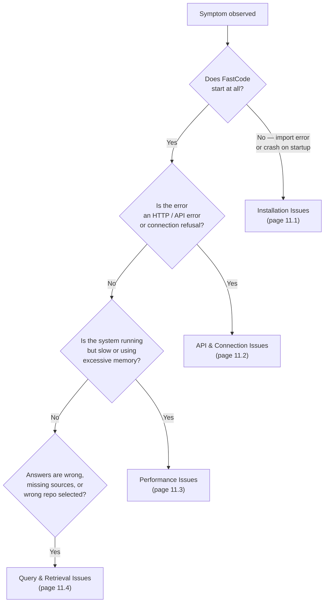
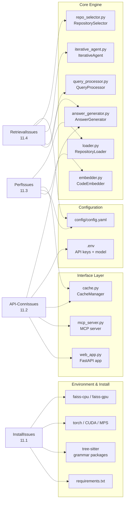

<!-- source: DeepWiki mcp.deepwiki.com · repo HKUDS/FastCode · page 11 Troubleshooting · fetched 2026-11-09 -->

# Troubleshooting

<details>
<summary>Relevant source files</summary>

The following files were used as context for generating this wiki page:

- [README.md](README.md)

</details>


This page is the entry point for diagnosing and resolving problems with FastCode. It maps common symptoms to the relevant sub-pages and provides a shared diagnostic reference (health-check commands, log locations, key config fields) that applies across all problem categories.

For configuration details that are referenced throughout this guide, see [Configuration](#8). For development environment setup, see [Development Environment Setup](#10.1).

---

## Diagnostic Overview

When something goes wrong with FastCode, the failure almost always surfaces in one of four layers: the Python environment and dependencies, the LLM/API connection and transport, the indexing and retrieval performance, or the quality of answers returned. Each layer has a dedicated sub-page.

**Diagnostic decision tree:**



Sources: [README.md:344-350]()

---

## Sub-Page Map

| Problem Area | Typical Symptoms | Sub-Page |
|---|---|---|
| Installation | `ImportError`, `ModuleNotFoundError`, `faiss-cpu` install failure, device errors from `torch` | [11.1](#11.1) |
| API & Connections | `401 Unauthorized`, `Connection refused`, wrong LLM provider, CORS errors, Redis `ConnectionError`, MCP JSON-RPC failures | [11.2](#11.2) |
| Performance | Slow indexing, high RAM usage, queries taking >30 s, embedding bottlenecks | [11.3](#11.3) |
| Query & Retrieval | Poor answer quality, irrelevant sources, wrong repo selected in multi-repo mode, stale multi-turn context | [11.4](#11.4) |

---

## FastCode Component Map for Troubleshooting

Understanding which component owns a symptom is the fastest way to find the root cause. The diagram below maps observable failure modes to the code files and classes responsible for each area.

**Component → failure surface map:**



Sources: [README.md:344-350](), [README.md:555-666]()

---

## First-Response Checklist

Run these checks before diving into a specific sub-page. They surface the most common root causes quickly.

### 1. Health Endpoint

If `web_app.py` is running, hit the health endpoint:

```
GET /api/health
```

A `200 OK` with `"status": "healthy"` confirms the server is up and the FastCode engine initialized without error. Any other response indicates a startup failure — see [11.1](#11.1) or [11.2](#11.2).

### 2. Verify Environment Variables

All LLM calls require at least `OPENAI_API_KEY`, `MODEL`, and `BASE_URL` to be set. Check your `.env` file or shell environment:

| Variable | Required for | Notes |
|---|---|---|
| `OPENAI_API_KEY` | All LLM calls | Also used as the credential for non-OpenAI providers via OpenAI-compatible APIs |
| `MODEL` | All LLM calls | Must match the model name expected by `BASE_URL` |
| `BASE_URL` | All LLM calls | Defaults to OpenAI endpoint; override for OpenRouter, local models, etc. |
| `REDIS_URL` | Redis cache only | Only needed when `cache.backend: redis` in `config/config.yaml` |

See [11.2](#11.2) for detailed API key troubleshooting and [Environment Variables](#12.3) for the full reference.

### 3. Check `config/config.yaml` Sections

Most behavioral problems trace back to a misconfigured section:

| Config Section | Controls | Relevant Sub-page |
|---|---|---|
| `embedding.device` | `auto` / `cuda` / `mps` / `cpu` selection in `CodeEmbedder` | [11.1](#11.1), [11.3](#11.3) |
| `vector_store.backend` | `faiss` / `chromadb` / `qdrant` | [11.1](#11.1) |
| `cache.backend` | `disk` / `redis` | [11.2](#11.2) |
| `retrieval.semantic_weight` / `keyword_weight` / `graph_weight` | Hybrid scorer weights | [11.4](#11.4) |
| `generation.llm_provider` / `generation.model` | Which LLM is called by `AnswerGenerator` | [11.2](#11.2) |
| `agent.iterative.max_iterations` | Loop depth in `IterativeAgent` | [11.3](#11.3) |

See [Configuration Reference](#12.1) for the full flat listing of every key and its default.

### 4. Reproduce with the CLI

When the web UI or MCP server is involved, it can be hard to tell whether the error is in the interface layer or the engine. Strip it down to `main.py` to isolate:

```
python main.py --repo /path/to/repo --query "test query"
```

If this works but `web_app.py` does not, the problem is in [11.2](#11.2). If neither works, start at [11.1](#11.1).

---

## Log Locations

| Component | Log output |
|---|---|
| `web_app.py` | `stdout` / `stderr` of the process; configure log level with `uvicorn` flags |
| `mcp_server.py` | Redirected to a `.log` file when using stdio transport to avoid polluting the JSON-RPC stream |
| `cache.py` (disk backend) | Errors printed to `stderr`; disk path is `cache.cache_directory` in `config/config.yaml` |
| `iterative_agent.py` | Per-iteration debug lines logged via Python `logging`; set `logging.basicConfig(level=logging.DEBUG)` for verbose output |

Sources: [README.md:551-666]()

---

## Scope Boundaries

| Topic | Where to find it |
|---|---|
| Adding a new LLM provider | [Extension Points](#10.3) |
| Adding a new programming language | [Adding Language Support](#10.4) |
| Docker-specific environment problems | [Docker Deployment](#7.1), [Docker Compose Setup](#7.2) |
| Nanobot / Feishu-specific issues | [Nanobot Integration](#6.4) |
| Full config key listing | [Configuration Reference](#12.1) |
| Full environment variable listing | [Environment Variables](#12.3) |

---

