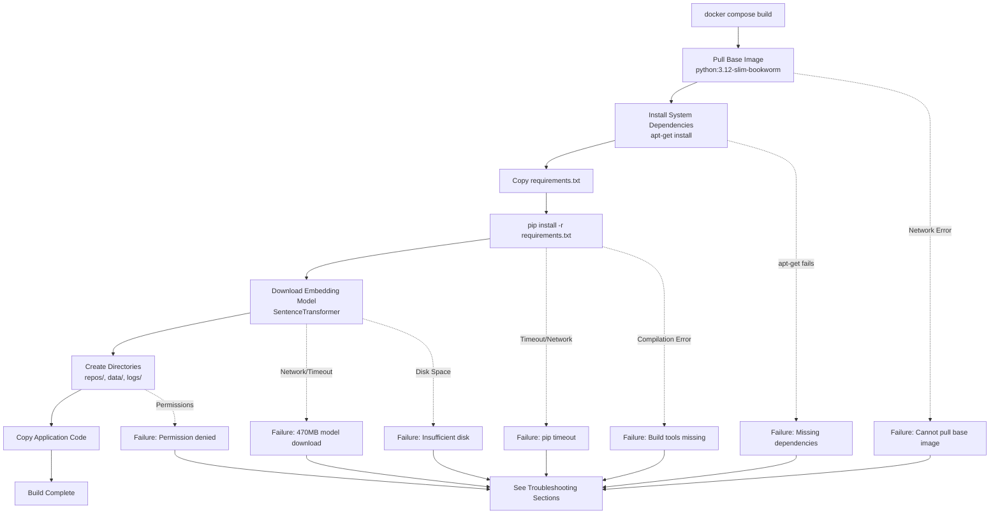
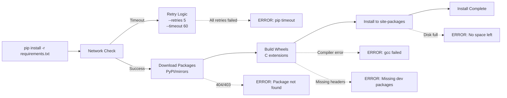
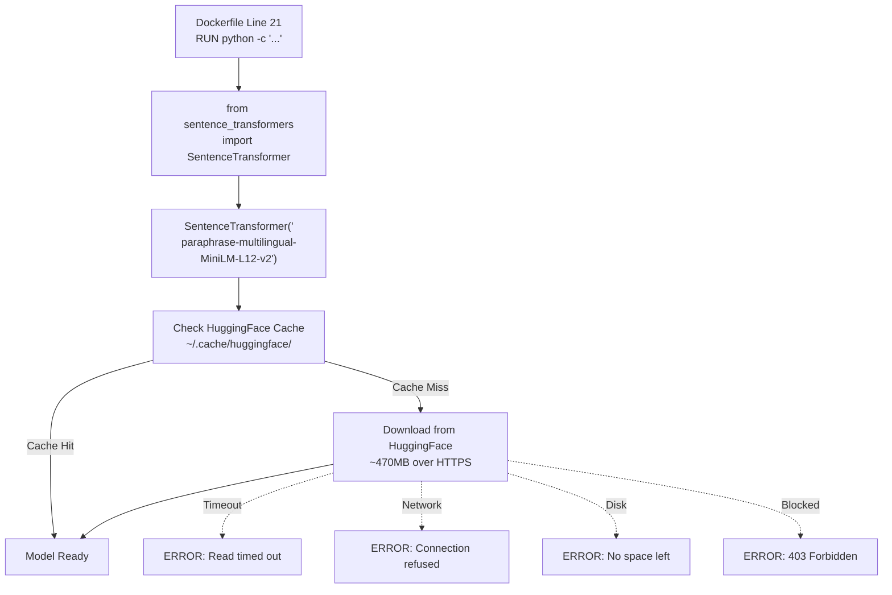
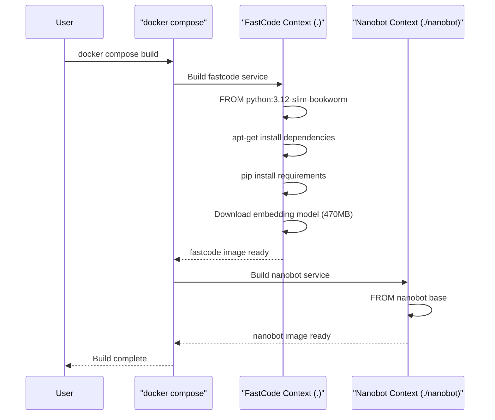
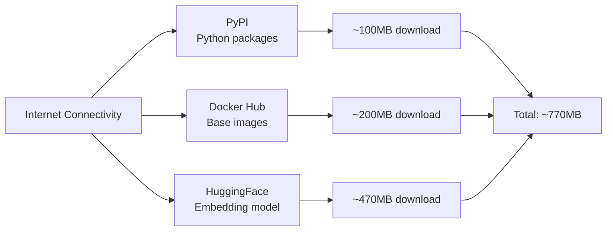

<!-- source: DeepWiki mcp.deepwiki.com · repo HKUDS/FastCode · page 11.1 Installation Issues · fetched 2026-11-09 -->

# Installation Issues

<details>
<summary>Relevant source files</summary>

The following files were used as context for generating this wiki page:

- [README.md](README.md)
- [requirements.txt](requirements.txt)

</details>


## Purpose and Scope

This document provides troubleshooting guidance for installation and deployment problems with FastCode. It covers Docker build failures, dependency installation errors, platform-specific compatibility issues, and configuration problems that prevent successful deployment.

For runtime API connection issues, see [API & Connection Issues](#11.2). For performance problems after successful installation, see [Performance Issues](#11.3). For general deployment architecture and setup procedures, see [Docker Deployment](#7.1) and [Docker Compose Setup](#7.2).

---

## Docker Build Process Overview

The following diagram illustrates the Docker build process and common failure points:

**Docker Build Pipeline and Failure Points**



Sources: [Dockerfile:1-39](), [docker-compose.yml:12-30]()

---

## Base Image and System Dependencies

### Base Image Pull Failures

**Symptom**: `Error response from daemon: manifest for python:3.12-slim-bookworm not found`

**Cause**: Network connectivity issues, Docker Hub rate limiting, or regional access restrictions.

**Solutions**:

| Issue | Solution |
|-------|----------|
| Network timeout | Increase Docker daemon timeout: `"max-concurrent-downloads": 3` in `/etc/docker/daemon.json` |
| Docker Hub rate limit | Authenticate with Docker Hub: `docker login` or use mirror registry |
| Regional restrictions | Configure Docker registry mirror in `daemon.json` |
| Proxy required | Set proxy environment variables: `HTTP_PROXY`, `HTTPS_PROXY` in Docker daemon config |

**Example daemon.json configuration**:
```json
{
  "registry-mirrors": ["https://your-mirror.com"],
  "max-concurrent-downloads": 3,
  "max-download-attempts": 5
}
```

Sources: [Dockerfile:1]()

### System Dependency Installation Failures

**Build Step**: [Dockerfile:4-11]()

The build installs critical system packages: `git`, `build-essential`, `curl`, `ca-certificates`.

**Common Errors**:

```
E: Unable to locate package build-essential
E: Failed to fetch http://deb.debian.org/debian/...
```

**Diagnostic Command**:
```bash
docker build --no-cache --progress=plain . 2>&1 | grep "apt-get"
```

**Solutions**:

| Error Pattern | Root Cause | Fix |
|--------------|------------|-----|
| `Unable to locate package` | Stale apt cache | Add `apt-get update` before install (already in [Dockerfile:4]()) |
| `Failed to fetch` | Network/mirror issue | Use `--network=host` or configure apt mirror |
| `Package has no installation candidate` | Wrong Debian version | Verify base image is `bookworm` |
| `Hash Sum mismatch` | Corrupted apt cache | Add `--no-cache` to docker build |

**Missing git symptoms**: Repository cloning will fail with `git: command not found` during runtime.

**Missing build-essential symptoms**: `tree-sitter` and other C extensions will fail to compile during pip installation.

Sources: [Dockerfile:4-11]()

---

## Python Dependency Installation

### pip Installation Failures

**Build Step**: [Dockerfile:16-17]()

The build uses retry and timeout settings: `--retries 5 --timeout 60`.

**Failure Point Mapping**:



Sources: [Dockerfile:16-17]()

### Common Dependency Errors

**1. Network Timeout**

```
ERROR: Could not install packages due to an OSError: 
HTTPSConnectionPool(host='files.pythonhosted.org'): 
Read timed out after 60 seconds
```

**Solutions**:
- Increase timeout: Change [Dockerfile:17]() to `--timeout 180`
- Use PyPI mirror: Add `--index-url https://pypi.tuna.tsinghua.edu.cn/simple`
- Use host network: `docker build --network=host`

**2. Compilation Failures**

```
error: command 'gcc' failed: No such file or directory
```

**Cause**: `build-essential` package not installed (should be present from [Dockerfile:7]()).

**Verification**:
```bash
docker run --rm python:3.12-slim-bookworm gcc --version
```

**3. tree-sitter Compilation Issues**

tree-sitter is critical for parsing 8 programming languages. Compilation requires C compiler and headers.

**Error Pattern**:
```
error: [Errno 2] No such file or directory: 'cc'
Failed building wheel for tree-sitter
```

**Requirements** (provided by `build-essential` in [Dockerfile:7]()):
- gcc/g++ compiler
- libc development headers
- make utility

**4. Disk Space Exhaustion**

```
OSError: [Errno 28] No space left on device
```

**Check disk space before build**:
```bash
df -h /var/lib/docker
docker system df
```

**Clean Docker cache**:
```bash
docker builder prune
docker system prune -a
```

Sources: [Dockerfile:16-17](), [requirements.txt]()

---

## Embedding Model Download

### 470MB SentenceTransformer Download

**Build Step**: [Dockerfile:21]()

This is the most time-consuming and network-intensive step, downloading `paraphrase-multilingual-MiniLM-L12-v2` (~470MB).

**Model Download Architecture**:



Sources: [Dockerfile:19-21]()

### Troubleshooting Model Download

**Symptoms**:

```
requests.exceptions.ConnectionError: HTTPSConnectionPool(host='huggingface.co')
requests.exceptions.ReadTimeout: Read timed out
OSError: Can't load tokenizer for 'sentence-transformers/...'
```

**Solutions Table**:

| Issue | Detection | Solution |
|-------|-----------|----------|
| Network timeout | Build hangs at "Downloading..." for >5 minutes | Use `--network=host`, increase Docker timeout |
| HuggingFace unreachable | `ConnectionError` to huggingface.co | Use HF_ENDPOINT mirror (see below) |
| Disk space | `No space left on device` | Ensure 1GB+ free in Docker storage |
| Proxy required | Connection refused | Set `HTTP_PROXY`/`HTTPS_PROXY` build args |
| Model repository blocked | 403 Forbidden | Use mirror or VPN |

**Using HuggingFace Mirror**:

Modify [Dockerfile:21]() to use mirror:
```dockerfile
ENV HF_ENDPOINT=https://hf-mirror.com
RUN python -c "from sentence_transformers import SentenceTransformer; \
    SentenceTransformer('sentence-transformers/paraphrase-multilingual-MiniLM-L12-v2')"
```

**Pre-download Alternative**:

Instead of downloading during build, mount a pre-cached model:
```yaml
# docker-compose.yml volumes section
- ~/.cache/huggingface:/root/.cache/huggingface:ro
```

**Verifying Download Success**:

Check Docker layer size:
```bash
docker history fastcode:latest | grep "sentence-transformers"
```

Expected layer size: ~470MB

Sources: [Dockerfile:19-21]()

---

## Directory Creation and Permissions

### Directory Structure Setup

**Build Step**: [Dockerfile:24]()

Creates three persistent directories: `/app/repos`, `/app/data`, `/app/logs`.

**Permission Issues**:

```
mkdir: cannot create directory '/app/repos': Permission denied
```

**Cause**: User namespace mapping or SELinux restrictions.

**Docker User Context**:
- Build runs as `root` (default)
- Runtime may use different UID/GID if configured in [docker-compose.yml]()

**Solutions**:

| Context | Issue | Fix |
|---------|-------|-----|
| Build-time | Permission denied during mkdir | Ensure no USER directive before mkdir |
| Runtime | Cannot write to mounted volumes | Fix host directory permissions: `chmod 777 ./data` |
| SELinux enabled | Permission denied despite correct ownership | Add `:z` or `:Z` to volume mounts |
| Windows host | Path conversion issues | Use `/` not `\` in docker-compose.yml |

**Volume Mount Permissions** ([docker-compose.yml:24-26]()):

```yaml
volumes:
  - ./data:/app/data      # FastCode writes indexes
  - ./repos:/app/repos    # FastCode writes repos
  - ./logs:/app/logs      # FastCode writes logs
```

**Pre-create on host**:
```bash
mkdir -p data repos logs
chmod 755 data repos logs
```

Sources: [Dockerfile:24](), [docker-compose.yml:24-26]()

---

## docker-compose Build Issues

### Multi-Service Build

**Architecture**: FastCode + Nanobot services ([docker-compose.yml:10-56]())

**Build Command Sequence**:



Sources: [docker-compose.yml:10-56]()

### Nanobot Build Failures

**Context**: [docker-compose.yml:32-35]()

```yaml
nanobot:
  build:
    context: ./nanobot
    dockerfile: Dockerfile
```

**Common Issues**:

| Error | Cause | Solution |
|-------|-------|----------|
| `./nanobot: no such file or directory` | Missing nanobot submodule | Check if nanobot integration is needed |
| `Cannot locate Dockerfile` | Wrong context path | Verify `./nanobot/Dockerfile` exists |
| FastCode builds but nanobot fails | Independent build contexts | Check nanobot-specific requirements |

**Partial Build Recovery**:

If FastCode builds successfully but nanobot fails:
```bash
docker compose up fastcode  # Run only FastCode service
```

**Skip Nanobot** (if not needed):

Comment out nanobot service in [docker-compose.yml:32-56]().

Sources: [docker-compose.yml:32-56]()

---

## Platform-Specific Issues

### Linux-Specific

**Working Configuration**: [Dockerfile:1]() uses `slim-bookworm` which is Debian-based.

**Issues**:

| Distribution | Problem | Solution |
|--------------|---------|----------|
| RHEL/CentOS | SELinux blocks volume mounts | Add `:z` suffix: `./data:/app/data:z` |
| Alpine-based hosts | glibc compatibility | Use provided Debian base image |
| ARM64 (M1/M2) | No prebuilt wheels for some packages | Build takes longer; ensure Rosetta 2 disabled |

**ARM64 Build Time**:
- Expected: 15-20 minutes (vs 5-10 on x86_64)
- Bottleneck: Compiling tree-sitter and other C extensions

### macOS-Specific

**Docker Desktop Configuration**:

Minimum requirements for FastCode build:
- Memory: 4GB allocated to Docker
- Disk: 10GB free in Docker VM
- CPU: 2+ cores

**Common macOS Issues**:

```
ERROR: failed to solve: python:3.12-slim-bookworm: 
platform linux/arm64 is not supported
```

**Solution**: Ensure Docker Desktop uses correct platform:
```bash
docker build --platform linux/amd64 .
```

Or in [docker-compose.yml]()):
```yaml
services:
  fastcode:
    platform: linux/amd64
    build: ...
```

**File Sharing Performance**:

macOS volume mounts can be slow. For better performance during development:
- Use named volumes instead of bind mounts for `data/`
- Keep only `repos/` and `config/` as bind mounts

### Windows-Specific

**Path Separators**: [docker-compose.yml:20-26]() uses Unix paths.

**Issues**:

| Problem | Windows Symptom | Solution |
|---------|----------------|----------|
| Path conversion | `C:\Users\...` not recognized | Use WSL2 backend, not Hyper-V |
| Line endings | Config files not parsed | Ensure `.env` and `config.yaml` have LF endings |
| Volume permissions | Permission denied | Run Docker Desktop as Administrator |
| Antivirus blocking | Build hangs at pip install | Add Docker directories to AV exclusions |

**WSL2 Backend** (recommended):

Docker Desktop → Settings → General → Use WSL2 based engine

**Git Line Endings**:
```bash
git config --global core.autocrlf input
```

Sources: [docker-compose.yml:1-61]()

---

## Environment Configuration Issues

### Missing or Invalid .env File

**Required File**: [env.example:1-18]()

**Build vs Runtime**:
- `.env` is **not required for build**
- `.env` is **required for runtime** (LLM API keys)

**Common Error at Startup**:
```
ValueError: OPENAI_API_KEY not found in environment
```

**Solution**:

1. Copy template:
```bash
cp env.example .env
```

2. Configure provider ([env.example:1-18]()):

```bash
# Option 1: OpenAI
OPENAI_API_KEY=sk-proj-...
MODEL=gpt-4-turbo
BASE_URL=https://api.openai.com/v1

# Option 2: OpenRouter (Gemini)
OPENAI_API_KEY=sk-or-...
MODEL=google/gemini-3-flash-preview
BASE_URL=https://openrouter.ai/api/v1

# Option 3: Local Ollama
OPENAI_API_KEY=ollama
MODEL=qwen3-coder-30b_fastcode
BASE_URL=http://localhost:11434/v1
```

3. Verify mount in [docker-compose.yml:20]():
```yaml
volumes:
  - ./.env:/app/.env:ro
```

**Read-only Mount**: The `:ro` flag prevents accidental modification inside container.

Sources: [env.example:1-18](), [docker-compose.yml:20]()

### config.yaml Not Found

**Default Config**: [docker-compose.yml:21]()

```yaml
- ./config:/app/config:ro
```

**Error**:
```
FileNotFoundError: [Errno 2] No such file or directory: '/app/config/config.yaml'
```

**Verification**:
```bash
ls -la config/config.yaml
```

**Solution**: Ensure `config/` directory exists with valid `config.yaml`. See [Configuration Reference](#12.1) for complete schema.

Sources: [docker-compose.yml:21]()

---

## Network and Connectivity

### Build-Time Network Requirements

**Network-Intensive Steps**:



**Network Failure Points**:

| Resource | Host | Port | Protocol | Failure Impact |
|----------|------|------|----------|----------------|
| Docker Hub | registry-1.docker.io | 443 | HTTPS | Cannot pull base image |
| PyPI | pypi.org / files.pythonhosted.org | 443 | HTTPS | Cannot install packages |
| HuggingFace | huggingface.co | 443 | HTTPS | Cannot download model |

**Corporate Proxy Configuration**:

Add to [Dockerfile]():
```dockerfile
ENV HTTP_PROXY=http://proxy.corp.com:8080
ENV HTTPS_PROXY=http://proxy.corp.com:8080
ENV NO_PROXY=localhost,127.0.0.1
```

Or pass as build args:
```bash
docker build --build-arg HTTP_PROXY=http://proxy:8080 .
```

Sources: [Dockerfile:1-39]()

### Offline Installation

**Pre-requisites**:
1. Base image: `python:3.12-slim-bookworm` saved as tar
2. Python packages: Downloaded wheels
3. Embedding model: Pre-cached HuggingFace model

**Steps**:

```bash
# 1. Save base image (on machine with internet)
docker pull python:3.12-slim-bookworm
docker save python:3.12-slim-bookworm > base-image.tar

# 2. Download Python packages
pip download -r requirements.txt -d ./packages

# 3. Download embedding model
python -c "from sentence_transformers import SentenceTransformer; \
    SentenceTransformer('sentence-transformers/paraphrase-multilingual-MiniLM-L12-v2')"
# Model cached in ~/.cache/huggingface/

# 4. Transfer files to offline machine
# 5. Load base image
docker load < base-image.tar

# 6. Modify Dockerfile to use local packages
RUN pip install --no-index --find-links=/packages -r requirements.txt
```

Sources: [Dockerfile:16-21]()

---

## Resource Requirements

### Minimum System Requirements

**Build Requirements**:

| Resource | Minimum | Recommended | Notes |
|----------|---------|-------------|-------|
| RAM | 2GB | 4GB | Model loading requires memory |
| Disk Space | 5GB | 10GB | Includes Docker layers, model cache |
| CPU | 2 cores | 4 cores | For tree-sitter compilation |
| Network | 1 Mbps | 10 Mbps | For downloading dependencies |

**Runtime Requirements** (after build):

| Resource | Minimum | Recommended | Notes |
|----------|---------|-------------|-------|
| RAM | 2GB | 4GB+ | Depends on repository size |
| Disk Space | 2GB | 5GB+ | For repos, indexes, cache |
| CPU | 1 core | 2+ cores | For embedding generation |

**Checking Available Resources**:

```bash
# Docker Desktop allocated resources
docker info | grep -E "CPUs|Total Memory"

# Available disk space
df -h /var/lib/docker

# Build resource limits
docker build --memory=4g --memory-swap=4g .
```

Sources: [Dockerfile:1-39]()

---

## Verification Steps

### Post-Build Verification

**1. Image Exists**:
```bash
docker images | grep fastcode
```

Expected output:
```
fastcode    latest    abc123def456    2 minutes ago    1.2GB
```

**2. Layer Inspection**:
```bash
docker history fastcode:latest
```

Verify critical layers:
- Base image: `python:3.12-slim-bookworm`
- System packages: `apt-get install`
- Python packages: `pip install`
- Embedding model: `SentenceTransformer` download (~470MB)

**3. Directory Structure**:
```bash
docker run --rm fastcode:latest ls -la /app
```

Expected directories: `fastcode/`, `config/`, `api.py`, `repos/`, `data/`, `logs/`

**4. Python Imports**:
```bash
docker run --rm fastcode:latest python -c "import fastcode; print(fastcode.__version__)"
```

Expected: `2.0.0` (or current version)

**5. Embedding Model**:
```bash
docker run --rm fastcode:latest python -c "from sentence_transformers import SentenceTransformer; m = SentenceTransformer('sentence-transformers/paraphrase-multilingual-MiniLM-L12-v2'); print('Model loaded')"
```

Should complete in <5 seconds (model already cached).

Sources: [Dockerfile:1-39]()

### Runtime Verification

**1. Container Starts**:
```bash
docker compose up -d
docker compose ps
```

Expected state: `running` for fastcode service.

**2. API Health Check**:
```bash
curl http://localhost:8001/health
```

Expected response:
```json
{"status": "healthy", "version": "2.0.0"}
```

**3. Logs Check**:
```bash
docker compose logs fastcode
```

Should show:
```
INFO:     Started server process
INFO:     Uvicorn running on http://0.0.0.0:8001
```

No Python tracebacks or import errors.

Sources: [docker-compose.yml:10-30](), [api.py]()

---

## Quick Troubleshooting Reference

### Error Pattern Matching

| Error Message Fragment | File Reference | Section |
|------------------------|----------------|---------|
| `manifest for python:3.12 not found` | [Dockerfile:1]() | Base Image Pull Failures |
| `Unable to locate package build-essential` | [Dockerfile:4-11]() | System Dependency Installation |
| `pip timeout` | [Dockerfile:17]() | pip Installation Failures |
| `HTTPSConnectionPool(host='huggingface.co')` | [Dockerfile:21]() | Embedding Model Download |
| `Permission denied` | [Dockerfile:24]() | Directory Creation and Permissions |
| `./nanobot: no such file` | [docker-compose.yml:34]() | Nanobot Build Failures |
| `OPENAI_API_KEY not found` | [env.example:3]() | Missing .env File |
| `config.yaml not found` | [docker-compose.yml:21]() | config.yaml Not Found |

### Build Command Variants

**Standard Build**:
```bash
docker compose build
```

**Rebuild Without Cache** (force fresh build):
```bash
docker compose build --no-cache
```

**Build with Progress Details**:
```bash
docker compose build --progress=plain
```

**Build Specific Service**:
```bash
docker compose build fastcode
```

**Build with Resource Limits**:
```bash
docker build --memory=4g --cpu-shares=1024 -t fastcode .
```

Sources: [docker-compose.yml:12-14]()

---

## Getting Help

If none of the solutions in this document resolve your installation issue:

1. **Collect Diagnostic Information**:
   ```bash
   docker version
   docker compose version
   docker info
   df -h /var/lib/docker
   docker compose build --progress=plain 2>&1 | tee build.log
   ```

2. **Check Related Documentation**:
   - [Docker Deployment](#7.1) - Deployment architecture
   - [Environment Configuration](#2.2) - LLM provider setup
   - [API & Connection Issues](#11.2) - Runtime problems

3. **Review Logs**:
   ```bash
   docker compose logs fastcode > fastcode.log
   ```

4. **Verify Configuration Files**:
   - `.env` exists and contains valid API keys
   - `config/config.yaml` is valid YAML
   - All file paths use forward slashes (`/`)

Sources: [Dockerfile:1-39](), [docker-compose.yml:1-61](), [env.example:1-18]()

---

