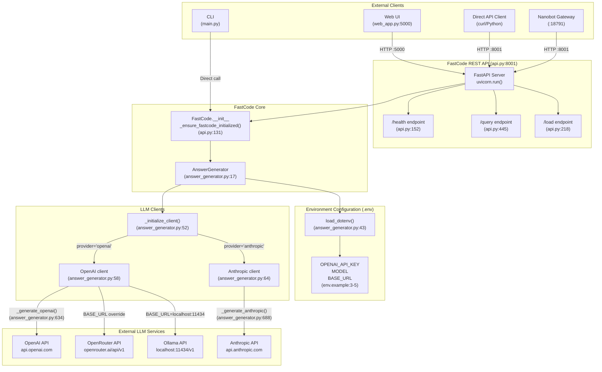
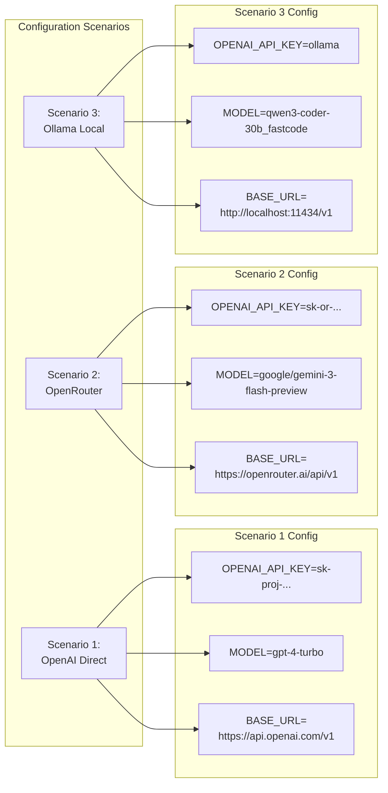
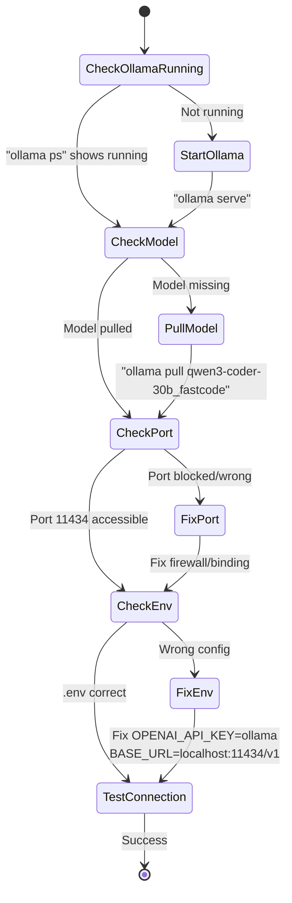
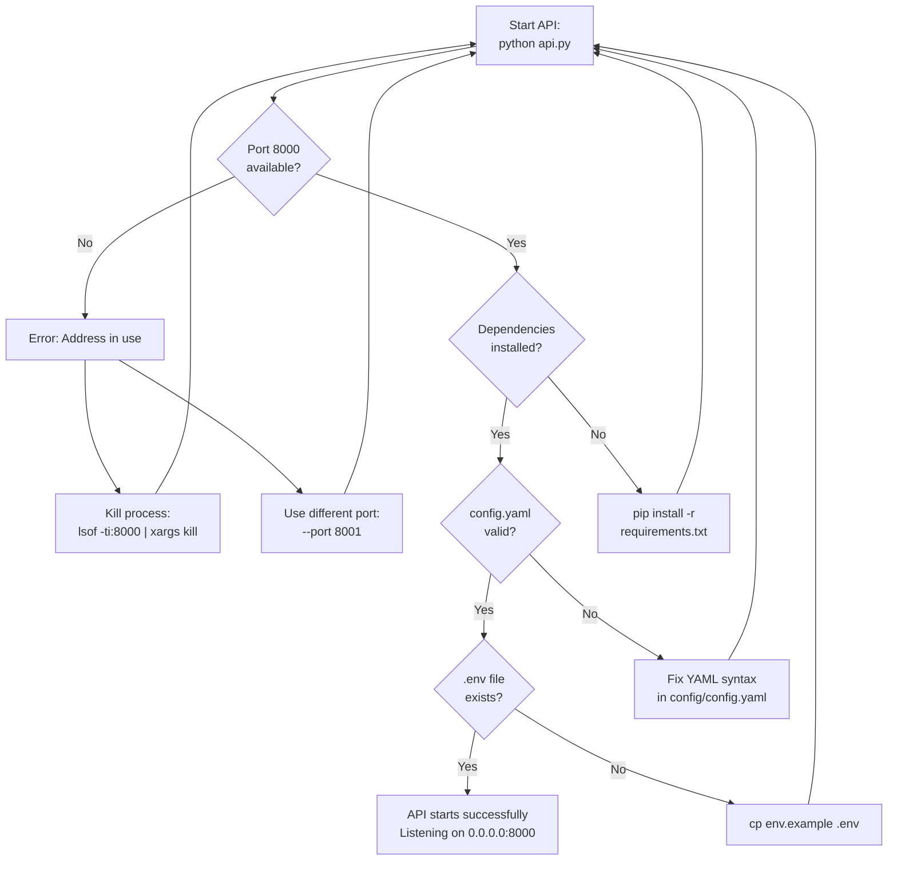
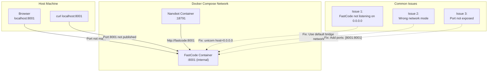
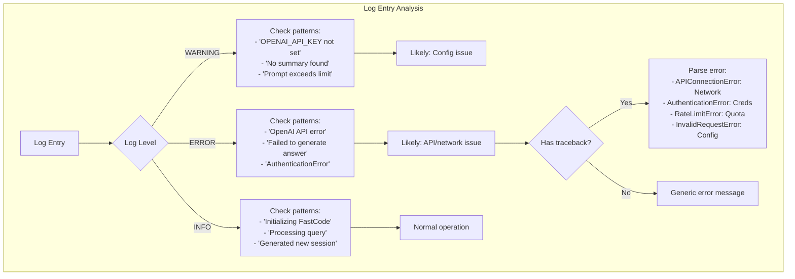
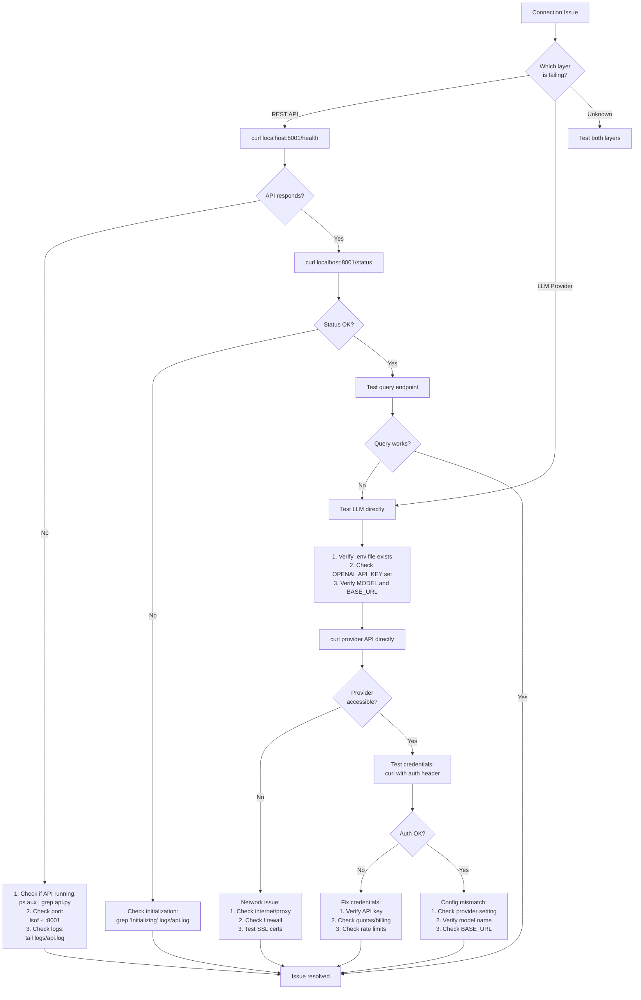

<!-- source: DeepWiki mcp.deepwiki.com · repo HKUDS/FastCode · page 11.2 API & Connection Issues · fetched 2026-11-09 -->

# API & Connection Issues

<details>
<summary>Relevant source files</summary>

The following files were used as context for generating this wiki page:

- [README.md](README.md)
- [fastcode/cache.py](fastcode/cache.py)
- [mcp_server.py](mcp_server.py)
- [web_app.py](web_app.py)

</details>


This page covers troubleshooting for API and connection problems in FastCode, including LLM provider authentication failures, network connectivity issues, REST API errors, and environment configuration problems. For issues related to installation and dependencies, see [Installation Issues](#11.1). For performance-related problems like slow queries or timeouts during indexing, see [Performance Issues](#11.3).

## Overview of API & Connection Architecture

FastCode connects to external services at three main integration points: the REST API server ([api.py]()), LLM providers for answer generation ([fastcode/answer_generator.py]()), and optional bot gateways (Nanobot). Understanding this architecture helps diagnose where connection failures occur.

### API & Connection Flow



**Sources:** [api.py:1-796](), [fastcode/answer_generator.py:1-886](), [env.example:1-18]()

## Environment Configuration Issues

Environment configuration is the most common source of API connection failures. The system reads LLM credentials and endpoints from `.env` file via `load_dotenv()` at [fastcode/answer_generator.py:43]().

### Missing or Invalid .env File

**Symptom:** `AnswerGenerator` logs warnings like `"OPENAI_API_KEY not set"` at [fastcode/answer_generator.py:57]() or [fastcode/answer_generator.py:63]().

**Diagnosis:**
1. Check if `.env` file exists in the project root directory
2. Verify file is named exactly `.env` (not `.env.example` or `.env.txt`)
3. Ensure file has Unix line endings (LF, not CRLF) on Linux/macOS

**Solution:**
```bash
# Copy example file
cp env.example .env

# Edit with your credentials
nano .env
```

Required variables:
| Variable | Purpose | Example |
|----------|---------|---------|
| `OPENAI_API_KEY` | API key for OpenAI or compatible provider | `sk-...` or `ollama` |
| `MODEL` | Model identifier | `gpt-4-turbo` or `qwen3-coder-30b_fastcode` |
| `BASE_URL` | API endpoint URL | `https://api.openai.com/v1` or `http://localhost:11434/v1` |

**Sources:** [env.example:1-18](), [fastcode/answer_generator.py:42-50]()

### Provider and Credential Mismatches

**Symptom:** Errors like `"OpenAI API error: AuthenticationError"` from [fastcode/answer_generator.py:660]() or `"Anthropic API error"` from [fastcode/answer_generator.py:711]().

**Common misconfigurations:**

```bash
# ❌ Wrong: provider='openai' but ANTHROPIC_API_KEY set
ANTHROPIC_API_KEY=sk-ant-...
MODEL=claude-3-opus
BASE_URL=https://api.anthropic.com

# ✅ Correct: Set provider to 'anthropic' in config.yaml
# OR use OpenAI-compatible format for Anthropic
OPENAI_API_KEY=sk-ant-...
MODEL=anthropic/claude-3-opus
BASE_URL=https://anthropic.openai.azure.com/v1
```

**Diagnosis:**
1. Check `generation.provider` in [config/config.yaml]() - must match your environment setup
2. Verify API key prefix matches provider:
   - OpenAI: `sk-proj-...` or `sk-...`
   - Anthropic: `sk-ant-...`
   - OpenRouter: `sk-or-...`
   - Ollama: `ollama` (literal string)

**Sources:** [fastcode/answer_generator.py:52-68](), [env.example:1-18]()

### Model Name and BASE_URL Conflicts

**Symptom:** `"Error: model 'gpt-4' does not exist"` or connection refused to wrong endpoint.

**Common issues:**



**Solution table:**

| Provider | OPENAI_API_KEY | MODEL | BASE_URL |
|----------|---------------|-------|----------|
| OpenAI | `sk-proj-...` | `gpt-4-turbo`, `gpt-4` | `https://api.openai.com/v1` (default) |
| OpenRouter | `sk-or-...` | `google/gemini-3-flash-preview`, `anthropic/claude-3.5-sonnet` | `https://openrouter.ai/api/v1` |
| Ollama | `ollama` | `qwen3-coder-30b_fastcode`, `codellama:34b` | `http://localhost:11434/v1` |
| Anthropic | Set `ANTHROPIC_API_KEY` | `claude-3-opus`, `claude-3-sonnet` | (uses default) |

**Verification command:**
```bash
# Test OpenAI-compatible endpoint
curl -X POST $BASE_URL/chat/completions \
  -H "Authorization: Bearer $OPENAI_API_KEY" \
  -H "Content-Type: application/json" \
  -d '{"model":"'$MODEL'","messages":[{"role":"user","content":"test"}],"max_tokens":5}'
```

**Sources:** [env.example:1-18](), [fastcode/answer_generator.py:46-50]()

## LLM Provider-Specific Connection Issues

### OpenAI Connection Failures

**Error patterns from `_generate_openai()` at [fastcode/answer_generator.py:634-661]():**

| Error | Cause | Solution |
|-------|-------|----------|
| `AuthenticationError: Invalid API key` | Wrong/expired key | Verify key at platform.openai.com/api-keys |
| `RateLimitError: Rate limit exceeded` | Too many requests | Add retry logic or wait |
| `APIConnectionError: Connection error` | Network/firewall issue | Check internet, proxy settings |
| `APITimeoutError: Request timed out` | Slow response | Increase timeout in client config |
| `InvalidRequestError: model does not exist` | Wrong model name | Check available models at platform.openai.com/docs/models |

**Detailed diagnosis:**

```python
# Test OpenAI connection independently
from openai import OpenAI
import os

client = OpenAI(
    api_key=os.getenv("OPENAI_API_KEY"),
    base_url=os.getenv("BASE_URL")
)

try:
    response = client.chat.completions.create(
        model=os.getenv("MODEL"),
        messages=[{"role": "user", "content": "Hello"}],
        max_tokens=5
    )
    print("✓ Connection successful:", response.choices[0].message.content)
except Exception as e:
    print("✗ Connection failed:", type(e).__name__, str(e))
```

**Common fix for empty responses:**

The code at [fastcode/answer_generator.py:649-656]() includes defensive checks for providers returning partial payloads:

```python
if not response or not getattr(response, "choices", None):
    raise ValueError(f"Empty response or no choices returned: {response}")
```

If you see `"LLM response has no content"`, the provider API may be incompatible. Try:
1. Update `openai` library: `pip install --upgrade openai`
2. Check if `BASE_URL` requires `/v1` suffix
3. Verify model name format for your provider

**Sources:** [fastcode/answer_generator.py:634-661](), [fastcode/answer_generator.py:663-686]()

### Ollama Connection Issues

**Symptom:** `"Connection refused"` or `"APIConnectionError"` when using local Ollama models.

**Checklist:**



**Commands:**
```bash
# 1. Verify Ollama is running
ollama ps
# Expected output: NAME                        ID              SIZE     PROCESSOR    UNTIL
#                  qwen3-coder-30b_fastcode    ...            ...      ...          ...

# 2. If not running, start Ollama
ollama serve

# 3. Check if model is available
ollama list | grep qwen3-coder-30b_fastcode

# 4. Pull model if missing
ollama pull qwen3-coder-30b_fastcode

# 5. Test connection
curl http://localhost:11434/v1/chat/completions \
  -H "Content-Type: application/json" \
  -d '{"model":"qwen3-coder-30b_fastcode","messages":[{"role":"user","content":"test"}],"max_tokens":5}'
```

**Environment setup for Ollama:**
```bash
# .env configuration for Ollama
OPENAI_API_KEY=ollama
MODEL=qwen3-coder-30b_fastcode
BASE_URL=http://localhost:11434/v1
```

**Docker networking:** If running FastCode in Docker and Ollama on host:
- Replace `localhost` with `host.docker.internal` (Mac/Windows) or `172.17.0.1` (Linux)
- `BASE_URL=http://host.docker.internal:11434/v1`

**Sources:** [env.example:11-14](), [fastcode/answer_generator.py:58]()

### Anthropic Connection Issues

**Error patterns from `_generate_anthropic()` at [fastcode/answer_generator.py:688-712]():**

```python
# Anthropic-specific error handling
if not response or not getattr(response, "content", None):
    raise ValueError(f"Empty response or no content returned: {response}")
```

**Common issues:**

| Issue | Symptom | Fix |
|-------|---------|-----|
| Wrong key variable | `"Anthropic client not initialized"` | Set `ANTHROPIC_API_KEY` env var, not `OPENAI_API_KEY` |
| Model not available | `"model: 'claude-4' is not supported"` | Use valid model: `claude-3-opus-20240229`, `claude-3-sonnet-20240229`, `claude-3-haiku-20240307` |
| Region restrictions | `"Location not supported"` | Check if your region has API access |
| Content filtering | Response with empty `content` | Query triggered content policy, rephrase |

**Configuration in `config.yaml`:**
```yaml
generation:
  provider: "anthropic"  # Must set to 'anthropic'
  model: "claude-3-opus-20240229"
  temperature: 0.4
  max_tokens: 20000
```

**Testing Anthropic connection:**
```python
from anthropic import Anthropic
import os

client = Anthropic(api_key=os.getenv("ANTHROPIC_API_KEY"))
try:
    response = client.messages.create(
        model="claude-3-opus-20240229",
        max_tokens=5,
        messages=[{"role": "user", "content": "Hello"}]
    )
    print("✓ Connected:", response.content[0].text)
except Exception as e:
    print("✗ Failed:", e)
```

**Sources:** [fastcode/answer_generator.py:60-68](), [fastcode/answer_generator.py:688-712]()

## REST API Connection Issues

### FastAPI Server Startup Failures

**Symptoms in logs at [logs/api.log]():**
- `"Address already in use"` - port conflict
- `"ModuleNotFoundError"` - missing dependencies
- `"Configuration error"` - invalid config.yaml

**Diagnosis and fixes:**



**Commands:**
```bash
# Check if port is in use
lsof -i :8000

# Kill existing process
lsof -ti:8000 | xargs kill -9

# Start on different port
python api.py --port 8001

# Verify server is running
curl http://localhost:8000/health
```

**Expected health response:**
```json
{
  "status": "healthy",
  "repo_loaded": false,
  "repo_indexed": false,
  "multi_repo_mode": false
}
```

**Sources:** [api.py:152-168](), [api.py:780-796]()

### Lazy Initialization Issues

FastCode uses lazy initialization at [api.py:131-137]() to avoid startup delays. The `_ensure_fastcode_initialized()` function creates the FastCode instance on first request.

**Issue:** First API call is slow or times out.

**Diagnosis:**
```bash
# Check initialization in logs
tail -f logs/api.log | grep "Initializing FastCode"
# Should show: "Initializing FastCode system (lazy initialization)"
```

**Impact on different endpoints:**

| Endpoint | Lazy Init Triggered | Expected Delay |
|----------|---------------------|----------------|
| `/` | No | <10ms |
| `/health` | No | <10ms |
| `/status` | Yes | 1-5s (loads config) |
| `/load` | Yes | 1-5s + git clone time |
| `/query` | Yes | 1-5s + query processing |

**Solution:** Pre-warm the system by calling `/status` endpoint after startup:
```bash
# In startup script
python api.py &
sleep 2
curl http://localhost:8000/status
```

**Sources:** [api.py:131-138](), [api.py:87-94]()

### CORS and Network Access Issues

**Symptom:** Browser-based clients see `"Access-Control-Allow-Origin"` errors.

CORS middleware configuration at [api.py:104-111]():
```python
app.add_middleware(
    CORSMiddleware,
    allow_origins=["*"],  # Allows all origins
    allow_credentials=True,
    allow_methods=["*"],
    allow_headers=["*"],
)
```

**Current configuration allows all origins (`"*"`)**, which is permissive but insecure for production.

**For production deployment:**
1. Edit [api.py:107]() to restrict origins:
   ```python
   allow_origins=["https://yourdomain.com", "http://localhost:5000"],
   ```

2. Or set environment variable:
   ```bash
   export ALLOWED_ORIGINS="https://yourdomain.com,http://localhost:5000"
   ```

**Testing CORS:**
```bash
curl -H "Origin: http://localhost:3000" \
     -H "Access-Control-Request-Method: POST" \
     -X OPTIONS http://localhost:8000/query
# Should return Access-Control-Allow-Origin header
```

**Sources:** [api.py:104-111]()

### Docker Networking Issues

**Symptom:** Nanobot container cannot reach FastCode API at `http://fastcode:8001`.

**Container-to-container communication in [docker-compose.yml]():**
- Service name `fastcode` resolves to FastCode container IP
- Port 8001 is exposed internally (not published to host)
- Nanobot uses `FASTCODE_API_URL=http://fastcode:8001`

**Common issues:**



**Diagnosis commands:**
```bash
# Check if containers are on same network
docker network inspect fastcode_default

# Test container-to-container connectivity
docker exec -it nanobot curl http://fastcode:8001/health

# Check FastCode binding
docker exec -it fastcode netstat -tlnp | grep 8001
# Should show: 0.0.0.0:8001 (not 127.0.0.1:8001)
```

**Fix for host access:** Add port mapping in docker-compose.yml:
```yaml
services:
  fastcode:
    ports:
      - "8001:8001"  # Add this line
```

**Sources:** [api.py:780-784]()

## Authentication and Authorization Errors

### Invalid API Keys

**Error detection in AnswerGenerator initialization:**

At [fastcode/answer_generator.py:55-57]():
```python
api_key = self.api_key
if not api_key:
    self.logger.warning("OPENAI_API_KEY not set")
```

**This warning appears in logs but doesn't prevent initialization** - failures occur later during API calls.

**Error patterns:**

| Provider | Error Message | Source |
|----------|--------------|--------|
| OpenAI | `AuthenticationError: Incorrect API key` | [answer_generator.py:660]() |
| OpenRouter | `401 Unauthorized: Invalid API Key` | [answer_generator.py:660]() |
| Anthropic | `AuthenticationError: invalid x-api-key` | [answer_generator.py:711]() |
| Ollama | No auth error (uses literal string) | N/A |

**Verification steps:**

```bash
# 1. Check if key is set
echo $OPENAI_API_KEY | cut -c1-10
# Should show: sk-proj-... or sk-or-... or sk-ant-...

# 2. Verify key format
export KEY_PREFIX=$(echo $OPENAI_API_KEY | cut -d'-' -f1-2)
case $KEY_PREFIX in
  "sk-proj"|"sk-or"|"sk-ant") echo "✓ Valid format" ;;
  "sk") echo "⚠ Legacy OpenAI key" ;;
  *) echo "✗ Invalid format" ;;
esac

# 3. Test key with provider
curl https://api.openai.com/v1/models \
  -H "Authorization: Bearer $OPENAI_API_KEY" | jq '.data[0].id'
# Should return model name, not error
```

**Sources:** [fastcode/answer_generator.py:45-68](), [fastcode/answer_generator.py:660](), [fastcode/answer_generator.py:711]()

### Rate Limiting and Quotas

**OpenAI/OpenRouter rate limits:** Enforced by provider, not FastCode.

**Symptoms:**
- HTTP 429 errors from [answer_generator.py:660]()
- Error message: `"Rate limit exceeded"` or `"You exceeded your current quota"`

**Solutions:**

1. **Check quota/billing:**
   - OpenAI: https://platform.openai.com/usage
   - OpenRouter: https://openrouter.ai/credits

2. **Implement retry with exponential backoff** (not currently in codebase):
   ```python
   # External client implementation
   import time
   from openai import RateLimitError
   
   for attempt in range(3):
       try:
           result = fastcode.query(question)
           break
       except RateLimitError as e:
           if attempt < 2:
               wait = 2 ** attempt
               print(f"Rate limited, retrying in {wait}s...")
               time.sleep(wait)
           else:
               raise
   ```

3. **Reduce request frequency:**
   - Add delays between queries
   - Use caching (enabled by default in [config/config.yaml]())
   - Reduce `max_tokens` in generation config

**Sources:** [fastcode/answer_generator.py:634-661]()

## Network and Timeout Issues

### Connection Timeouts

**Default timeout behavior:** The OpenAI and Anthropic clients don't have explicit timeouts configured in [fastcode/answer_generator.py:58]() and [fastcode/answer_generator.py:64](). They use library defaults (~60-120 seconds).

**Symptoms:**
- Long-running queries hang
- `APITimeoutError` from LLM client
- Process becomes unresponsive

**Diagnosis:**

```bash
# Monitor response time
time curl -X POST http://localhost:8001/query \
  -H "Content-Type: application/json" \
  -d '{"question":"How does auth work?"}' \
  -o /dev/null

# Check if it's network or processing
# Fast response (<5s) = processing issue, see section 11.3
# Slow response (>30s) = likely network timeout
```

**Solution - Add timeout to client initialization:**

Edit [fastcode/answer_generator.py:58]() to add timeout:
```python
return OpenAI(
    api_key=api_key, 
    base_url=self.base_url,
    timeout=60.0  # Add this parameter
)
```

**For Anthropic at [fastcode/answer_generator.py:64]():**
```python
return Anthropic(
    api_key=api_key, 
    base_url=self.base_url,
    timeout=60.0  # Add this parameter
)
```

**Sources:** [fastcode/answer_generator.py:52-68]()

### Proxy and Firewall Issues

**Symptom:** `APIConnectionError: Connection error` even with valid credentials.

**FastCode does not have built-in proxy support** - must configure at system level or in OpenAI/Anthropic client.

**System-level proxy configuration:**
```bash
# Set proxy environment variables before starting FastCode
export HTTP_PROXY=http://proxy.company.com:8080
export HTTPS_PROXY=http://proxy.company.com:8080
export NO_PROXY=localhost,127.0.0.1

python api.py
```

**Client-level proxy (requires code modification):**

Edit [fastcode/answer_generator.py:58]():
```python
import httpx

return OpenAI(
    api_key=api_key,
    base_url=self.base_url,
    http_client=httpx.Client(proxy="http://proxy.company.com:8080")
)
```

**Firewall rules needed:**

| Destination | Port | Protocol | Purpose |
|------------|------|----------|---------|
| api.openai.com | 443 | HTTPS | OpenAI API |
| openrouter.ai | 443 | HTTPS | OpenRouter API |
| api.anthropic.com | 443 | HTTPS | Anthropic API |
| localhost | 11434 | HTTP | Ollama (local) |
| localhost | 8001 | HTTP | FastCode API |

**Testing firewall:**
```bash
# Test HTTPS connectivity
curl -v https://api.openai.com/v1/models 2>&1 | grep "Connected"

# Test if port is blocked
nc -zv api.openai.com 443
```

**Sources:** [fastcode/answer_generator.py:58](), [fastcode/answer_generator.py:64]()

### SSL Certificate Issues

**Symptom:** `SSLError: certificate verify failed`

**Cause:** Corporate proxies, self-signed certificates, or outdated CA bundles.

**Temporary workaround (NOT for production):**
```bash
# Disable SSL verification (insecure)
export CURL_CA_BUNDLE=""
export REQUESTS_CA_BUNDLE=/dev/null
python api.py
```

**Proper solution:**
```bash
# 1. Update CA certificates
sudo apt-get update && sudo apt-get install ca-certificates  # Ubuntu/Debian
brew install ca-certificates  # macOS

# 2. Install corporate CA certificate
sudo cp company-root-ca.crt /usr/local/share/ca-certificates/
sudo update-ca-certificates

# 3. Point Python to CA bundle
export REQUESTS_CA_BUNDLE=/etc/ssl/certs/ca-certificates.crt
export SSL_CERT_FILE=/etc/ssl/certs/ca-certificates.crt
```

**For Docker deployment:** Mount CA certificates:
```yaml
volumes:
  - /etc/ssl/certs:/etc/ssl/certs:ro
```

**Sources:** Not explicitly handled in codebase - relies on Python `requests` and `httpx` defaults.

## Debugging Connection Issues

### Log File Analysis

**Log locations:**
- REST API logs: [logs/api.log]() (configured at [api.py:117-127]())
- FastCode core logs: [logs/fastcode.log]() (if configured in system)

**Key log patterns:**



**Useful grep patterns:**
```bash
# Find all errors
grep -E "(ERROR|Exception)" logs/api.log

# Find API connection issues
grep -E "(APIConnectionError|Connection error|timed out)" logs/api.log

# Find authentication failures
grep -E "(AuthenticationError|Invalid API key|Unauthorized)" logs/api.log

# Find initialization issues
grep "Initializing FastCode" logs/api.log

# Find query processing
grep "Processing query" logs/api.log | tail -20
```

**Sources:** [api.py:117-127](), [fastcode/answer_generator.py:23]()

### Verbose Logging

**Current logging level:** INFO (set at [api.py:120]())

**Enable DEBUG logging for detailed diagnostics:**

Edit [api.py:120]():
```python
logging.basicConfig(
    level=logging.DEBUG,  # Changed from INFO
    format="%(asctime)s - %(name)s - %(levelname)s - %(message)s",
    handlers=[
        logging.FileHandler(log_dir / "api.log"),
        logging.StreamHandler()
    ]
)
```

**Debug output includes:**
- Detailed HTTP request/response info
- Token counts and truncation decisions
- Query processing steps
- Cache hits/misses
- Vector store operations

**Restart required:** Changes to logging config require restarting the API server.

**Performance impact:** DEBUG logging increases log file size significantly and may slow down operations by 10-20%.

**Sources:** [api.py:116-128]()

### Testing API Endpoints Independently

**Diagnostic curl commands:**

```bash
# 1. Test server health (no initialization)
curl http://localhost:8001/health
# Expected: {"status":"initializing"} or {"status":"healthy"}

# 2. Test full status (triggers initialization)
curl http://localhost:8001/status
# Expected: {"status":"ready","repo_loaded":false,...}

# 3. Test query endpoint (requires indexed repo)
curl -X POST http://localhost:8001/query \
  -H "Content-Type: application/json" \
  -d '{
    "question": "What is FastCode?",
    "filters": null,
    "repo_filter": null,
    "multi_turn": false
  }'
# Expected: {"answer":"...","query":"...","context_elements":...}

# 4. Test with verbose output
curl -v http://localhost:8001/health 2>&1 | grep "HTTP"
# Shows HTTP status codes and headers
```

**Expected response times:**

| Endpoint | Cold Start | Warm |
|----------|-----------|------|
| `/health` | <100ms | <10ms |
| `/status` | 1-5s | <100ms |
| `/query` (first) | 5-30s | N/A |
| `/query` (cached) | 100-500ms | 100-500ms |

**Sources:** [api.py:141-796]()

### Connection Testing Decision Tree



**Sources:** [api.py:141-796](), [fastcode/answer_generator.py:1-886]()

## Common Error Messages Reference

### Quick Reference Table

| Error Message | File Location | Most Likely Cause | Fix |
|--------------|---------------|-------------------|-----|
| `OPENAI_API_KEY not set` | [answer_generator.py:57]() | Missing .env file | Create .env with API key |
| `OpenAI client not initialized` | [answer_generator.py:636]() | Failed client setup | Check provider config |
| `AuthenticationError: Invalid API key` | [answer_generator.py:660]() | Wrong/expired key | Verify key at provider dashboard |
| `Empty response or no choices returned` | [answer_generator.py:651]() | Provider incompatibility | Check BASE_URL and model name |
| `LLM response has no content` | [answer_generator.py:656]() | Empty response from API | Update openai library, check provider |
| `Anthropic client not initialized` | [answer_generator.py:690]() | Missing ANTHROPIC_API_KEY | Set ANTHROPIC_API_KEY env var |
| `Address already in use` | [api.py:784]() | Port 8001 in use | Kill process or use --port flag |
| `Repository not indexed` | [api.py:450]() | Query before indexing | Run /index endpoint first |
| `Connection refused` | Runtime | Network issue | Check if service is running |
| `APIConnectionError` | [answer_generator.py:660]() | Network/firewall | Check proxy, firewall, SSL |
| `RateLimitError` | [answer_generator.py:660]() | Rate limit exceeded | Wait or check quotas |
| `APITimeoutError` | [answer_generator.py:660]() | Timeout | Add timeout parameter to client |

**Sources:** [api.py:1-796](), [fastcode/answer_generator.py:1-886]()

### Error Response Format

All API errors follow the FastAPI HTTPException format at [api.py:15]():

```json
{
  "detail": "Error message describing the problem"
}
```

**HTTP status codes used:**
- `400` - Bad request (e.g., repository not loaded/indexed)
- `404` - Not found (e.g., session doesn't exist)
- `500` - Internal server error (e.g., LLM API failure, processing error)

**Examples:**

```bash
# Repository not indexed
curl -X POST http://localhost:8001/query -d '{"question":"test"}'
# Response: 400 {"detail":"Repository not indexed"}

# Session not found
curl -X DELETE http://localhost:8001/session/nonexistent
# Response: 404 {"detail":"Session 'nonexistent' not found"}

# LLM API failure
curl -X POST http://localhost:8001/query -d '{"question":"test"}'
# Response: 500 {"detail":"OpenAI API error: AuthenticationError..."}
```

**Sources:** [api.py:215](), [api.py:450](), [api.py:652]()

---

