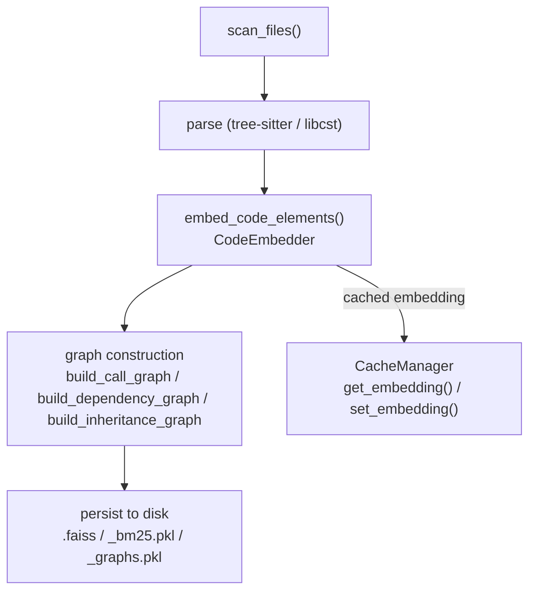
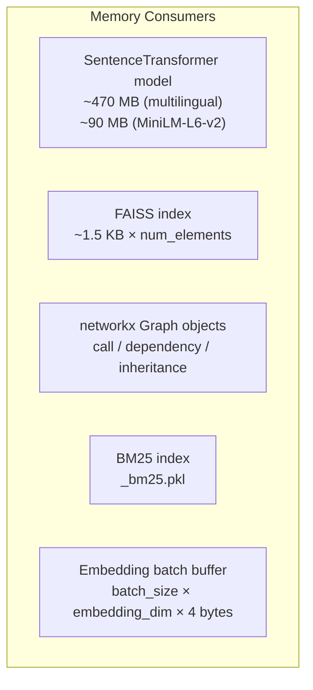
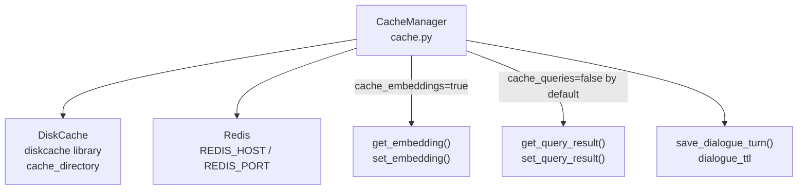

<!-- source: DeepWiki mcp.deepwiki.com · repo HKUDS/FastCode · page 11.3 Performance Issues · fetched 2026-11-09 -->

# Performance Issues

<details>
<summary>Relevant source files</summary>

The following files were used as context for generating this wiki page:

- [README.md](README.md)
- [config/config.yaml](config/config.yaml)
- [fastcode/cache.py](fastcode/cache.py)
- [fastcode/embedder.py](fastcode/embedder.py)

</details>


This page covers symptoms and remedies for common performance problems in FastCode: slow indexing, slow query responses, high memory consumption, and cache-related slowdowns. For configuration key definitions and types, see [Configuration Reference](#12.1). For query accuracy problems that are distinct from speed, see [Query & Retrieval Issues](#11.4).

---

## Symptom Overview

| Symptom | Likely Area | Primary Config Section |
|---|---|---|
| First index takes many minutes | Embedding, Graph building | `embedding`, `graph`, `indexing` |
| Each query takes > 10 seconds | Query processing, LLM calls | `query`, `retrieval`, `agent` |
| RAM usage > 4 GB during indexing | Embedding batch size, Graph | `embedding.batch_size`, `graph` |
| Repeated queries are not faster | Cache disabled or misconfigured | `cache` |
| Index scan in web UI is slow | Index scan cache not tuned | `vector_store.index_scan_cache_ttl` |
| Git clone is slow | Deep clone depth | `repository.clone_depth` |

---

## Slow Indexing

Indexing involves four expensive steps: file scanning, parsing, embedding, and graph construction. The pipeline is defined in the code indexer and executed sequentially.

**Indexing pipeline bottlenecks by step:**



Sources: `fastcode/embedder.py`, `config/config.yaml`

### Embedding Is the Primary Bottleneck

`CodeEmbedder.embed_batch()` calls `SentenceTransformer.encode()` for all indexed code elements. Device selection is the most impactful single variable.

**Device auto-detection logic** ([fastcode/embedder.py:28-29]()):

```
auto → cuda (if available) → mps (if Apple Silicon) → cpu
```

Setting `device: "auto"` in `config/config.yaml` enables this. If the model is running on CPU when a GPU is available, check that `torch` was installed with CUDA support (`torch.cuda.is_available()` should return `True`).

**Batch size** controls how many code elements are embedded per GPU/CPU call:

```yaml
# config/config.yaml
embedding:
  batch_size: 32       # Increase to 64–128 on GPU; decrease to 8–16 on CPU-only
  max_seq_length: 512  # Reduce to 256 to speed up embedding at slight accuracy cost
```

A progress bar is shown only when the number of texts exceeds 100 ([fastcode/embedder.py:68-69]()).

### Repository Scanning and File Filtering

Large repositories with many files that should be excluded will slow down parsing. Add patterns to `ignore_patterns` and tighten `max_file_size_mb`:

```yaml
# config/config.yaml
repository:
  clone_depth: 1           # Keep at 1 (shallow clone) for any Git URL
  max_file_size_mb: 2      # Default is 5; reduce to skip large generated files
  ignore_patterns:
    - "*.pyc"
    - "node_modules"
    - "dist/*"
    - "build/*"
    - "*.lock"
    - "*.min.js"
```

### Graph Construction

All three graphs are enabled by default. Building them is optional for basic use:

```yaml
# config/config.yaml
graph:
  build_call_graph: true
  build_dependency_graph: true
  build_inheritance_graph: true
  max_depth: 5     # Reduce to 2–3 for large repos
```

Disabling `build_call_graph` and `build_dependency_graph` saves significant time on large codebases because every function definition is visited to trace its calls. Note that this removes graph-based retrieval scoring; see the `graph_weight` setting in the retrieval section.

### Repository Overview Generation

`generate_repo_overview: true` triggers an LLM call during indexing to summarize the repository. On large repositories or slow LLM providers, this adds latency:

```yaml
# config/config.yaml
indexing:
  generate_repo_overview: false  # Disable to skip the LLM call at index time
```

This only affects multi-repository selection accuracy; see [Two-Stage Retrieval](#9.5).

---

## Slow Queries

Query latency comes from three sources: query processing (optionally LLM-enhanced), retrieval (hybrid search), and answer generation (always an LLM call).

**Query execution flow:**


Sources: `config/config.yaml`

### LLM Enhancement Mode

The `llm_enhancement_mode` setting controls whether `QueryProcessor` makes an extra LLM call before retrieval:

```yaml
# config/config.yaml
query:
  llm_enhancement_mode: "adaptive"  # Options: "adaptive", "always", "off"
```

| Mode | Behavior | Latency Impact |
|---|---|---|
| `always` | LLM called for every query | +1–3 s per query |
| `adaptive` | LLM called only for complex/implementation queries | Moderate |
| `off` | Rule-based only, no extra LLM call | Fastest |

`adaptive` is the recommended setting for most deployments.

### Query Decomposition

With `decompose_complex: true`, complex queries are split into `max_subqueries` sub-queries, each processed independently. This multiplies retrieval calls:

```yaml
query:
  decompose_complex: true
  max_subqueries: 3      # Reduce to 1–2 for faster responses
```

### Agency Mode

When `enable_agency_mode: true`, `IterativeAgent` runs up to `max_iterations` full retrieval rounds before generating an answer. This is the largest single source of query latency:

```yaml
# config/config.yaml
retrieval:
  enable_agency_mode: false   # Disable for standard, single-pass retrieval

agent:
  iterative:
    max_iterations: 4         # Reduce to 2 if agency mode is kept on
    max_total_lines: 12000    # Reduce to limit context accumulation
    confidence_threshold: 95  # Lower to 80 to stop earlier
```

See [Agency Mode](#5.3) for a full cost/accuracy tradeoff discussion.

### Multi-Repository Overhead

With multiple indexed repositories, `RepositorySelector` runs an LLM call to select which repos to search before retrieval begins. Tune these settings:

```yaml
retrieval:
  select_repos_by_overview: true  # Set false to search all repos directly
  top_repos_to_search: 5          # Reduce to 2–3
  repo_selection_method: "embedding"  # Use "embedding" instead of "llm" to avoid LLM call
```

---

## High Memory Usage

Memory is consumed at three points: the embedding model, the FAISS vector store, and graph structures.



Sources: `fastcode/embedder.py`, `config/config.yaml`

### Embedding Model Size

The default model configured in `config.yaml` is `paraphrase-multilingual-MiniLM-L12-v2` (~470 MB). Switch to the smaller English-only model if multilingual support is not needed:

```yaml
embedding:
  model: "sentence-transformers/all-MiniLM-L6-v2"  # ~90 MB, English only
```

### Batch Size During Indexing

A large `batch_size` keeps more text tensors in memory simultaneously. On machines with limited RAM, reduce it:

```yaml
embedding:
  batch_size: 8   # Reduce from default 32 to lower peak memory
```

### Graph Memory

Each of the three graphs is stored as a `networkx` graph object in memory. For large codebases with thousands of functions, these can grow significantly. Disable unused graphs:

```yaml
graph:
  build_call_graph: false
  build_dependency_graph: true   # Keep if dependency tracing is important
  build_inheritance_graph: false
```

---

## Cache-Related Slowdowns

The `CacheManager` in [fastcode/cache.py]() provides two backends: `disk` (via `diskcache`) and `redis`. Misconfiguration can cause cache misses or excessive I/O.

**Cache configuration mapping:**



Sources: `fastcode/cache.py`, `config/config.yaml`

### Embedding Cache

Embedding cache is enabled by default. When `cache_embeddings: true`, `CacheManager.get_embedding()` is checked before calling `CodeEmbedder`. Re-indexing an already-indexed repo will be significantly faster if embeddings are cached.

```yaml
cache:
  enabled: true
  cache_embeddings: true   # Must be true for re-index speedup
  ttl: 3600                # Increase to 86400 (24h) or more for stable repos
```

### Query Result Cache

Query caching is **disabled by default** (`cache_queries: false`). Enable it only for workloads where the same queries are repeated against unchanged code:

```yaml
cache:
  cache_queries: true   # Enable to cache full query results
  ttl: 3600
```

Note that cached query results do not reflect code changes made after caching. Changing the code requires clearing the cache via `POST /api/clear-cache`.

### Index Scan Cache (Web UI Status Panel)

The web status panel calls an index scan to count indexed elements. Without a cache, this scan runs on every page load:

```yaml
vector_store:
  index_scan_cache_ttl: 30     # Cache the scan for 30 seconds (0 = disabled)
  index_scan_sample_size: 100  # Reduce for faster but less accurate counts
```

### Disk Cache Size Limit

If the disk cache grows past `max_size_mb`, writes silently fail and the cache degrades:

```yaml
cache:
  max_size_mb: 1000   # Increase if cache directory size is growing near this limit
  cache_directory: "./data/cache"
```

Check actual cache size with `GET /api/status` or `CacheManager.get_stats()` ([fastcode/cache.py:182-205]()).

### Redis vs Disk Backend

| Factor | `disk` (diskcache) | `redis` |
|---|---|---|
| Setup | Zero dependencies beyond `diskcache` | Requires running Redis instance |
| Speed | Fast for small caches | Faster for large caches with high concurrency |
| Persistence | Survives process restarts | Survives restarts if Redis is persistent |
| Multi-process | Limited | Full support |

Switch to Redis when multiple workers access the cache concurrently:

```yaml
cache:
  backend: "redis"
```

Redis connection uses `REDIS_HOST` and `REDIS_PORT` environment variables, defaulting to `localhost:6379` ([fastcode/cache.py:55-58]()). If Redis is unavailable, `CacheManager` sets `self.enabled = False` and logs an error rather than raising an exception ([fastcode/cache.py:63-65]()).

---

## Quick Reference: Performance Tuning Knobs

| Goal | Config Key | Recommended Change |
|---|---|---|
| Faster indexing (GPU available) | `embedding.device` | `"cuda"` or `"auto"` |
| Faster indexing (CPU only) | `embedding.batch_size` | `8`–`16` |
| Smaller embedding model | `embedding.model` | `all-MiniLM-L6-v2` |
| Skip LLM on simple queries | `query.llm_enhancement_mode` | `"adaptive"` or `"off"` |
| Disable multi-round agent | `retrieval.enable_agency_mode` | `false` |
| Fewer agent iterations | `agent.iterative.max_iterations` | `2` |
| Faster multi-repo search | `retrieval.repo_selection_method` | `"embedding"` |
| Reduce graph memory | `graph.build_call_graph` | `false` |
| Persist embedding cache | `cache.cache_embeddings` | `true` |
| Cache status scans | `vector_store.index_scan_cache_ttl` | `60` |
| Avoid large file parsing | `repository.max_file_size_mb` | `2` |
| Shallow git clone | `repository.clone_depth` | `1` (already default) |

Sources: `config/config.yaml`, `fastcode/embedder.py`, `fastcode/cache.py`

---

