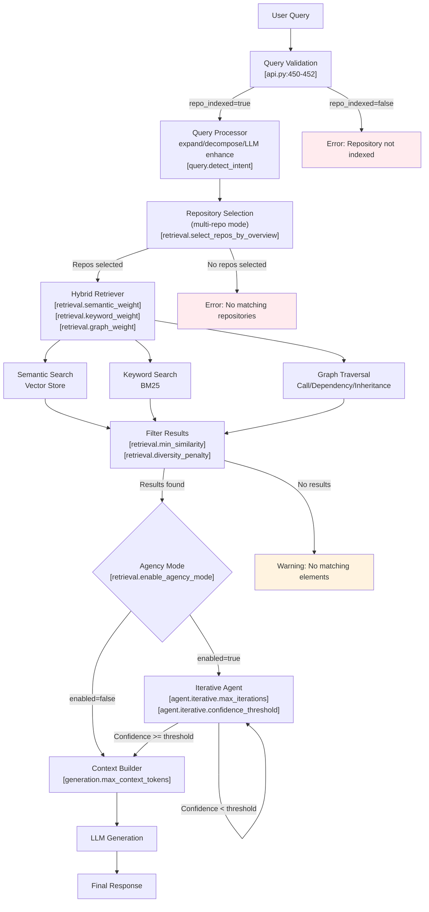
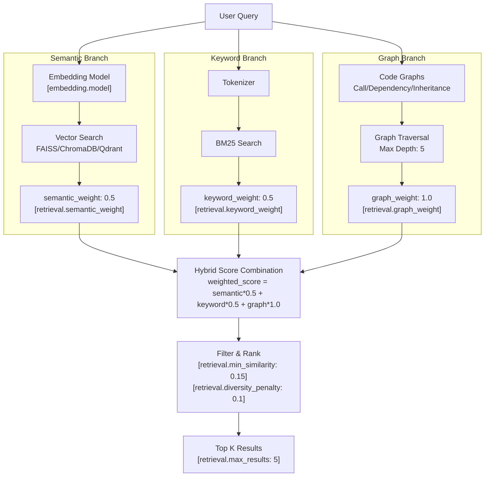
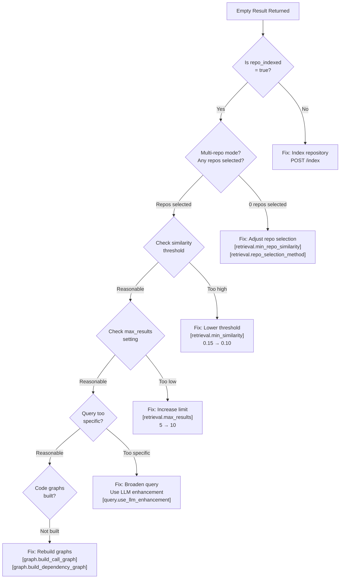
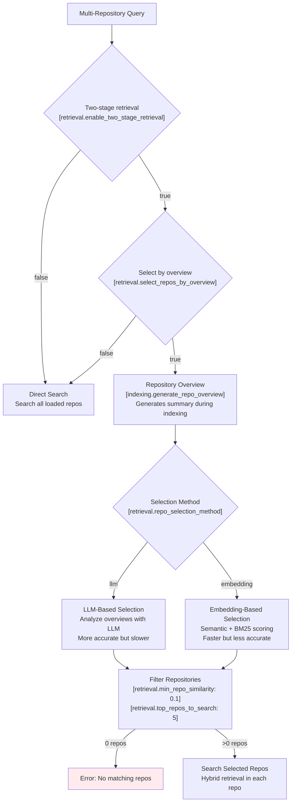
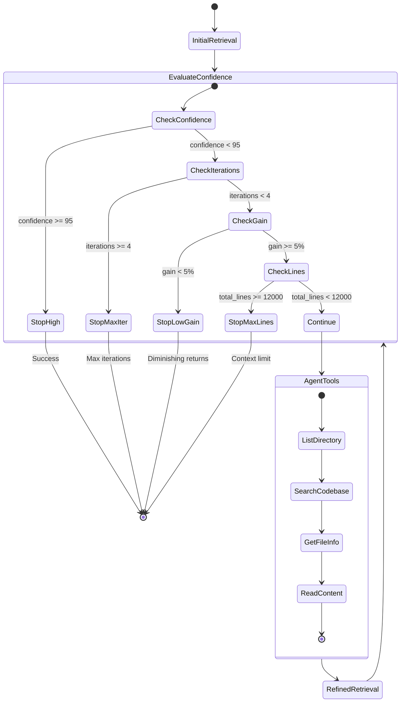
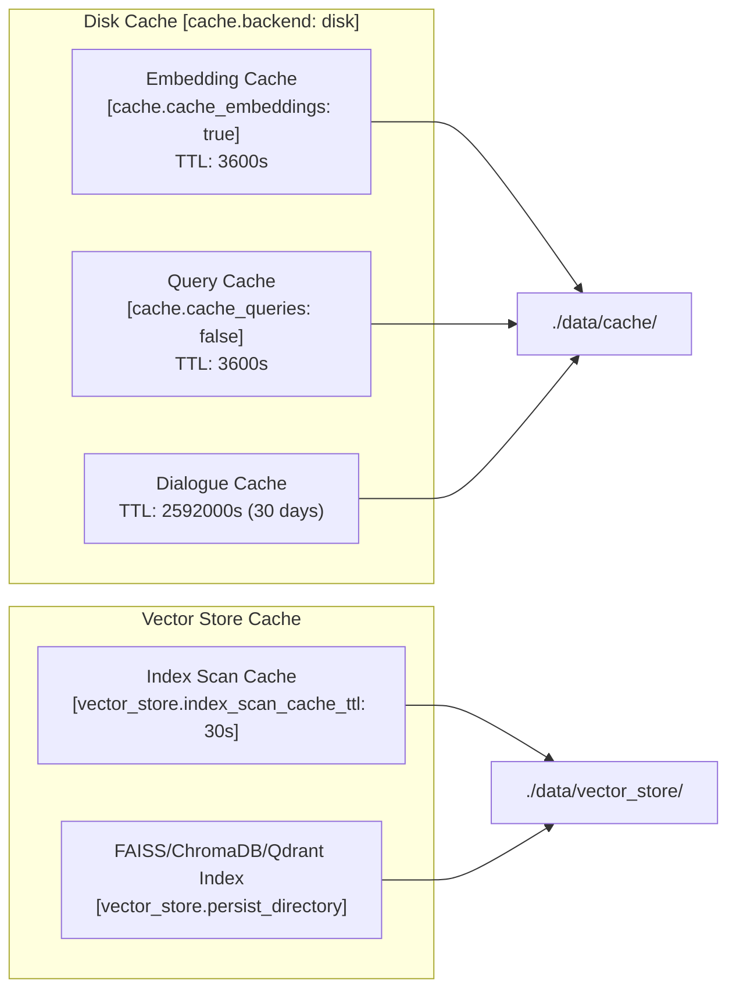

<!-- source: DeepWiki mcp.deepwiki.com · repo HKUDS/FastCode · page 11.4 Query & Retrieval Issues · fetched 2026-11-09 -->

# Query & Retrieval Issues

<details>
<summary>Relevant source files</summary>

The following files were used as context for generating this wiki page:

- [README.md](README.md)
- [config/config.yaml](config/config.yaml)
- [fastcode/embedder.py](fastcode/embedder.py)
- [fastcode/query_processor.py](fastcode/query_processor.py)

</details>


This document covers common problems with query execution and code retrieval, including poor search results, empty responses, and retrieval failures. These issues typically manifest as low-quality answers, missing relevant code, or complete query failures.

For issues with API connectivity and LLM provider errors, see [API & Connection Issues](#11.2). For performance-related concerns like slow queries, see [Performance Issues](#11.3).

---

## Overview of Query & Retrieval Pipeline

Understanding where failures occur requires knowledge of the complete retrieval flow:



**Sources:** [api.py:445-493](), [config/config.yaml:98-180]()

---

## Common Symptoms and Root Causes

### Symptom Matrix

| Symptom | Common Causes | Configuration Check | Log Pattern |
|---------|--------------|---------------------|-------------|
| **Empty results** | `min_similarity` too high<br/>Repository not indexed<br/>Query too specific | `retrieval.min_similarity`<br/>`retrieval.max_results` | "No matching elements found" |
| **Low relevance** | Poor embedding model<br/>Incorrect search weights<br/>Missing graph relationships | `embedding.model`<br/>`retrieval.semantic_weight`<br/>`graph.build_*` | "Similarity scores < 0.2" |
| **Missing code** | `max_results` too low<br/>Agency mode disabled<br/>Diversity penalty too high | `retrieval.max_results`<br/>`retrieval.enable_agency_mode`<br/>`retrieval.diversity_penalty` | "Retrieved X of Y candidates" |
| **Wrong repository** | Repository selection failed<br/>`min_repo_similarity` too high | `retrieval.repo_selection_method`<br/>`retrieval.min_repo_similarity` | "No repositories matched query" |
| **Timeout errors** | Agency mode iteration limit<br/>Context window exceeded | `agent.iterative.max_iterations`<br/>`generation.max_context_tokens` | "Max iterations reached" |

**Sources:** [config/config.yaml:98-120](), [config/config.yaml:169-180]()

---

## Repository Not Indexed

### Description

The most fundamental issue occurs when the repository has not been indexed, preventing any query execution.

### Diagnostic Check

```bash
# Check if repository is indexed
curl http://localhost:8001/status

# Expected response with repo_indexed=true
{
  "status": "ready",
  "repo_loaded": true,
  "repo_indexed": true,
  "repo_info": {...}
}
```

### Common Causes

1. **Repository loaded but not indexed**: [api.py:218-236]() loads the repository, but [api.py:238-261]() must be called separately
2. **Indexing failed silently**: Check logs at `./logs/api.log` for exceptions during indexing
3. **Vector store persistence failure**: Verify `./data/vector_store/` directory has write permissions

### Resolution Steps

```bash
# 1. Force re-index
curl -X POST "http://localhost:8001/index?force=true"

# 2. Or use atomic load-and-index
curl -X POST http://localhost:8001/load-and-index \
  -H "Content-Type: application/json" \
  -d '{
    "source": "/path/to/repo",
    "is_url": false
  }'

# 3. Verify indexing completed
curl http://localhost:8001/summary
```

### Configuration Check

Ensure vector store persistence is enabled:

```yaml
# config/config.yaml
vector_store:
  persist_directory: "./data/vector_store"  # Must be writable
```

**Sources:** [api.py:238-261](), [api.py:263-286](), [config/config.yaml:82-97]()

---

## Poor Search Results (Low Relevance)

### Description

Queries return results, but the retrieved code elements have low relevance to the question.

### Retrieval Configuration Impact



**Sources:** [config/config.yaml:99-108](), [config/config.yaml:163-167]()

### Common Configuration Issues

#### 1. Min Similarity Too High

If `min_similarity` is too strict, relevant results are filtered out:

```yaml
# config/config.yaml
retrieval:
  min_similarity: 0.15  # Default
  # If set too high (e.g., 0.5), most results are filtered
  # If set too low (e.g., 0.05), noise is included
```

**Symptoms:**
- Empty results for valid queries
- "No matching elements found" in logs

**Fix:**
```yaml
retrieval:
  min_similarity: 0.10  # Lower threshold for broader results
```

#### 2. Imbalanced Hybrid Search Weights

The default configuration balances semantic and keyword search equally, with graph traversal having double weight:

```yaml
# config/config.yaml
retrieval:
  semantic_weight: 0.5
  keyword_weight: 0.5
  graph_weight: 1.0
```

**Adjustment Strategies:**

| Query Type | Recommended Weights | Rationale |
|------------|---------------------|-----------|
| Natural language ("How does X work?") | semantic: 0.7, keyword: 0.3 | Semantic similarity more important |
| Specific identifiers ("find User class") | semantic: 0.3, keyword: 0.7 | Exact keyword matches critical |
| Relationship queries ("What calls function Y?") | graph: 1.5, others: 0.5 | Graph traversal essential |

#### 3. Wrong Embedding Model

The embedding model affects semantic search quality:

```yaml
# config/config.yaml
embedding:
  # Default: Multilingual support but moderate quality
  model: "sentence-transformers/paraphrase-multilingual-MiniLM-L12-v2"
  
  # Alternative 1: English-only, faster
  # model: "sentence-transformers/all-MiniLM-L6-v2"
  
  # Alternative 2: Better quality, larger model
  # model: "BAAI/bge-large-en-v1.5"
```

**Changing the model requires re-indexing:**

```bash
# 1. Update config.yaml
# 2. Clear cache
curl -X POST http://localhost:8001/clear-cache

# 3. Force re-index
curl -X POST "http://localhost:8001/index?force=true"
```

**Sources:** [config/config.yaml:58-66](), [config/config.yaml:99-108]()

---

## Empty Results or "No Matching Elements"

### Description

The query executes successfully but returns no code elements, resulting in a generic or empty answer.

### Diagnostic Flow



**Sources:** [config/config.yaml:98-120](), [config/config.yaml:163-167]()

### Resolution: Adjust Retrieval Parameters

```yaml
# config/config.yaml - Recommended for broader results
retrieval:
  min_similarity: 0.10        # Lower from default 0.15
  max_results: 10             # Increase from default 5
  diversity_penalty: 0.05     # Lower from default 0.1 to allow similar results
  
  # Multi-repository settings
  min_repo_similarity: 0.05   # Lower from default 0.1
  top_repos_to_search: 10     # Increase from default 5
  max_files_to_search: 20     # Increase from default 15
```

**Sources:** [config/config.yaml:99-117]()

---

## Multi-Repository Selection Failures

### Description

In multi-repository mode, the system fails to select relevant repositories, causing queries to search the wrong codebases or return no results.

### Repository Selection Architecture



**Sources:** [config/config.yaml:110-117]()

### Common Issues

#### 1. No Repository Overviews Generated

**Symptom:** Repository selection returns 0 repos even with valid loaded repositories

**Cause:** `generate_repo_overview` was disabled during indexing

**Fix:**
```yaml
# config/config.yaml
indexing:
  generate_repo_overview: true  # Must be enabled
```

Then force re-index:
```bash
curl -X POST "http://localhost:8001/index?force=true"
```

#### 2. min_repo_similarity Too High

**Symptom:** Log shows "No repositories matched query" despite having relevant repos loaded

**Current setting:**
```yaml
retrieval:
  min_repo_similarity: 0.1  # Default
```

**Fix:** Lower the threshold:
```yaml
retrieval:
  min_repo_similarity: 0.05  # More lenient
```

#### 3. LLM Selection Method Failing

**Symptom:** Errors in logs related to LLM API calls during repository selection

**Cause:** LLM provider issues or invalid API key

**Fix:** Switch to embedding-based selection:
```yaml
retrieval:
  repo_selection_method: "embedding"  # Switch from "llm"
```

**Sources:** [config/config.yaml:110-117](), [config/config.yaml:77-80]()

---

## Agency Mode Issues

### Description

When `enable_agency_mode: true`, the iterative agent may fail to converge, hit iteration limits, or produce incomplete results.

### Iterative Agent Stopping Conditions

The agent stops when ANY of these conditions are met:

```yaml
# config/config.yaml
agent:
  iterative:
    max_iterations: 4           # Hard limit on rounds
    confidence_threshold: 95    # Stop if confidence >= 95%
    min_confidence_gain: 5      # Stop if gain < 5% per round
    max_total_lines: 12000      # Stop if code exceeds limit
```



**Sources:** [config/config.yaml:169-180]()

### Common Problems

#### 1. Agent Hits Max Iterations Without Converging

**Symptom:** Log shows "Max iterations reached (4)" but confidence < 95%

**Possible Causes:**
- Code too complex or scattered
- Confidence threshold too high
- Agent tools not finding relevant code

**Fix 1 - Increase iteration limit:**
```yaml
agent:
  iterative:
    max_iterations: 6  # Increase from 4
```

**Fix 2 - Lower confidence threshold:**
```yaml
agent:
  iterative:
    confidence_threshold: 85  # Lower from 95
```

**Fix 3 - Adjust confidence gain requirement:**
```yaml
agent:
  iterative:
    min_confidence_gain: 3  # Lower from 5
```

#### 2. Context Limit Exceeded

**Symptom:** Agent stops with "Max total lines exceeded" before reaching high confidence

**Cause:** `max_total_lines: 12000` is too restrictive for complex queries

**Fix:**
```yaml
agent:
  iterative:
    max_total_lines: 20000  # Increase limit
```

Also verify context window management:
```yaml
generation:
  max_context_tokens: 200000     # Overall limit
  reserve_tokens_for_response: 10000  # Reserve for answer
```

#### 3. Agent Tools Not Working

**Symptom:** Agent iterations don't improve results

**Cause:** `repo_root` not properly configured for agent tools

**Verification:**
```bash
# Check if repo_root is set in config
grep repo_root config/config.yaml

# Should output:
repo_root: ./repos  # Or specific path
```

**Fix:** Ensure agent has access to repository files:
```yaml
# config/config.yaml
repo_root: ./repos  # Directory where repos are cloned

repository:
  ignore_patterns:
    # Ensure important files aren't excluded
    - "*.pyc"
    - "__pycache__"
    # Don't exclude too aggressively
```

**Sources:** [config/config.yaml:4-6](), [config/config.yaml:169-180]()

---

## Query Processing Issues

### Description

Problems with query understanding, expansion, or LLM enhancement prevent effective retrieval.

### Query Processing Configuration

```yaml
# config/config.yaml
query:
  expand_query: true              # Add synonyms and related terms
  decompose_complex: true         # Break down complex queries
  max_subqueries: 3              # Limit decomposition
  extract_keywords: true         # Extract important terms
  detect_intent: true            # Detect query type
  
  # LLM enhancement
  use_llm_enhancement: true
  llm_enhancement_mode: "adaptive"  # "adaptive", "always", "off"
```

### Enhancement Mode Selection

| Mode | When Applied | Trade-off |
|------|-------------|-----------|
| `"adaptive"` | Complex/implementation queries only | **Recommended**: Balance speed and accuracy |
| `"always"` | All queries | Slower, more accurate, higher cost |
| `"off"` | Never | Faster, rule-based only, may miss context |

### Common Issues

#### 1. Query Too Specific - No Results

**Symptom:** Specific queries like "find the authenticate_user function" return nothing

**Cause:** Exact keyword not in indexed code

**Fix:** Enable query expansion and LLM enhancement:
```yaml
query:
  expand_query: true
  use_llm_enhancement: true
  llm_enhancement_mode: "always"  # Force LLM to understand intent
```

#### 2. LLM Enhancement Failing

**Symptom:** Errors in logs during query processing: "Failed to enhance query with LLM"

**Cause:** LLM provider connection issues

**Fix 1 - Disable LLM enhancement temporarily:**
```yaml
query:
  llm_enhancement_mode: "off"
```

**Fix 2 - Check LLM configuration:**
```bash
# Verify environment variables
grep MODEL .env
grep BASE_URL .env
grep OPENAI_API_KEY .env
```

#### 3. Multi-Turn Context Not Working

**Symptom:** Follow-up questions don't reference previous conversation

**Cause:** Multi-turn dialogue not enabled or session ID not passed

**Fix in API calls:**
```bash
# 1. Create session
SESSION_ID=$(curl -X POST http://localhost:8001/new-session | jq -r '.session_id')

# 2. First query with multi_turn enabled
curl -X POST http://localhost:8001/query \
  -H "Content-Type: application/json" \
  -d "{
    \"question\": \"How does authentication work?\",
    \"multi_turn\": true,
    \"session_id\": \"$SESSION_ID\"
  }"

# 3. Follow-up query with SAME session_id
curl -X POST http://localhost:8001/query \
  -H "Content-Type: application/json" \
  -d "{
    \"question\": \"What files would be affected if I change it?\",
    \"multi_turn\": true,
    \"session_id\": \"$SESSION_ID\"
  }"
```

**Fix in configuration:**
```yaml
query:
  history_summary_rounds: 10  # Number of previous rounds to use
  max_summary_words: 500      # Context for rewriting

generation:
  enable_multi_turn: true     # Enable multi-turn mode
  context_rounds: 10          # Rounds to include in context
```

**Sources:** [config/config.yaml:122-161](), [api.py:445-493]()

---

## Cache Corruption or Staleness

### Description

Cached embeddings, queries, or indices may become stale or corrupted, causing retrieval failures.

### Cache Architecture



**Sources:** [config/config.yaml:182-192](), [config/config.yaml:92-96]()

### Common Cache Issues

#### 1. Stale Embeddings After Model Change

**Symptom:** After changing embedding model, results are still poor

**Cause:** Old embeddings cached

**Fix:**
```bash
# 1. Clear cache
curl -X POST http://localhost:8001/clear-cache

# 2. Force re-index
curl -X POST "http://localhost:8001/index?force=true"

# Or manually delete cache
rm -rf ./data/cache/*
rm -rf ./data/vector_store/*
```

#### 2. Stale Repository List in Web UI

**Symptom:** Recently indexed repositories don't appear in available list

**Cause:** Index scan cache not invalidated

**Fix:**
```bash
# Refresh index cache
curl -X POST http://localhost:8001/refresh-index-cache

# Or reduce cache TTL in config
```

```yaml
# config/config.yaml
vector_store:
  index_scan_cache_ttl: 10  # Lower from 30 seconds
```

#### 3. Dialogue History Lost

**Symptom:** Multi-turn conversations lose context

**Cause:** Dialogue cache expired

**Fix:**
```yaml
# config/config.yaml
cache:
  dialogue_ttl: 2592000  # 30 days (default)
  # Increase if needed:
  dialogue_ttl: 7776000  # 90 days
```

**Sources:** [config/config.yaml:182-192](), [api.py:700-739]()

---

## Diagnostic Checklist

Use this checklist to systematically debug query and retrieval issues:

### 1. Verify System State

```bash
# Check overall status
curl http://localhost:8001/status

# Expected keys in response:
# - repo_loaded: true
# - repo_indexed: true
# - available_repositories: [...]
# - loaded_repositories: [...]
```

### 2. Test Basic Retrieval

```bash
# Simple query to test end-to-end flow
curl -X POST http://localhost:8001/query \
  -H "Content-Type: application/json" \
  -d '{
    "question": "What files are in this repository?",
    "multi_turn": false
  }'

# Check response fields:
# - answer: Should contain actual file names
# - context_elements: Should be > 0
# - sources: Should contain file entries
```

### 3. Examine Retrieval Configuration

```bash
# Check current configuration
cat config/config.yaml | grep -A 20 "^retrieval:"

# Key values to verify:
# - min_similarity: 0.15 (or lower)
# - max_results: 5 (or higher)
# - enable_agency_mode: true/false
# - semantic_weight, keyword_weight, graph_weight
```

### 4. Inspect Cache State

```bash
# Get cache statistics
curl http://localhost:8001/cache-stats

# Check cache directory size
du -sh ./data/cache/
du -sh ./data/vector_store/

# Clear if suspicious
curl -X POST http://localhost:8001/clear-cache
```

### 5. Check Logs for Errors

```bash
# Recent API logs
tail -n 100 ./logs/api.log | grep -i error

# FastCode core logs
tail -n 100 ./logs/fastcode.log | grep -i error

# Common error patterns to look for:
# - "No matching elements found"
# - "Repository not indexed"
# - "Failed to generate embedding"
# - "LLM API error"
# - "Max iterations reached"
```

### 6. Test Multi-Repository Selection (if applicable)

```bash
# List loaded repositories
curl http://localhost:8001/repositories

# Test query with repo_filter
curl -X POST http://localhost:8001/query \
  -H "Content-Type: application/json" \
  -d '{
    "question": "Test query",
    "repo_filter": ["specific-repo-name"]
  }'
```

**Sources:** [api.py:152-169](), [api.py:171-192](), [api.py:713-720]()

---

## Advanced Debugging

### Enable Debug Logging

```yaml
# config/config.yaml
logging:
  level: "DEBUG"  # Change from "INFO"
  console: true
  file: "./logs/fastcode.log"
```

Restart the API server after changing log level:
```bash
# Stop current process
pkill -f "python api.py"

# Start with debug logging
python api.py --host 0.0.0.0 --port 8001
```

### Isolate Retrieval Components

Test each retrieval component individually:

#### Test Semantic Search Only

```yaml
# config/config.yaml - Temporarily disable other components
retrieval:
  semantic_weight: 1.0
  keyword_weight: 0.0
  graph_weight: 0.0
```

#### Test Keyword Search Only

```yaml
retrieval:
  semantic_weight: 0.0
  keyword_weight: 1.0
  graph_weight: 0.0
```

#### Test Graph Traversal Only

```yaml
retrieval:
  semantic_weight: 0.0
  keyword_weight: 0.0
  graph_weight: 1.0
```

### Verify Graph Construction

```bash
# Check if graphs were built during indexing
ls -lh ./data/vector_store/*/call_graph.pkl
ls -lh ./data/vector_store/*/dependency_graph.pkl
ls -lh ./data/vector_store/*/inheritance_graph.pkl
```

If files are missing:
```yaml
# config/config.yaml
graph:
  build_call_graph: true
  build_dependency_graph: true
  build_inheritance_graph: true
```

Then force re-index.

**Sources:** [config/config.yaml:163-167](), [config/config.yaml:201-206]()

---

## Resolution Strategies Summary

| Issue Category | First Steps | Configuration Changes | Nuclear Option |
|----------------|-------------|----------------------|----------------|
| **Empty Results** | Lower `min_similarity` to 0.10<br/>Increase `max_results` to 10 | Enable agency mode<br/>Adjust hybrid weights | Clear cache and re-index |
| **Low Relevance** | Check embedding model<br/>Verify graph construction | Increase semantic weight<br/>Enable LLM enhancement | Switch to better embedding model |
| **Multi-Repo Failures** | Lower `min_repo_similarity`<br/>Check overviews generated | Switch to embedding selection<br/>Increase `top_repos_to_search` | Disable two-stage retrieval |
| **Agency Issues** | Increase `max_iterations`<br/>Lower `confidence_threshold` | Increase `max_total_lines`<br/>Adjust `min_confidence_gain` | Disable agency mode temporarily |
| **Cache Problems** | Clear cache via API<br/>Refresh index cache | Reduce cache TTL values<br/>Disable query cache | Delete `./data/` directory entirely |

**Sources:** [config/config.yaml:98-120](), [config/config.yaml:169-180](), [config/config.yaml:182-192]()

---

## Related Documentation

- For LLM provider connection errors, see [API & Connection Issues](#11.2)
- For slow query execution, see [Performance Issues](#11.3)
- For configuration details, see [Retrieval Configuration](#8.6) and [Agent Configuration](#8.9)
- For multi-repository setup, see [Multi-Repository Support](#3.2)

---

