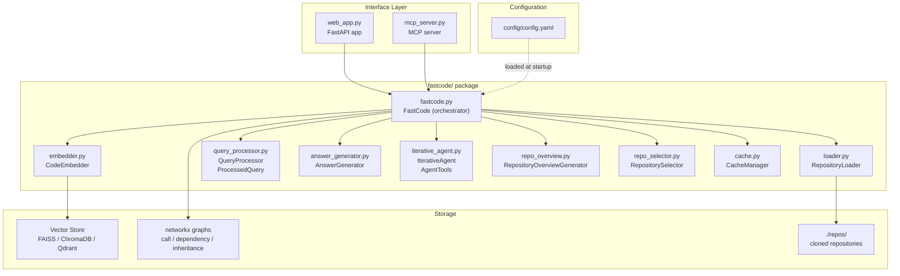
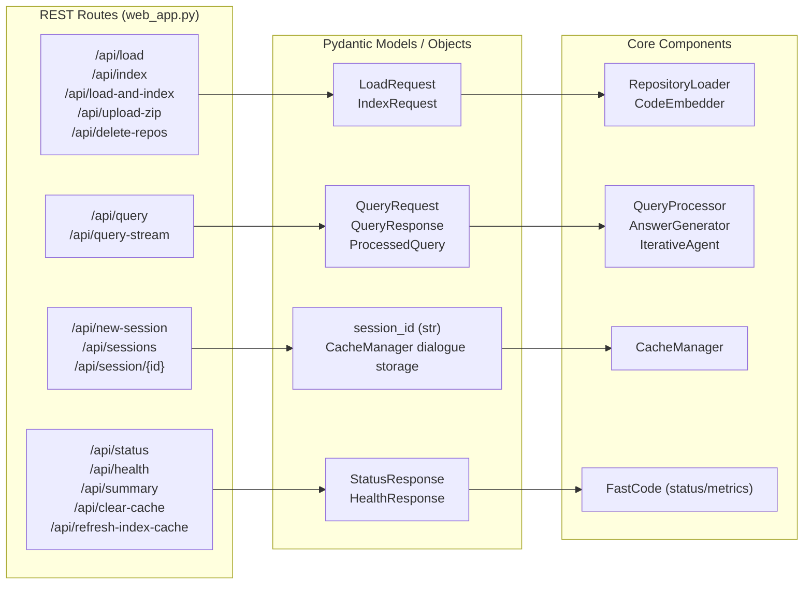

<!-- source: DeepWiki mcp.deepwiki.com · repo HKUDS/FastCode · page 12 Reference · fetched 2026-11-09 -->

# Reference

Relevant source files

The following files were used as context for generating this wiki page:

- [README.md](README.md)

This section is an index of quick-reference material for FastCode. The child pages contain complete, flat listings of configuration keys, API endpoints, environment variables, supported languages, and LLM providers.

For conceptual explanations of these systems, see the relevant topic pages: configuration behavior is described in [Configuration](#8), interface details are in [Interfaces & APIs](#6), and deployment considerations are in [Deployment](#7).

---

## What This Section Covers

| Page | Title | What You'll Find |
|------|-------|-----------------|
| [12.1](#12.1) | Configuration Reference | Every `config/config.yaml` key with type, default, and description |
| [12.2](#12.2) | API Reference | All REST endpoints with method, path, request body, and response schema |
| [12.3](#12.3) | Environment Variables | All recognized env vars, their components, and required vs. optional status |
| [12.4](#12.4) | Supported Languages | File extensions, language names, and tree-sitter grammar packages |
| [12.5](#12.5) | LLM Provider Support | Supported providers, required env vars per provider, and compatible models |

---

## Component-to-Source Map

The following diagram maps each major system component to its source file and primary class or entry point. Use this to navigate from a conceptual name to a searchable code location.

**FastCode Engine: Components and Source Files**

Sources: [README.md:1-100]()

---

## API Endpoint Summary

The following diagram maps each REST API route category to its source file and the query or session objects it uses. For full schemas, see [API Reference](#12.2).

**REST API Routes → Handler File → Core Objects**

Sources: [README.md:393-546]()

---

## Environment Variables — Quick Reference

The three core environment variables required to run FastCode with an external LLM:

| Variable | Purpose | Required |
|----------|---------|----------|
| `OPENAI_API_KEY` | Authentication key for the LLM provider | **Yes** |
| `MODEL` | Model name to use for generation and query processing | **Yes** |
| `BASE_URL` | API base URL for the provider endpoint | **Yes** |

All three are read by `AnswerGenerator`, `QueryProcessor`, `RepositoryOverviewGenerator`, `RepositorySelector`, and `IterativeAgent`. See [Environment Variables](#12.3) for the full listing, including optional variables such as Redis connection settings.

---

## Supported Languages — Quick Reference

| Language | Extensions |
|----------|-----------|
| Python | `.py` |
| JavaScript | `.js`, `.jsx` |
| TypeScript | `.ts`, `.tsx` |
| Java | `.java` |
| Go | `.go` |
| C | `.c`, `.h` |
| C++ | `.cpp`, `.cc`, `.cxx`, `.hpp` |
| Rust | `.rs` |
| C# | `.cs` |

Language support is controlled by the `supported_extensions` list in `config/config.yaml` and by the tree-sitter grammar packages installed in the environment. See [Supported Languages](#12.4) for grammar package details and [Adding Language Support](#10.4) for extending this list.

Sources: [README.md:717-727]()

---

## LLM Provider — Quick Reference

FastCode communicates with LLMs via an OpenAI-compatible HTTP interface. The active provider is selected by setting `BASE_URL` to the appropriate endpoint:

| Provider | `BASE_URL` | Notes |
|----------|-----------|-------|
| OpenAI | `https://api.openai.com/v1` | Default |
| OpenRouter | `https://openrouter.ai/api/v1` | Access to many models |
| Ollama (local) | `http://localhost:11434/v1` | Local model inference |
| Any OpenAI-compatible | Custom URL | Requires `OPENAI_API_KEY` set to any non-empty string |

See [LLM Provider Support](#12.5) for details on the `openai_chat_completion` compatibility shim used for models that return `max_completion_tokens` instead of `max_tokens`.

Sources: [README.md:672-715]()

---

## Configuration Sections — Quick Reference

The `config/config.yaml` file is divided into named sections. Each section corresponds to a configurable subsystem:

| Section | Controls | Detail Page |
|---------|---------|-------------|
| `repository` | Clone depth, file size limits, ignore patterns, extensions | [12.1](#12.1), [8.1](#8.1) |
| `parser` | Docstring/comment/import extraction, complexity, max function lines | [12.1](#12.1), [8.2](#8.2) |
| `embedding` | Model name, device, batch size, normalization | [12.1](#12.1), [8.3](#8.3) |
| `indexing` | Granularity levels, class context, repo overview generation | [12.1](#12.1), [8.4](#8.4) |
| `vector_store` | Backend (faiss/chromadb/qdrant), distance metric, persist path | [12.1](#12.1), [8.5](#8.5) |
| `retrieval` | Semantic/keyword/graph weights, diversity penalty, agency mode | [12.1](#12.1), [8.6](#8.6) |
| `query` | Query expansion, decomposition, LLM enhancement mode, multi-turn | [12.1](#12.1), [8.7](#8.7) |
| `generation` | LLM provider, temperature, token budget, context rounds | [12.1](#12.1), [8.8](#8.8) |
| `agent.iterative` | Max iterations, confidence threshold, line budget | [12.1](#12.1), [8.9](#8.9) |
| `cache` | Backend (disk/redis), TTL, embedding/query cache flags | [12.1](#12.1), [8.10](#8.10) |
| `graph` | Call/dependency/inheritance graph build flags, max depth | [12.1](#12.1), [8.11](#8.11) |

Sources: [README.md:670-682]()

---

## MCP Tools — Quick Reference

When running `mcp_server.py`, the following tools are exposed to MCP-compatible clients (Cursor, Claude Code, Windsurf):

| Tool | Description |
|------|-------------|
| `code_qa` | Ask a question about one or more repositories; auto-clones and indexes if needed |
| `list_indexed_repos` | List all repositories with existing index data |
| `list_sessions` | List all conversation sessions |
| `get_session_history` | Retrieve Q&A history for a specific `session_id` |
| `delete_session` | Delete a session and its stored history |
| `delete_repo_metadata` | Remove index files (`.faiss`, `_metadata.pkl`, `_bm25.pkl`, `_graphs.pkl`) for a repo |

See [MCP Server](#6.3) for transport configuration (stdio vs. SSE) and integration instructions.

Sources: [README.md:617-626]()

---

