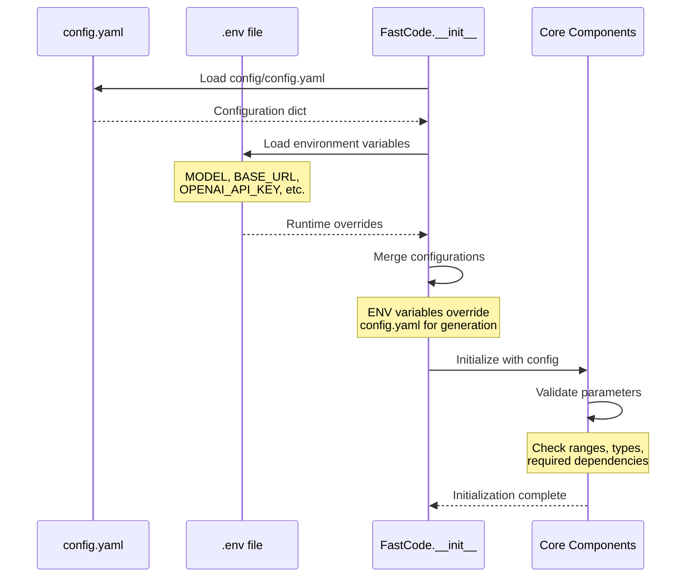
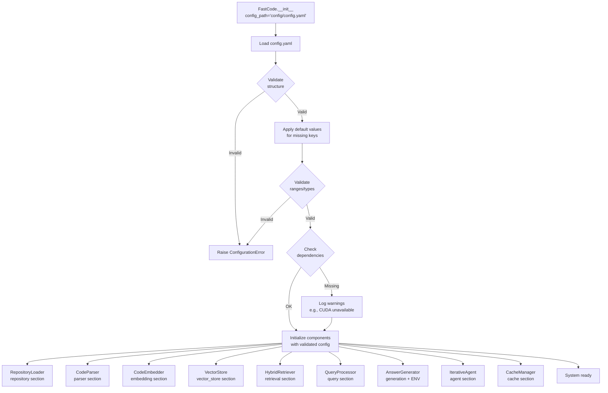
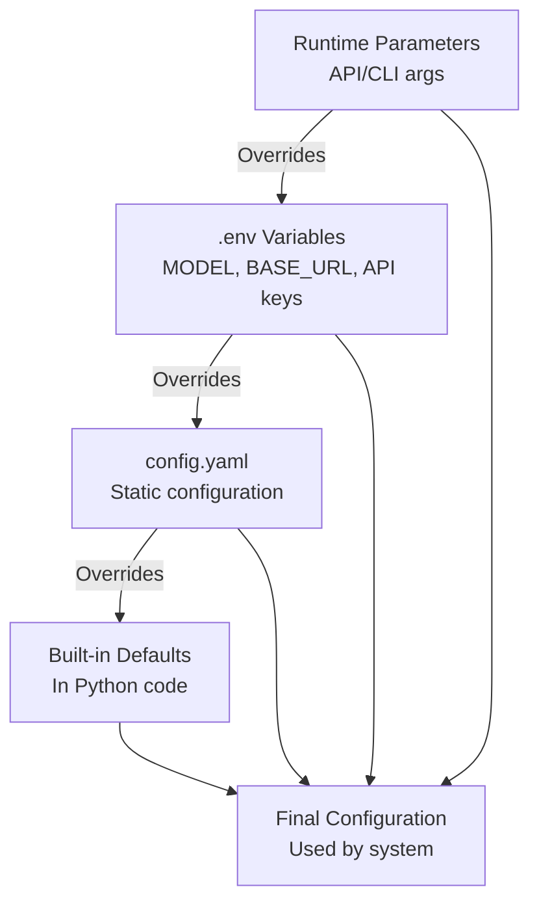

<!-- source: DeepWiki mcp.deepwiki.com · repo HKUDS/FastCode · page 12.1 Configuration Reference · fetched 2026-11-09 -->

# Configuration Reference

<details>
<summary>Relevant source files</summary>

The following files were used as context for generating this wiki page:

- [config/config.yaml](config/config.yaml)
- [fastcode/embedder.py](fastcode/embedder.py)

</details>


This page provides a complete alphabetical reference of all configuration options available in FastCode's `config.yaml` file. Each option is documented with its type, default value, valid ranges, and behavioral impact on the system.

For step-by-step configuration guides organized by functional area, see pages [8.1](#8.1) through [8.11](#8.11). For environment variable configuration (API keys, model selection), see [12.3](#12.3). For runtime API parameters that override configuration, see [12.2](#12.2).

**Scope**: This reference covers all static configuration options in `config/config.yaml`. Runtime parameters passed to the REST API, CLI, or Web UI are documented separately in [12.2](#12.2).

---

## Configuration Structure Overview

The FastCode configuration file is organized into 14 top-level sections, each controlling a specific subsystem. The following diagram shows how these sections map to core system components:

**Diagram: Configuration Sections to Component Mapping**

```mermaid
graph LR
    subgraph "config.yaml Sections"
        repo_root["repo_root"]
        repository["repository"]
        parser["parser"]
        embedding["embedding"]
        indexing["indexing"]
        vector_store["vector_store"]
        retrieval["retrieval"]
        query["query"]
        generation["generation"]
        graph["graph"]
        agent["agent"]
        cache["cache"]
        evaluation["evaluation"]
        logging["logging"]
    end
    
    subgraph "FastCode Components"
        RL["RepositoryLoader<br/>repository_loader.py"]
        CP["CodeParser<br/>code_parser.py"]
        CI["CodeIndexer<br/>code_indexer.py"]
        CE["CodeEmbedder<br/>code_embedder.py"]
        VS["VectorStore<br/>vector_store.py"]
        HR["HybridRetriever<br/>hybrid_retriever.py"]
        QP["QueryProcessor<br/>query_processor.py"]
        AG["AnswerGenerator<br/>answer_generator.py"]
        GB["GraphBuilder<br/>graph_builder.py"]
        IA["IterativeAgent<br/>iterative_agent.py"]
        CM["CacheManager<br/>cache_manager.py"]
        LOG["Logging<br/>logging configuration"]
    end
    
    repo_root --> RL
    repository --> RL
    parser --> CP
    embedding --> CE
    indexing --> CI
    vector_store --> VS
    retrieval --> HR
    query --> QP
    generation --> AG
    graph --> GB
    agent --> IA
    cache --> CM
    evaluation --> CI
    evaluation --> VS
    evaluation --> CM
    logging --> LOG
```

Sources: [config/config.yaml:1-207]()

---

## Configuration Loading Flow

The following diagram illustrates how configuration values flow from `config.yaml` and environment variables through the FastCode initialization process:

**Diagram: Configuration Loading and Priority**



Sources: [config/config.yaml:1-207]()

---

## Configuration Reference by Section

### Top-Level Configuration

| Key | Type | Default | Description |
|-----|------|---------|-------------|
| `repo_root` | string | `"./repos"` | Base directory for cloned/loaded repositories. Overridden when loading repositories dynamically via API or CLI. Used by `RepositoryLoader` and `AgentTools`. |

Sources: [config/config.yaml:6]()

---

### Repository Section

Controls repository loading, file filtering, and supported file types.

| Key | Type | Default | Description |
|-----|------|---------|-------------|
| `repository.clone_depth` | integer | `1` | Git shallow clone depth. Set to `1` for faster cloning (only latest commit) or `null` for full history. Used by `RepositoryLoader.clone_repository()`. |
| `repository.max_file_size_mb` | integer | `5` | Maximum file size in megabytes. Files larger than this are skipped during parsing. Prevents memory issues with large binary or generated files. |
| `repository.ignore_patterns` | list[string] | See below | Glob patterns for files/directories to exclude. Applied during `RepositoryLoader.load_repository()`. |
| `repository.supported_extensions` | list[string] | See below | File extensions to parse. Only files with these extensions are processed by `CodeParser`. |

**Default `ignore_patterns`**:
```yaml
- "*.pyc"
- "__pycache__"
- "node_modules"
- ".git"
- "*.min.js"
- "*.bundle.js"
- "dist/*"
- "build/*"
- "*.lock"
```

**Default `supported_extensions`**:
```yaml
- .py
- .js, .ts, .jsx, .tsx
- .java
- .go
- .cpp, .c, .h
- .rs
- .rb, .php, .cs, .swift, .kt
- .pyx
- .toml, .md, .txt, .yaml, .rst, .json, .html, .css, .xml
```

Sources: [config/config.yaml:8-49]()

---

### Parser Section

Controls AST-based code parsing behavior across all supported languages.

| Key | Type | Default | Description |
|-----|------|---------|-------------|
| `parser.extract_docstrings` | boolean | `true` | Extract docstrings from functions/classes. Used for documentation-level indexing ([indexing.levels:75]()). |
| `parser.extract_comments` | boolean | `true` | Extract inline comments. Enables comment-based search in `HybridRetriever`. |
| `parser.extract_imports` | boolean | `true` | Extract import statements. Used for dependency graph construction ([graph.build_dependency_graph:165]()). |
| `parser.compute_complexity` | boolean | `true` | Calculate cyclomatic complexity for functions. Stored in `CodeElement.metadata`. |
| `parser.max_function_lines` | integer | `3000` | Skip functions longer than this line count. Prevents processing of extremely large generated code. |

Sources: [config/config.yaml:50-57]()

---

### Embedding Section

Controls semantic embedding generation using SentenceTransformer models.

| Key | Type | Default | Description |
|-----|------|---------|-------------|
| `embedding.model` | string | `"sentence-transformers/paraphrase-multilingual-MiniLM-L12-v2"` | Hugging Face model identifier. Must be compatible with `sentence-transformers` library. Model is loaded in `CodeEmbedder.__init__()`. |
| `embedding.device` | string | `"cuda"` | Computation device: `"cuda"`, `"cpu"`, or `"mps"` (Apple Silicon). Auto-detection fallback to CPU if CUDA unavailable. |
| `embedding.batch_size` | integer | `32` | Batch size for embedding generation. Higher values increase memory usage but improve throughput. Used in `CodeEmbedder.encode_batch()`. |
| `embedding.max_seq_length` | integer | `512` | Maximum token length for input sequences. Text exceeding this is truncated. Must match model's training length. |
| `embedding.normalize_embeddings` | boolean | `true` | L2-normalize embeddings to unit length. Required for cosine similarity computation in vector stores. |

**Model Selection Notes**:
- Default: `paraphrase-multilingual-MiniLM-L12-v2` (470MB, multilingual)
- Alternative: `all-MiniLM-L6-v2` (90MB, English-only, faster)
- High-quality: `BAAI/bge-large-en-v1.5` (larger, better accuracy)

Sources: [config/config.yaml:58-67]()

---

### Indexing Section

Controls the 4-level hierarchical indexing strategy and context inclusion.

| Key | Type | Default | Description |
|-----|------|---------|-------------|
| `indexing.levels` | list[string] | `["file", "class", "function", "documentation"]` | Multi-level indexing hierarchy. Each level creates separate embeddings in vector store. See [3.3](#3.3) for details. |
| `indexing.include_imports` | boolean | `true` | Include import statements in function/class context. Enhances understanding of dependencies. |
| `indexing.include_class_context` | boolean | `true` | Include parent class information in method embeddings. Enables better method search. |
| `indexing.generate_repo_overview` | boolean | `true` | Generate repository-level summaries. Required for multi-repository selection ([3.2](#3.2)). |

**Indexing Levels**:
- `file`: File-level metadata (path, size, type)
- `class`: Class definitions with bases and methods
- `function`: Function signatures with parameters and returns
- `documentation`: Docstrings and comments

Sources: [config/config.yaml:68-81]()

---

### Vector Store Section

Controls vector database configuration, indexing algorithms, and persistence.

| Key | Type | Default | Description |
|-----|------|---------|-------------|
| `vector_store.type` | string | `"faiss"` | Vector store backend: `"faiss"`, `"chromadb"`, or `"qdrant"`. Selected in `VectorStore.create()`. |
| `vector_store.distance_metric` | string | `"cosine"` | Distance metric: `"cosine"`, `"l2"`, or `"inner_product"`. Must match embedding normalization. |
| `vector_store.index_type` | string | `"HNSW"` | FAISS index type. `"HNSW"` for approximate nearest neighbor, `"Flat"` for exact search. |
| `vector_store.ef_construction` | integer | `200` | HNSW construction parameter. Higher values improve accuracy but slow indexing. |
| `vector_store.ef_search` | integer | `50` | HNSW search parameter. Higher values improve recall but slow queries. |
| `vector_store.m` | integer | `16` | HNSW connectivity parameter. Controls graph connectivity (typical: 16-64). |
| `vector_store.persist_directory` | string | `"./data/vector_store"` | Directory for vector store persistence. FAISS index saved to `{persist_directory}/{repo_name}.index`. |
| `vector_store.index_scan_cache_ttl` | integer | `30` | Cache duration (seconds) for index scans in web interface. Set to `0` to disable. |
| `vector_store.index_scan_sample_size` | integer | `100` | Sample size for file count estimation. Improves web UI responsiveness. |

**HNSW Parameter Tuning**:
- `ef_construction=200, ef_search=50`: Balanced (default)
- `ef_construction=400, ef_search=100`: High accuracy, slower
- `ef_construction=100, ef_search=20`: Fast, lower recall

Sources: [config/config.yaml:82-97]()

---

### Retrieval Section

Controls hybrid retrieval strategy, multi-repository selection, and agency mode.

| Key | Type | Default | Description |
|-----|------|---------|-------------|
| `retrieval.semantic_weight` | float | `0.5` | Weight for semantic similarity in hybrid search. Range: 0.0-1.0. Used in `HybridRetriever.combine_scores()`. |
| `retrieval.keyword_weight` | float | `0.5` | Weight for BM25 keyword scoring. Range: 0.0-1.0. Should sum with semantic_weight ≈ 1.0. |
| `retrieval.graph_weight` | float | `1.0` | Weight for graph-based expansion. Applied multiplicatively to graph neighbors. |
| `retrieval.min_similarity` | float | `0.15` | Minimum similarity threshold (0.0-1.0). Results below this are filtered out. |
| `retrieval.max_results` | integer | `5` | Maximum results per retrieval operation. Limits context size for generation. |
| `retrieval.diversity_penalty` | float | `0.1` | MMR diversity penalty (0.0-1.0). Higher values increase result diversity. |
| `retrieval.enable_two_stage_retrieval` | boolean | `true` | Enable two-stage retrieval: repository selection → code search. See [9.5](#9.5). |
| `retrieval.select_repos_by_overview` | boolean | `true` | Select repositories using overview summaries before detailed search. |
| `retrieval.repo_selection_method` | string | `"llm"` | Repository selection method: `"llm"` (LLM-based) or `"embedding"` (semantic+BM25). |
| `retrieval.top_repos_to_search` | integer | `5` | Number of repositories to select in multi-repo scenarios. |
| `retrieval.min_repo_similarity` | float | `0.1` | Minimum similarity for repository selection. Lower threshold than `min_similarity`. |
| `retrieval.max_files_to_search` | integer | `15` | Maximum files to retrieve across all repositories. |
| `retrieval.enable_agency_mode` | boolean | `true` | Enable iterative agent-based retrieval. See [5.3](#5.3) for details. |

**Repository Selection Methods**:
- `"llm"`: Uses LLM to analyze repository overviews and select most relevant repos
- `"embedding"`: Uses semantic + BM25 scoring on overview texts (faster, no LLM cost)

Sources: [config/config.yaml:98-120]()

---

### Query Section

Controls query processing, LLM enhancement, and multi-turn dialogue.

| Key | Type | Default | Description |
|-----|------|---------|-------------|
| `query.expand_query` | boolean | `true` | Add synonyms and related terms to query. Improves recall. |
| `query.decompose_complex` | boolean | `true` | Break complex queries into sub-queries. Enables multi-part answers. |
| `query.max_subqueries` | integer | `3` | Maximum sub-queries for decomposition. Prevents excessive splitting. |
| `query.extract_keywords` | boolean | `true` | Extract keywords for BM25 search. Used in `HybridRetriever.keyword_search()`. |
| `query.detect_intent` | boolean | `true` | Detect query intent type: `how`, `what`, `where`, `debug`, `implement`. |
| `query.use_llm_enhancement` | boolean | `true` | Enable LLM-based query understanding. Requires LLM provider configuration. |
| `query.llm_enhancement_mode` | string | `"always"` | LLM enhancement mode: `"adaptive"`, `"always"`, or `"off"`. See below. |
| `query.history_summary_rounds` | integer | `10` | Number of previous rounds to use for multi-turn query rewriting. |
| `query.max_summary_words` | integer | `500` | Maximum words per round summary. Controls context length. |

**LLM Enhancement Modes**:
- `"adaptive"`: Use LLM only for complex/implementation queries (recommended, cost-efficient)
- `"always"`: Use LLM for all queries (slower, more accurate)
- `"off"`: Disable LLM enhancement (fastest, rule-based only)

Sources: [config/config.yaml:122-141]()

---

### Generation Section

Controls LLM-based answer generation, context management, and prompt formatting.

| Key | Type | Default | Description |
|-----|------|---------|-------------|
| `generation.provider` | string | `"openai"` | LLM provider: `"openai"`, `"anthropic"`, or `"local"`. See [12.5](#12.5) for provider details. |
| `generation.temperature` | float | `0.4` | Sampling temperature (0.0-2.0). Lower values = more focused, higher = more creative. |
| `generation.max_tokens` | integer | `20000` | Maximum tokens in generated response. Limited by model's maximum. |
| `generation.max_context_tokens` | integer | `200000` | Maximum context tokens (prompt + code). Truncation occurs if exceeded. |
| `generation.reserve_tokens_for_response` | integer | `10000` | Tokens reserved for response generation. Ensures model has room to complete answer. |
| `generation.include_file_paths` | boolean | `true` | Include file paths in context. Enables source citations in answers. |
| `generation.include_line_numbers` | boolean | `true` | Include line numbers in code snippets. Improves precision of references. |
| `generation.include_related_code` | boolean | `true` | Include graph-expanded related code. Provides additional context. |
| `generation.enable_multi_turn` | boolean | `true` | Enable multi-turn dialogue mode. Maintains conversation history. See [9.2](#9.2). |
| `generation.context_rounds` | integer | `10` | Number of previous dialogue rounds to include in generation context. |

**Note**: The actual `model` and `base_url` are read from environment variables (`MODEL`, `BASE_URL`) rather than config.yaml. This separates runtime credentials from static configuration.

Sources: [config/config.yaml:142-161]()

---

### Graph Section

Controls code graph construction for structural code understanding.

| Key | Type | Default | Description |
|-----|------|---------|-------------|
| `graph.build_call_graph` | boolean | `true` | Build function call graph. Used for graph traversal in `HybridRetriever`. See [3.4](#3.4). |
| `graph.build_dependency_graph` | boolean | `true` | Build module dependency graph. Tracks import relationships. |
| `graph.build_inheritance_graph` | boolean | `true` | Build class inheritance graph. Tracks class hierarchies. |
| `graph.max_depth` | integer | `5` | Maximum graph traversal depth. Limits expansion to prevent context explosion. |

**Graph Types**:
- **Call Graph**: Function invocations (caller → callee)
- **Dependency Graph**: Module imports (importer → imported)
- **Inheritance Graph**: Class hierarchies (child → parent)

Sources: [config/config.yaml:162-168]()

---

### Agent Section

Controls iterative agent behavior, confidence thresholds, and stopping conditions.

| Key | Type | Default | Description |
|-----|------|---------|-------------|
| `agent.iterative.max_iterations` | integer | `4` | Maximum retrieval iterations. Prevents infinite loops. See [5.1](#5.1). |
| `agent.iterative.confidence_threshold` | integer | `95` | Stop if confidence ≥ this value (0-100). Primary stopping condition. |
| `agent.iterative.min_confidence_gain` | integer | `5` | Minimum confidence gain (%) required to continue iteration. |
| `agent.iterative.max_total_lines` | integer | `12000` | Maximum total lines of code across all retrieved elements. Token budget control. |
| `agent.iterative.temperature_agent` | float | `0.2` | Temperature for agent reasoning. Lower than generation for focused exploration. |
| `agent.iterative.max_tokens_agent` | integer | `8000` | Maximum tokens for agent responses. Controls agent output length. |
| `agent.iterative.max_elements` | integer | `100` | Maximum elements after relevance filtering. Prevents unbounded growth. |
| `agent.iterative.max_candidates_display` | integer | `200` | Maximum candidates to show in formatted output. Display optimization. |

**Stopping Conditions** (any met → stop):
1. `confidence >= confidence_threshold` (≥95%)
2. `iterations >= max_iterations` (≥4)
3. `gain < min_confidence_gain` (<5%)
4. `total_lines >= max_total_lines` (≥12000)

Sources: [config/config.yaml:169-181]()

---

### Cache Section

Controls caching behavior, backends, and TTL settings.

| Key | Type | Default | Description |
|-----|------|---------|-------------|
| `cache.enabled` | boolean | `true` | Enable caching globally. Disabling reduces memory but increases latency. |
| `cache.backend` | string | `"disk"` | Cache backend: `"disk"` or `"redis"`. Disk uses local filesystem, Redis requires external service. |
| `cache.ttl` | integer | `3600` | TTL (seconds) for embeddings and general cache. Default: 1 hour. |
| `cache.dialogue_ttl` | integer | `2592000` | TTL (seconds) for dialogue history. Default: 30 days. Longer for conversation persistence. |
| `cache.max_size_mb` | integer | `1000` | Maximum cache size in megabytes. LRU eviction when exceeded. |
| `cache.cache_embeddings` | boolean | `true` | Cache code embeddings. Significant speedup for repeated indexing. |
| `cache.cache_queries` | boolean | `false` | Cache query results. Disabled by default (queries may have dynamic context). |
| `cache.cache_directory` | string | `"./data/cache"` | Directory for disk-based cache. Only used when `backend="disk"`. |

**Cache Architecture**: See [9.1](#9.1) for detailed cache system documentation.

Sources: [config/config.yaml:182-192]()

---

### Evaluation Section

Controls special modes for benchmarking and evaluation. Typically disabled in production.

| Key | Type | Default | Description |
|-----|------|---------|-------------|
| `evaluation.enabled` | boolean | `false` | Enable evaluation mode. Changes system behavior for reproducible benchmarks. |
| `evaluation.in_memory_index` | boolean | `false` | Keep index purely in RAM. No disk persistence during evaluation. |
| `evaluation.disable_cache` | boolean | `false` | Skip query and embedding cache. Forces fresh computation. |
| `evaluation.disable_persistence` | boolean | `false` | Skip writing FAISS/BM25/graph files. Speeds up repeated evaluations. |
| `evaluation.force_reindex` | boolean | `false` | Always rebuild indexes instead of loading cached artifacts. |

**Use Case**: Enable `evaluation.enabled=true` when running benchmarks or tests where reproducibility and controlled behavior are required.

Sources: [config/config.yaml:193-200]()

---

### Logging Section

Controls logging output, format, and destinations.

| Key | Type | Default | Description |
|-----|------|---------|-------------|
| `logging.level` | string | `"INFO"` | Logging level: `"DEBUG"`, `"INFO"`, `"WARNING"`, `"ERROR"`. |
| `logging.format` | string | `"%(asctime)s - %(name)s - %(levelname)s - %(message)s"` | Python logging format string. |
| `logging.file` | string | `"./logs/fastcode.log"` | Log file path. Directory created automatically if missing. |
| `logging.console` | boolean | `true` | Enable console (stdout) logging. Set to `false` for production daemons. |

**Logging Levels**:
- `DEBUG`: Verbose internal operations (e.g., token counts, retrieval scores)
- `INFO`: Major operations (e.g., repository loading, query processing)
- `WARNING`: Potential issues (e.g., truncated context, missing files)
- `ERROR`: Failures (e.g., parsing errors, API failures)

Sources: [config/config.yaml:201-207]()

---

## Configuration Validation and Defaults

The following diagram shows how configuration validation occurs during system initialization:

**Diagram: Configuration Validation Flow**



**Validation Checks**:
- Type validation (int, float, bool, string, list)
- Range validation (e.g., `0.0 <= similarity <= 1.0`)
- Dependency checks (e.g., CUDA availability for `device="cuda"`)
- File path validity (e.g., writable directories)
- Model availability (e.g., Hugging Face model exists)

Sources: [config/config.yaml:1-207]()

---

## Cross-Reference: Configuration to Code Entities

The following table maps each configuration section to the primary Python classes that consume it:

| Configuration Section | Primary Class(es) | File Path(s) |
|----------------------|-------------------|--------------|
| `repo_root` | `RepositoryLoader`, `AgentTools` | `fastcode/repository_loader.py`, `fastcode/agent_tools.py` |
| `repository` | `RepositoryLoader` | `fastcode/repository_loader.py` |
| `parser` | `CodeParser` | `fastcode/code_parser.py` |
| `embedding` | `CodeEmbedder` | `fastcode/code_embedder.py` |
| `indexing` | `CodeIndexer` | `fastcode/code_indexer.py` |
| `vector_store` | `VectorStore`, `FAISSVectorStore`, `ChromaDBVectorStore`, `QdrantVectorStore` | `fastcode/vector_store.py` |
| `retrieval` | `HybridRetriever`, `RepositorySelector` | `fastcode/hybrid_retriever.py`, `fastcode/repository_selector.py` |
| `query` | `QueryProcessor` | `fastcode/query_processor.py` |
| `generation` | `AnswerGenerator` | `fastcode/answer_generator.py` |
| `graph` | `GraphBuilder`, `CallGraph`, `DependencyGraph`, `InheritanceGraph` | `fastcode/graph_builder.py` |
| `agent` | `IterativeAgent` | `fastcode/iterative_agent.py` |
| `cache` | `CacheManager` | `fastcode/cache_manager.py` |
| `evaluation` | `CodeIndexer`, `VectorStore`, `CacheManager` | Multiple files (evaluation mode affects multiple components) |
| `logging` | Python `logging` module | Standard library (configured in `fastcode/__init__.py`) |

Sources: [config/config.yaml:1-207]()

---

## Common Configuration Patterns

### Pattern 1: Fast Indexing (Development)

Optimize for speed during development with minimal accuracy trade-offs:

```yaml
repository:
  clone_depth: 1
  max_file_size_mb: 2

embedding:
  model: "sentence-transformers/all-MiniLM-L6-v2"  # Smaller, faster
  device: "cpu"
  batch_size: 64

vector_store:
  index_type: "Flat"  # Exact search, no HNSW overhead
  
retrieval:
  enable_agency_mode: false  # Single-pass retrieval
  
query:
  llm_enhancement_mode: "off"  # No LLM pre-processing
  
cache:
  enabled: true
  cache_embeddings: true
  cache_queries: true
```

### Pattern 2: High Accuracy (Production)

Optimize for accuracy with multi-stage retrieval and agent refinement:

```yaml
embedding:
  model: "BAAI/bge-large-en-v1.5"  # High-quality embeddings
  device: "cuda"

vector_store:
  index_type: "HNSW"
  ef_construction: 400  # High accuracy
  ef_search: 100

retrieval:
  enable_agency_mode: true
  enable_two_stage_retrieval: true
  repo_selection_method: "llm"
  diversity_penalty: 0.15  # More diverse results
  
query:
  llm_enhancement_mode: "adaptive"
  
agent:
  iterative:
    max_iterations: 4
    confidence_threshold: 95
```

### Pattern 3: Multi-Repository at Scale

Optimize for handling many repositories efficiently:

```yaml
retrieval:
  enable_two_stage_retrieval: true
  select_repos_by_overview: true
  repo_selection_method: "embedding"  # Faster than LLM
  top_repos_to_search: 3  # Limit scope
  max_files_to_search: 10

cache:
  enabled: true
  backend: "redis"  # Shared cache across instances
  cache_embeddings: true

vector_store:
  index_scan_cache_ttl: 60  # Cache repo scans
```

### Pattern 4: Cost Minimization

Minimize LLM API costs while maintaining reasonable quality:

```yaml
query:
  llm_enhancement_mode: "adaptive"  # Only for complex queries
  
retrieval:
  enable_agency_mode: false  # No iterative LLM calls
  repo_selection_method: "embedding"  # No LLM for repo selection

generation:
  max_context_tokens: 50000  # Smaller context
  reserve_tokens_for_response: 5000
  enable_multi_turn: false  # No conversation history

cache:
  cache_queries: true  # Cache answers
  ttl: 7200  # 2-hour cache
```

Sources: [config/config.yaml:1-207]()

---

## Configuration File Location and Precedence

FastCode loads configuration from the following locations in order of precedence (highest to lowest):

1. **Runtime Parameters**: API/CLI parameters override all config (e.g., `--agency-mode`, `--max-results`)
2. **Environment Variables**: `.env` file for secrets and runtime settings (MODEL, BASE_URL, API keys)
3. **Configuration File**: `config/config.yaml` for static system configuration
4. **Built-in Defaults**: Hardcoded defaults in component constructors

**Precedence Diagram**:



**Example**: If `config.yaml` sets `generation.temperature: 0.4`, but API request includes `temperature=0.7`, the system uses `0.7` for that request only.

Sources: [config/config.yaml:1-207]()

---

## Configuration Migration and Versioning

FastCode 2.0 introduced significant configuration changes from 1.x. Key migrations:

| 1.x Configuration | 2.0 Configuration | Notes |
|-------------------|-------------------|-------|
| `retrieval.use_agent` | `retrieval.enable_agency_mode` | Renamed for clarity |
| `query.llm_mode` | `query.llm_enhancement_mode` | Added `"adaptive"` option |
| `generation.context_limit` | `generation.max_context_tokens` | Renamed, default increased to 200K |
| N/A | `retrieval.repo_selection_method` | New: LLM vs embedding-based repo selection |
| N/A | `agent.iterative.*` | New: Detailed agent configuration section |
| N/A | `cache.dialogue_ttl` | New: Separate TTL for dialogue vs embeddings |
| N/A | `evaluation.*` | New: Benchmark mode configuration |

**Backward Compatibility**: FastCode 2.0 does not automatically migrate 1.x config files. Manual migration required.

Sources: [config/config.yaml:1-207]()

---

## See Also

- [8.1](#8.1) through [8.11](#8.11): Configuration guides organized by functional area
- [12.3](#12.3): Environment variable reference (MODEL, BASE_URL, API keys)
- [12.2](#12.2): REST API parameter reference (runtime overrides)
- [7.4](#7.4): Production configuration best practices
- [9.3](#9.3): Performance tuning through configuration

---

