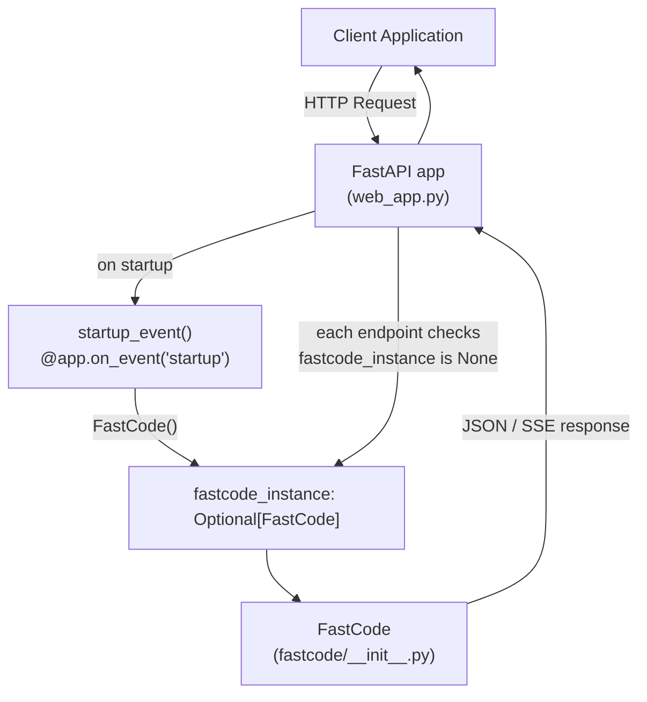
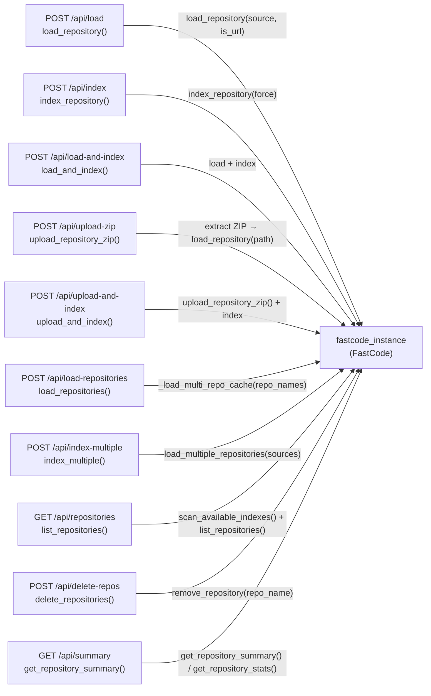
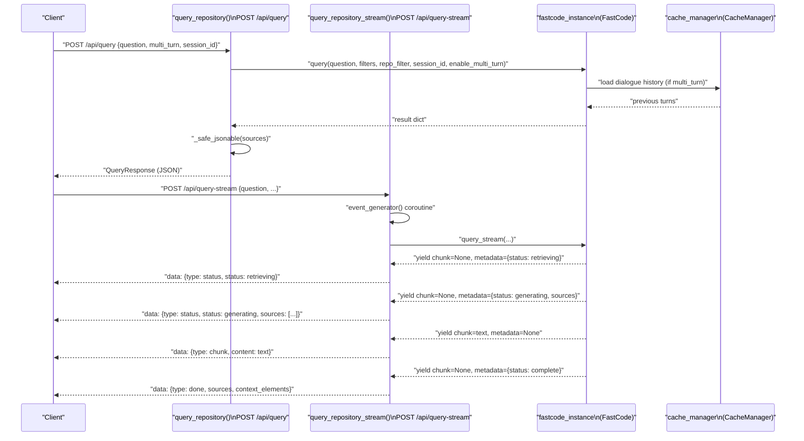
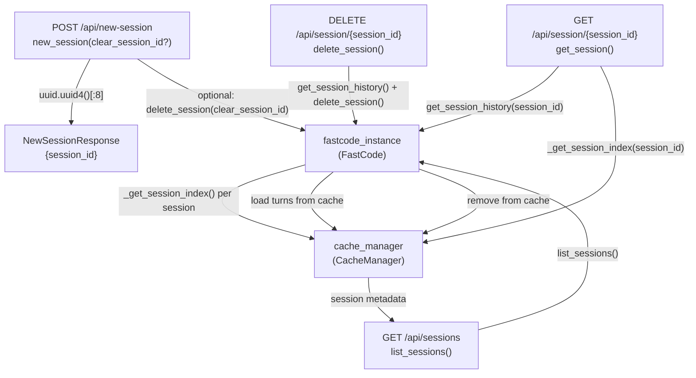

<!-- source: DeepWiki mcp.deepwiki.com · repo HKUDS/FastCode · page 12.2 API Reference · fetched 2026-11-09 -->

# API Reference

<details>
<summary>Relevant source files</summary>

The following files were used as context for generating this wiki page:

- [web_app.py](web_app.py)

</details>


This document provides complete reference documentation for the FastCode REST API. It covers all available endpoints, request/response schemas, and usage notes for integrating FastCode into external applications.

For deployment information, see page 7.1. For Web UI, see page 6.2. For MCP server integration, see page 6.3. For Feishu/Lark bot integration, see page 6.4.

---

## Base Configuration

The FastCode REST API is implemented in `web_app.py` using FastAPI and runs on port `5777` by default. It provides the complete REST interface to all FastCode functionality.

### Starting the API Server

```bash
# Default (127.0.0.1:5777)
python web_app.py

# Custom host and port
python web_app.py --host 0.0.0.0 --port 5777

# With auto-reload for development
python web_app.py --reload
```

Auto-generated API documentation is available at `http://localhost:5777/docs` (Swagger UI) and `http://localhost:5777/redoc` (ReDoc).

Sources: [web_app.py:814-828]()

---

## API Architecture

### System Initialization and Request Flow

**Diagram: web_app.py startup and request lifecycle**



The `fastcode_instance` global is initialized **at server startup** via `startup_event()`, not lazily. Every endpoint checks `if fastcode_instance is None` and raises HTTP 500 if startup failed.

Sources: [web_app.py:103-128]()

---

## Request/Response Models

All API endpoints use Pydantic models for request validation and response serialization.

### Core Models

| Model | Purpose | Key Fields |
|-------|---------|------------|
| `LoadRepositoryRequest` | Load repository from URL or path | `source: str`, `is_url: bool` |
| `QueryRequest` | Submit code query | `question: str`, `filters: Optional[Dict]`, `repo_filter: Optional[List[str]]`, `multi_turn: bool`, `session_id: Optional[str]` |
| `QueryResponse` | Query result | `answer: str`, `query: str`, `context_elements: int`, `sources: List[Dict]`, `prompt_tokens`, `completion_tokens`, `total_tokens`, `session_id: Optional[str]` |
| `LoadRepositoriesRequest` | Load existing indexed repos by name | `repo_names: List[str]` |
| `IndexMultipleRequest` | Batch load and index repositories | `sources: List[LoadRepositoryRequest]` |
| `DeleteReposRequest` | Delete repositories | `repo_names: List[str]`, `delete_source: bool` |
| `StatusResponse` | System status | `status: str`, `repo_loaded: bool`, `repo_indexed: bool`, `repo_info: Dict`, `available_repositories: List[Dict]`, `loaded_repositories: List[Dict]` |
| `NewSessionResponse` | New session info | `session_id: str` |

Sources: [web_app.py:36-80](), [web_app.py:751-753]()

---

## Endpoint Reference

### Health & Status Endpoints

#### GET /

Serves the web interface HTML (`web_interface.html`). Not a JSON API endpoint.

Sources: [web_app.py:131-137]()

---

#### GET /api/health

Lightweight health check. Does not trigger any expensive operations.

**Response:**
```json
{
  "status": "healthy",
  "repo_loaded": true,
  "repo_indexed": true,
  "multi_repo_mode": false
}
```

Sources: [web_app.py:165-176]()

---

#### GET /api/status

Comprehensive system status including available and loaded repositories.

**Query Parameters:**

| Parameter | Type | Default | Description |
|-----------|------|---------|-------------|
| `full_scan` | bool | `false` | Force full disk scan of available indexes (slower) |

**Response Model:** `StatusResponse`

```json
{
  "status": "ready",
  "repo_loaded": true,
  "repo_indexed": true,
  "repo_info": { "name": "FastCode", "path": "/app/repos/FastCode" },
  "available_repositories": [
    { "name": "FastCode", "index_path": "...", "size_mb": 12.5 }
  ],
  "loaded_repositories": [
    { "name": "FastCode", "elements": 3847 }
  ]
}
```

`status` is `"ready"` when `fastcode_instance.repo_indexed` is `True`, otherwise `"not_ready"`.

Sources: [web_app.py:140-162]()

---

### Repository Management Endpoints

**Diagram: Repository management endpoints mapped to web_app.py handler functions**



Sources: [web_app.py:205-617]()

---

#### POST /api/load

Load a repository from a URL or local path (does not index).

**Request Model:** `LoadRepositoryRequest`

```json
{
  "source": "https://github.com/HKUDS/FastCode",
  "is_url": true
}
```

**Response:**
```json
{
  "status": "success",
  "message": "Repository loaded successfully",
  "repo_info": { "name": "FastCode", "path": "./repos/FastCode" }
}
```

Sources: [web_app.py:205-223]()

---

#### POST /api/index

Index the currently loaded repository.

**Query Parameters:**

| Parameter | Type | Default | Description |
|-----------|------|---------|-------------|
| `force` | bool | `false` | Force re-indexing even if index already exists |

**Response:**
```json
{
  "status": "success",
  "message": "Repository indexed successfully",
  "summary": { ... }
}
```

After indexing, the endpoint calls `fastcode_instance.vector_store.invalidate_scan_cache()` to keep the available-repos listing fresh.

**Error Codes:** 400 if no repository is loaded.

Sources: [web_app.py:226-250]()

---

#### POST /api/load-and-index

Load and index a repository in a single call.

**Request Model:** `LoadRepositoryRequest`

**Query Parameters:**

| Parameter | Type | Default | Description |
|-----------|------|---------|-------------|
| `force` | bool | `false` | Force re-indexing |

**Response:**
```json
{
  "status": "success",
  "message": "Repository loaded and indexed successfully",
  "summary": { ... }
}
```

Sources: [web_app.py:279-303]()

---

#### POST /api/load-repositories

Load one or more existing indexed repositories from their persisted index files (no re-indexing). Calls `fastcode_instance._load_multi_repo_cache(repo_names=...)` internally.

**Request Model:** `LoadRepositoriesRequest`

```json
{
  "repo_names": ["FastCode", "example-repo"]
}
```

**Response:**
```json
{
  "status": "success",
  "loaded": [ ... ],
  "stats": { "total_repositories": 2, "total_elements": 5081 }
}
```

Sources: [web_app.py:306-331]()

---

#### POST /api/index-multiple

Load and index multiple repositories in a single batch call.

**Request Model:** `IndexMultipleRequest`

```json
{
  "sources": [
    { "source": "https://github.com/user/repo1", "is_url": true },
    { "source": "/path/to/repo2", "is_url": false }
  ]
}
```

**Response:**
```json
{
  "status": "success",
  "message": "Repositories indexed successfully",
  "stats": { "total_repositories": 2, "total_elements": 5081 }
}
```

Sources: [web_app.py:253-276]()

---

#### POST /api/upload-zip

Upload a repository as a ZIP archive (multipart form). Does not index — use `/api/upload-and-index` for combined upload and indexing.

**Request:**
- Content-Type: `multipart/form-data`
- Form field: `file` (`.zip`, max 100 MB)

**Processing Steps:**
1. Validates `.zip` extension and 100 MB size limit.
2. Saves to temp directory, extracts contents.
3. If extracted root has a single top-level folder, treats it as the repository root.
4. Strips common branch suffixes from the repo name: `-main`, `-master`, `_main`, `_master`.
5. Moves the result to `./repos/<repo_name>`.
6. Calls `fastcode_instance.load_repository(str(repo_path), is_url=False)`.

**Response:**
```json
{
  "status": "success",
  "message": "ZIP file 'FastCode-main.zip' uploaded and extracted to repos/FastCode",
  "repo_info": { ... },
  "repo_path": "./repos/FastCode"
}
```

**Error Codes:** 400 for invalid ZIP or oversized file.

Sources: [web_app.py:334-426]()

---

#### POST /api/upload-and-index

Upload a ZIP archive and index in a single call. Internally calls `upload_repository_zip()` then `fastcode_instance.index_repository(force=force)`.

**Request:**
- Content-Type: `multipart/form-data`
- Form field: `file` (`.zip`)

**Query Parameters:**

| Parameter | Type | Default | Description |
|-----------|------|---------|-------------|
| `force` | bool | `false` | Force re-indexing |

**Response:**
```json
{
  "status": "success",
  "message": "Repository uploaded and indexed successfully",
  "summary": { ... }
}
```

Sources: [web_app.py:429-457]()

---

#### GET /api/repositories

List all repositories available on disk and currently loaded in memory.

**Query Parameters:**

| Parameter | Type | Default | Description |
|-----------|------|---------|-------------|
| `full_scan` | bool | `false` | Force full disk scan (bypasses index scan cache) |

**Response:**
```json
{
  "status": "success",
  "available": [ { "name": "FastCode", "size_mb": 12.5 } ],
  "loaded": [ { "name": "FastCode", "elements": 3847 } ]
}
```

Sources: [web_app.py:179-202]()

---

#### POST /api/delete-repos

Delete one or more repositories including their vector index files and optionally the cloned source in `./repos/`.

**Request Model:** `DeleteReposRequest`

```json
{
  "repo_names": ["old-repo", "test-repo"],
  "delete_source": true
}
```

`delete_source: true` also deletes the source files from `./repos/<repo_name>`. Set to `false` to only remove index data.

**Response:**
```json
{
  "status": "success",
  "message": "Deleted 2 repository(ies), freed 45.32 MB",
  "results": [
    { "repo_name": "old-repo", "deleted_files": [ ... ], "freed_mb": 23.45 }
  ]
}
```

Sources: [web_app.py:751-785]()

---

#### GET /api/summary

Get a summary of the currently loaded repository. In single-repo mode calls `fastcode_instance.get_repository_summary()`; in multi-repo mode calls `fastcode_instance.get_repository_stats()`.

**Error Codes:** 400 if no repository is loaded.

**Response:**
```json
{
  "status": "success",
  "summary": { ... }
}
```

Sources: [web_app.py:595-617]()

---

### Query Endpoints

**Diagram: Query flow through query_repository() and query_repository_stream()**



Sources: [web_app.py:460-592]()

---

#### POST /api/query

Execute a query and return a complete JSON response.

**Request Model:** `QueryRequest`

```json
{
  "question": "How does authentication work in this project?",
  "filters": null,
  "repo_filter": ["FastCode"],
  "multi_turn": true,
  "session_id": "abc123"
}
```

**Field Details:**

| Field | Type | Description |
|-------|------|-------------|
| `question` | `str` | Natural language query |
| `filters` | `Optional[Dict]` | Optional search filters |
| `repo_filter` | `Optional[List[str]]` | Restrict search to specific repository names |
| `multi_turn` | `bool` | Enable conversation history (requires `session_id`) |
| `session_id` | `Optional[str]` | 8-char session ID; auto-generated if omitted |

**Response Model:** `QueryResponse`

```json
{
  "answer": "The authentication system uses JWT tokens...",
  "query": "How does authentication work in this project?",
  "context_elements": 12,
  "sources": [
    { "file": "auth/jwt_handler.py", "element_type": "function", "name": "create_access_token", "score": 0.89 }
  ],
  "prompt_tokens": 2340,
  "completion_tokens": 567,
  "total_tokens": 2907,
  "session_id": "abc123"
}
```

- `session_id` is always returned (auto-generated for single-turn requests).
- `sources` are serialized using `_safe_jsonable()` to handle custom object types.
- `total_tokens` is computed as `prompt_tokens + completion_tokens` if not provided by the LLM client.

**Error Codes:** 400 if repository is not indexed.

Sources: [web_app.py:460-512]()

---

#### POST /api/query-stream

Execute a query with streaming response via Server-Sent Events (SSE).

**Request Model:** `QueryRequest` (same as `/api/query`)

**Response:** `text/event-stream`

**SSE Event Types:**

| `type` | When emitted | Additional fields |
|--------|-------------|-------------------|
| `"status"` with `"retrieving"` | Retrieval phase begins | — |
| `"status"` with `"generating"` | Generation phase begins | `sources`, `session_id` |
| `"chunk"` | Each streamed text token | `content: str` |
| `"done"` | Generation complete | `sources`, `context_elements`, `session_id` |
| `"error"` | Exception caught | `error: str` |

**Example Event Stream:**
```
data: {"type": "status", "status": "retrieving"}

data: {"type": "status", "status": "generating", "sources": [...], "session_id": "abc123"}

data: {"type": "chunk", "content": "The authentication"}

data: {"type": "chunk", "content": " system uses JWT tokens"}

data: {"type": "done", "sources": [...], "context_elements": 12, "session_id": "abc123"}
```

**Response Headers:**
```
Cache-Control: no-cache
Connection: keep-alive
X-Accel-Buffering: no
```

The SSE stream is produced by the `event_generator()` async generator which wraps `fastcode_instance.query_stream()`.

**Error Codes:** 400 if repository is not indexed.

Sources: [web_app.py:515-592]()

---

### Session Management Endpoints

**Diagram: Session lifecycle mapped to cache_manager and FastCode methods**



Sources: [web_app.py:657-811]()

---

#### POST /api/new-session

Create a new session ID. Optionally clears an existing session first.

**Query Parameters:**

| Parameter | Type | Description |
|-----------|------|-------------|
| `clear_session_id` | `Optional[str]` | If provided, calls `fastcode_instance.delete_session(clear_session_id)` before creating the new session |

**Response Model:** `NewSessionResponse`

```json
{ "session_id": "a3f7b2c1" }
```

The session ID is the first 8 characters of a `uuid.uuid4()` string.

Sources: [web_app.py:657-667]()

---

#### GET /api/sessions

List all recorded dialogue sessions with metadata.

**Response:**
```json
{
  "status": "success",
  "sessions": [
    {
      "session_id": "a3f7b2c1",
      "title": "Authentication Implementation",
      "total_turns": 5,
      "created": 1704067200,
      "last_updated": 1704070800,
      "multi_turn": true
    }
  ]
}
```

- Sessions are sorted by `last_updated` (most recent first).
- `title` defaults to `"Session {session_id}"` if not set.
- `multi_turn` reflects whether `enable_multi_turn` was active for this session.
- Timestamps are Unix epoch seconds.

Sources: [web_app.py:703-727]()

---

#### GET /api/session/{session_id}

Retrieve the full dialogue history for a session.

**Path Parameters:** `session_id` — the 8-character session identifier.

**Response:**
```json
{
  "status": "success",
  "session_id": "a3f7b2c1",
  "history": [
    {
      "turn": 1,
      "query": "How does authentication work?",
      "answer": "The authentication system uses JWT tokens...",
      "summary": "Explained JWT authentication flow",
      "timestamp": 1704067200
    }
  ],
  "multi_turn": true
}
```

- `history` is an empty array `[]` if the session is not found.
- All history entries are passed through `_safe_jsonable()`.
- `multi_turn` is read from `cache_manager._get_session_index(session_id)`.

Sources: [web_app.py:730-748]()

---

#### DELETE /api/session/{session_id}

Delete a conversation session and all its stored turns.

**Path Parameters:** `session_id` — the 8-character session identifier.

**Response:**
```json
{
  "status": "success",
  "message": "Session 'a3f7b2c1' deleted (5 turns)"
}
```

**Error Codes:**
- 404: Session not found (no history exists).
- 500: Deletion call returned `False`.

Sources: [web_app.py:788-811]()

---

### System Operations Endpoints

#### POST /api/clear-cache

Clear all cached data by calling `fastcode_instance.cache_manager.clear()`.

**Response:**
```json
{ "status": "success", "message": "Cache cleared" }
```

If the cache is disabled or clearing fails:
```json
{ "status": "failed", "message": "Failed to clear cache or cache disabled" }
```

Sources: [web_app.py:620-631]()

---

#### POST /api/refresh-index-cache

Invalidate and rebuild the in-memory index scan cache. Calls `fastcode_instance.vector_store.invalidate_scan_cache()` followed by a fresh `scan_available_indexes(use_cache=False)`.

**Use Case:** Call after manually adding or removing index files from the persist directory.

**Response:**
```json
{
  "status": "success",
  "message": "Index cache refreshed",
  "repository_count": 12
}
```

Sources: [web_app.py:634-654]()

---

## Utility Functions

### `_safe_jsonable()`

Recursively converts objects to JSON-serializable structures. Applied to `sources` arrays in all query response paths.

**Conversion Rules (in priority order):**

| Input type | Output |
|------------|--------|
| `None`, `bool`, `int`, `float`, `str` | Unchanged |
| `dict` | Recursively converted dict |
| `list`, `tuple`, `set` | List of recursively converted items |
| Object with `to_dict()` | Result of `to_dict()` recursively converted |
| Object with `__dict__` | Result of `vars(obj)` recursively converted |
| Anything else | `repr(obj)` string |

Sources: [web_app.py:670-700]()

### `startup_event()`

Registered with `@app.on_event("startup")`. Constructs the global `fastcode_instance = FastCode()` at server startup. Every endpoint raises HTTP 500 if `fastcode_instance is None`.

Sources: [web_app.py:123-128]()

---

## Error Handling

### HTTP Status Codes

| Code | Usage |
|------|-------|
| 200 | Successful request |
| 400 | Bad request — repository not loaded/indexed, missing parameters, invalid file |
| 404 | Resource not found — session does not exist |
| 500 | Internal server error — `fastcode_instance` not initialized, or operation failed |

### Error Response Format

FastAPI's default `HTTPException` format:

```json
{ "detail": "Error message describing what went wrong" }
```

**Common error messages:**

| Message | Trigger |
|---------|---------|
| `"FastCode not initialized"` | `fastcode_instance is None` (startup failure) |
| `"Repository not indexed"` | Query before indexing |
| `"No repository loaded"` | Index or summary before loading |
| `"Only ZIP files are supported"` | Non-`.zip` file uploaded |
| `"File too large. Maximum size is 100.0MB"` | Uploaded ZIP exceeds 100 MB |
| `"Session 'abc123' not found"` | DELETE on non-existent session |

Sources: [web_app.py:148-149](), [web_app.py:232-233](), [web_app.py:341-351](), [web_app.py:795-797]()

---

## Example Usage

### Python Client

```python
import requests

BASE_URL = "http://localhost:5777"

# 1. Load and index a repository from GitHub
response = requests.post(f"{BASE_URL}/api/load-and-index", json={
    "source": "https://github.com/user/repo",
    "is_url": True
})
print(response.json())

# 2. Non-streaming query
response = requests.post(f"{BASE_URL}/api/query", json={
    "question": "How is user authentication implemented?",
    "multi_turn": False
})
result = response.json()
print(f"Answer: {result['answer']}")
print(f"Tokens: {result['total_tokens']}")
print(f"Session: {result['session_id']}")

# 3. Multi-turn conversation
session_id = requests.post(f"{BASE_URL}/api/new-session").json()["session_id"]

for question in [
    "Where is the User model defined?",
    "What fields does it have?",
]:
    result = requests.post(f"{BASE_URL}/api/query", json={
        "question": question,
        "multi_turn": True,
        "session_id": session_id,
    }).json()
    print(result["answer"])

# 4. List all sessions
print(requests.get(f"{BASE_URL}/api/sessions").json())
```

### JavaScript / TypeScript Client (Streaming)

```javascript
const BASE_URL = "http://localhost:5777";

async function queryStream(question) {
  const response = await fetch(`${BASE_URL}/api/query-stream`, {
    method: "POST",
    headers: { "Content-Type": "application/json" },
    body: JSON.stringify({ question, multi_turn: false }),
  });

  const reader = response.body.getReader();
  const decoder = new TextDecoder();

  while (true) {
    const { done, value } = await reader.read();
    if (done) break;

    for (const line of decoder.decode(value).split("\n")) {
      if (!line.startsWith("data: ")) continue;
      const data = JSON.parse(line.slice(6));
      if (data.type === "chunk") process.stdout.write(data.content);
      else if (data.type === "done") console.log("\nSources:", data.sources);
    }
  }
}

queryStream("Explain the main entry point");
```

### cURL Examples

```bash
BASE="http://localhost:5777"

# Health check
curl "$BASE/api/health"

# Load and index
curl -X POST "$BASE/api/load-and-index" \
  -H "Content-Type: application/json" \
  -d '{"source": "https://github.com/user/repo", "is_url": true}'

# Non-streaming query
curl -X POST "$BASE/api/query" \
  -H "Content-Type: application/json" \
  -d '{"question": "How does the main function work?", "multi_turn": false}'

# Upload and index a ZIP
curl -X POST "$BASE/api/upload-and-index" -F "file=@my-repo.zip"

# List repositories
curl "$BASE/api/repositories"

# Delete a repository
curl -X POST "$BASE/api/delete-repos" \
  -H "Content-Type: application/json" \
  -d '{"repo_names": ["old-repo"], "delete_source": true}'

# Streaming query (print only text chunks)
curl -X POST "$BASE/api/query-stream" \
  -H "Content-Type: application/json" \
  -d '{"question": "Explain the architecture"}' \
  | grep '^data:' | sed 's/^data: //' | python3 -c \
    "import sys,json; [print(json.loads(l).get('content',''),end='') for l in sys.stdin if l.strip()]"
```

---

## CORS Configuration

The API includes CORS middleware allowing cross-origin requests from any origin:

```python
app.add_middleware(
    CORSMiddleware,
    allow_origins=["*"],
    allow_credentials=True,
    allow_methods=["*"],
    allow_headers=["*"],
)
```

**Production Recommendation:** Restrict `allow_origins` to specific domains for security.

**Sources:** [api.py:104-111]()

---

## Logging

All API requests and errors are logged to:
- **Console:** Real-time stdout/stderr
- **Log File:** `./logs/api.log`

**Log Format:**
```
%(asctime)s - %(name)s - %(levelname)s - %(message)s
```

**Example Logs:**
```
2024-01-01 12:00:00 - __main__ - INFO - Starting FastCode API at http://0.0.0.0:8001
2024-01-01 12:00:05 - __main__ - INFO - Loading repository: https://github.com/user/repo
2024-01-01 12:00:15 - __main__ - INFO - Repository loaded successfully
2024-01-01 12:00:20 - __main__ - INFO - Processing query: How does authentication work?
```

**Sources:** [api.py:116-128]()

---

## Docker Integration

The API server is designed for Docker deployment. See [Docker Compose Setup](#7.2) for complete configuration.

**Key Environment Variables:**
- `FASTCODE_API_URL` - Used by Nanobot to communicate with API
- `OPENAI_API_KEY` - LLM provider API key
- `MODEL` - Model name for FastCode queries
- `NANOBOT_MODEL` - Model name for Nanobot agent

**Volume Mounts:**
```yaml
volumes:
  - ./.env:/app/.env:ro
  - ./config:/app/config:ro
  - ./data:/app/data
  - ./repos:/app/repos
  - ./logs:/app/logs
```

**Sources:** [README.md:723-744]()

---

## Nanobot Tool Registration

When deployed with Nanobot, the API automatically exposes these tools:

| Tool Name | API Endpoint | Function |
|-----------|--------------|----------|
| `fastcode_load_repo` | `POST /load-and-index` | Load and index repository |
| `fastcode_query` | `POST /query` | Query code with natural language |
| `fastcode_list_repos` | `GET /repositories` | List loaded/available repositories |
| `fastcode_status` | `GET /status` | View system status |
| `fastcode_session` | `POST /new-session`, `GET /sessions`, etc. | Manage conversation sessions |

**Sources:** [README.md:766-777]()

---

