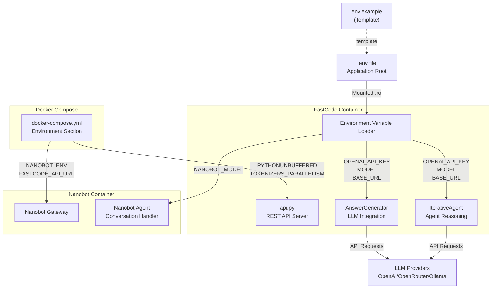
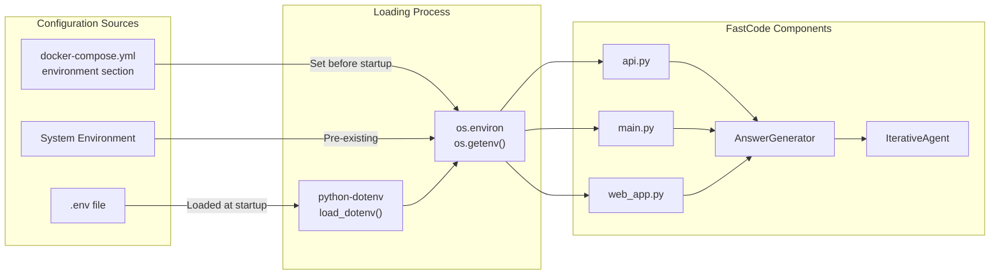
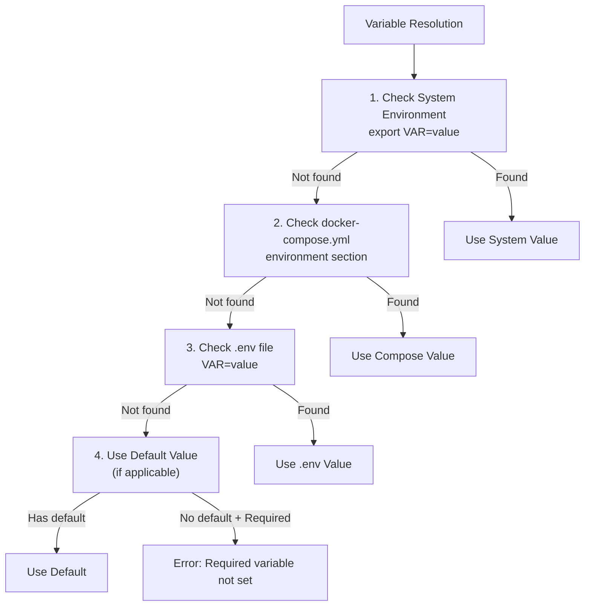
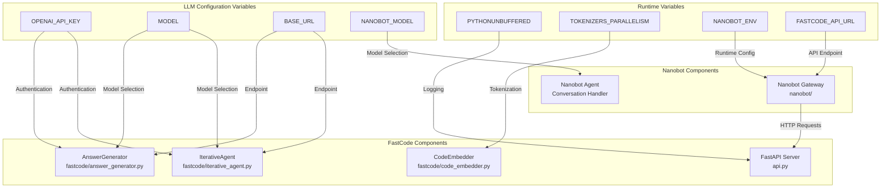

<!-- source: DeepWiki mcp.deepwiki.com · repo HKUDS/FastCode · page 12.3 Environment Variables · fetched 2026-11-09 -->

# Environment Variables

<details>
<summary>Relevant source files</summary>

The following files were used as context for generating this wiki page:

- [README.md](README.md)
- [fastcode/answer_generator.py](fastcode/answer_generator.py)
- [fastcode/query_processor.py](fastcode/query_processor.py)
- [fastcode/repo_overview.py](fastcode/repo_overview.py)
- [fastcode/repo_selector.py](fastcode/repo_selector.py)

</details>


This document provides a complete reference of all environment variables used by FastCode and its integrated services. Environment variables configure LLM provider connections, model selection, and runtime behavior for both the FastCode core system and the Nanobot gateway.

For configuring system behavior beyond environment variables, see [Configuration Reference](#12.1). For information about specific LLM providers and their requirements, see [LLM Provider Support](#12.5).

## Purpose and Scope

Environment variables in FastCode serve three primary purposes:

1. **LLM Provider Authentication**: API keys and credentials for OpenAI, OpenRouter, Anthropic, and local model services
2. **Model Selection**: Specify which models to use for answer generation and agent reasoning
3. **Runtime Configuration**: Control Python and library behavior in containerized environments

Environment variables are loaded from a `.env` file in the application root directory and are referenced by the core FastCode system, the Nanobot gateway, and Docker Compose orchestration.

## Environment Variable Overview

### Configuration Flow Diagram



**Sources**: [docker-compose.yml:1-61](), [env.example:1-18]()

## Core LLM Configuration Variables

These variables configure the primary LLM provider used by FastCode for answer generation and agent-based retrieval.

### Variable Reference Table

| Variable | Required | Description | Default | Examples |
|----------|----------|-------------|---------|----------|
| `OPENAI_API_KEY` | Yes | API key for authentication with LLM provider | None | `sk-...`, `ollama` (for local) |
| `MODEL` | Yes | Model identifier to use for generation | None | `gpt-4`, `google/gemini-3-flash-preview`, `qwen3-coder-30b_fastcode` |
| `BASE_URL` | No | Custom API endpoint URL | Provider default | `https://openrouter.ai/api/v1`, `http://localhost:11434/v1` |
| `NANOBOT_MODEL` | No | Model for Nanobot agent reasoning | Uses `MODEL` | `minimax/minimax-m2.1`, `gpt-4-turbo` |

### OPENAI_API_KEY

**Purpose**: Authenticates requests to OpenAI-compatible API endpoints.

**Usage Context**: Required by `AnswerGenerator` and `IterativeAgent` when making LLM API calls. The variable name is `OPENAI_API_KEY` regardless of the actual provider (OpenRouter, Anthropic, etc.) due to OpenAI API compatibility standards.

**Special Values**:
- For Ollama local models: set to `ollama` (literal string)
- For OpenRouter: use your OpenRouter API key
- For OpenAI: use your OpenAI API key starting with `sk-`

**Example Configurations**:

```bash
# OpenAI
OPENAI_API_KEY=sk-proj-abc123...

# OpenRouter (Gemini)
OPENAI_API_KEY=sk-or-v1-xyz789...

# Local Ollama
OPENAI_API_KEY=ollama
```

**Sources**: [env.example:3](), [env.example:12]()

### MODEL

**Purpose**: Specifies the model identifier for answer generation and multi-turn conversations.

**Usage Context**: Passed to `AnswerGenerator` when initializing LLM clients. The model identifier format varies by provider:
- OpenAI: Model name (e.g., `gpt-4`, `gpt-4-turbo`)
- OpenRouter: Provider/model format (e.g., `google/gemini-3-flash-preview`)
- Ollama: Local model name (e.g., `qwen3-coder-30b_fastcode`)

**Provider-Specific Formats**:

| Provider | Format | Example |
|----------|--------|---------|
| OpenAI | `model-name` | `gpt-4` |
| OpenRouter | `provider/model-name` | `google/gemini-3-flash-preview` |
| Ollama | `model-name` | `qwen3-coder-30b_fastcode` |
| Anthropic | `model-name` | `claude-3-sonnet-20240229` |

**Sources**: [env.example:4](), [env.example:8](), [env.example:13]()

### BASE_URL

**Purpose**: Overrides the default API endpoint URL for the LLM provider.

**Usage Context**: Optional. When set, directs all LLM API requests to the specified endpoint instead of the provider's default. Required for OpenRouter and Ollama, optional for OpenAI (defaults to `https://api.openai.com/v1`).

**Common Values**:

```bash
# OpenRouter
BASE_URL=https://openrouter.ai/api/v1

# Local Ollama
BASE_URL=http://localhost:11434/v1

# OpenAI (default, usually omitted)
BASE_URL=https://api.openai.com/v1

# Custom OpenAI-compatible endpoint
BASE_URL=https://your-custom-endpoint.com/v1
```

**Sources**: [env.example:5](), [env.example:9](), [env.example:14]()

## Nanobot Configuration Variables

### NANOBOT_MODEL

**Purpose**: Specifies the model used by Nanobot gateway for agent reasoning and conversation handling in messaging platforms (Feishu/Telegram).

**Usage Context**: Used by the Nanobot agent when processing messages from Feishu or Telegram. This can be different from the main `MODEL` variable to optimize costs or use specialized models for conversational tasks.

**Default Behavior**: If not set, Nanobot uses the value from `MODEL`.

**Example Configuration**:

```bash
# Use MiniMax for Nanobot conversations
NANOBOT_MODEL=minimax/minimax-m2.1

# Use GPT-4 Turbo for Nanobot
NANOBOT_MODEL=gpt-4-turbo

# Use same model as FastCode
# (omit NANOBOT_MODEL or set it equal to MODEL)
```

**Rationale**: Separating Nanobot's model allows using faster/cheaper models for conversational interactions while reserving more powerful models for deep code analysis queries.

**Sources**: [env.example:17-18]()

## Runtime Environment Variables

These variables control Python runtime behavior and library configuration in containerized environments.

### PYTHONUNBUFFERED

**Purpose**: Forces Python stdout and stderr streams to be unbuffered.

**Usage Context**: Set by Docker Compose for the FastCode container to ensure log messages appear immediately in `docker compose logs`.

**Value**: `1` (enabled)

**Effect**: 
- Log messages appear in real-time without buffering
- Essential for debugging and monitoring containerized applications
- No performance impact for production use

**Sources**: [docker-compose.yml:28]()

### TOKENIZERS_PARALLELISM

**Purpose**: Controls parallel tokenization in the HuggingFace Transformers library.

**Usage Context**: Set by Docker Compose to prevent deadlocks when using SentenceTransformer models for code embedding.

**Value**: `false` (disabled)

**Effect**:
- Prevents potential deadlocks in multi-threaded environments
- Recommended for containerized deployments
- Slight performance trade-off for stability

**Related Component**: `CodeEmbedder` uses SentenceTransformer models which depend on the Transformers tokenizer.

**Sources**: [docker-compose.yml:29]()

### NANOBOT_ENV

**Purpose**: Identifies the runtime environment for Nanobot gateway.

**Usage Context**: Set by Docker Compose for the Nanobot container to enable container-aware configuration.

**Value**: `docker` (in containerized deployment)

**Effect**: Enables Nanobot to adjust paths, networking, and configuration loading for Docker environments.

**Sources**: [docker-compose.yml:51]()

### FASTCODE_API_URL

**Purpose**: Specifies the FastCode REST API endpoint for Nanobot to communicate with.

**Usage Context**: Set by Docker Compose to enable container-to-container communication via Docker network.

**Value**: `http://fastcode:8001` (Docker service name resolution)

**Effect**: Nanobot forwards user queries to FastCode's internal API endpoint. In Docker Compose, `fastcode` resolves to the FastCode container's IP address.

**Sources**: [docker-compose.yml:53]()

## Configuration Methods

### Environment Variable Loading Diagram



**Sources**: [docker-compose.yml:27-29](), [docker-compose.yml:50-53]()

### Method 1: .env File

The primary configuration method for local development and Docker deployments.

**Location**: `.env` in the application root directory (same directory as `docker-compose.yml`)

**Setup**:
```bash
# Copy template
cp env.example .env

# Edit with your values
nano .env
```

**Docker Mount**: The `.env` file is mounted read-only into the FastCode container at `/app/.env`

```yaml
# From docker-compose.yml
volumes:
  - ./.env:/app/.env:ro
```

**Sources**: [docker-compose.yml:20]()

### Method 2: Docker Compose Environment

For container-specific runtime variables that shouldn't be in `.env`.

**Configuration**: Edit `docker-compose.yml` environment sections

```yaml
services:
  fastcode:
    environment:
      - PYTHONUNBUFFERED=1
      - TOKENIZERS_PARALLELISM=false
  
  nanobot:
    environment:
      - NANOBOT_ENV=docker
      - FASTCODE_API_URL=http://fastcode:8001
```

**Sources**: [docker-compose.yml:27-29](), [docker-compose.yml:50-53]()

### Method 3: System Environment

For production environments with secret management systems.

**Setup**:
```bash
# Export before running
export OPENAI_API_KEY="sk-..."
export MODEL="gpt-4"
python main.py
```

## Provider-Specific Configuration Examples

### OpenAI Configuration

```bash
# .env
OPENAI_API_KEY=sk-proj-abc123def456...
MODEL=gpt-4
# BASE_URL not needed (uses default)
```

**Features**:
- Access to GPT-4, GPT-4 Turbo, GPT-3.5 Turbo
- Streaming support
- Function calling for agent tools

**Cost Considerations**: GPT-4 is more expensive but provides higher quality answers. Use with appropriate token limits in configuration.

**Sources**: [env.example:3-5]()

### OpenRouter Configuration (Gemini)

```bash
# .env
OPENAI_API_KEY=sk-or-v1-xyz789...
MODEL=google/gemini-3-flash-preview
BASE_URL=https://openrouter.ai/api/v1
```

**Features**:
- Access to multiple providers through single API
- Gemini models for cost-effective queries
- Automatic provider routing

**Model Format**: `provider/model-name` (e.g., `google/gemini-3-flash-preview`, `anthropic/claude-3-sonnet`)

**Sources**: [env.example:7-9]()

### Local Ollama Configuration

```bash
# .env
OPENAI_API_KEY=ollama
MODEL=qwen3-coder-30b_fastcode
BASE_URL=http://localhost:11434/v1
```

**Features**:
- No API costs
- Full data privacy (local inference)
- Requires local GPU resources

**Prerequisites**:
1. Ollama installed and running on `localhost:11434`
2. Model pulled: `ollama pull qwen3-coder-30b_fastcode`

**Docker Networking**: When running FastCode in Docker but Ollama on host:
```bash
# Use host.docker.internal instead of localhost
BASE_URL=http://host.docker.internal:11434/v1
```

**Sources**: [env.example:11-14]()

### Hybrid Configuration (FastCode + Nanobot)

Use different models for different purposes:

```bash
# .env
# FastCode: Use powerful model for code analysis
OPENAI_API_KEY=sk-proj-abc123...
MODEL=gpt-4-turbo
BASE_URL=https://api.openai.com/v1

# Nanobot: Use faster model for conversations
NANOBOT_MODEL=gpt-3.5-turbo
```

**Rationale**:
- `gpt-4-turbo` for deep code understanding and agent reasoning
- `gpt-3.5-turbo` for fast conversational responses in messaging apps
- Cost optimization: Only use expensive models where necessary

**Sources**: [env.example:17-18]()

## Environment Variable Precedence

When the same variable is defined in multiple places, the following precedence order applies:



**Precedence Order** (highest to lowest):
1. **System environment variables**: Set via `export` or system configuration
2. **Docker Compose environment section**: Variables in `docker-compose.yml`
3. **.env file**: Variables in `.env` file
4. **Default values**: Built-in defaults (only for optional variables)

**Example**:
```bash
# .env file
MODEL=gpt-3.5-turbo

# Override via system environment
export MODEL=gpt-4

# Result: Uses gpt-4 (system environment takes precedence)
```

**Sources**: [docker-compose.yml:27-29](), [docker-compose.yml:50-53]()

## Security Considerations

### Protecting API Keys

**Best Practices**:

1. **Never commit .env to version control**
   ```bash
   # Verify .env is in .gitignore
   cat .gitignore | grep ".env"
   ```

2. **Use read-only mounts in Docker**
   ```yaml
   volumes:
     - ./.env:/app/.env:ro  # :ro = read-only
   ```

3. **Restrict file permissions**
   ```bash
   chmod 600 .env  # Owner read/write only
   ```

4. **Use secret management in production**
   - Docker Secrets
   - Kubernetes Secrets
   - AWS Secrets Manager
   - HashiCorp Vault

**Sources**: [docker-compose.yml:20]()

### Variable Validation

FastCode performs validation on startup:

1. **Required variables**: `OPENAI_API_KEY` and `MODEL` must be set
2. **Format validation**: Model identifiers checked against provider patterns
3. **Connection testing**: Optional health check to verify API connectivity

**Error Messages**:
- Missing `OPENAI_API_KEY`: "Error: OPENAI_API_KEY environment variable not set"
- Missing `MODEL`: "Error: MODEL environment variable not set"
- Invalid `BASE_URL`: "Warning: Could not connect to BASE_URL"

## Environment Variable Reference Summary

### Complete Variable Matrix

| Variable | Component | Required | Provider | Default | Container |
|----------|-----------|----------|----------|---------|-----------|
| `OPENAI_API_KEY` | FastCode Core | Yes | All | None | FastCode |
| `MODEL` | AnswerGenerator, IterativeAgent | Yes | All | None | FastCode |
| `BASE_URL` | AnswerGenerator, IterativeAgent | Optional | All | Provider default | FastCode |
| `NANOBOT_MODEL` | Nanobot Agent | Optional | All | Uses `MODEL` | Nanobot |
| `PYTHONUNBUFFERED` | Python Runtime | No | N/A | `1` | FastCode |
| `TOKENIZERS_PARALLELISM` | HuggingFace | No | N/A | `false` | FastCode |
| `NANOBOT_ENV` | Nanobot Runtime | No | N/A | `docker` | Nanobot |
| `FASTCODE_API_URL` | Nanobot Gateway | Yes | N/A | `http://fastcode:8001` | Nanobot |

### Variable Usage by Component



**Sources**: [env.example:1-18](), [docker-compose.yml:27-29](), [docker-compose.yml:50-53]()

## Troubleshooting

### Common Issues

**Issue**: "Error: OPENAI_API_KEY environment variable not set"
- **Cause**: Missing or incorrectly named `.env` file
- **Solution**: Verify `.env` exists in application root: `ls -la .env`

**Issue**: "Connection refused" or "Could not connect to API"
- **Cause**: Incorrect `BASE_URL` or network connectivity
- **Solution**: Test endpoint manually: `curl $BASE_URL/models`

**Issue**: Nanobot cannot reach FastCode API
- **Cause**: `FASTCODE_API_URL` pointing to wrong host
- **Solution**: Use Docker service name: `http://fastcode:8001` (not `localhost`)

**Issue**: Model not found errors
- **Cause**: Incorrect `MODEL` identifier for provider
- **Solution**: Verify model format matches provider requirements (see Provider-Specific Configuration)

For more troubleshooting guidance, see [API & Connection Issues](#11.2).

**Sources**: [docker-compose.yml:53]()

---

