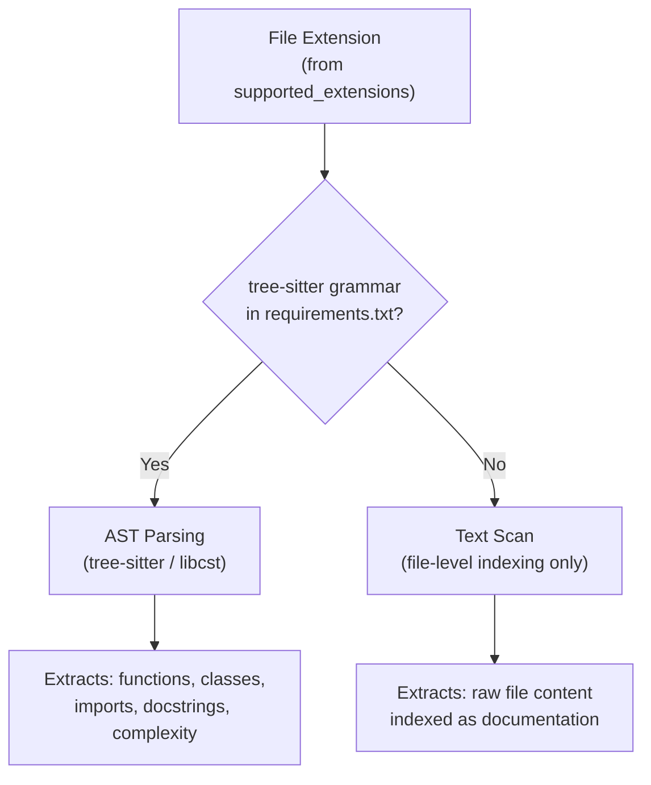
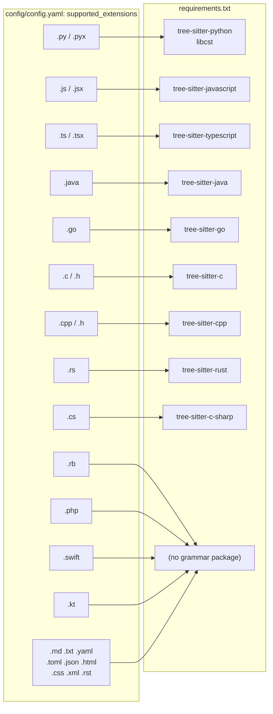

<!-- source: DeepWiki mcp.deepwiki.com · repo HKUDS/FastCode · page 12.4 Supported Languages · fetched 2026-11-09 -->

# Supported Languages

Relevant source files

The following files were used as context for generating this wiki page:

- [config/config.yaml](config/config.yaml)
- [fastcode/embedder.py](fastcode/embedder.py)
- [requirements.txt](requirements.txt)

This page lists every programming language and file format that FastCode recognizes, along with the corresponding file extensions, tree-sitter grammar packages, and the level of parsing support each receives. For instructions on adding a new language, see [Adding Language Support](#10.4). For configuration of which extensions are scanned, see [Repository Configuration](#8.1).

---

## How Language Support Works

FastCode handles languages at two distinct levels:

1. **AST-parsed languages** — A tree-sitter grammar package (or `libcst` for Python) is installed, allowing the parser to extract structured code elements such as functions, classes, imports, docstrings, and compute complexity metrics.
2. **Text-scanned languages** — The file extension is listed in `supported_extensions` but no tree-sitter grammar is installed. These files are ingested as raw text and indexed at the file level only; no function or class extraction occurs.

The `supported_extensions` list in `config/config.yaml` [config/config.yaml:22-49]() controls which files the `RepositoryLoader` includes during a scan. The tree-sitter packages listed in `requirements.txt` [requirements.txt:10-20]() determine which of those files receive deep AST parsing.

---

**Diagram: Extension → Parser Resolution**

Sources: [requirements.txt:9-20](), [config/config.yaml:22-49]()

---

## AST-Parsed Languages

These languages have a tree-sitter grammar package (or `libcst`) installed. The code parser can extract structural elements — functions, classes, imports, docstrings — and compute cyclomatic complexity.

| Language | Extensions | Package in `requirements.txt` | Notes |
|---|---|---|---|
| Python | `.py` | `tree-sitter-python` | Also uses `libcst` for Python-specific CST analysis |
| Python (Cython) | `.pyx` | `tree-sitter-python` | Parsed with the Python grammar |
| JavaScript | `.js`, `.jsx` | `tree-sitter-javascript` | JSX syntax supported via JS grammar |
| TypeScript | `.ts`, `.tsx` | `tree-sitter-typescript` | TSX syntax supported via TS grammar |
| Java | `.java` | `tree-sitter-java` | |
| Go | `.go` | `tree-sitter-go` | |
| C | `.c`, `.h` | `tree-sitter-c` | Headers shared with C++ |
| C++ | `.cpp`, `.h` | `tree-sitter-cpp` | `.h` may be parsed as either C or C++ |
| Rust | `.rs` | `tree-sitter-rust` | |
| C# | `.cs` | `tree-sitter-c-sharp` | |

Sources: [requirements.txt:10-20](), [config/config.yaml:22-39]()

---

## Text-Scanned Languages

These extensions appear in `supported_extensions` but have no corresponding tree-sitter grammar package in `requirements.txt`. Files with these extensions are included in the repository scan and indexed at the file level. They contribute to BM25 keyword search and semantic embedding but yield no function- or class-level elements.

| Language | Extensions |
|---|---|
| Ruby | `.rb` |
| PHP | `.php` |
| Swift | `.swift` |
| Kotlin | `.kt` |

Sources: [requirements.txt:10-20](), [config/config.yaml:36-39]()

---

## Non-Code Text Formats

These are documentation and data formats included in `supported_extensions` for text-based indexing. They are treated similarly to text-scanned languages — no AST parsing occurs — but they commonly provide valuable documentation context (e.g., README files, configuration files).

| Format | Extensions |
|---|---|
| Markdown | `.md` |
| reStructuredText | `.rst` |
| Plain text | `.txt` |
| YAML | `.yaml` |
| TOML | `.toml` |
| JSON | `.json` |
| HTML | `.html` |
| CSS | `.css` |
| XML | `.xml` |

Sources: [config/config.yaml:40-49]()

---

## Summary Diagram: Extensions to Packages

**Diagram: `supported_extensions` mapped to `requirements.txt` packages**

Sources: [requirements.txt:10-20](), [config/config.yaml:22-49]()

---

## Configuring Supported Extensions

The `supported_extensions` key under `repository` in `config/config.yaml` [config/config.yaml:22-49]() is the single place to add or remove file extensions from scanning. The `RepositoryLoader.scan_files()` method applies this list as a filter on every file in the repository.

To add a new language with full AST parsing:
1. Install the corresponding `tree-sitter-<language>` package.
2. Add the file extension to `supported_extensions`.
3. Register the grammar in the parser module.

See [Adding Language Support](#10.4) for the complete procedure.

> **Note:** Extensions not in `supported_extensions` are silently skipped by `scan_files()` regardless of whether a grammar package is installed.

Sources: [config/config.yaml:8-49]()

---

