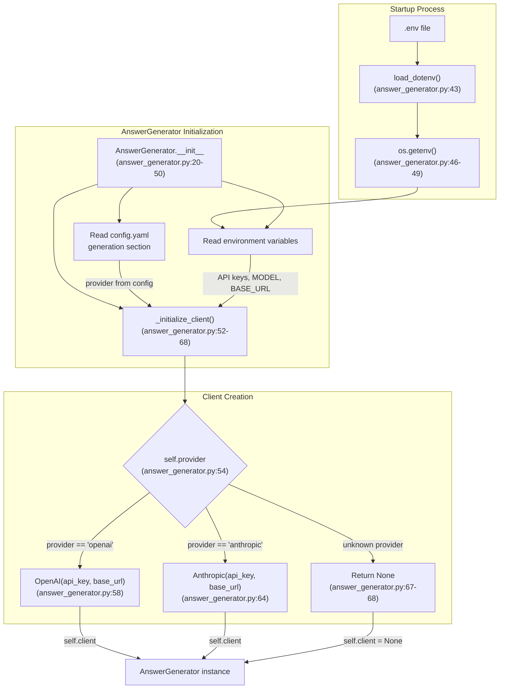
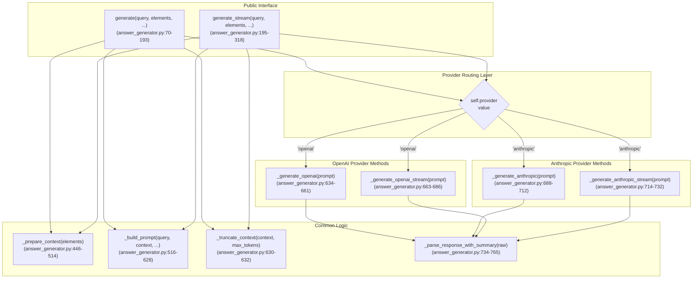
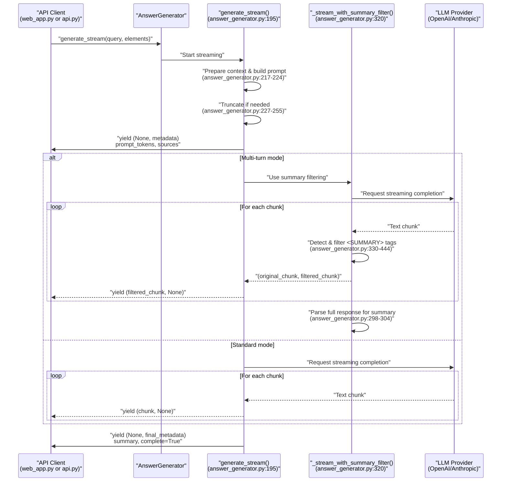
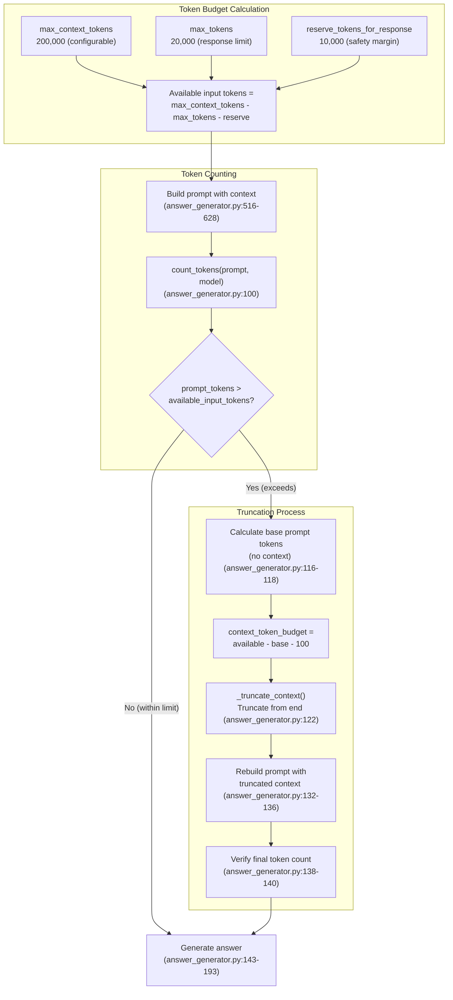

<!-- source: DeepWiki mcp.deepwiki.com · repo HKUDS/FastCode · page 12.5 LLM Provider Support · fetched 2026-11-09 -->

# LLM Provider Support

<details>
<summary>Relevant source files</summary>

The following files were used as context for generating this wiki page:

- [README.md](README.md)
- [fastcode/answer_generator.py](fastcode/answer_generator.py)
- [fastcode/llm_utils.py](fastcode/llm_utils.py)

</details>


## Purpose and Scope

This document provides a complete reference for LLM (Large Language Model) provider integration in FastCode. It covers the supported providers, configuration methods, client initialization, and provider-specific implementation details.

FastCode supports multiple LLM providers to enable flexible deployment scenarios, from cloud-based APIs to local models. For general configuration settings beyond LLM providers, see [Configuration](#8). For answer generation logic that uses these providers, see [Answer Generator](#4.7).

---

## Supported Providers Overview

FastCode supports four categories of LLM providers through a unified abstraction layer:

| Provider | Type | Configuration | Use Case |
|----------|------|---------------|----------|
| **OpenAI** | Cloud API | OpenAI API key + `BASE_URL` | GPT-4, GPT-4 Turbo models |
| **OpenRouter** | Cloud API Gateway | OpenRouter API key + OpenRouter URL | Access to multiple models (Gemini, Claude, etc.) |
| **Anthropic** | Cloud API | Anthropic API key | Claude models (Opus, Sonnet, Haiku) |
| **Ollama** | Local Server | Local endpoint | Self-hosted models (Qwen, Llama, etc.) |

All providers share the same interface through the `AnswerGenerator` class, enabling seamless switching without code changes.

**Sources:** [README.md:552-595](), [fastcode/answer_generator.py:17-68]()

---

## Configuration System

### Environment Variables

LLM provider configuration is managed entirely through environment variables defined in the `.env` file. This centralizes API credentials and model selection:

```bash
# Core configuration (required)
OPENAI_API_KEY=your_api_key_here
MODEL=model_name
BASE_URL=api_base_url

# Optional: Anthropic-specific
ANTHROPIC_API_KEY=your_anthropic_key

# Optional: Nanobot integration
NANOBOT_MODEL=minimax/minimax-m2.1
```

The system loads these variables at runtime using `python-dotenv`, ensuring credentials are never hard-coded in the codebase.

**Sources:** [env.example:1-18](), [fastcode/answer_generator.py:42-50]()

### Configuration Loading Flow



**Sources:** [fastcode/answer_generator.py:20-68]()

---

## Provider Implementation Architecture

### AnswerGenerator Class Structure

The `AnswerGenerator` class in [fastcode/answer_generator.py]() provides a unified interface for all LLM providers. It abstracts provider differences into a single public API for answer generation.



**Sources:** [fastcode/answer_generator.py:17-886]()

### Provider Selection Logic

Provider selection occurs during `AnswerGenerator` initialization and routes API calls to the appropriate implementation:

| Provider Value | Client Library | API Endpoint | Method Called |
|----------------|----------------|--------------|---------------|
| `"openai"` | `openai.OpenAI` | `self.base_url` | `_generate_openai()` or `_generate_openai_stream()` |
| `"anthropic"` | `anthropic.Anthropic` | `self.base_url` | `_generate_anthropic()` or `_generate_anthropic_stream()` |
| Other | None | N/A | Returns error message |

The `provider` field is read from `config.yaml` under `generation.provider`, defaulting to `"openai"` if not specified.

**Sources:** [fastcode/answer_generator.py:25-68](), [fastcode/answer_generator.py:143-149]()

---

## Provider-Specific Configuration

### OpenAI and OpenAI-Compatible APIs

OpenAI and OpenAI-compatible providers (including OpenRouter) use the same client library and configuration pattern.

#### Configuration Examples

**Standard OpenAI:**
```bash
OPENAI_API_KEY=sk-proj-xxxxxxxxxxxxx
MODEL=gpt-4-turbo
BASE_URL=https://api.openai.com/v1
```

**OpenRouter (for Gemini, Claude, etc.):**
```bash
OPENAI_API_KEY=sk-or-v1-xxxxxxxxxxxxx
MODEL=google/gemini-flash-1.5
BASE_URL=https://openrouter.ai/api/v1
```

**Custom OpenAI-compatible endpoint:**
```bash
OPENAI_API_KEY=your_custom_key
MODEL=custom-model-name
BASE_URL=https://your-api.example.com/v1
```

#### Implementation Details

The OpenAI provider uses the `openai` Python library to make API calls. The implementation handles both standard completion and streaming responses:

```python
# Non-streaming completion (answer_generator.py:640-645)
response = self.client.chat.completions.create(
    model=self.model,
    messages=[{"role": "user", "content": prompt}],
    temperature=self.temperature,
    max_tokens=self.max_tokens,
)
```

The method includes defensive error handling to catch edge cases where providers return incomplete responses.

**Sources:** [fastcode/answer_generator.py:634-686](), [README.md:556-563](), [README.md:576-584]()

### Anthropic Claude

Anthropic's Claude models use a separate API with a different response format.

#### Configuration Example

```bash
ANTHROPIC_API_KEY=sk-ant-xxxxxxxxxxxxx
MODEL=claude-3-opus-20240229
BASE_URL=https://api.anthropic.com/v1
```

Note: Set `generation.provider` to `"anthropic"` in `config/config.yaml`.

#### Implementation Details

The Anthropic provider uses the `anthropic` Python library with its own message format:

```python
# Non-streaming completion (answer_generator.py:694-699)
response = self.client.messages.create(
    model=self.model,
    max_tokens=self.max_tokens,
    temperature=self.temperature,
    messages=[{"role": "user", "content": prompt}]
)
```

Anthropic responses return content blocks rather than direct message content, requiring different parsing logic.

**Sources:** [fastcode/answer_generator.py:688-732](), [fastcode/answer_generator.py:60-64]()

### Local Models (Ollama)

Ollama enables running LLMs locally without cloud API dependencies. FastCode connects to Ollama's OpenAI-compatible API endpoint.

#### Configuration Example

```bash
OPENAI_API_KEY=ollama
MODEL=qwen3-coder-30b_fastcode
BASE_URL=http://localhost:11434/v1
```

#### Setup Requirements

1. Install and start Ollama server:
   ```bash
   ollama serve
   ```

2. Pull the desired model:
   ```bash
   ollama pull qwen3-coder-30b_fastcode
   ```

3. Configure FastCode to use the local endpoint (as shown above)

#### Advantages

- **No API costs**: All inference runs locally
- **Data privacy**: Code never leaves your infrastructure
- **Network independence**: Works without internet connectivity
- **Custom models**: Can fine-tune and use specialized models

#### Limitations

- **Resource requirements**: Requires sufficient GPU/CPU and RAM
- **Performance**: Slower than cloud APIs depending on hardware
- **Model availability**: Limited to models supported by Ollama

**Sources:** [README.md:586-594](), [env.example:11-14]()

---

## Streaming Response Support

FastCode supports streaming responses from LLM providers, enabling real-time display of generated text as it arrives. This improves user experience for long-form answers.

### Streaming Architecture



### Streaming Implementation Details

The `generate_stream()` method yields tuples of `(text_chunk, metadata)`:

1. **Initial metadata yield** [answer_generator.py:257-264](): Returns prompt tokens, sources, and context info
2. **Text chunk yields** [answer_generator.py:269-294](): Streams LLM response text incrementally
3. **Final metadata yield** [answer_generator.py:306-310](): Returns completion flag and extracted summary

#### Multi-turn Summary Filtering

In multi-turn dialogue mode, the streaming system filters out `<SUMMARY>` tags to prevent them from appearing in the user-facing output. The `_stream_with_summary_filter()` method [answer_generator.py:320-444]() implements a buffered streaming approach:

- Uses regex patterns to detect summary start/end markers
- Maintains a buffer to handle tags split across chunks
- Yields original chunks for internal tracking and filtered chunks for display

**Sources:** [fastcode/answer_generator.py:195-318](), [fastcode/answer_generator.py:320-444](), [fastcode/answer_generator.py:663-686](), [fastcode/answer_generator.py:714-732]()

---

## Model Selection and Parameters

### Model Configuration

Models are specified via the `MODEL` environment variable and can be any model identifier supported by your chosen provider:

```bash
# OpenAI models
MODEL=gpt-4
MODEL=gpt-4-turbo
MODEL=gpt-3.5-turbo

# OpenRouter models (provider/model format)
MODEL=google/gemini-flash-1.5
MODEL=anthropic/claude-3-opus
MODEL=meta-llama/llama-3-70b-instruct

# Ollama local models
MODEL=qwen3-coder-30b_fastcode
MODEL=codellama:34b
MODEL=mistral:latest
```

### Generation Parameters

Additional model behavior is controlled through `config.yaml` under the `generation` section:

| Parameter | Default | Description | Location |
|-----------|---------|-------------|----------|
| `provider` | `"openai"` | LLM provider type | [answer_generator.py:25]() |
| `temperature` | `0.4` | Randomness (0.0-1.0) | [answer_generator.py:28]() |
| `max_tokens` | `20000` | Maximum response length | [answer_generator.py:29]() |
| `max_context_tokens` | `200000` | Maximum input context | [answer_generator.py:31]() |
| `reserve_tokens_for_response` | `10000` | Safety margin for output | [answer_generator.py:32]() |

These parameters affect answer quality, cost, and latency:

- **Lower temperature** (0.0-0.3): More deterministic, focused answers
- **Higher temperature** (0.7-1.0): More creative, varied responses
- **Higher max_tokens**: Allows longer answers but increases cost
- **Lower max_context_tokens**: Reduces cost but may truncate context

**Sources:** [fastcode/answer_generator.py:20-41](), [env.example:1-18]()

---

## Token Management and Cost Control

### Context Window Management

FastCode implements sophisticated token management to stay within provider limits and control costs:



### Truncation Strategy

When context exceeds available tokens [answer_generator.py:108-140]():

1. **Preserve prompt structure**: Keep system prompt, query, and dialogue history
2. **Truncate context from end**: Remove lower-priority code snippets
3. **Maintain context quality**: Prioritize most relevant code elements
4. **Verify final size**: Double-check token count after truncation

This ensures the most relevant code context is retained while staying within model limits.

### Cost Optimization

Token usage directly impacts API costs. FastCode optimizes costs through:

- **Semantic targeting**: Retrieve only relevant code sections
- **Agent iteration limits**: Stop after 4 rounds or 12,000 lines total [README.md:101-112]()
- **Context truncation**: Automatically reduce context when needed
- **Caching**: Reuse embeddings and query results (see [Caching System](#9.1))

**Sources:** [fastcode/answer_generator.py:99-140](), [fastcode/answer_generator.py:630-632]()

---

## Multi-Turn Dialogue Integration

### Summary Generation for Session Continuity

In multi-turn mode, LLM providers are prompted to generate structured summaries alongside answers. These summaries enable context-aware follow-up queries.

#### Summary Format

The system prompts the LLM to generate summaries in XML-like tags [answer_generator.py:544-572]():

```xml
<SUMMARY>
Files Read:
- [repo_name/file_path_1] - [brief description]
- [repo_name/file_path_2] - [brief description]

Missing Information:
- [description of what's still needed]
- [why this information would be helpful]

Key Facts:
- [fact 1]
- [fact 2]

Symbol Mappings:
- [user term] → [actual symbol in codebase]
</SUMMARY>
```

#### Summary Extraction

The `_parse_response_with_summary()` method [answer_generator.py:734-765]() uses multiple regex patterns to extract summaries:

- Handles case variations: `<SUMMARY>`, `<Summary>`, `<summary>`
- Supports markdown formatting: `**SUMMARY**`, `**<SUMMARY>**`
- Removes summary from user-facing answer while preserving it for session storage

#### Fallback Summary Generation

If the LLM doesn't produce a proper summary, `_generate_fallback_summary()` [answer_generator.py:767-840]() creates one from retrieved elements:

- Lists all analyzed files with paths
- Includes code element signatures and docstrings
- Truncates long content to stay within limits
- Provides query and answer preview for context

**Sources:** [fastcode/answer_generator.py:516-628](), [fastcode/answer_generator.py:734-840]()

---

## Error Handling and Resilience

### Provider Initialization Failures

The `_initialize_client()` method handles missing API keys gracefully [answer_generator.py:52-68]():

```python
if not api_key:
    self.logger.warning("OPENAI_API_KEY not set")
return OpenAI(api_key=api_key, base_url=self.base_url)
```

A warning is logged but the system continues, allowing other components to initialize.

### API Call Error Handling

Both OpenAI and Anthropic generation methods include comprehensive error handling:

#### Defensive Response Parsing

```python
# Check for empty or malformed responses (answer_generator.py:650-656)
if not response or not getattr(response, "choices", None):
    raise ValueError(f"Empty response or no choices returned: {response}")
first_choice = response.choices[0]
message = getattr(first_choice, "message", None)
content = getattr(message, "content", None) if message else None
if content is None:
    raise ValueError(f"LLM response has no content: {response}")
```

This prevents crashes from providers that return partial or unexpected payloads.

#### Streaming Error Recovery

Streaming methods catch exceptions and yield error messages as text [answer_generator.py:684-686](), [answer_generator.py:730-732]():

```python
except Exception as e:
    self.logger.error(f"OpenAI streaming API error: {e}")
    yield f"\n\nError: {str(e)}"
```

This ensures the client receives error information through the same streaming interface.

### Full Error Context

The `generate()` method provides complete error tracebacks in the response [answer_generator.py:183-193]():

```python
except Exception as e:
    self.logger.error(f"Failed to generate answer: {e}")
    import traceback
    full_error = traceback.format_exc()
    self.logger.error(f"Full error traceback:\n{full_error}")
    return {
        "answer": f"Error generating answer: {str(e)}",
        "query": query,
        "context_elements": len(retrieved_elements),
        "error": full_error,
    }
```

**Sources:** [fastcode/answer_generator.py:52-68](), [fastcode/answer_generator.py:183-193](), [fastcode/answer_generator.py:634-732]()

---

## Provider Comparison Table

| Feature | OpenAI | OpenRouter | Anthropic | Ollama |
|---------|--------|------------|-----------|--------|
| **API Key Required** | Yes (OpenAI) | Yes (OpenRouter) | Yes (Anthropic) | No |
| **Internet Required** | Yes | Yes | Yes | No |
| **Streaming Support** | ✓ | ✓ | ✓ | ✓ |
| **Cost** | Per token | Per token | Per token | Hardware only |
| **Latency** | Low | Low-Medium | Low | Varies by hardware |
| **Model Selection** | OpenAI models only | 100+ models | Claude models only | Ollama-compatible models |
| **Privacy** | Data sent to OpenAI | Data sent to providers | Data sent to Anthropic | Fully local |
| **Context Window** | Model-dependent | Model-dependent | Model-dependent | Model-dependent |
| **Best For** | Production with OpenAI | Multi-model access | Claude-specific needs | Privacy, offline, cost-sensitive |

**Sources:** [README.md:552-606](), [fastcode/answer_generator.py:17-886]()

---

## Configuration Examples by Use Case

### Production Deployment (Cloud)

```bash
# Recommended for production: OpenRouter with Gemini for cost-effectiveness
OPENAI_API_KEY=sk-or-v1-xxxxxxxxxxxxx
MODEL=google/gemini-flash-1.5
BASE_URL=https://openrouter.ai/api/v1
```

Advantages: Access to fast, cost-effective models with automatic fallback to alternatives.

### Development Environment (Local)

```bash
# Recommended for development: Ollama for zero-cost iteration
OPENAI_API_KEY=ollama
MODEL=qwen3-coder-30b_fastcode
BASE_URL=http://localhost:11434/v1
```

Advantages: No API costs, full control, works offline.

### High-Accuracy Requirements

```bash
# Use GPT-4 or Claude Opus for maximum accuracy
OPENAI_API_KEY=sk-xxxxxxxxxxxxx
MODEL=gpt-4-turbo
BASE_URL=https://api.openai.com/v1
```

Adjust `temperature=0.2` in `config.yaml` for more deterministic outputs.

### Multi-Repository Enterprise

```bash
# Use Anthropic Claude for long-context support
ANTHROPIC_API_KEY=sk-ant-xxxxxxxxxxxxx
MODEL=claude-3-opus-20240229
BASE_URL=https://api.anthropic.com/v1
```

Set `generation.provider: anthropic` in `config.yaml`. Claude's 200K+ context window handles large codebases.

**Sources:** [README.md:552-595](), [env.example:1-18]()

---

## Troubleshooting

### Common Issues and Solutions

| Issue | Cause | Solution |
|-------|-------|----------|
| `"Error: OpenAI client not initialized"` | Missing or invalid `OPENAI_API_KEY` | Verify `.env` file exists and contains valid API key |
| `"Empty response or no choices returned"` | Provider returned malformed response | Check provider status; verify model name is correct |
| `"LLM response has no content"` | Defensive parsing caught incomplete payload | Check API logs; may need to retry |
| `"OpenAI API error: 401"` | Authentication failed | Verify API key is active and has proper permissions |
| `"Connection refused to localhost:11434"` | Ollama not running | Start Ollama server: `ollama serve` |
| `"Model not found: xxx"` | Model not available/pulled | For Ollama: `ollama pull model_name` |
| Token limit exceeded | Prompt + response exceeds context window | Reduce `max_context_tokens` or enable truncation |
| Slow response times | Large context or slow model | Reduce retrieved elements; use faster model |

### Debugging Tips

1. **Enable debug logging**: Set log level to DEBUG to see full prompt and response details
2. **Check token counts**: Monitor `prompt_tokens` in response to identify context bloat
3. **Test with minimal context**: Try queries with `max_results=1` to isolate provider issues
4. **Verify API connectivity**: Use `curl` to test provider endpoints directly
5. **Compare providers**: Test same query with different providers to isolate issues

**Sources:** [fastcode/answer_generator.py:52-193](), [fastcode/answer_generator.py:634-732]()

---

## Related Configuration

For comprehensive configuration of LLM behavior beyond provider selection, see:

- [Generation Configuration](#8.8): Temperature, token limits, prompt settings
- [Agent Configuration](#8.9): Agent-specific model parameters and temperature
- [Query Configuration](#8.7): LLM enhancement modes for query processing
- [Caching Configuration](#8.10): Cache settings for LLM responses

**Sources:** [fastcode/answer_generator.py:20-41]()