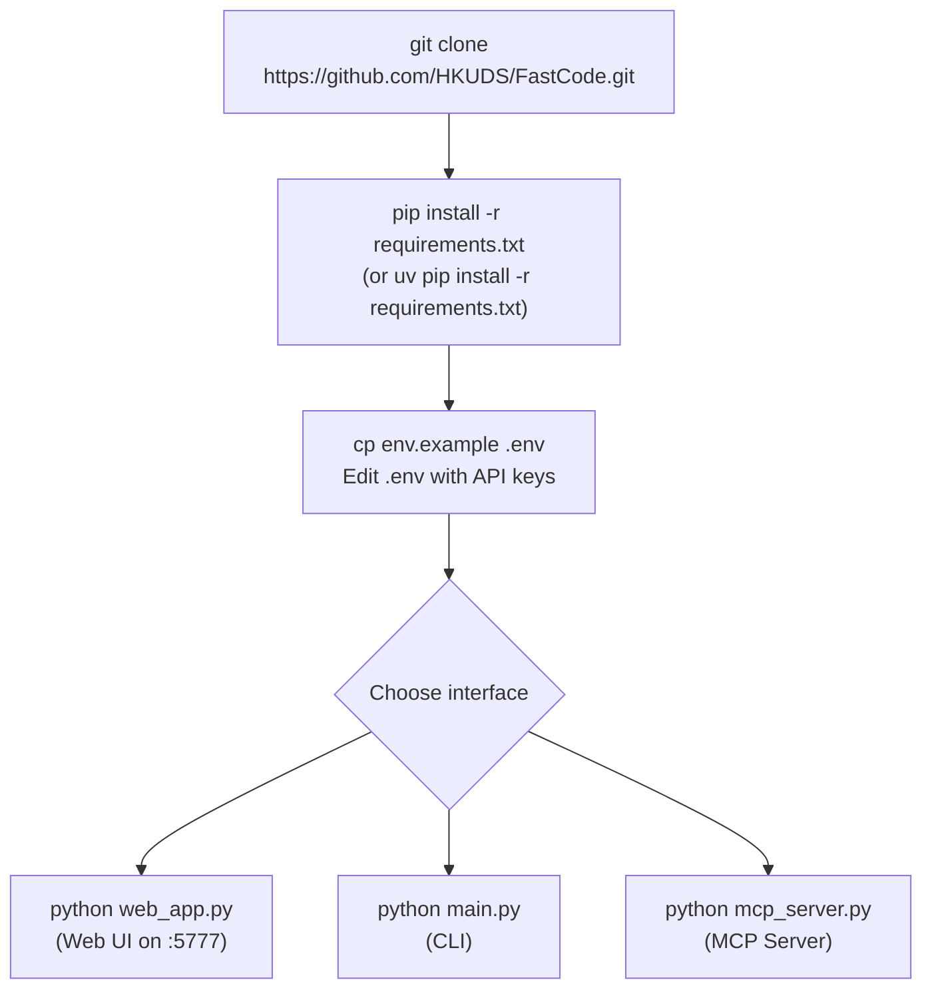
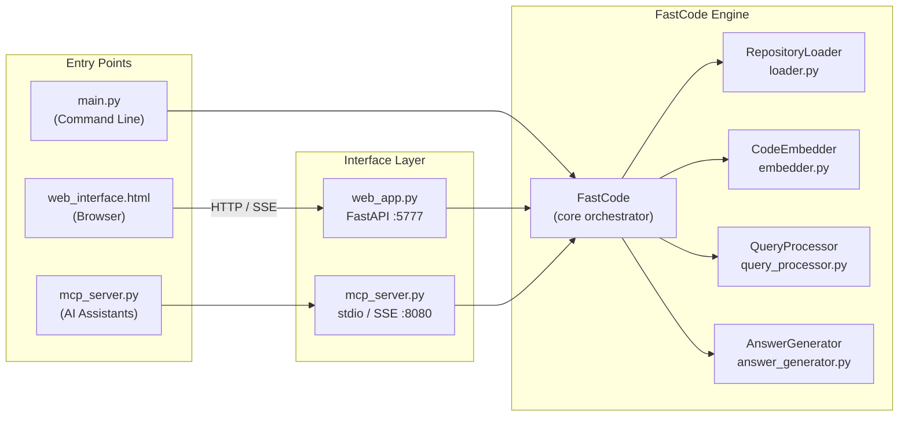
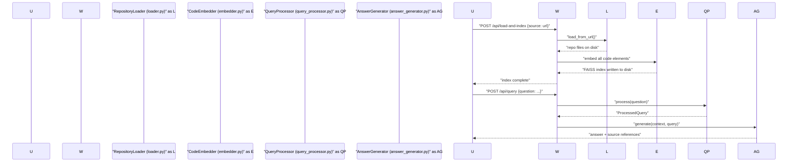

<!-- source: DeepWiki mcp.deepwiki.com · repo HKUDS/FastCode · page 2 Getting Started · fetched 2026-11-09 -->

# Getting Started

<details>
<summary>Relevant source files</summary>

The following files were used as context for generating this wiki page:

- [README.md](README.md)
- [requirements.txt](requirements.txt)

</details>


This page covers the minimum steps required to install FastCode, configure your environment, and make your first query. It is intentionally concise; each major step has a dedicated sub-page with full detail:

- For the full dependency list and platform-specific install steps, see [Installation](#2.1).
- For all environment variables and `.env` file options, see [Environment Configuration](#2.2).
- For a complete end-to-end walkthrough with the web UI, see [Quick Start Guide](#2.3).

---

## Prerequisites

| Requirement | Minimum Version | Notes |
|---|---|---|
| Python | 3.12+ | Required by all components |
| Git | Any recent version | Required for cloning repositories |
| An LLM API key | — | OpenAI, OpenRouter, or a local model endpoint |

FastCode runs on **Linux**, **macOS**, and **Windows**. On Apple Silicon (M1/M2/M3), all dependencies are ARM-compatible. On Windows, use Git Bash or WSL if you run any `.sh` scripts.

---

## Setup Flow

**Figure 1: FastCode Setup Sequence**



Sources: [README.md:145-161]()

---

## Step 1 — Clone the Repository

```bash
git clone https://github.com/HKUDS/FastCode.git
cd FastCode
```

---

## Step 2 — Install Dependencies

The recommended approach uses `uv` for faster resolution:

```bash
pip install uv
uv venv --python=3.12
source .venv/bin/activate      # On Windows: .venv\Scripts\activate
uv pip install -r requirements.txt
```

Alternatively, use plain pip:

```bash
pip install -r requirements.txt
```

The `requirements.txt` file installs all required packages across FastCode's major subsystems:

| Category | Key Packages |
|---|---|
| Code Parsing | `tree-sitter`, language grammars, `libcst` |
| Embeddings & Vector Store | `sentence-transformers`, `faiss-cpu`, `chromadb` |
| Search & Retrieval | `rank-bm25`, `networkx` |
| LLM Integration | `openai`, `anthropic`, `tiktoken` |
| API & Web | `fastapi`, `uvicorn`, `flask`, `pydantic` |
| Caching | `diskcache`, `redis` |
| MCP Server | `mcp[cli]` |

See [Installation](#2.1) for platform-specific troubleshooting and optional GPU/Redis setup.

Sources: [requirements.txt:1-56]()

---

## Step 3 — Configure Environment

```bash
cp env.example .env
# Edit .env with your preferred editor
```

At minimum, set the three variables that identify your LLM provider:

```env
OPENAI_API_KEY=sk-...
MODEL=gpt-4o
BASE_URL=https://api.openai.com/v1
```

These variables are read at startup by `web_app.py`, `mcp_server.py`, and `main.py`. Common provider configurations:

| Provider | `MODEL` example | `BASE_URL` |
|---|---|---|
| OpenAI | `gpt-4o` | `https://api.openai.com/v1` |
| OpenRouter | `google/gemini-flash-1.5` | `https://openrouter.ai/api/v1` |
| Ollama (local) | `qwen3-coder-30b_fastcode` | `http://localhost:11434/v1` |

See [Environment Configuration](#2.2) for the full list of optional variables, including model overrides, Redis connection settings, and embedding device selection.

Sources: [README.md:670-715]()

---

## Step 4 — Start FastCode

### Web Interface (Recommended)

```bash
python web_app.py --host 0.0.0.0 --port 5777
```

Open `http://localhost:5777` in a browser. The web UI (`web_interface.html`) connects to the `web_app.py` FastAPI server.

### Command-Line Interface

```bash
# Single repository
python main.py --repo /path/to/repo --query "How does authentication work?"

# Multiple repositories
python main.py --repos /path/to/repo1 /path/to/repo2 --query "Your question"
```

### MCP Server (Cursor / Claude Code / Windsurf)

```bash
python mcp_server.py                          # stdio transport (default)
python mcp_server.py --transport sse --port 8080  # SSE transport
```

See [MCP Server](#6.3) for configuration details for Cursor and Claude Code.

Sources: [README.md:355-390](), [README.md:550-666]()

---

## Interface-to-Code Map

**Figure 2: Entry Points and Their Corresponding Code Entities**



Sources: [README.md:355-400](), [README.md:550-570]()

---

## Indexing and Querying a Repository

Once the server is running, the typical workflow has two phases:

**Figure 3: Repository Indexing and Query Flow**



Sources: [README.md:355-400](), [README.md:404-546]()

---

## Next Steps

| Goal | Page |
|---|---|
| Full installation options and platform troubleshooting | [Installation](#2.1) |
| All environment variables and `.env` configuration | [Environment Configuration](#2.2) |
| Step-by-step web UI walkthrough | [Quick Start Guide](#2.3) |
| REST API endpoint reference | [REST API](#6.1) |
| MCP server setup for Cursor / Claude Code | [MCP Server](#6.3) |
| `config/config.yaml` tuning | [Configuration](#8) |
| Docker and production deployment | [Deployment](#7) |

---

