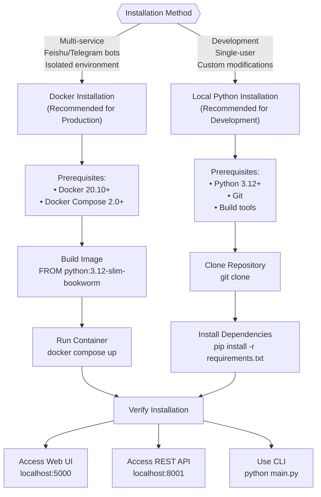
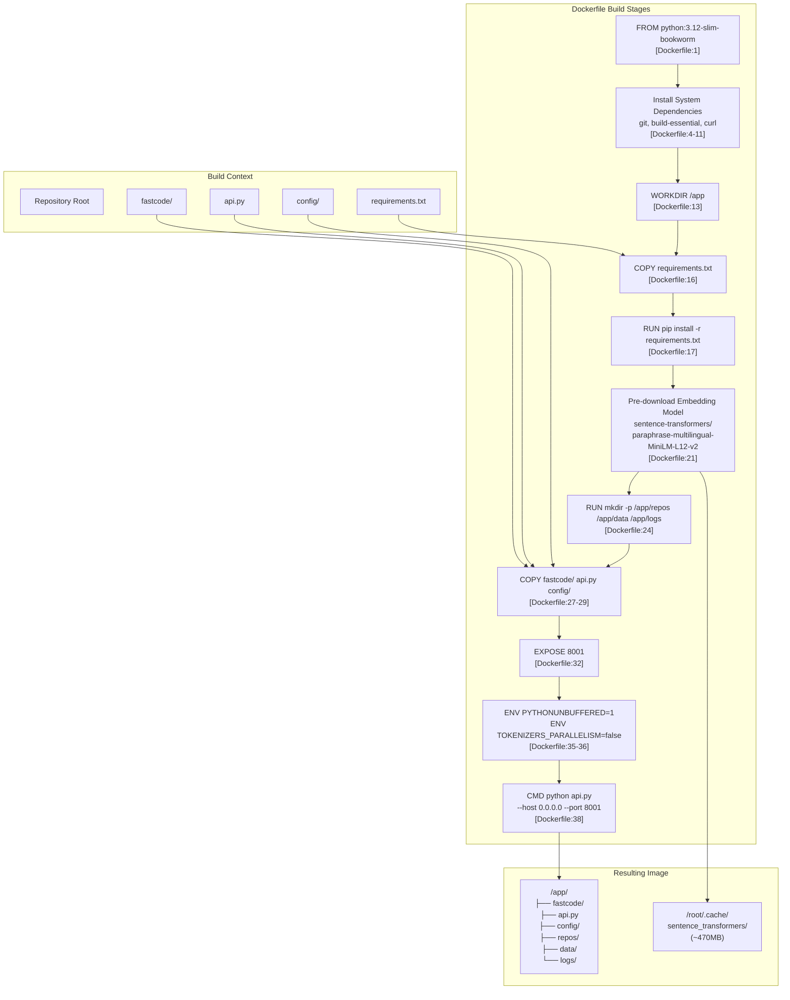
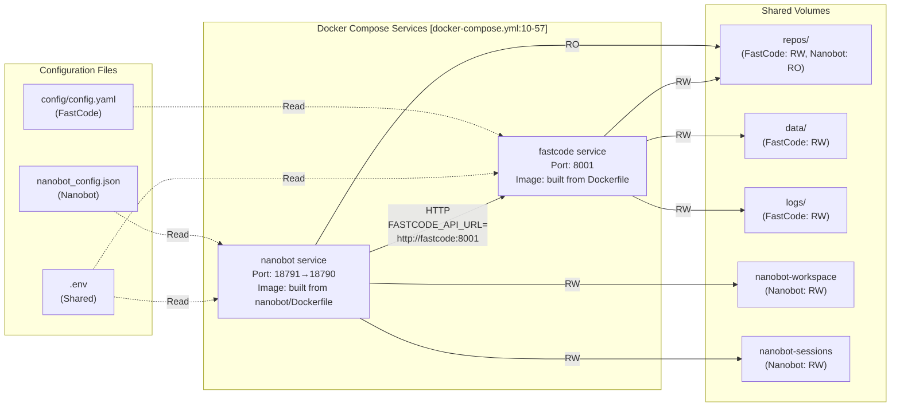
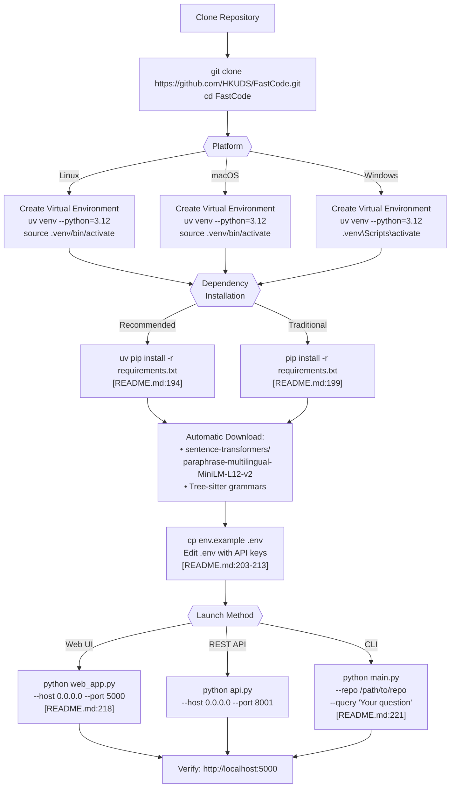

<!-- source: DeepWiki mcp.deepwiki.com · repo HKUDS/FastCode · page 2.1 Installation · fetched 2026-11-09 -->

# Installation

<details>
<summary>Relevant source files</summary>

The following files were used as context for generating this wiki page:

- [README.md](README.md)
- [requirements.txt](requirements.txt)

</details>


This page provides comprehensive instructions for installing FastCode on your system. It covers both Docker-based deployment (recommended for production and multi-service setups) and local Python installation (recommended for development and single-user scenarios).

For information about configuring environment variables and API keys after installation, see [Environment Configuration](#2.2). For deployment in production environments, see [Docker Deployment](#7.1) and [Docker Compose Setup](#7.2).

---

## System Requirements

FastCode requires the following dependencies to function properly:

| Component | Minimum Version | Purpose |
|-----------|----------------|---------|
| **Python** | 3.12+ | Core runtime environment |
| **Git** | Any recent version | Repository cloning functionality |
| **Build Tools** | gcc/clang/MSVC | Tree-sitter grammar compilation |
| **Memory** | 4 GB RAM | Embedding model and index operations |
| **Disk Space** | 2 GB | Model cache, indexes, and repositories |

**Platform Support:**
- ✅ Linux (Ubuntu 20.04+, Debian 11+, RHEL 8+)
- ✅ macOS (10.15+, including Apple Silicon M1/M2/M3)
- ✅ Windows (10/11, both native and WSL)

Sources: [README.md:164-346](), [Dockerfile:1-11]()

---

## Installation Methods Overview

FastCode provides two primary installation methods, each optimized for different use cases:



**Docker Installation** ([Dockerfile:1-39](), [docker-compose.yml:1-61]())
- Pre-configured environment with all dependencies
- Multi-service orchestration (FastCode + Nanobot)
- Persistent volumes for data, repos, and logs
- Automatic model pre-download during build
- Suitable for production deployments and bot integrations

**Local Python Installation** ([README.md:168-348]())
- Direct access to source code for modifications
- Faster development iteration cycle
- Platform-specific optimizations available
- Suitable for single-user scenarios and development

Sources: [README.md:162-164](), [Dockerfile:1-39](), [docker-compose.yml:1-61]()

---

## Docker Installation (Recommended)

Docker installation provides an isolated, reproducible environment with all dependencies pre-configured. This method is recommended for production deployments, multi-service setups (FastCode + Nanobot), and users who want a turnkey solution.

### Understanding the Docker Build Process

The following diagram illustrates how the Dockerfile constructs the FastCode image, showing the actual files and directories involved:



**Key Build Optimizations:**
- **Layer Caching:** `requirements.txt` is copied and installed before application code ([Dockerfile:16-17]()), ensuring dependency installation layers are cached even when code changes
- **Model Pre-download:** The embedding model is downloaded during build ([Dockerfile:21]()), not at runtime, reducing container startup time from minutes to seconds
- **Minimal Base Image:** Uses `python:3.12-slim-bookworm` ([Dockerfile:1]()) to minimize image size while providing necessary system libraries

Sources: [Dockerfile:1-39]()

### Building and Running with Docker

#### Single-Service Deployment (FastCode Only)

```bash
# Clone the repository
git clone https://github.com/HKUDS/FastCode.git
cd FastCode

# Create .env file (see Environment Configuration page #2.2)
cp env.example .env
# Edit .env with your API keys and model settings

# Build the Docker image
docker build -t fastcode:latest .

# Run the container
docker run -d \
  --name fastcode \
  -p 8001:8001 \
  -v $(pwd)/.env:/app/.env:ro \
  -v $(pwd)/config:/app/config:ro \
  -v $(pwd)/data:/app/data \
  -v $(pwd)/repos:/app/repos \
  -v $(pwd)/logs:/app/logs \
  fastcode:latest

# Verify the container is running
docker ps | grep fastcode

# View logs
docker logs -f fastcode
```

**Volume Mounts Explained:**

| Host Path | Container Path | Access | Purpose |
|-----------|---------------|--------|---------|
| `./.env` | `/app/.env` | Read-only | API keys and model configuration |
| `./config` | `/app/config` | Read-only | FastCode system configuration |
| `./data` | `/app/data` | Read-write | Vector indexes and cache |
| `./repos` | `/app/repos` | Read-write | Cloned repositories |
| `./logs` | `/app/logs` | Read-write | Application logs |

Sources: [Dockerfile:24-38](), [docker-compose.yml:18-26]()

#### Multi-Service Deployment (FastCode + Nanobot)

For deployments that include Feishu/Telegram bot integration via Nanobot, use Docker Compose:

```bash
# One-command launch (recommended)
./run_nanobot.sh

# The script automatically:
# 1. Builds images if not present
# 2. Generates nanobot_config.json if missing
# 3. Starts both services
# 4. Shows status and health check
```

The `docker-compose.yml` orchestrates two services:



**Service Communication:**
- The Nanobot container communicates with FastCode via internal Docker network using `http://fastcode:8001` ([docker-compose.yml:53]())
- No public IP or webhook configuration required for Feishu integration
- Both services share the `.env` file for API keys ([docker-compose.yml:20](), [docker-compose.yml:42]())

For detailed Nanobot setup and Feishu/Telegram configuration, see [Nanobot Integration](#6.4).

Sources: [docker-compose.yml:1-61](), [README.md:610-763]()

---

## Local Python Installation

Local installation provides direct access to source code, enabling rapid development iteration and custom modifications. This method is recommended for developers contributing to FastCode or users who need fine-grained control over the environment.

### Platform-Specific Installation Flow

The following diagram shows the actual commands and files involved in local installation across different platforms:



Sources: [README.md:168-348]()

### Step-by-Step Installation Instructions

#### 1. Clone the Repository

```bash
git clone https://github.com/HKUDS/FastCode.git
cd FastCode
```

#### 2. Install Dependencies

**Option A: Using `uv` (Recommended)**

[uv](https://github.com/astral-sh/uv) provides significantly faster dependency resolution and installation compared to pip:

```bash
# Install uv
pip install uv

# Create virtual environment
uv venv --python=3.12

# Activate environment
# On Linux/macOS:
source .venv/bin/activate
# On Windows:
.venv\Scripts\activate

# Install dependencies (faster than pip)
uv pip install -r requirements.txt
```

**Option B: Using `pip` (Traditional)**

```bash
# Create virtual environment (optional but recommended)
python -m venv .venv
source .venv/bin/activate  # Linux/macOS
# or
.venv\Scripts\activate  # Windows

# Install dependencies
pip install -r requirements.txt
```

**What Gets Installed:**

The `requirements.txt` file includes the following major dependencies:

| Package | Version | Purpose |
|---------|---------|---------|
| `fastapi[standard]` | 0.115.6 | REST API framework ([api.py:1]()) |
| `sentence-transformers` | 3.3.1 | Code embedding generation |
| `faiss-cpu` | 1.9.0.post1 | Vector similarity search |
| `chromadb` | 0.5.23 | Alternative vector store |
| `tree-sitter` | 0.23.2 | AST parsing across 8 languages |
| `redis` | 5.2.1 | Optional distributed caching |
| `tiktoken` | 0.8.0 | Token counting for LLM calls |
| `rank-bm25` | 0.2.2 | Keyword search (BM25 algorithm) |

Sources: [README.md:186-200]()

#### 3. Configure Environment Variables

```bash
# Create .env file from template
cp env.example .env

# Edit with your preferred editor
nano .env  # Linux/macOS
# or
notepad .env  # Windows
```

Minimal `.env` configuration:

```env
OPENAI_API_KEY=your_api_key_here
MODEL=gpt-4-turbo
BASE_URL=https://api.openai.com/v1
```

For complete environment configuration options, see [Environment Configuration](#2.2).

Sources: [README.md:203-213]()

#### 4. Launch FastCode

**Web UI (Recommended for Interactive Use):**

```bash
python web_app.py --host 0.0.0.0 --port 5000
```

Access at: `http://localhost:5000`

**REST API (Recommended for Programmatic Access):**

```bash
python api.py --host 0.0.0.0 --port 8001
```

API documentation at: `http://localhost:8001/docs`

**Command-Line Interface:**

```bash
# Single repository query
python main.py --repo /path/to/repo --query "Your question here"

# Multi-repository query
python main.py --repos /path/to/repo1 /path/to/repo2 --query "Your question"
```

Sources: [README.md:215-222](), [README.md:355-386]()

### Platform-Specific Considerations

#### Apple Silicon (M1/M2/M3)

FastCode is fully compatible with ARM architecture. All dependencies, including `faiss-cpu`, have native ARM builds.

```bash
# No special configuration needed
pip install -r requirements.txt
```

Sources: [README.md:282]()

#### Windows

**Common Issues and Solutions:**

1. **SSL Certificate Errors:**
   ```cmd
   pip install --upgrade certifi
   ```

2. **Permission Errors:**
   - Run Command Prompt or PowerShell as Administrator

3. **FAISS Installation Failure:**
   ```cmd
   pip install faiss-cpu --no-cache-dir
   ```

4. **Line Ending Issues for Bash Scripts:**
   - Use Git Bash or WSL for `./run_nanobot.sh`
   - Ensure `.sh` files use LF line endings (enforced by `.gitattributes`)

Sources: [README.md:342-346]()

---

## Post-Installation Verification

After installation, verify that FastCode is working correctly:

### 1. Check System Status

**For Docker Installation:**

```bash
# Check container health
docker ps | grep fastcode

# View logs
docker logs -f fastcode

# Check API health endpoint
curl http://localhost:8001/health
```

**For Local Installation:**

```bash
# Start API server
python api.py --host 0.0.0.0 --port 8001

# In another terminal, check health
curl http://localhost:8001/health
```

Expected response:

```json
{
  "status": "healthy",
  "version": "2.0.0",
  "timestamp": "2024-01-15T10:30:00Z"
}
```

### 2. Load and Index a Test Repository

**Using Web UI:**

1. Navigate to `http://localhost:5000`
2. Enter a repository URL (e.g., `https://github.com/octocat/Hello-World`)
3. Click "Load and Index Repository"
4. Wait for indexing to complete
5. Ask a test question: "What files are in this repository?"

**Using REST API:**

```bash
# Load and index a repository
curl -X POST "http://localhost:8001/load-and-index" \
  -H "Content-Type: application/json" \
  -d '{
    "source": "https://github.com/octocat/Hello-World",
    "is_url": true
  }'

# Query the repository
curl -X POST "http://localhost:8001/query" \
  -H "Content-Type: application/json" \
  -d '{
    "question": "What files are in this repository?",
    "multi_turn": false
  }'
```

**Using CLI:**

```bash
python main.py \
  --repo https://github.com/octocat/Hello-World \
  --query "What files are in this repository?"
```

Sources: [README.md:355-544]()

### 3. Verify Component Initialization

Check that all core components initialized successfully by examining logs:

**Expected Log Output:**

```
INFO - Loading configuration from config/config.yaml
INFO - Initializing CodeEmbedder with model: sentence-transformers/paraphrase-multilingual-MiniLM-L12-v2
INFO - Initializing VectorStore (type: faiss, metric: cosine)
INFO - CodeParser initialized for 8 languages
INFO - CacheManager initialized (backend: disk, directory: ./data/cache)
INFO - FastCode initialized successfully (version: 2.0.0)
INFO - API server running on http://0.0.0.0:8001
```

If you see errors related to missing dependencies, GPU/CUDA unavailability, or configuration issues, see [Installation Issues](#11.1) for troubleshooting guidance.

---

## Directory Structure After Installation

Understanding the directory structure helps with troubleshooting and maintenance:

```
FastCode/
├── fastcode/              # Core FastCode modules
│   ├── __init__.py        # Main FastCode class
│   ├── code_parser.py     # AST parsing for 8 languages
│   ├── code_indexer.py    # Multi-level indexing
│   ├── code_embedder.py   # Semantic embeddings
│   ├── vector_store.py    # Vector storage abstraction
│   ├── hybrid_retriever.py # Hybrid search
│   ├── answer_generator.py # LLM integration
│   ├── iterative_agent.py  # Agent-based retrieval
│   └── ...
├── api.py                 # REST API server
├── web_app.py             # Web UI server
├── main.py                # CLI entry point
├── config/
│   └── config.yaml        # System configuration
├── .env                   # Environment variables (created by user)
├── requirements.txt       # Python dependencies
├── Dockerfile             # Docker build instructions
├── docker-compose.yml     # Multi-service orchestration
├── repos/                 # Cloned repositories (created at runtime)
├── data/                  # Vector indexes and cache (created at runtime)
│   ├── repos/             # Per-repository data
│   │   └── <repo_name>/
│   │       ├── faiss.index
│   │       ├── metadata.json
│   │       └── ...
│   └── cache/             # Query and embedding cache
└── logs/                  # Application logs (created at runtime)
    └── fastcode.log
```

**Runtime Directories:**

The following directories are automatically created during first run:

- `repos/` - Stores cloned Git repositories ([Dockerfile:24]())
- `data/` - Vector indexes, code graphs, and cache ([Dockerfile:24]())
- `logs/` - Application logs ([Dockerfile:24]())

For Docker deployments, these directories are mounted as volumes to persist data between container restarts ([docker-compose.yml:18-26]()).

Sources: [Dockerfile:24-29](), [docker-compose.yml:18-26]()

---

## Next Steps

After successful installation:

1. **Configure API Keys and Models** - See [Environment Configuration](#2.2) for detailed instructions on setting up OpenAI, OpenRouter, or local Ollama models

2. **Index Your First Repository** - Follow the [Quick Start Guide](#2.3) to load and query your first codebase

3. **Customize Configuration** - Review [Configuration](#8) to tune retrieval parameters, adjust token limits, and enable advanced features like agency mode

4. **Explore Interfaces** - Try the [Web Interface](#6.2), [REST API](#6.1), or [Command Line Interface](#6.3) to find your preferred workflow

5. **Deploy to Production** - For production deployments, review [Production Considerations](#7.4) for security, performance tuning, and operational best practices

Sources: [README.md:138-160]()

---

