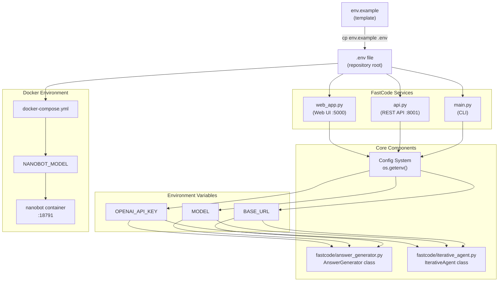
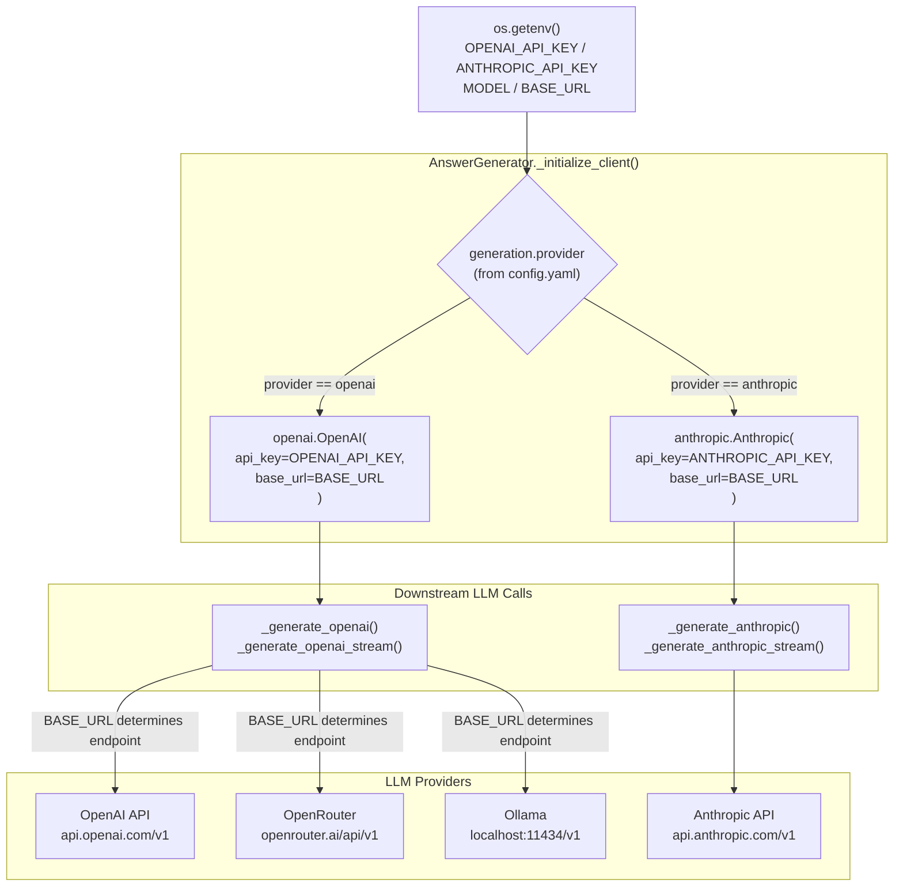
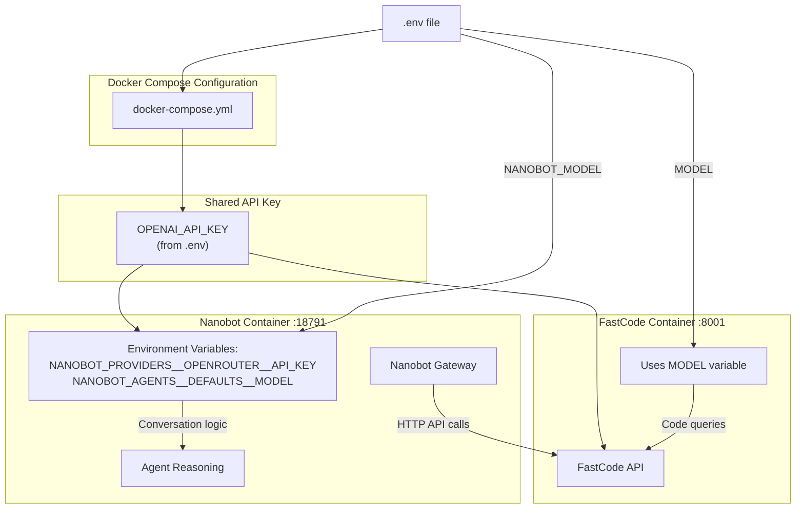
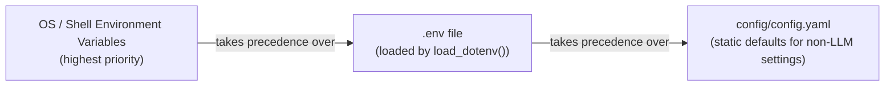

<!-- source: DeepWiki mcp.deepwiki.com · repo HKUDS/FastCode · page 2.2 Environment Configuration · fetched 2026-11-09 -->

# Environment Configuration

<details>
<summary>Relevant source files</summary>

The following files were used as context for generating this wiki page:

- [README.md](README.md)
- [config/config.yaml](config/config.yaml)
- [fastcode/answer_generator.py](fastcode/answer_generator.py)
- [fastcode/embedder.py](fastcode/embedder.py)

</details>


This page covers the configuration of environment variables in the `.env` file for LLM provider integration. Environment variables control which LLM provider FastCode uses (OpenAI, OpenRouter, or Ollama), the model selection, API authentication, and endpoint URLs.

For system-wide configuration options like retrieval weights, caching, and indexing parameters, see [Configuration](#8). For instructions on installation and dependency setup, see [Installation](#2.1).

## Overview

FastCode requires three core environment variables to connect to LLM providers:

| Variable | Purpose | Required |
|----------|---------|----------|
| `OPENAI_API_KEY` | Authentication token for OpenAI-compatible providers | Yes |
| `MODEL` | Model identifier (e.g., `gpt-4`, `qwen3-coder-30b_fastcode`) | Yes |
| `BASE_URL` | API endpoint URL for the LLM provider | Yes |
| `ANTHROPIC_API_KEY` | Authentication token when `provider: "anthropic"` is set in `config.yaml` | Only for Anthropic |
| `NANOBOT_MODEL` | Model used by Nanobot for Feishu bot integration | No (Docker only) |

All three core variables (`OPENAI_API_KEY`, `MODEL`, `BASE_URL`) are read directly via `os.getenv()` in `AnswerGenerator.__init__()` after calling `load_dotenv()`. The `config/config.yaml` generation section includes the comment: *"NOTE: model and base_url are read from environment variables (MODEL, BASE_URL)"* — these two values are never pulled from `config.yaml`.

An additional variable `ANTHROPIC_API_KEY` can be set when using the `anthropic` provider. These variables are defined in the `.env` file at the repository root. FastCode provides `env.example` as a template.

Sources: [fastcode/answer_generator.py:43-51](), [config/config.yaml:142-151](), [README.md:202-213]()

## Environment Variable Loading

### Configuration Loading Flow



**Environment Variable Loading in Code**

`AnswerGenerator.__init__()` calls `load_dotenv()` then reads `os.getenv("OPENAI_API_KEY")`, `os.getenv("ANTHROPIC_API_KEY")`, `os.getenv("BASE_URL")`, and `os.getenv("MODEL")`. The provider selection (`openai` vs `anthropic`) is read from `config.yaml`'s `generation.provider` key; the actual credentials and endpoint come exclusively from environment variables.

Sources: [fastcode/answer_generator.py:43-51](), [fastcode/answer_generator.py:53-69](), [config/config.yaml:142-151](), [README.md:610-677]()

## Provider-Specific Configuration

### OpenAI Configuration

For OpenAI's GPT models (GPT-4, GPT-4 Turbo, GPT-3.5):

```env
OPENAI_API_KEY=sk-proj-...
MODEL=gpt-4
BASE_URL=https://api.openai.com/v1
```

| Parameter | Value | Notes |
|-----------|-------|-------|
| `OPENAI_API_KEY` | Starts with `sk-proj-` or `sk-` | Obtain from platform.openai.com |
| `MODEL` | `gpt-4`, `gpt-4-turbo`, `gpt-3.5-turbo` | Model identifier |
| `BASE_URL` | `https://api.openai.com/v1` | OpenAI API endpoint |

**Example from README:**

[README.md:559-563]() demonstrates OpenAI configuration:

```env
OPENAI_API_KEY=sk-...
MODEL=gpt-4
BASE_URL=https://api.openai.com/v1
```

**Sources:** [README.md:556-564](), [env.example:3-5]()

### OpenRouter Configuration

OpenRouter provides access to multiple model providers (Google Gemini, Anthropic Claude, Meta Llama) through a unified API:

```env
OPENAI_API_KEY=sk-or-v1-...
MODEL=google/gemini-flash-1.5
BASE_URL=https://openrouter.ai/api/v1
```

| Parameter | Value | Notes |
|-----------|-------|-------|
| `OPENAI_API_KEY` | Starts with `sk-or-v1-` | Obtain from openrouter.ai |
| `MODEL` | `google/gemini-flash-1.5`, `anthropic/claude-3-opus` | Provider-prefixed model name |
| `BASE_URL` | `https://openrouter.ai/api/v1` | OpenRouter API endpoint |

**Common OpenRouter Models:**

| Model Identifier | Provider | Use Case |
|-----------------|----------|----------|
| `google/gemini-3-flash-preview` | Google | Fast, cost-effective (recommended in [env.example:8]()) |
| `google/gemini-flash-1.5` | Google | Production-ready Gemini |
| `anthropic/claude-3-opus` | Anthropic | High-quality reasoning |
| `meta-llama/llama-3-70b` | Meta | Open-source alternative |

**Example from README:**

[README.md:577-583]() shows OpenRouter configuration with Gemini:

```env
OPENAI_API_KEY=sk-or-...
MODEL=google/gemini-flash-1.5
BASE_URL=https://openrouter.ai/api/v1
```

**Sources:** [README.md:576-584](), [env.example:7-9]()

### Ollama (Local Models)

For running models locally via Ollama:

```env
OPENAI_API_KEY=ollama
MODEL=qwen3-coder-30b_fastcode
BASE_URL=http://localhost:11434/v1
```

| Parameter | Value | Notes |
|-----------|-------|-------|
| `OPENAI_API_KEY` | `ollama` | Fixed value for local models |
| `MODEL` | `qwen3-coder-30b_fastcode` | Local model name |
| `BASE_URL` | `http://localhost:11434/v1` | Ollama server endpoint |

**Ollama Setup Requirements:**

1. Install Ollama: `curl -fsSL https://ollama.com/install.sh | sh`
2. Pull the model: `ollama pull qwen3-coder-30b_fastcode`
3. Verify server is running: `curl http://localhost:11434/v1/models`

**Example from README:**

[README.md:587-593]() demonstrates local Ollama configuration:

```env
OPENAI_API_KEY=ollama
MODEL=qwen3-coder-30b_fastcode
BASE_URL=http://localhost:11434/v1
```

**Sources:** [README.md:586-594](), [env.example:11-14]()

## Provider Selection Architecture

### How FastCode Routes Requests to LLM Providers

**Provider routing via `AnswerGenerator._initialize_client()`**



`AnswerGenerator._initialize_client()` branches on `generation.provider` from `config.yaml`. When `provider` is `"openai"`, it constructs `openai.OpenAI(api_key=..., base_url=...)` — the same client code handles OpenAI, OpenRouter, and Ollama because all three expose an OpenAI-compatible endpoint. The `BASE_URL` value alone determines which service receives the request.

Sources: [fastcode/answer_generator.py:53-69](), [fastcode/answer_generator.py:635-663](), [fastcode/answer_generator.py:691-715](), [README.md:552-594]()

## Nanobot Model Configuration

### Dual-Model Architecture for Docker Deployment

When deploying FastCode with Nanobot (for Feishu/Telegram bot integration), the system uses **two separate models**:

| Model Variable | Purpose | Used By |
|----------------|---------|---------|
| `MODEL` | Code analysis and query answering | FastCode container |
| `NANOBOT_MODEL` | Agent reasoning and conversation management | Nanobot container |

**Configuration in `.env`:**

```env
# FastCode Model (Code Analysis)
OPENAI_API_KEY=sk-or-v1-xxx
BASE_URL=https://openrouter.ai/api/v1
MODEL=google/gemini-3-flash-preview

# Nanobot Model (Agent Reasoning / Feishu Conversations)
NANOBOT_MODEL=minimax/minimax-m2.1
```

### Environment Variable Injection via Docker Compose



**Docker Compose Configuration:**

[docker-compose.yml]() injects environment variables into containers:

```yaml
services:
  fastcode:
    environment:
      - OPENAI_API_KEY=${OPENAI_API_KEY}
      - MODEL=${MODEL}
      - BASE_URL=${BASE_URL}
  
  nanobot:
    environment:
      - NANOBOT_PROVIDERS__OPENROUTER__API_KEY=${OPENAI_API_KEY}
      - NANOBOT_AGENTS__DEFAULTS__MODEL=${NANOBOT_MODEL}
```

**Why Separate Models?**

1. **Cost Optimization:** Use a cheaper model (e.g., `minimax-m2.1`) for simple agent reasoning, reserve expensive models (e.g., `gemini-3-flash`) for code analysis
2. **Performance Tuning:** Different models excel at different tasks (conversation vs. code understanding)
3. **Token Management:** Agent reasoning uses fewer tokens than code analysis

**Example Configuration from README:**

[README.md:640-654]() demonstrates the dual-model setup:

```env
# ===== Shared API Configuration =====
OPENAI_API_KEY=sk-or-v1-xxx
BASE_URL=https://openrouter.ai/api/v1

# ===== FastCode Model (Code Analysis) =====
MODEL=google/gemini-3-flash-preview

# ===== Nanobot Model (Agent Reasoning / Feishu Conversations) =====
NANOBOT_MODEL=minimax/minimax-m2.1
```

**Sources:** [README.md:640-677](), [env.example:17-18]()

## Configuration Validation

### Verifying Environment Variables

After creating the `.env` file, verify configuration using the CLI:

```bash
# Test configuration with a simple query
python main.py --repo ./repos/sample --query "Test query"
```

Expected output on success:
- No authentication errors
- Model responds with an answer
- Token counts displayed

Common error messages:

| Error | Cause | Solution |
|-------|-------|----------|
| `AuthenticationError: Incorrect API key` | Invalid `OPENAI_API_KEY` | Check API key from provider dashboard |
| `Connection error` | Wrong `BASE_URL` | Verify endpoint URL |
| `Model not found` | Invalid `MODEL` identifier | Check model availability on provider |
| `Name or service not known` (Ollama) | Ollama server not running | Start Ollama: `ollama serve` |

### Environment Variable Precedence

`load_dotenv()` (from the `python-dotenv` library) does **not** override variables already present in the OS environment. The effective lookup order is:

**Precedence diagram (highest → lowest)**



**Example:** If `MODEL=gpt-3.5-turbo` is already exported in the shell environment and `.env` contains `MODEL=gpt-4`, FastCode uses `gpt-3.5-turbo` from the shell. To force the `.env` value, either unset the shell variable or pass `override=True` to `load_dotenv()`.

Note: `MODEL` and `BASE_URL` have **no** fallback in `config.yaml` — if they are unset in both the environment and `.env`, `os.getenv()` returns `None` and the LLM client will fail to initialize.

Sources: [fastcode/answer_generator.py:43-51](), [README.md:202-223](), [config/config.yaml:142-151]()

## Multi-Provider Configuration Table

### Complete Configuration Reference

| Provider | OPENAI_API_KEY Format | Example MODEL | BASE_URL | Notes |
|----------|----------------------|---------------|----------|-------|
| **OpenAI** | `sk-proj-...` | `gpt-4`, `gpt-4-turbo` | `https://api.openai.com/v1` | Official OpenAI models |
| **OpenRouter** | `sk-or-v1-...` | `google/gemini-3-flash-preview` | `https://openrouter.ai/api/v1` | Unified access to multiple providers |
| **Ollama** | `ollama` | `qwen3-coder-30b_fastcode` | `http://localhost:11434/v1` | Local models, no API key required |

**Model Recommendations by Use Case:**

| Use Case | Recommended Model | Provider | Configuration |
|----------|-------------------|----------|---------------|
| **Production** | `google/gemini-3-flash-preview` | OpenRouter | [env.example:8]() |
| **Development** | `gpt-4` | OpenAI | [README.md:211]() |
| **Cost-Sensitive** | `google/gemini-flash-1.5` | OpenRouter | [README.md:269]() |
| **Privacy/Local** | `qwen3-coder-30b_fastcode` | Ollama | [README.md:329]() |
| **High Accuracy** | `gpt-4-turbo` | OpenAI | [README.md:385]() |

**Sources:** [README.md:552-594](), [env.example:1-18]()

## Security Considerations

### API Key Protection

**Best Practices:**

1. **Never commit `.env` to version control:**
   - The repository includes `.env` in [.gitignore]()
   - Use [env.example:1-18]() as a template

2. **Restrict file permissions:**
   ```bash
   chmod 600 .env  # Read/write for owner only
   ```

3. **Docker secrets (production):**
   ```yaml
   services:
     fastcode:
       secrets:
         - openai_api_key
   secrets:
     openai_api_key:
       file: ./secrets/openai_api_key.txt
   ```

4. **Environment variable injection (CI/CD):**
   ```bash
   export OPENAI_API_KEY=$(vault read -field=key secret/openai)
   python api.py
   ```

**Sources:** [README.md:202-213](), [env.example:1-18]()

## Related Configuration

For additional configuration beyond environment variables:

- **System-wide settings:** See [Configuration](#8) for `config/config.yaml` options
- **Retrieval parameters:** See [Retrieval Configuration](#8.6) for semantic/keyword weights
- **Agent settings:** See [Agent Configuration](#8.9) for iteration limits and confidence thresholds
- **Caching:** See [Cache Configuration](#8.10) for disk/Redis backend setup
- **LLM provider details:** See [LLM Provider Support](#12.5) for comprehensive provider documentation

**Sources:** [config/config.yaml:1-207]()

---

