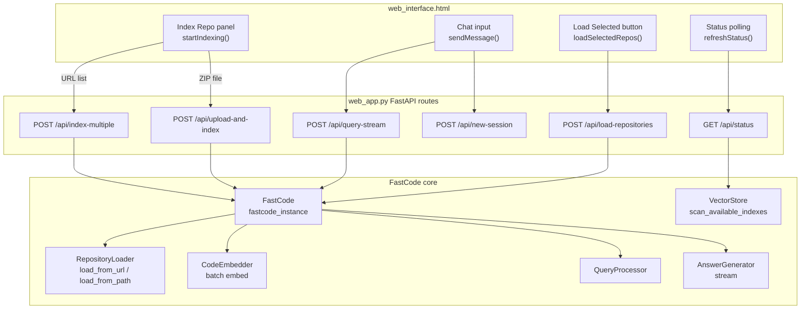
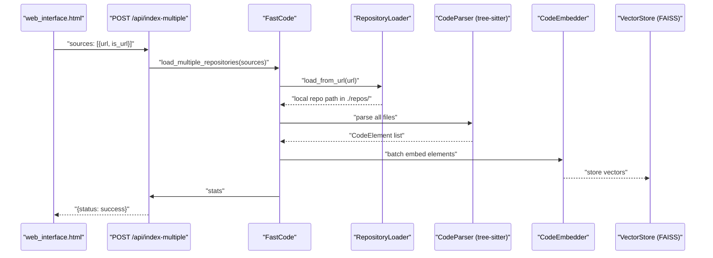
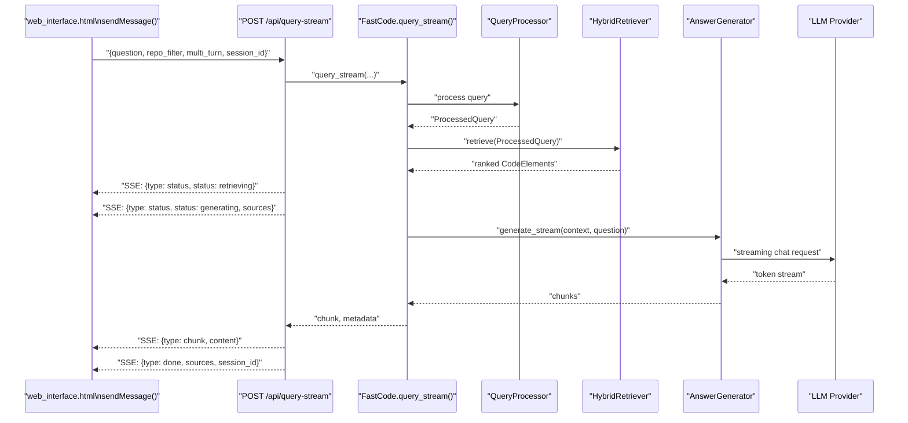

<!-- source: DeepWiki mcp.deepwiki.com · repo HKUDS/FastCode · page 2.3 Quick Start Guide · fetched 2026-11-09 -->

# Quick Start Guide

<details>
<summary>Relevant source files</summary>

The following files were used as context for generating this wiki page:

- [README.md](README.md)
- [web_app.py](web_app.py)
- [web_interface.html](web_interface.html)

</details>


This page walks through a complete end-to-end workflow: starting the FastCode web server, indexing a repository, and making your first query through the web interface. It assumes you have already installed dependencies and configured your environment.

- For installation steps, see [Installation](#2.1)
- For environment variables and API key setup, see [Environment Configuration](#2.2)
- For the full REST API reference, see [REST API](#6.1)
- For MCP server integration with Cursor or Claude Code, see [MCP Server](#6.3)

---

## Starting the Web Server

The primary entry point is `web_app.py`, which starts a FastAPI application served by Uvicorn.

```bash
python web_app.py --host 0.0.0.0 --port 5777
```

**Arguments:**

| Argument | Default | Description |
|---|---|---|
| `--host` | `127.0.0.1` | Network interface to bind. Use `0.0.0.0` to expose on all interfaces. |
| `--port` | `5777` | TCP port to listen on. |
| `--reload` | off | Enable Uvicorn auto-reload for development. |

On startup, the `startup_event` handler [web_app.py:123-128]() instantiates the global `FastCode` object and initializes all subsystems (embedder, vector store, cache manager). This takes several seconds on first run while the embedding model loads.

Once running, open `http://localhost:5777` in a browser to access the web interface (`web_interface.html`).

Sources: [web_app.py:814-829](), [web_app.py:123-128]()

---

## End-to-End Flow

The following diagram maps the actions a user takes in the UI to the underlying API calls and engine components.

**Diagram: User actions → API routes → FastCode engine**



Sources: [web_app.py:253-276](), [web_app.py:429-457](), [web_app.py:515-592](), [web_interface.html:1012-1040]()

---

## Step 1 — Index a Repository

### Option A: Index from a GitHub URL

1. Click **Index Repo** in the sidebar. The Add Repo panel appears.
2. Make sure the **URL** tab is selected (it is by default).
3. Paste one or more GitHub URLs, one per line, into the text area.
4. Click **Index**.

The UI calls `startIndexing()` [web_interface.html:1012-1040](), which sends a `POST /api/index-multiple` request with the list of sources. The server dispatches to `fastcode_instance.load_multiple_repositories()`, which clones each URL into `./repos/` and then runs the full parsing and embedding pipeline.

**Request body sent to `/api/index-multiple`:**
```json
{
  "sources": [
    { "source": "https://github.com/owner/repo", "is_url": true }
  ]
}
```

### Option B: Index from a ZIP archive

1. Click **Index Repo** and switch to the **Upload ZIP** tab.
2. Click the upload area and select one or more `.zip` files.
3. Click **Index**.

Each file is uploaded via `POST /api/upload-and-index` [web_app.py:429-457](). The server extracts the archive into `./repos/<repo_name>/`, loads it as a local path, indexes it, then cleans up the temporary extraction directory.

**File size limit:** 100 MB per ZIP. The repo name is derived from the ZIP filename with `-main` / `-master` suffixes stripped automatically [web_app.py:355-362]().

### What happens during indexing

**Diagram: Indexing pipeline triggered by /api/index-multiple**



After indexing, the vector store's scan cache is invalidated [web_app.py:265-267]() so the sidebar immediately reflects the new repository.

Sources: [web_app.py:253-276](), [web_app.py:429-457](), [web_interface.html:1012-1040]()

---

## Step 2 — Select a Repository

After indexing, the sidebar's **Repositories** tab lists all available (on-disk indexed) repositories. Each entry shows the repo name, file count, and size.

- Click a repository card to toggle selection. Selected repos are highlighted in teal and shown as badges in the top header bar.
- If you have previously indexed repos that are not loaded into memory, click **Load Selected** to call `POST /api/load-repositories` [web_app.py:306-331](), which restores them from the saved FAISS index and metadata files without re-parsing.

The message input box and send button remain disabled until at least one repo is selected and loaded (`repo_indexed` is `true`).

Sources: [web_interface.html:536-553](), [web_interface.html:555-569](), [web_app.py:306-331]()

---

## Step 3 — Ask a Question

Type a question in the input box at the bottom of the page and press **Enter** (or the send button).

**Example questions:**
- `Where is the authentication logic implemented?`
- `How does the payment processing flow work?`
- `What files would be affected if I change the User model?`
- `Explain the dependency between module A and module B`

### Single-turn vs. Multi-turn mode

A toggle in the input bar switches between **Single-turn** and **Multi-turn** mode [web_interface.html:374-378]().

| Mode | `multi_turn` value | Behaviour |
|---|---|---|
| Single-turn (default) | `false` | Each query is independent. No previous context is used. |
| Multi-turn | `true` | Previous Q&A in the same session is included in the query context for reference resolution and continuity. |

Both modes create a session ID automatically. Multi-turn sessions are shown with a `multi` badge in the History tab.

### How a query flows through the system

**Diagram: Query request → streaming response via /api/query-stream**



The browser renders streamed tokens progressively using `marked.parse()` for Markdown formatting [web_interface.html:418-446](). Source file citations appear below the answer as badge chips once the stream completes.

Sources: [web_app.py:515-592](), [web_interface.html:571-763]()

---

## Step 4 — Review the Response

Each assistant response includes:

- **Answer text** — rendered Markdown with syntax-highlighted code blocks.
- **Sources panel** — file path badges showing which code elements were retrieved. Each badge includes the repository name, file path, and line range where applicable (e.g. `my-repo: auth/login.py (45-92)`).

The session ID is displayed in the top-right corner of the chat header (`ID: <session_id>`).

---

## Session History

The **History** tab in the sidebar lists all saved sessions. Clicking a session restores all turns into the chat view and sets the active session ID, allowing you to continue from where you left off [web_interface.html:955-979]().

Sessions can be deleted individually with the trash icon on hover.

Sources: [web_interface.html:924-953](), [web_interface.html:955-979]()

---

## Alternative: Command-Line Interface

For scripting or one-off queries without the web server, use `main.py` directly:

```bash
# Single repository query
python main.py --repo /path/to/repo --query "Your question"

# Multi-repository query
python main.py --repos /path/to/repo1 /path/to/repo2 --query "Your question"

# With a specific model override
python main.py --repo /path/to/repo --query "Your question" --model gpt-4-turbo
```

This does not require a running server and skips the web interface entirely.

Sources: [README.md:376-389]()

---

## Alternative: MCP Server

If you use an AI coding assistant (Claude Code or Cursor), you can connect it to FastCode via the MCP protocol instead of the web interface. The MCP server exposes a `code_qa` tool that the assistant calls automatically. See [MCP Server](#6.3) for full setup instructions.

---

## Common First-Run Issues

| Symptom | Likely cause | Fix |
|---|---|---|
| Input box stays disabled after indexing | `repo_indexed` is `false`; repo not selected | Click the repo card to select it, then click **Load Selected** |
| Indexing spinner never stops | Network timeout cloning large repo | Use ZIP upload instead of URL |
| `FastCode not initialized` error | Server crashed on startup | Check logs in `./logs/web_app.log` for embedding model or API key errors |
| Empty answer / no sources | No `.env` file or wrong `OPENAI_API_KEY` | Verify environment variables per [Environment Configuration](#2.2) |
| Port already in use | Another process on port 5777 | Pass `--port 5778` (or any free port) |

Sources: [web_app.py:123-128](), [web_app.py:108-120]()

---

