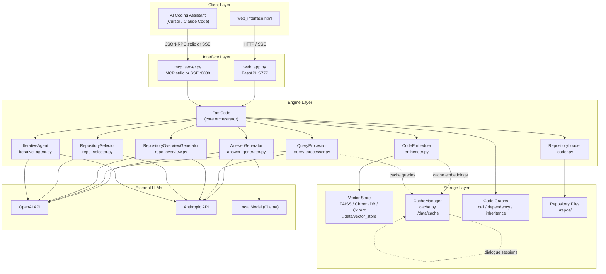
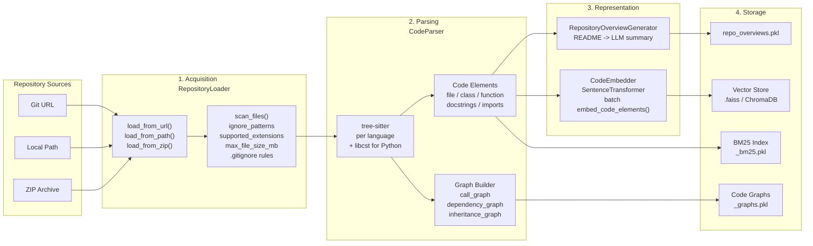
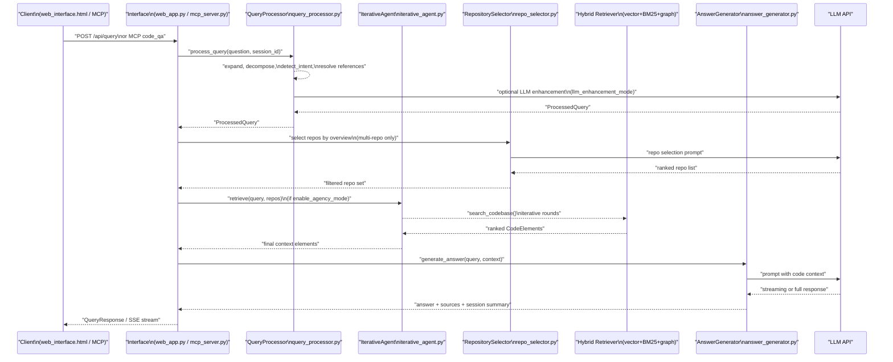
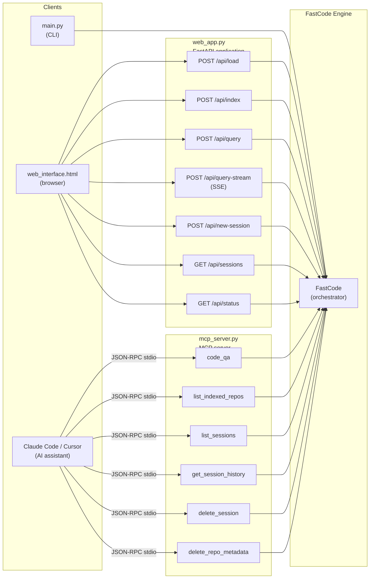
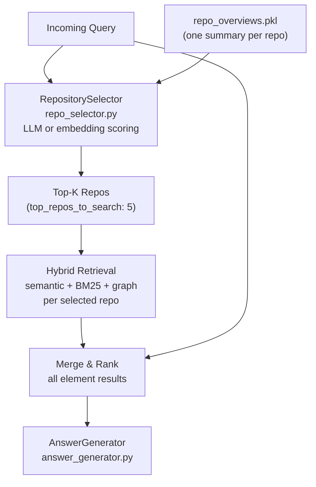
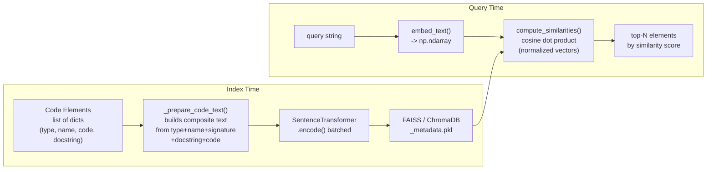

<!-- source: DeepWiki mcp.deepwiki.com · repo HKUDS/FastCode · page 3 System Architecture · fetched 2026-11-09 -->

# System Architecture

<details>
<summary>Relevant source files</summary>

The following files were used as context for generating this wiki page:

- [README.md](README.md)
- [config/config.yaml](config/config.yaml)
- [fastcode/embedder.py](fastcode/embedder.py)

</details>


This page describes how FastCode's major subsystems are organized and how they interact, from receiving a query through answer generation. It is intended as a structural reference for developers and integrators.

For the three-phase algorithmic framework in depth, see [Three-Phase Framework](#3.1). For details on individual components, see [Core Components](#4). For deployment topology, see [Deployment](#7).

---

## Layered Design

FastCode is organized into four distinct layers. Each layer has a clearly bounded responsibility, and communication between layers is one-directional during a query: clients call interfaces, interfaces call the engine, and the engine reads from storage and writes answers back upward.

**Top-Level Layer Diagram**



Sources: [README.md:77-116](), [config/config.yaml:1-205]()

---

## Component Roles

| Component | File | Class | Primary Responsibility |
|---|---|---|---|
| Core Orchestrator | `fastcode/` | `FastCode` | Wires together all sub-components; entry point for all queries |
| Repository Loader | `fastcode/loader.py` | `RepositoryLoader` | Clones/copies repos from URL, path, or ZIP into `./repos/` |
| Code Embedder | `fastcode/embedder.py` | `CodeEmbedder` | Generates `SentenceTransformer` embeddings for all code elements |
| Query Processor | `fastcode/query_processor.py` | `QueryProcessor` | Expands, decomposes, and optionally enhances queries via LLM |
| Answer Generator | `fastcode/answer_generator.py` | `AnswerGenerator` | Constructs prompts, manages token budget, calls LLM for final answer |
| Iterative Agent | `fastcode/iterative_agent.py` | `IterativeAgent` | Multi-round retrieval loop with confidence scoring |
| Overview Generator | `fastcode/repo_overview.py` | `RepositoryOverviewGenerator` | Summarizes repos via README + LLM for multi-repo selection |
| Repository Selector | `fastcode/repo_selector.py` | `RepositorySelector` | Selects relevant repos from overviews using LLM or embeddings |
| Cache Manager | `fastcode/cache.py` | `CacheManager` | Disk or Redis caching for embeddings, queries, and sessions |
| Web App | `web_app.py` | FastAPI app | REST API and SSE streaming endpoint at port 5777 |
| MCP Server | `mcp_server.py` | MCP server | JSON-RPC interface for AI coding assistants |

Sources: [config/config.yaml:1-10](), [fastcode/embedder.py:13-34](), [README.md:77-116]()

---

## Code Ingestion Pipeline

When a repository is loaded and indexed, data flows through four sequential stages. The output of this pipeline is a set of persistent artifacts: a FAISS (or ChromaDB/Qdrant) vector index, a BM25 keyword index, three code graphs, and an optional repository overview.

**Ingestion Pipeline: Source to Indexed Artifacts**



Sources: [README.md:85-116](), [config/config.yaml:9-97](), [fastcode/embedder.py:83-109]()

---

## Query Processing Pipeline

After repositories are indexed, incoming queries pass through a processing pipeline before retrieval and generation occur.

**Query-to-Answer Flow**



Sources: [README.md:919-935](), [config/config.yaml:98-160]()

---

## Three-Phase Framework

FastCode's design is organized around three conceptual phases that correspond to system-level subsystem groupings. These phases map directly to the components described above.

| Phase | Purpose | Key Components |
|---|---|---|
| **Semantic-Structural Code Representation** | Build a queryable, multi-granularity model of the codebase | `CodeParser`, `CodeEmbedder`, vector store, BM25 index, `GraphBuilder` |
| **Lightning-Fast Codebase Navigation** | Locate the most relevant code elements without loading entire files | `HybridRetriever`, `IterativeAgent`, `RepositorySelector`, code skimming |
| **Cost-Efficient Context Management** | Control token budget, iteration depth, and context selection | `IterativeAgent` confidence loop, `AnswerGenerator` token budgeting, `CacheManager` |

For detailed documentation on each phase, see [Three-Phase Framework](#3.1).

Sources: [README.md:79-116]()

---

## Storage Layout

The storage layer is organized around a `persist_directory` (default `./data/vector_store`) and a `cache_directory` (default `./data/cache`). Each indexed repository produces the following artifacts on disk:

```
./data/
  vector_store/
    <repo_name>.faiss          # FAISS flat or HNSW index
    <repo_name>_metadata.pkl   # Element metadata (file, line, type, etc.)
    <repo_name>_bm25.pkl       # BM25 index for keyword search
    <repo_name>_graphs.pkl     # Call/dependency/inheritance graphs (networkx)
    repo_overviews.pkl         # Per-repo overview summaries

./data/cache/
    embeddings/                # Cached embedding vectors (if cache_embeddings: true)
    queries/                   # Cached query results (if cache_queries: true)
    dialogue/                  # Session dialogue history (dialogue_ttl: 30 days)

./repos/
    <repo_name>/               # Cloned or extracted repository source files
```

Sources: [config/config.yaml:82-97](), [config/config.yaml:182-192](), [README.md:626-627]()

---

## Configuration Sections and Their Engine Targets

`config/config.yaml` is the single configuration file for the entire engine. Each top-level key maps to a specific component or subsystem.

| Config Section | Component Controlled | Key Settings |
|---|---|---|
| `repository` | `RepositoryLoader` | `clone_depth`, `max_file_size_mb`, `ignore_patterns`, `supported_extensions` |
| `parser` | Code parser (tree-sitter / libcst) | `extract_docstrings`, `extract_imports`, `compute_complexity` |
| `embedding` | `CodeEmbedder` | `model`, `device`, `batch_size`, `max_seq_length` |
| `indexing` | Code indexer | `levels` (file/class/function/documentation), `generate_repo_overview` |
| `vector_store` | Vector store backend | `type` (faiss/chromadb/qdrant), `persist_directory`, `index_type` |
| `retrieval` | `HybridRetriever`, `RepositorySelector` | `semantic_weight`, `keyword_weight`, `graph_weight`, `enable_agency_mode` |
| `query` | `QueryProcessor` | `expand_query`, `decompose_complex`, `llm_enhancement_mode` |
| `generation` | `AnswerGenerator` | `provider`, `max_context_tokens`, `context_rounds` |
| `agent.iterative` | `IterativeAgent` | `max_iterations`, `confidence_threshold`, `max_total_lines` |
| `cache` | `CacheManager` | `backend` (disk/redis), `ttl`, `dialogue_ttl` |
| `graph` | Graph builder | `build_call_graph`, `build_dependency_graph`, `build_inheritance_graph` |

Sources: [config/config.yaml:1-205]()

---

## Interface Layer Detail

FastCode exposes two independent server-side interfaces. Both interfaces delegate entirely to the same `FastCode` engine object — there is no functional difference in what each interface can do.

**Interface Layer: Entry Points**



Sources: [README.md:392-666]()

For complete endpoint documentation, see [REST API](#6.1) and [MCP Server](#6.3).

---

## Multi-Repository Architecture

When multiple repositories are indexed, FastCode uses a two-stage retrieval process to avoid searching all repositories on every query.

**Multi-Repository Selection Flow**



The `select_repos_by_overview` config flag (default `true`) enables this two-stage path. When `repo_selection_method` is `"llm"`, the `RepositorySelector` sends repo overviews to an LLM; when `"embedding"`, it uses semantic and BM25 scoring directly.

For detailed coverage of multi-repository support, see [Multi-Repository Support](#3.2).

Sources: [config/config.yaml:98-120](), [README.md:637-658]()

---

## Embedding and Vector Store Integration

The `CodeEmbedder` class in [fastcode/embedder.py:13-34]() uses a `SentenceTransformer` model (default: `paraphrase-multilingual-MiniLM-L12-v2`) with automatic device detection: CUDA → MPS → CPU, set at [fastcode/embedder.py:28-29]().

At index time, `embed_code_elements()` [fastcode/embedder.py:83-109]() processes all parsed elements in batches, attaching an `embedding` vector to each element dictionary. At query time, the query string is embedded using `embed_text()` [fastcode/embedder.py:42-52]() and compared against the stored index using cosine similarity via `compute_similarities()` [fastcode/embedder.py:171-194]().

**Embedding Flow: Code Elements to Vector Store**



Sources: [fastcode/embedder.py:36-109](), [fastcode/embedder.py:149-194](), [config/config.yaml:59-66]()

---

## Graph Modeling

FastCode builds three `networkx` graphs from parsed code, controlled by the `graph` section of `config.yaml`. These graphs are stored in `<repo_name>_graphs.pkl` and used at query time to augment retrieval scores.

| Graph Type | Config Flag | What it captures |
|---|---|---|
| Call graph | `build_call_graph: true` | Which functions call which other functions |
| Dependency graph | `build_dependency_graph: true` | File-level import/require relationships |
| Inheritance graph | `build_inheritance_graph: true` | Class inheritance hierarchies |

Graph traversal depth is bounded by `max_depth: 5` in [config/config.yaml:167]().

At retrieval time, the `graph_weight` parameter (default `1`) in the `retrieval` section scales graph-based scores relative to `semantic_weight` and `keyword_weight`. For a full explanation of graph scoring and hybrid retrieval, see [Multi-Layer Graph Modeling](#3.4) and [Hybrid Retriever](#4.6).

Sources: [config/config.yaml:162-168](), [config/config.yaml:98-110]()

---

