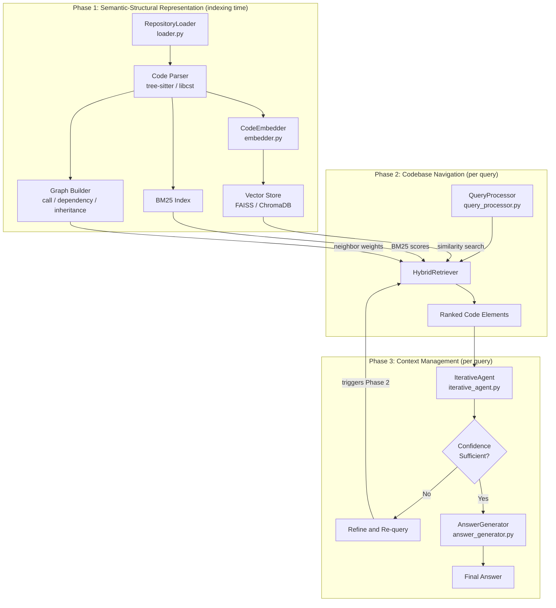
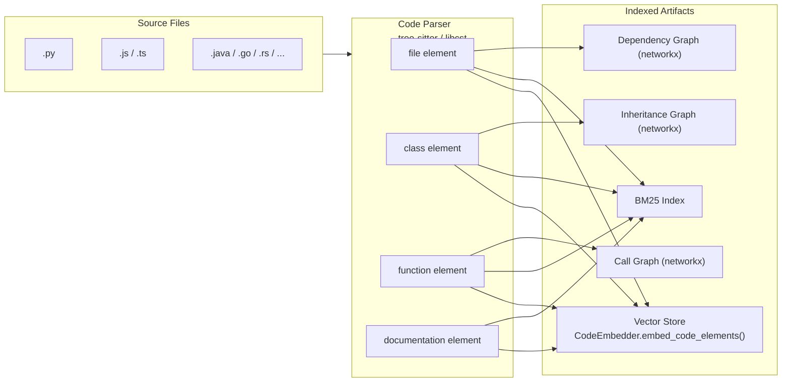
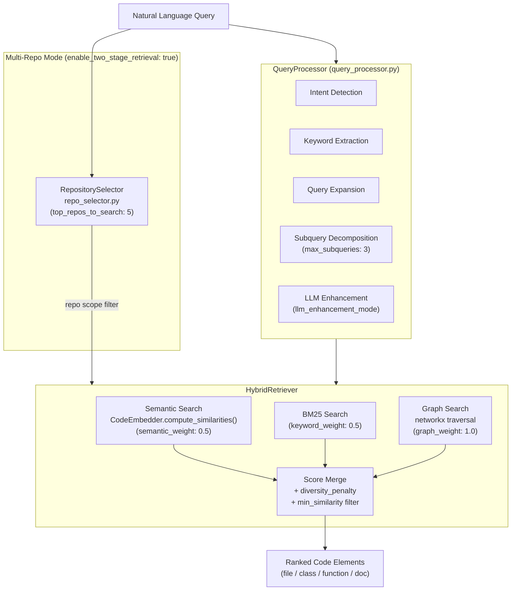
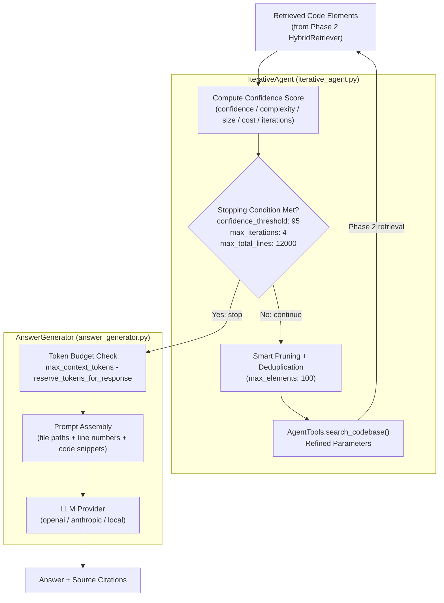

<!-- source: DeepWiki mcp.deepwiki.com · repo HKUDS/FastCode · page 3.1 Three-Phase Framework · fetched 2026-11-09 -->

# Three-Phase Framework

Relevant source files

The following files were used as context for generating this wiki page:

- [README.md](README.md)
- [config/config.yaml](config/config.yaml)
- [fastcode/embedder.py](fastcode/embedder.py)

This page explains the three-phase design that FastCode uses to transform a raw codebase into precise, token-efficient answers. It covers the data flow through each phase, which classes handle each step, and how configuration keys control behavior.

- For the granularity levels of the code index, see [Hierarchical Code Indexing](#3.3).
- For the call, dependency, and inheritance graphs built in Phase 1, see [Multi-Layer Graph Modeling](#3.4).
- For the iterative agent that drives Phase 3, see [Iterative Agent](#5.1).
- For two-stage repository selection, see [Two-Stage Retrieval](#9.5).
- For code skimming specifics, see [Code Skimming](#9.4).

---

## Framework Overview

FastCode organizes its pipeline into three sequential phases:

| Phase | Name | Runs When | Output |
|-------|------|-----------|--------|
| 1 | Semantic-Structural Code Representation | Once, at indexing time | Vector store + BM25 index + code graphs |
| 2 | Lightning-Fast Codebase Navigation | Every query | Ranked list of relevant code elements |
| 3 | Cost-Efficient Context Management | Every query | Final LLM context + answer |

Phase 1 produces persistent artifacts on disk. Phases 2 and 3 consume those artifacts on every query. When the iterative agent is enabled, Phase 3 can trigger additional Phase 2 retrieval rounds before generating an answer.

**Diagram: Three-Phase Pipeline**

Sources: [README.md:79-116](), [config/config.yaml:69-180]()

---

## Phase 1: Semantic-Structural Code Representation

Phase 1 converts raw source files into three queryable artifact types. It runs once per repository and persists results to disk under `vector_store.persist_directory` (default: `./data/vector_store`).

### Hierarchical Code Indexing

The parser extracts code elements at four granularity levels, configured by `indexing.levels` in `config/config.yaml`:

| Level | What It Captures |
|-------|-----------------|
| `file` | File-level metadata and import statements |
| `class` | Class definitions, base classes, and class docstrings |
| `function` | Function signatures, bodies, and function docstrings |
| `documentation` | Standalone comments and module-level documentation |

Each extracted element becomes a discrete, independently retrievable entry in the vector store. This allows retrieval at the sub-file level — a single relevant function can be returned without pulling in its surrounding file. For deeper details, see [Hierarchical Code Indexing](#3.3).

### Embedding Generation via `CodeEmbedder`

The `CodeEmbedder` class in `fastcode/embedder.py` converts each element into a dense vector. The key method chain is:

- `embed_code_elements()` ([fastcode/embedder.py:83-109]()) — iterates over all elements, prepares texts, calls `embed_batch()`
- `_prepare_code_text()` ([fastcode/embedder.py:111-147]()) — assembles the embedding input by concatenating available fields in order: `Type`, `Name`, `Signature`, `Documentation`, `Code` (truncated to 10,000 characters)
- `embed_batch()` ([fastcode/embedder.py:54-81]()) — encodes texts using a `SentenceTransformer` model in batches

Device selection is automatic at initialization ([fastcode/embedder.py:28-29]()): CUDA → MPS → CPU. The default model is `sentence-transformers/paraphrase-multilingual-MiniLM-L12-v2` ([config/config.yaml:60]()). When `embedding.normalize_embeddings` is `true`, dot product is used for similarity scoring instead of full cosine computation ([fastcode/embedder.py:149-168]()).

### Multi-Layer Graph Modeling

Three structural graphs are built from the parsed elements and stored alongside the vector index:

| Graph | Nodes | Edges | Config Flag |
|-------|-------|-------|-------------|
| Call Graph | functions | caller → callee | `graph.build_call_graph` |
| Dependency Graph | files | importer → imported | `graph.build_dependency_graph` |
| Inheritance Graph | classes | subclass → superclass | `graph.build_inheritance_graph` |

Traversal depth during retrieval is bounded by `graph.max_depth` (default: `5`) ([config/config.yaml:167]()). Graph weights contribute to the hybrid retrieval score in Phase 2. For full implementation details, see [Multi-Layer Graph Modeling](#3.4).

**Diagram: Phase 1 — Source Files to Indexed Artifacts**

Sources: [fastcode/embedder.py:83-147](), [config/config.yaml:59-80](), [config/config.yaml:162-167]()

---

## Phase 2: Lightning-Fast Codebase Navigation

Phase 2 transforms a natural language query into a ranked list of relevant code elements. It runs on every query, consuming the artifacts produced in Phase 1.

### Query Processing

`QueryProcessor` (`fastcode/query_processor.py`) pre-processes the incoming query before retrieval. Each operation is independently toggleable in `config/config.yaml`:

| Operation | Config Key | Default | Effect |
|-----------|-----------|---------|--------|
| Intent detection | `query.detect_intent` | `true` | Classifies query as how/what/where/debug/implement |
| Keyword extraction | `query.extract_keywords` | `true` | Supplies terms to BM25 retrieval |
| Query expansion | `query.expand_query` | `true` | Adds synonyms and related terms |
| Decomposition | `query.decompose_complex` | `true` | Splits query into up to `max_subqueries: 3` subqueries |
| LLM enhancement | `query.llm_enhancement_mode` | `"always"` | Rewrites query using an LLM call; options: `adaptive`, `always`, `off` |

In multi-turn sessions, `QueryProcessor` also resolves pronoun references (e.g., "it", "that class") against the session's dialogue history. See [Query Processor](#4.7).

### Hybrid Retrieval

The `HybridRetriever` combines three independent signals into a single ranked result:

| Signal | Config Key | Default Weight | Data Source |
|--------|-----------|---------------|-------------|
| Semantic (vector) | `retrieval.semantic_weight` | `0.5` | `CodeEmbedder.compute_similarities()` on FAISS/ChromaDB |
| Keyword (BM25) | `retrieval.keyword_weight` | `0.5` | BM25 index built at indexing time |
| Graph | `retrieval.graph_weight` | `1.0` | Neighbor proximity in call/dependency/inheritance graphs |

Post-scoring filters: `retrieval.diversity_penalty: 0.1` penalizes near-duplicate results; `retrieval.min_similarity: 0.15` drops low-scoring elements; `retrieval.max_results: 5` caps the result count per subquery. See [Hybrid Retriever](#4.6).

### Two-Stage Retrieval for Multiple Repositories

When more than one repository is indexed and `retrieval.enable_two_stage_retrieval: true`, Phase 2 adds a preliminary repository selection step:

1. **Stage 1 — Repository selection**: `RepositorySelector` (`fastcode/repo_selector.py`) scores repository overviews (generated by `RepositoryOverviewGenerator` in `fastcode/repo_overview.py`) against the query using LLM scoring (`retrieval.repo_selection_method: "llm"`). The top `retrieval.top_repos_to_search: 5` repositories are selected.
2. **Stage 2 — Element retrieval**: The hybrid retriever runs only against those selected repositories.

Controlled by `retrieval.select_repos_by_overview: true` ([config/config.yaml:112]()). See [Two-Stage Retrieval](#9.5) and [Multi-Repository Support](#3.2).

### Code Skimming

When the agent needs to assess a file without loading it fully, Phase 2 applies **code skimming**: only structural markers (function names, class definitions, type hints, and short docstrings) are extracted. This avoids loading full function bodies into the token budget during the navigation step. See [Code Skimming](#9.4).

**Diagram: Phase 2 — Natural Language Query to Ranked Code Elements**

Sources: [config/config.yaml:98-119](), [config/config.yaml:122-139](), [README.md:95-106]()

---

## Phase 3: Cost-Efficient Context Management

Phase 3 evaluates whether the retrieved elements are sufficient to answer the query, iterates if needed, then assembles the final LLM prompt within a strict token budget.

### Iterative Agent Loop

`IterativeAgent` (`fastcode/iterative_agent.py`) wraps Phase 2 retrieval in a confidence-driven loop. On each iteration it computes a confidence score by weighing five factors: current confidence level, query complexity, codebase size, resource cost, and iteration count. The loop continues until a stopping condition is met:

| Stopping Condition | Config Key | Default |
|-------------------|-----------|---------|
| Confidence above threshold | `agent.iterative.confidence_threshold` | `95` (out of 100) |
| Gain per round too small | `agent.iterative.min_confidence_gain` | `5` |
| Iteration limit reached | `agent.iterative.max_iterations` | `4` |
| Line budget exhausted | `agent.iterative.max_total_lines` | `12,000` |

After each retrieval round, the agent applies smart pruning (via `agent.iterative.max_elements: 100`) and deduplication before the next round. Agency mode is enabled by `retrieval.enable_agency_mode: true` ([config/config.yaml:119]()). When disabled, a single Phase 2 pass is used. See [Agency Mode](#5.3) and [Iterative Agent](#5.1).

### Token Budget and Context Assembly

`AnswerGenerator` (`fastcode/answer_generator.py`) assembles the final prompt within a two-part token budget:

| Config Key | Default | Role |
|-----------|---------|------|
| `generation.max_context_tokens` | `200,000` | Total token ceiling for the prompt |
| `generation.reserve_tokens_for_response` | `10,000` | Tokens held back for the model's output |

The usable context window is `max_context_tokens - reserve_tokens_for_response`. Retrieved elements are inserted in descending relevance order; lower-priority elements are truncated or dropped when the budget is reached. Optional content is controlled by `generation.include_file_paths`, `generation.include_line_numbers`, and `generation.include_related_code` ([config/config.yaml:153-156]()). See [Answer Generator](#4.8).

**Diagram: Phase 3 — Iterative Agent to Final Answer**

Sources: [config/config.yaml:169-180](), [config/config.yaml:148-156](), [README.md:107-116]()

---

## Phase Interaction Summary

The three phases are not fully independent — Phase 3 can trigger additional Phase 2 passes, and Phase 1 artifacts are shared across all queries. The table below summarizes inter-phase data flows:

| From | To | Data Transferred |
|------|----|-----------------|
| Phase 1 `CodeEmbedder` | Phase 2 `HybridRetriever` | Normalized embedding vectors in FAISS/ChromaDB |
| Phase 1 Graph Builder | Phase 2 `HybridRetriever` | `networkx` graph files (call/dependency/inheritance) |
| Phase 1 Parser | Phase 2 `HybridRetriever` | BM25 index (`.pkl` file) |
| Phase 2 `HybridRetriever` | Phase 3 `IterativeAgent` | Ranked code element list with scores |
| Phase 3 `IterativeAgent` | Phase 2 `HybridRetriever` | Refined search parameters (re-query trigger) |
| Phase 3 `IterativeAgent` | Phase 3 `AnswerGenerator` | Pruned and deduplicated element set |

---

## Configuration Quick Reference

All phase behavior is controlled through `config/config.yaml`. Key sections by phase:

| Phase | Config Section | Representative Keys |
|-------|---------------|---------------------|
| 1 | `indexing` | `levels`, `include_imports`, `generate_repo_overview` |
| 1 | `embedding` | `model`, `device`, `batch_size`, `normalize_embeddings` |
| 1 | `graph` | `build_call_graph`, `build_dependency_graph`, `build_inheritance_graph`, `max_depth` |
| 1 | `vector_store` | `type`, `distance_metric`, `persist_directory` |
| 2 | `retrieval` | `semantic_weight`, `keyword_weight`, `graph_weight`, `enable_two_stage_retrieval`, `enable_agency_mode` |
| 2 | `query` | `expand_query`, `decompose_complex`, `llm_enhancement_mode`, `max_subqueries` |
| 3 | `agent.iterative` | `max_iterations`, `confidence_threshold`, `min_confidence_gain`, `max_total_lines` |
| 3 | `generation` | `max_context_tokens`, `reserve_tokens_for_response`, `temperature`, `max_tokens` |

For per-key documentation, see the [Configuration](#8) section and its sub-pages ([Retrieval Configuration](#8.6), [Agent Configuration](#8.9), [Generation Configuration](#8.8)).

Sources: [config/config.yaml:1-205]()

---

