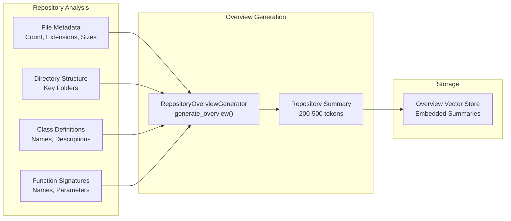
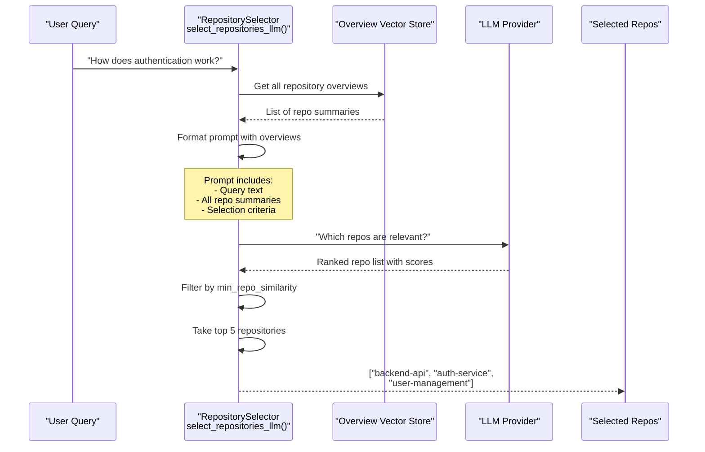
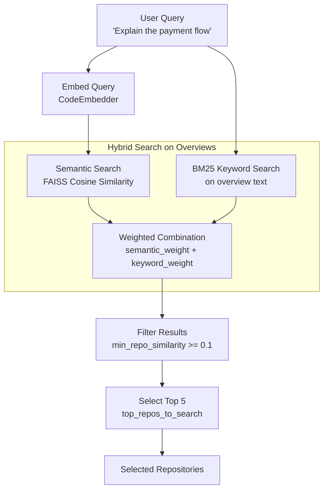
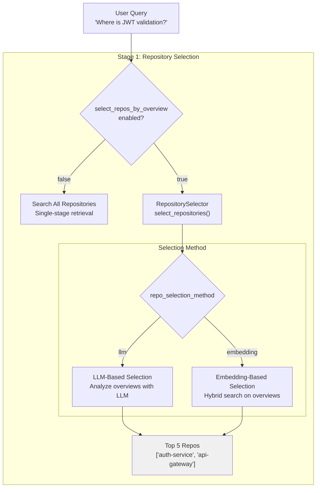
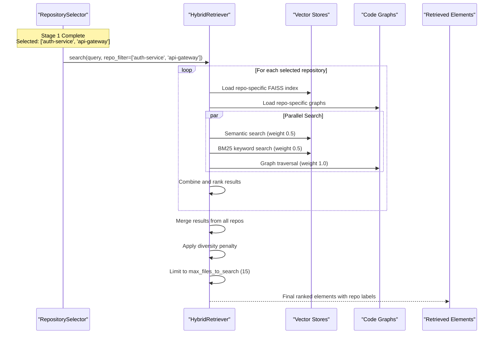
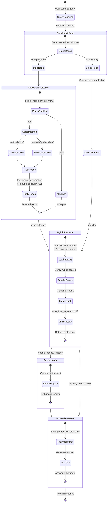

<!-- source: DeepWiki mcp.deepwiki.com · repo HKUDS/FastCode · page 3.2 Multi-Repository Support · fetched 2026-11-09 -->

# Multi-Repository Support

<details>
<summary>Relevant source files</summary>

The following files were used as context for generating this wiki page:

- [README.md](README.md)
- [config/config.yaml](config/config.yaml)
- [fastcode/embedder.py](fastcode/embedder.py)
- [fastcode/repo_overview.py](fastcode/repo_overview.py)
- [fastcode/repo_selector.py](fastcode/repo_selector.py)

</details>


FastCode provides native support for analyzing and querying across multiple code repositories simultaneously. This capability enables cross-repository dependency analysis, comparative code understanding, and efficient query routing to the most relevant codebases.

This page covers the architecture and mechanisms for multi-repository support, including repository selection methods and two-stage retrieval. For information about indexing individual repositories, see [Hierarchical Code Indexing](#3.3). For query processing details, see [Hybrid Retriever](#4.6).

---

## Architecture Overview

Multi-repository support in FastCode is built around three core principles:

1. **Independent Indexing**: Each repository maintains its own semantic vectors and structural graphs
2. **Intelligent Selection**: A two-stage process first selects relevant repositories, then searches within them
3. **Unified Query Interface**: Users query across all repositories using a single natural language question

The system can handle dozens of repositories efficiently by avoiding unnecessary searches in irrelevant codebases.

### High-Level Multi-Repository Flow

```mermaid
graph TB
    subgraph "Repository Sources"
        GitURL["Git URL<br/>github.com/user/repo"]
        LocalPath["Local Path<br/>/path/to/repo"]
        ZipFile["ZIP Upload<br/>via API"]
    end
    
    subgraph "Repository Management"
        Loader["RepositoryLoader<br/>fastcode/loader.py"]
        Parser["CodeParser<br/>fastcode/parser.py"]
        Indexer["CodeIndexer<br/>fastcode/indexer.py"]
    end
    
    subgraph "Per-Repository Storage"
        Repo1["Repository 1<br/>data/vector_store/repo1/<br/>FAISS Index + Graphs"]
        Repo2["Repository 2<br/>data/vector_store/repo2/<br/>FAISS Index + Graphs"]
        RepoN["Repository N<br/>data/vector_store/repoN/<br/>FAISS Index + Graphs"]
    end
    
    subgraph "Repository Selection"
        OverviewGen["RepositoryOverviewGenerator<br/>fastcode/repo_overview.py"]
        Selector["RepositorySelector<br/>fastcode/repo_selector.py"]
    end
    
    subgraph "Query Execution"
        Query["User Query"]
        SelectedRepos["Top 5 Repositories<br/>min_similarity >= 0.1"]
        Retriever["HybridRetriever<br/>fastcode/retriever.py"]
        Results["Query Results"]
    end
    
    GitURL --> Loader
    LocalPath --> Loader
    ZipFile --> Loader
    
    Loader --> Parser
    Parser --> Indexer
    
    Indexer --> Repo1
    Indexer --> Repo2
    Indexer --> RepoN
    
    Repo1 --> OverviewGen
    Repo2 --> OverviewGen
    RepoN --> OverviewGen
    
    Query --> Selector
    OverviewGen --> Selector
    
    Selector --> SelectedRepos
    
    SelectedRepos --> Retriever
    Repo1 -.->|if selected| Retriever
    Repo2 -.->|if selected| Retriever
    RepoN -.->|if selected| Retriever
    
    Retriever --> Results
```



**Sources:** [config/config.yaml:110-117](), [README.md:49-53](), Diagram 3

---

## Repository Management

### Loading Multiple Repositories

Each repository is loaded and indexed independently through the `RepositoryLoader` class. The system supports three input methods:

| Input Method | API Endpoint | Use Case |
|--------------|--------------|----------|
| Git URL | `POST /load` | Clone from GitHub, GitLab, etc. |
| Local Path | `POST /load` | Index existing local repositories |
| ZIP Upload | `POST /upload-zip` | Upload repository archives |

Multiple repositories can be loaded sequentially or in batch:

```bash
# Single repository
POST /load-and-index
{
  "source": "https://github.com/user/repo1",
  "is_url": true
}

# Batch loading
POST /index-multiple
{
  "sources": [
    {"source": "https://github.com/user/repo1", "is_url": true},
    {"source": "/path/to/repo2", "is_url": false}
  ]
}
```

**Sources:** [README.md:403-459](), [fastcode/__init__.py:16]()

### Repository Storage Structure

Each repository is stored in an isolated directory structure:

```
data/vector_store/
├── repo1/
│   ├── faiss_index.bin          # FAISS vector index
│   ├── bm25_index.pkl            # BM25 keyword index
│   ├── call_graph.pkl            # Function call graph
│   ├── dependency_graph.pkl      # Module dependency graph
│   └── inheritance_graph.pkl     # Class inheritance graph
├── repo2/
│   └── ...
└── repoN/
    └── ...

repos/
├── repo1/                        # Cloned repository source
├── repo2/
└── repoN/
```

This separation ensures that:
- Indexes can be loaded independently
- Repository updates don't affect other repositories
- Query performance scales linearly with selected repositories, not total repositories

**Sources:** [config/config.yaml:92](), [config/config.yaml:6]()

---

## Repository Overview Generation

The `RepositoryOverviewGenerator` creates high-level summaries of each repository to enable efficient repository selection. These overviews are generated during the indexing phase.

### Overview Components



### Overview Content Structure

A typical repository overview includes:

1. **Repository Metadata**: Name, language distribution, file count
2. **Primary Purpose**: Inferred from README, main modules, or prominent classes
3. **Key Components**: Major classes, functions, and modules with descriptions
4. **Technologies**: Frameworks, libraries, and dependencies detected

The overview is designed to be:
- **Concise**: 200-500 tokens to minimize selection overhead
- **Informative**: Contains enough detail to determine relevance
- **Searchable**: Embedded using the same `CodeEmbedder` as code elements

**Sources:** [fastcode/__init__.py:21](), [config/config.yaml:80]()

---

## Repository Selection

When multiple repositories are loaded, FastCode uses a two-stage approach to efficiently route queries to the most relevant codebases. This is controlled by the `RepositorySelector` class.

### Selection Configuration

```yaml
retrieval:
  enable_two_stage_retrieval: true
  select_repos_by_overview: true
  repo_selection_method: "llm"  # or "embedding"
  top_repos_to_search: 5
  min_repo_similarity: 0.1
  max_files_to_search: 15
```

**Sources:** [config/config.yaml:111-116]()

### Selection Method Comparison

| Aspect | LLM-Based Selection | Embedding-Based Selection |
|--------|---------------------|---------------------------|
| **Implementation** | Uses LLM to analyze repository overviews | Semantic search + BM25 on overviews |
| **Accuracy** | Higher for complex queries | Good for keyword-heavy queries |
| **Speed** | Slower (~1-2 seconds) | Faster (~100-200ms) |
| **Cost** | Requires LLM API call | No additional cost |
| **Best For** | Cross-cutting concerns, abstract queries | Specific technology/framework queries |

**Sources:** [config/config.yaml:113]()

### LLM-Based Repository Selection



The LLM-based method sends all repository overviews to the language model with a prompt asking it to:
1. Analyze the query intent
2. Match query requirements to repository capabilities
3. Return ranked list of relevant repositories with confidence scores

This method excels at understanding abstract queries like "show me microservice communication patterns" or "where is caching implemented?"

**Sources:** [config/config.yaml:113](), [fastcode/__init__.py:22]()

### Embedding-Based Repository Selection



The embedding-based method uses the same hybrid retrieval strategy as code search:
1. **Semantic Search**: Embed the query and compute cosine similarity against overview embeddings
2. **Keyword Search**: BM25 scoring on overview text
3. **Weighted Combination**: Combine scores using configured weights (default: 0.5 each)
4. **Filtering**: Apply minimum similarity threshold (default: 0.1)
5. **Selection**: Take top N repositories (default: 5)

This method is efficient for queries with specific technical terms like "React hooks usage" or "PostgreSQL connection pooling".

**Sources:** [config/config.yaml:100-103](), [config/config.yaml:113]()

### Selection Thresholds

The selection process uses two key parameters:

- **`top_repos_to_search`** (default: 5): Maximum number of repositories to search
  - Prevents overwhelming the retriever with too many sources
  - Balances comprehensiveness with performance
  - Can be increased for broader searches or decreased for faster responses

- **`min_repo_similarity`** (default: 0.1): Minimum similarity score for inclusion
  - Filters out clearly irrelevant repositories
  - Lower threshold (0.05-0.1): More inclusive, catches edge cases
  - Higher threshold (0.2-0.3): More precise, faster execution

If fewer than `top_repos_to_search` repositories exceed `min_repo_similarity`, only those repositories are searched.

**Sources:** [config/config.yaml:114-115]()

---

## Two-Stage Retrieval Process

The two-stage retrieval process separates repository selection from code search, dramatically reducing the search space.

### Stage 1: Repository Selection



**Sources:** [config/config.yaml:111-113]()

### Stage 2: Code Search Within Selected Repositories



The code search stage:
1. Loads only the vector stores and graphs for selected repositories
2. Performs hybrid retrieval (semantic + keyword + graph) within each repository
3. Merges and re-ranks results across repositories
4. Applies the global limit of `max_files_to_search` (default: 15 files)

**Sources:** [config/config.yaml:116](), [fastcode/__init__.py:19]()

---

## Query Execution Flow

### Complete Multi-Repository Query Lifecycle



**Sources:** [config/config.yaml:110-120](), [fastcode/__init__.py:15]()

---

## Multi-Repository Query Response Format

When querying across multiple repositories, the response includes repository labels for each retrieved element:

```json
{
  "answer": "JWT validation occurs in two services...",
  "sources": [
    {
      "file_path": "auth-service/src/middleware/jwt.py",
      "repository": "auth-service",
      "element_type": "function",
      "element_name": "validate_jwt_token",
      "similarity_score": 0.87
    },
    {
      "file_path": "api-gateway/handlers/auth.go",
      "repository": "api-gateway",
      "element_type": "function",
      "element_name": "VerifyJWT",
      "similarity_score": 0.82
    }
  ],
  "metadata": {
    "total_repositories": 12,
    "selected_repositories": 2,
    "selection_method": "llm",
    "repositories_searched": ["auth-service", "api-gateway"],
    "total_elements_retrieved": 8,
    "total_tokens": 4532
  }
}
```

The repository label enables:
- **Source Attribution**: Users know which repository each code snippet comes from
- **Cross-Repository Analysis**: Understanding how code in different repos interacts
- **Navigation**: Direct links to specific files in specific repositories

**Sources:** [README.md:467-496]()

---

## Configuration Reference

### Multi-Repository Settings

| Parameter | Type | Default | Description |
|-----------|------|---------|-------------|
| `enable_two_stage_retrieval` | boolean | `true` | Enable repository selection before code search |
| `select_repos_by_overview` | boolean | `true` | Use overviews for selection (works in agency and normal mode) |
| `repo_selection_method` | string | `"llm"` | Selection method: `"llm"` or `"embedding"` |
| `top_repos_to_search` | integer | `5` | Maximum repositories to search |
| `min_repo_similarity` | float | `0.1` | Minimum similarity threshold (0.0-1.0) |
| `max_files_to_search` | integer | `15` | Maximum files to retrieve across all selected repos |

### Indexing Settings for Multiple Repositories

| Parameter | Type | Default | Description |
|-----------|------|---------|-------------|
| `generate_repo_overview` | boolean | `true` | Generate repository summary during indexing |
| `include_repo_overview` | boolean | - | Include overview in context (deprecated, use overview for selection) |

**Sources:** [config/config.yaml:110-117](), [config/config.yaml:80]()

---

## Performance Characteristics

### Repository Selection Overhead

| Selection Method | Typical Latency | LLM API Call | Best Use Case |
|------------------|-----------------|--------------|---------------|
| None (all repos) | 0ms | No | Single or few repositories |
| Embedding-based | 100-200ms | No | Many repositories, keyword queries |
| LLM-based | 1-2 seconds | Yes | Many repositories, complex queries |

### Scalability Limits

| Scenario | Repositories | Selection Required | Expected Performance |
|----------|--------------|-------------------|---------------------|
| Small scale | 1-3 repos | Not needed | ~2-3 seconds per query |
| Medium scale | 4-10 repos | Recommended | ~3-5 seconds per query |
| Large scale | 11-50 repos | Essential | ~4-6 seconds per query |
| Very large scale | 50+ repos | Essential + caching | ~5-8 seconds per query |

The two-stage approach ensures that query latency grows logarithmically rather than linearly with the number of repositories.

**Sources:** [README.md:29-33](), [config/config.yaml:114-115]()

---

## Common Multi-Repository Patterns

### Pattern 1: Microservices Architecture

Multiple repositories representing different microservices:

```
repos/
├── auth-service/
├── user-service/
├── payment-service/
├── notification-service/
└── api-gateway/
```

**Query Examples:**
- "How do services communicate with each other?"
- "Where is authentication validated across services?"
- "Show me all API endpoints related to payments"

### Pattern 2: Monorepo with Multiple Projects

Single repository with multiple independent projects:

```
monorepo/
├── backend/
├── frontend/
├── mobile/
└── shared-lib/
```

FastCode treats this as a single repository, but can use graph traversal to understand cross-project dependencies.

### Pattern 3: Main Application + Dependencies

Main codebase plus key dependency repositories:

```
repos/
├── my-app/
├── custom-framework/
└── internal-library/
```

**Query Examples:**
- "How does my-app use custom-framework's authentication?"
- "Where is the internal-library configuration loaded?"

**Sources:** [README.md:52]()

---

## Troubleshooting Multi-Repository Queries

### Issue: Repository Not Selected

**Symptoms:** Expected repository not included in search results

**Possible Causes:**
1. Repository overview doesn't match query semantics
2. `min_repo_similarity` threshold too high
3. Repository exceeded `top_repos_to_search` limit

**Solutions:**
- Lower `min_repo_similarity` to 0.05-0.08
- Increase `top_repos_to_search` to 7-10
- Switch from `"embedding"` to `"llm"` selection method
- Regenerate repository overview if it's outdated

### Issue: Slow Multi-Repository Queries

**Symptoms:** Queries take >10 seconds

**Possible Causes:**
1. Too many repositories being searched
2. LLM-based selection adding latency
3. Large vector indexes

**Solutions:**
- Enable two-stage retrieval if disabled
- Switch to embedding-based selection
- Reduce `top_repos_to_search` to 3-4
- Ensure vector indexes are using HNSW

### Issue: Incomplete Cross-Repository Results

**Symptoms:** Missing relevant code from some repositories

**Possible Causes:**
1. `max_files_to_search` limit too low
2. Results dominated by single repository
3. Diversity penalty too aggressive

**Solutions:**
- Increase `max_files_to_search` to 20-25
- Lower `diversity_penalty` from 0.1 to 0.05
- Use agency mode for comprehensive multi-repo searches

**Sources:** [config/config.yaml:106-108](), [config/config.yaml:114-116]()

---

## Related Pages

- For repository loading details, see [Repository Loader](#4.1)
- For indexing strategy, see [Hierarchical Code Indexing](#3.3)
- For retrieval implementation, see [Hybrid Retriever](#4.6)
- For multi-repository configuration, see [Retrieval Configuration](#8.6)

---

