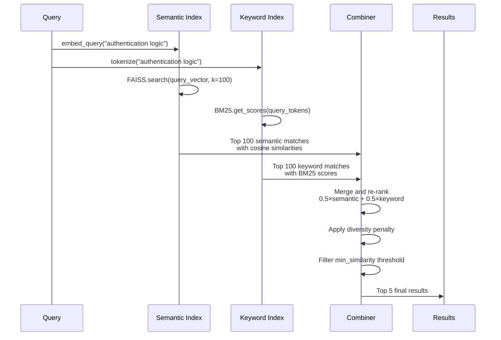

<!-- source: DeepWiki mcp.deepwiki.com · repo HKUDS/FastCode · page 3.3 Hierarchical Code Indexing · fetched 2026-11-09 -->

# Hierarchical Code Indexing

<details>
<summary>Relevant source files</summary>

The following files were used as context for generating this wiki page:

- [README.md](README.md)
- [config/config.yaml](config/config.yaml)
- [fastcode/embedder.py](fastcode/embedder.py)

</details>


## Purpose and Scope

This document describes FastCode's hierarchical code indexing system, which organizes code into four distinct levels (file, class, function, documentation) and maintains both semantic embeddings and keyword-based indices for efficient retrieval. This indexing strategy enables precise code search without loading entire files into memory, contributing to the system's 10x token savings.

For information about how these indices are queried during retrieval, see page 4.6 (Hybrid Retriever). For details on the semantic embedding generation, see page 4.4 (Code Embedder). For graph-based code relationships, see page 3.4 (Multi-Layer Graph Modeling).

---

## Overview of the Indexing Strategy

FastCode employs a **multi-level indexing approach** that decomposes codebases into progressively finer-grained units. Rather than treating files as monolithic blocks, the system creates separate index entries for files, classes, functions, and documentation. This granularity allows retrieval systems to target specific code constructs (e.g., "find the authentication function" retrieves function-level entries, not entire files).

The system maintains a **dual-index architecture**: semantic vectors for conceptual similarity matching and BM25 keyword indices for exact term matching. This hybrid approach combines the strengths of both methods—semantic understanding for natural language queries and keyword precision for technical terms.

**Hierarchical Code Index Architecture**

```mermaid
graph TB
    subgraph "Input"
        RepoFiles["\"Repository files\n(.py .js .java .go .rs ...)\""]
    end

    subgraph "fastcode/parser.py"
        CodeParser["\"CodeParser\n(tree-sitter + libcst)\""]
    end

    subgraph "config.yaml indexing.levels"
        L1["\"file\n(path, size, language, imports)\""]
        L2["\"class\n(name, bases, methods, docstring)\""]
        L3["\"function\n(signature, params, returns, body)\""]
        L4["\"documentation\n(docstrings, comments)\""]
    end

    subgraph "Context enrichment (config.yaml indexing)"
        ImportCtx["\"include_imports: true\""]
        ClassCtx["\"include_class_context: true\""]
        RepoOverview["\"generate_repo_overview: true\nRepositoryOverviewGenerator\""]
    end

    subgraph "fastcode/embedder.py — CodeEmbedder"
        PrepText["\"_prepare_code_text()\ncombines type+name+sig+doc+code\""]
        EmbedModel["\"embed_batch()\nSentenceTransformer.encode()\""]
        SemanticIndex["\"dense vectors\n(normalized, cosine distance)\""]
    end

    subgraph "BM25 index"
        KeywordIndex["\"rank_bm25.BM25Okapi\ntokenized corpus\""]
    end

    subgraph "Persistence (config.yaml vector_store.persist_directory)"
        VectorStore["\"FAISS HNSW index\n./data/vector_store\""]
        BM25Store["\"BM25 index\n_bm25.pkl\""]
        MetaStore["\"element metadata\n_metadata.pkl\""]
    end

    RepoFiles --> CodeParser
    CodeParser --> L1 & L2 & L3 & L4
    L1 --> ImportCtx
    L2 --> ClassCtx
    L1 & L2 & L3 --> RepoOverview
    L1 & L2 & L3 & L4 --> PrepText
    ImportCtx & ClassCtx & RepoOverview --> PrepText
    PrepText --> EmbedModel --> SemanticIndex
    PrepText --> KeywordIndex
    SemanticIndex --> VectorStore
    KeywordIndex --> BM25Store
    L1 & L2 & L3 & L4 --> MetaStore
```

Sources: [config/config.yaml:68-80](), [README.md:82-90](), [fastcode/embedder.py:83-148]()

---

## Four-Level Index Hierarchy

### Level 1: File Metadata

The **file level** captures high-level metadata about each source file in the repository. This level provides the broadest context and is used for coarse-grained filtering and navigation.

**Indexed Attributes:**
- **File path**: Relative path from repository root
- **File size**: Size in bytes (files exceeding `max_file_size_mb` are skipped)
- **File type**: Programming language extension
- **Import statements**: List of imported modules/packages
- **Module-level docstrings**: Top-level documentation strings

**Configuration:**

| Setting | Default | Description |
|---------|---------|-------------|
| `repository.max_file_size_mb` | 5 | Skip files larger than this size |
| `repository.supported_extensions` | .py, .js, .ts, .java, .go, .cpp, .c, .rs, .cs | Indexed file types |
| `indexing.include_imports` | true | Include import context in embeddings |

**Example File-Level Index Entry:**

```
Type: file
Path: fastcode/embedder.py
Size: 5847 bytes
Language: Python
Imports: logging, platform, typing, numpy, sentence_transformers, torch
Docstring: "Code Embedder - Generate embeddings for code snippets"
```

**Sources:**
- [config/config.yaml:8-48]()
- [config/config.yaml:78]()

### Level 2: Class Definitions

The **class level** indexes object-oriented constructs, including class definitions, inheritance relationships, and class-level documentation.

**Indexed Attributes:**
- **Class name**: Fully qualified name
- **Base classes**: Inheritance hierarchy
- **Methods**: List of method names (detailed in Level 3)
- **Class docstring**: Documentation describing the class purpose
- **Class-level attributes**: Static/class variables

**Configuration:**

| Setting | Default | Description |
|---------|---------|-------------|
| `indexing.include_class_context` | true | Include parent class info in embeddings |
| `parser.extract_docstrings` | true | Extract class docstrings |

**Example Class-Level Index Entry:**

```
Type: class
Name: CodeEmbedder
File: fastcode/embedder.py
Base Classes: None
Methods: __init__, _load_model, embed_text, embed_batch, embed_code_elements, 
         _prepare_code_text, compute_similarity, compute_similarities
Docstring: "Generate embeddings for code using sentence transformers"
```

**Sources:**
- [config/config.yaml:79]()
- [config/config.yaml:52]()
- [fastcode/embedder.py:13-14]()

### Level 3: Function Definitions

The **function level** provides the most detailed code-level indexing, capturing function signatures, parameters, return types, and implementation bodies.

**Indexed Attributes:**
- **Function name**: Function identifier
- **Signature**: Full function signature including parameters and return type
- **Parameters**: List of parameter names and types (if available)
- **Return type**: Return value type annotation
- **Function docstring**: Documentation describing function behavior
- **Code body**: Function implementation (truncated if exceeding `max_function_lines`)
- **Complexity metrics**: Cyclomatic complexity (if `compute_complexity` enabled)

**Configuration:**

| Setting | Default | Description |
|---------|---------|-------------|
| `parser.max_function_lines` | 3000 | Skip extremely long functions |
| `parser.compute_complexity` | true | Calculate cyclomatic complexity |
| `parser.extract_comments` | true | Include inline comments |

**Example Function-Level Index Entry:**

```
Type: function
Name: embed_batch
Class: CodeEmbedder
File: fastcode/embedder.py
Signature: def embed_batch(self, texts: List[str]) -> np.ndarray
Parameters: texts (List[str])
Returns: np.ndarray
Docstring: "Generate embeddings for a batch of texts"
Code: [54-82]
Complexity: 5
```

**Sources:**
- [config/config.yaml:56]()
- [config/config.yaml:52-55]()
- [fastcode/embedder.py:54-82]()

### Level 4: Documentation

The **documentation level** indexes standalone documentation not associated with specific code constructs, including module-level comments, README sections, and inline explanatory comments.

**Indexed Attributes:**
- **Documentation type**: docstring, comment, markdown
- **Associated context**: File or code construct the documentation refers to
- **Content**: Full documentation text
- **Summary**: Auto-generated summary (if long)

**Configuration:**

| Setting | Default | Description |
|---------|---------|-------------|
| `parser.extract_comments` | true | Extract inline comments |
| `parser.extract_docstrings` | true | Extract documentation strings |

**Example Documentation-Level Index Entry:**

```
Type: documentation
File: fastcode/embedder.py
Context: embed_code_elements method
Content: "Generate embeddings for code elements (functions, classes, etc.)"
Summary: "Embedding generation for structured code elements"
```

**Sources:**
- [config/config.yaml:52-53]()

---

## Hybrid Index Architecture

FastCode combines **semantic embeddings** (for conceptual similarity) with **BM25 keyword search** (for exact term matching). This dual-index approach addresses the complementary strengths of each method:

- **Semantic Index**: Matches queries like "authentication logic" to code handling user login, even without exact keyword matches
- **Keyword Index**: Finds exact matches for technical terms like `OAuth2PasswordBearer` or `JWT`

### Semantic Index (Embeddings)

The semantic index transforms code elements into dense vector representations using SentenceTransformer models. Each of the four hierarchy levels is embedded separately, preserving granularity.

**`CodeEmbedder._prepare_code_text` → Embedding Pipeline**

```mermaid
graph LR
    subgraph "fastcode/embedder.py — embed_code_elements()"
        CodeElement["\"code element dict\n(file / class / function / doc)\""]
        PrepText["\"_prepare_code_text(element)\nlines 111-147\""]
    end

    subgraph "Text fields concatenated"
        T1["\"Type: {element[type]}\""]
        T2["\"Name: {element[name]}\""]
        T3["\"Signature: {element[signature]}\""]
        T4["\"Documentation: {element[docstring]}\""]
        T5["\"Code: {element[code][:10000]}\""]
    end

    subgraph "fastcode/embedder.py — embed_batch()"
        EncodeCall["\"SentenceTransformer.encode()\nbatch_size=32\nnormalize_embeddings=True\""]
        NormVec["\"L2-normalized vector\n(embedding_dim dimensions)\""]
    end

    subgraph "fastcode/vector_store.py"
        FAISSIdx["\"FAISS HNSW index\nef_construction=200, m=16\""]
    end

    CodeElement --> PrepText
    PrepText --> T1 & T2 & T3 & T4 & T5
    T1 & T2 & T3 & T4 & T5 --> EncodeCall
    EncodeCall --> NormVec --> FAISSIdx
```

**Text Preparation for Embedding:**

The `_prepare_code_text` method in `CodeEmbedder` combines multiple attributes into a coherent text representation [fastcode/embedder.py:111-147]():

1. **Type**: Element type (file/class/function/documentation)
2. **Name**: Identifier
3. **Signature**: Function signature (if applicable)
4. **Documentation**: Docstrings and comments
5. **Summary**: Auto-generated summary (if available)
6. **Code**: Implementation (truncated to 10,000 characters if longer)

**Configuration:**

| Setting | Default | Description |
|---------|---------|-------------|
| `embedding.model` | `paraphrase-multilingual-MiniLM-L12-v2` | SentenceTransformer model name |
| `embedding.device` | `auto` | Compute device: `auto` detects CUDA → MPS → CPU |
| `embedding.batch_size` | `32` | Embedding batch size passed to `SentenceTransformer.encode()` |
| `embedding.max_seq_length` | `512` | Maximum token sequence length |
| `embedding.normalize_embeddings` | `true` | L2 normalization (enables dot-product cosine similarity) |
| `vector_store.type` | `faiss` | Vector store backend |
| `vector_store.index_type` | `HNSW` | Approximate nearest neighbor index type |
| `vector_store.distance_metric` | `cosine` | Distance metric used for similarity search |

Sources: [fastcode/embedder.py:111-148](), [config/config.yaml:59-66](), [config/config.yaml:83-92]()

### Keyword Index (BM25)

The keyword index uses the **BM25 (Best Matching 25)** algorithm, a probabilistic ranking function that scores documents based on term frequency (TF) and inverse document frequency (IDF).

**BM25 Scoring:**

For a query with terms $q_1, q_2, \ldots, q_n$ and document $d$:

$$
\text{BM25}(d, q) = \sum_{i=1}^{n} \text{IDF}(q_i) \cdot \frac{f(q_i, d) \cdot (k_1 + 1)}{f(q_i, d) + k_1 \cdot (1 - b + b \cdot \frac{|d|}{\text{avgdl}})}
$$

Where:
- $f(q_i, d)$: Frequency of term $q_i$ in document $d$
- $|d|$: Document length
- $\text{avgdl}$: Average document length in corpus
- $k_1$: Term frequency saturation parameter (typically 1.5)
- $b$: Length normalization parameter (typically 0.75)

**BM25 Index Construction:**

1. **Tokenization**: Split code text into tokens (identifiers, keywords, comments)
2. **Term Frequency Calculation**: Count occurrences of each term per document
3. **IDF Calculation**: Compute inverse document frequency for each term across corpus
4. **Index Serialization**: Persist BM25 index to disk

**Sources:**
- [README.md:88-89]()

### Index Combination Strategy

During retrieval, the system queries both indices in parallel and combines results using configurable weights:

**Hybrid Search Scoring:**

```
final_score = (semantic_weight × semantic_similarity) + (keyword_weight × bm25_score)
```

**Default Weights:**

| Index Type | Weight | Purpose |
|------------|--------|---------|
| Semantic | 0.5 | Conceptual similarity |
| Keyword | 0.5 | Exact term matching |

**Example Query Flow:**



**Configuration:**

| Setting | Default | Description |
|---------|---------|-------------|
| `retrieval.semantic_weight` | 0.5 | Weight for semantic similarity |
| `retrieval.keyword_weight` | 0.5 | Weight for BM25 scores |
| `retrieval.min_similarity` | 0.15 | Minimum combined score threshold |
| `retrieval.max_results` | 5 | Maximum results per query |
| `retrieval.diversity_penalty` | 0.1 | Penalty for similar results |

**Sources:**
- [config/config.yaml:99-108]()

---

## Index Construction Pipeline

The complete indexing pipeline transforms raw repository files into searchable indices through multiple stages:

**End-to-End Index Construction**

```mermaid
graph TB
    subgraph "Stage 1: fastcode/loader.py — RepositoryLoader"
        LoadRepo["\"load_from_url() / load_from_path() / load_from_zip()\""]
        FilterFiles["\"scan_files()\napply ignore_patterns, supported_extensions\nmax_file_size_mb filter\""]
    end

    subgraph "Stage 2: fastcode/parser.py — CodeParser"
        ASTParse["\"tree-sitter (8 languages) + libcst (Python)\nparse_file()\""]
        ExtractFile["\"file: path, size, language, imports\""]
        ExtractClass["\"class: name, bases, methods, docstring\""]
        ExtractFunc["\"function: signature, params, returns, body\n(skip if > max_function_lines)\""]
        ExtractDoc["\"documentation: docstrings, comments\""]
    end

    subgraph "Stage 3: fastcode/indexer.py — CodeIndexer"
        L1Index["\"level=file elements\""]
        L2Index["\"level=class elements\""]
        L3Index["\"level=function elements\""]
        L4Index["\"level=documentation elements\""]
    end

    subgraph "Stage 4: Context Enrichment"
        AddImports["\"include_imports: true\nadd import list to file/class text\""]
        AddClassCtx["\"include_class_context: true\nadd parent class info to function text\""]
        GenOverview["\"generate_repo_overview: true\nRepositoryOverviewGenerator.generate()\""]
    end

    subgraph "Stage 5: fastcode/embedder.py — CodeEmbedder"
        PrepTexts["\"_prepare_code_text(element)\nfor each element\""]
        BatchEmbed["\"embed_batch(texts)\nSentenceTransformer.encode(batch_size=32)\""]
        NormalizeVec["\"normalize_embeddings=True\""]
    end

    subgraph "Stage 6: Index Building"
        BuildFAISS["\"FAISS HNSW index\nef_construction=200, m=16\""]
        BuildBM25["\"rank_bm25.BM25Okapi\ntokenized corpus\""]
    end

    subgraph "Stage 7: Persistence (persist_directory)"
        SaveFAISS["\"*.faiss\n./data/vector_store/\""]
        SaveBM25["\"*_bm25.pkl\""]
        SaveMetadata["\"*_metadata.pkl\""]
    end

    LoadRepo --> FilterFiles --> ASTParse
    ASTParse --> ExtractFile & ExtractClass & ExtractFunc & ExtractDoc
    ExtractFile --> L1Index
    ExtractClass --> L2Index
    ExtractFunc --> L3Index
    ExtractDoc --> L4Index
    L1Index --> AddImports
    L2Index --> AddClassCtx
    L1Index & L2Index & L3Index --> GenOverview
    L1Index & L2Index & L3Index & L4Index --> PrepTexts
    AddImports & AddClassCtx & GenOverview --> PrepTexts
    PrepTexts --> BatchEmbed --> NormalizeVec
    NormalizeVec --> BuildFAISS --> SaveFAISS
    NormalizeVec --> BuildBM25 --> SaveBM25
    L1Index & L2Index & L3Index & L4Index --> SaveMetadata
```

**Performance Characteristics:**

| Repository Size | Files | Elements | Indexing Time | Index Size |
|----------------|-------|----------|---------------|------------|
| Small (< 100 files) | 50 | 500 | 5-10 seconds | 5-10 MB |
| Medium (100-1000 files) | 500 | 5,000 | 30-60 seconds | 50-100 MB |
| Large (> 1000 files) | 2,000 | 20,000 | 2-5 minutes | 200-500 MB |

**Sources:**
- [config/config.yaml:68-80]()

---

## Context Enrichment

To improve embedding quality, FastCode enriches code elements with additional context before generating embeddings.

### Import Context

When `include_imports` is enabled, the system adds imported module information to file and class embeddings. This helps the semantic index understand dependencies.

**Example:**

```
Original: "CodeEmbedder class for generating embeddings"
Enriched: "CodeEmbedder class for generating embeddings. 
           Imports: logging, numpy, sentence_transformers, torch"
```

**Configuration:**

```yaml
indexing:
  include_imports: true
```

**Sources:**
- [config/config.yaml:78]()

### Class Context

When `include_class_context` is enabled, method embeddings include information about their parent class, including base classes and class-level documentation.

**Example:**

```
Original: "embed_batch method for batch embedding generation"
Enriched: "embed_batch method in CodeEmbedder class 
           (inherits from: None). Generates embeddings for code 
           using sentence transformers. Batch embedding generation."
```

**Configuration:**

```yaml
indexing:
  include_class_context: true
```

**Sources:**
- [config/config.yaml:79]()

### Repository Overview

When `generate_repo_overview` is enabled, the system creates a high-level summary of the repository structure and purpose. This overview is used for:

1. **Multi-repository selection**: Choosing relevant repositories in multi-repo mode (see [Multi-Repository Support](#3.2))
2. **Context for embeddings**: Adding global context to all indexed elements

The overview includes:
- Repository name and description
- Main programming languages
- Key modules and packages
- Overall architecture (if detectable)

**Configuration:**

```yaml
indexing:
  generate_repo_overview: true
```

**Sources:**
- [config/config.yaml:80]()

---

## Configuration Options

Complete configuration reference for the hierarchical indexing system:

### Repository Settings

```yaml
repository:
  clone_depth: 1                    # Shallow clone depth
  max_file_size_mb: 5              # Skip files larger than this
  ignore_patterns:                 # Patterns to ignore
    - "*.pyc"
    - "__pycache__"
    - "node_modules"
    - ".git"
  supported_extensions:            # File types to index
    - .py
    - .js
    - .ts
    - .java
    - .go
    - .cpp
    - .c
    - .rs
    - .cs
```

### Parser Settings

```yaml
parser:
  extract_docstrings: true         # Extract documentation strings
  extract_comments: true           # Extract inline comments
  extract_imports: true            # Extract import statements
  compute_complexity: true         # Calculate cyclomatic complexity
  max_function_lines: 3000         # Skip extremely long functions
```

### Indexing Settings

```yaml
indexing:
  levels:                          # Four-level hierarchy
    - file
    - class
    - function
    - documentation
  include_imports: true            # Include import context
  include_class_context: true      # Include class hierarchy
  generate_repo_overview: true     # Generate repository summary
```

### Embedding Settings

```yaml
embedding:
  model: "sentence-transformers/paraphrase-multilingual-MiniLM-L12-v2"
  device: "auto"                   # auto (CUDA > MPS > CPU), cuda, mps, or cpu
  batch_size: 32                   # Embedding batch size
  max_seq_length: 512              # Maximum token length
  normalize_embeddings: true       # L2 normalization
```

### Vector Store Settings

```yaml
vector_store:
  type: "faiss"                    # faiss, chromadb, or qdrant
  distance_metric: "cosine"        # Distance metric
  index_type: "HNSW"               # HNSW for fast ANN search
  ef_construction: 200             # HNSW construction parameter
  ef_search: 50                    # HNSW search parameter
  m: 16                            # HNSW m parameter
  persist_directory: "./data/vector_store"
```

### Retrieval Settings

```yaml
retrieval:
  semantic_weight: 0.5             # Weight for semantic search
  keyword_weight: 0.5              # Weight for BM25 search
  min_similarity: 0.15             # Minimum score threshold
  max_results: 5                   # Maximum results per query
  diversity_penalty: 0.1           # Penalty for duplicate results
```

**Sources:**
- [config/config.yaml:8-108]()

---

