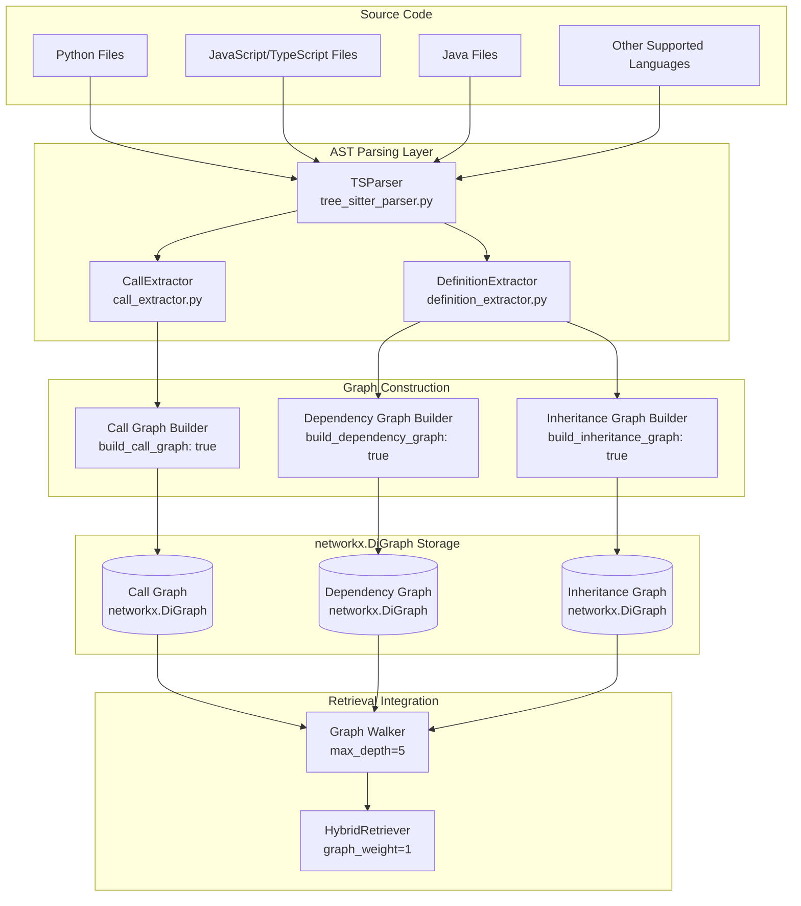
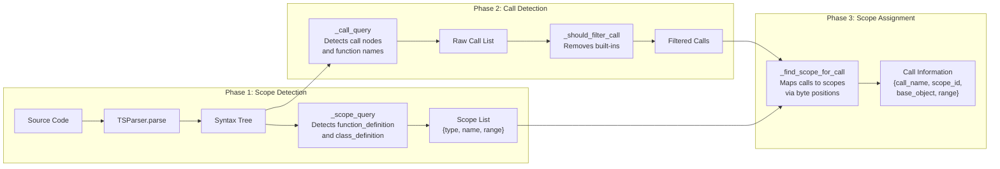
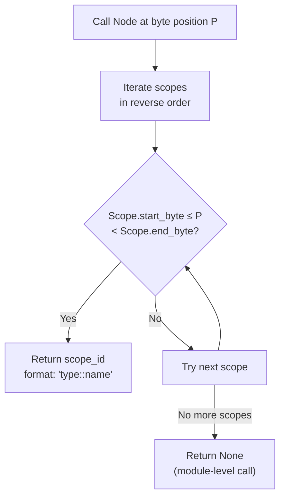
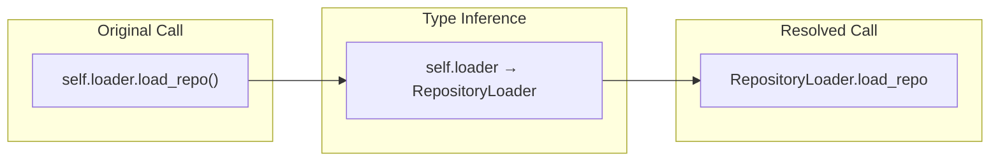
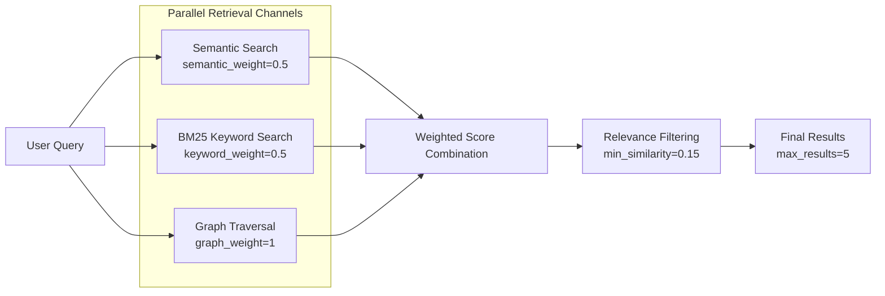
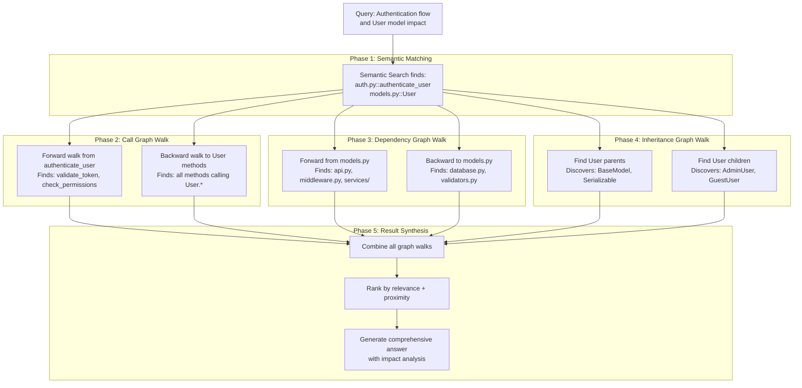

<!-- source: DeepWiki mcp.deepwiki.com · repo HKUDS/FastCode · page 3.4 Multi-Layer Graph Modeling · fetched 2026-11-09 -->

# Multi-Layer Graph Modeling

<details>
<summary>Relevant source files</summary>

The following files were used as context for generating this wiki page:

- [README.md](README.md)
- [config/config.yaml](config/config.yaml)
- [fastcode/embedder.py](fastcode/embedder.py)
- [requirements.txt](requirements.txt)

</details>


## Purpose and Scope

Multi-Layer Graph Modeling is FastCode's structural representation system that captures relationships between code entities through three interconnected graphs: the **Call Graph**, **Dependency Graph**, and **Inheritance Graph**. These graphs enable structural navigation during code retrieval by tracing how functions call each other, how modules depend on one another, and how classes inherit from their parents.

This page covers the construction and usage of these graph structures. For information about how graphs integrate with semantic and keyword search, see [Hybrid Retriever](#4.6). For the broader architectural context, see [Three-Phase Framework](#3.1).

---

## Graph Architecture Overview

FastCode builds three complementary graph layers that capture different aspects of code structure. All three graphs are implemented using `networkx.DiGraph` (directed graphs), with `networkx` listed as a core retrieval dependency. Each graph serves a distinct purpose in understanding codebase architecture and enabling precise code navigation.

**Graph Layer Architecture: from source files to `HybridRetriever` integration**



**Sources:** [README.md:82-90](), [config/config.yaml:163-167](), [requirements.txt:29]()

### networkx Implementation

All three graphs are `networkx.DiGraph` instances. This provides:

| Capability | Usage |
|---|---|
| Directed edges | Correctly models call direction, import direction, and inheritance direction |
| Node attributes | Store element metadata (type, file path, line numbers) on each node |
| Edge attributes | Store relationship metadata (call type, import alias) on each edge |
| Graph traversal | BFS/DFS via `networkx` APIs up to `max_depth` hops |
| Serialization | Pickled to disk as `_graphs.pkl` per repository |

**Sources:** [requirements.txt:29](), [config/config.yaml:163-167]()

---

## Call Graph: Function Invocation Tracking

The Call Graph captures which functions call which other functions, enabling impact analysis and execution flow tracing. This graph is essential for understanding how code execution flows through the codebase.

### Graph Structure

**Call Graph Node Types**

| Node Type | Identifier Format | Example |
|-----------|------------------|---------|
| Module-level Function | `file_path::function_name` | `auth.py::authenticate_user` |
| Class Method | `file_path::ClassName.method_name` | `user_model.py::User.validate` |
| Nested Function | `file_path::outer::inner` | `utils.py::process_data::normalize` |

**Call Graph Edge Attributes**

| Attribute | Type | Description |
|-----------|------|-------------|
| `call_type` | str | `"simple"`, `"attribute"`, or `"method"` |
| `source_scope` | str | Scope identifier of calling function |
| `target_scope` | str | Scope identifier of called function |
| `line_number` | int | Line where call occurs |

### Construction Process

The Call Graph is built using Tree-sitter-based AST parsing to extract function calls with scope tracking.

**Call Extraction Pipeline**



**Sources:** [fastcode/call_extractor.py:155-187](), [fastcode/call_extractor.py:221-273]()

### Call Types and Extraction

The `CallExtractor` class distinguishes between three types of function calls:

**1. Simple Function Calls**

Pattern: `function_name(args)`

```python
# Extracted as:
# call_name: "authenticate_user"
# call_type: "simple"
# base_object: None
result = authenticate_user(username, password)
```

**2. Attribute Access Calls**

Pattern: `object.method(args)` or `module.function(args)`

```python
# Extracted as:
# call_name: "validate"
# call_type: "attribute"
# base_object: "user"
user.validate()
```

**3. Method Calls on Self/Cls**

Pattern: `self.method()` or `cls.method()`

```python
# Extracted as:
# call_name: "save_to_database"
# call_type: "attribute"
# base_object: "self"
self.save_to_database()
```

**Sources:** [fastcode/call_extractor.py:346-387](), [fastcode/call_extractor.py:432-454]()

### Scope Tracking Implementation

Scope tracking ensures each function call is attributed to the correct containing function or class, enabling accurate call graph edges.

**Scope Resolution Algorithm**



**Sources:** [fastcode/call_extractor.py:389-410]()

### Built-in Function Filtering

The Call Graph excludes Python built-in functions to focus on application code relationships. A comprehensive set of 70+ built-in functions is filtered during extraction.

**Filtered Built-ins (Partial List)**

| Category | Functions |
|----------|-----------|
| Type Constructors | `int`, `str`, `list`, `dict`, `tuple`, `set`, `bool` |
| Iteration | `enumerate`, `range`, `zip`, `map`, `filter`, `iter` |
| Introspection | `type`, `isinstance`, `hasattr`, `getattr`, `dir` |
| I/O | `print`, `input`, `open` |
| Math | `abs`, `min`, `max`, `sum`, `round` |

**Sources:** [fastcode/call_extractor.py:47-72]()

---

## Dependency Graph: Module Import Tracking

The Dependency Graph captures import relationships between modules and files, enabling developers to understand module coupling and trace how changes propagate through the codebase.

### Graph Structure

**Dependency Graph Nodes**

Each node represents a module (Python file) or package, identified by its file path relative to the repository root.

**Dependency Graph Edges**

| Edge Direction | Meaning | Example |
|----------------|---------|---------|
| A → B | Module A imports from module B | `api.py` → `fastcode/__init__.py` |
| A → B (dotted) | Conditional import | `if TYPE_CHECKING: import X` |

### Import Types Tracked

The Dependency Graph tracks multiple import statement patterns:

**Standard Imports**
```python
import fastcode.retriever
from fastcode import CodeParser
from .local_module import helper
```

**Relative Imports**
```python
from . import sibling_module
from .. import parent_module
from ...grandparent import utility
```

**Aliased Imports**
```python
import numpy as np
from fastcode.retriever import HybridRetriever as Retriever
```

**Conditional Imports**
```python
if TYPE_CHECKING:
    from fastcode.embedder import CodeEmbedder
```

**Sources:** [config/config.yaml:51-54]()

### Construction from AST

The Dependency Graph is built during the indexing phase by extracting import statements from the Abstract Syntax Tree of each file. The `extract_imports` configuration option controls whether this information is collected.

**Dependency Edge Properties**

| Property | Type | Description |
|----------|------|-------------|
| `import_type` | str | `"absolute"`, `"relative"`, `"from_import"` |
| `imported_names` | list | Specific names imported (for `from X import Y`) |
| `alias` | str | Import alias if present (`as` clause) |
| `conditional` | bool | Whether import is inside a condition |

**Sources:** [config/config.yaml:51-54](), [config/config.yaml:78]()

---

## Inheritance Graph: Class Hierarchy Tracking

The Inheritance Graph captures class inheritance relationships, enabling understanding of object-oriented design patterns and polymorphism in the codebase.

### Graph Structure

**Inheritance Graph Nodes**

Each node represents a class definition, identified by: `file_path::ClassName`

Example: `fastcode/retriever.py::HybridRetriever`

**Inheritance Graph Edges**

| Edge Direction | Meaning | Example |
|----------------|---------|---------|
| Child → Parent | Child inherits from Parent | `HybridRetriever` → `BaseRetriever` |

### Multiple Inheritance Support

The graph supports Python's multiple inheritance by creating edges from a child to all of its parent classes.

```python
# Creates two edges:
# DatabaseModel → BaseModel
# DatabaseModel → SerializableMixin
class DatabaseModel(BaseModel, SerializableMixin):
    pass
```

### Abstract Base Classes

Abstract base classes and protocol classes are included in the graph with special marking:

```python
# Marked as abstract=True in graph node
from abc import ABC, abstractmethod

class BaseRetriever(ABC):
    @abstractmethod
    def retrieve(self, query: str):
        pass
```

**Sources:** [config/config.yaml:163-167]()

---

## Instance Type Inference for Enhanced Call Graphs

FastCode extends the Call Graph with type inference to resolve method calls on instance variables. This bridges the gap between `self.loader.load()` calls and the actual `RepositoryLoader.load()` method.

### Type Inference Patterns

The `CallExtractor.extract_instance_types()` method identifies three patterns to infer class types:

**Pattern 1: Constructor Assignment**

```python
# Infers: self.loader → RepositoryLoader
self.loader = RepositoryLoader(path)
```

**Pattern 2: Type Hint Annotation**

```python
# Infers: self.embedder → CodeEmbedder
self.embedder: CodeEmbedder
```

**Pattern 3: Type Hint with Assignment**

```python
# Infers: self.retriever → HybridRetriever
self.retriever: HybridRetriever = create_retriever()
```

**Sources:** [fastcode/call_extractor.py:475-536]()

### Scoped Type Tracking

Type inference is scope-aware, maintaining separate type mappings for each function to avoid cross-contamination:

**Type Mapping Structure**

```python
# Structure: { "scope_id": { "variable": ["Type1", "Type2"] } }
{
    "function::__init__": {
        "self.loader": ["RepositoryLoader"],
        "self.embedder": ["CodeEmbedder"]
    },
    "function::process_file": {
        "parser": ["CodeParser"],
        "local_var": ["TempClass"]
    },
    "global": {
        "config": ["Config"]
    }
}
```

**Sources:** [fastcode/call_extractor.py:505-536]()

### Enhanced Call Resolution

With type information, the Call Graph can resolve indirect method calls:



**Sources:** [fastcode/call_extractor.py:475-536]()

---

## Graph-Based Retrieval Integration

The three graph layers integrate with FastCode's hybrid retrieval system to enhance search results through structural navigation.

### Graph Traversal Configuration

**Configuration Parameters**

| Parameter | Default | Description |
|-----------|---------|-------------|
| `graph.build_call_graph` | `true` | Enable call graph construction |
| `graph.build_dependency_graph` | `true` | Enable dependency graph construction |
| `graph.build_inheritance_graph` | `true` | Enable inheritance graph construction |
| `graph.max_depth` | `5` | Maximum traversal depth for graph walks |
| `retrieval.graph_weight` | `1` | Weight for graph-based results in hybrid search |

**Sources:** [config/config.yaml:163-167](), [config/config.yaml:99-103]()

### Hybrid Search Integration

Graph traversal operates in parallel with semantic and keyword search, with results combined using configurable weights:

**Retrieval weight distribution across `HybridRetriever` search channels**



**Sources:** [config/config.yaml:99-108]()

### Graph Walk Strategies

The graph walker employs different strategies based on query intent:

**1. Forward Walk (Callee Discovery)**

For queries like "What does function X call?"
- Start from matched function nodes
- Traverse Call Graph in forward direction
- Max depth = 5 hops
- Collect all reachable functions

**2. Backward Walk (Caller Discovery)**

For queries like "What calls function X?"
- Start from matched function nodes
- Traverse Call Graph in reverse direction
- Max depth = 5 hops
- Collect all callers

**3. Dependency Walk (Impact Analysis)**

For queries like "What depends on module X?"
- Start from matched module nodes
- Traverse Dependency Graph forward and backward
- Collect dependent and dependency modules

**4. Inheritance Walk (Class Hierarchy)**

For queries like "What classes inherit from X?"
- Start from matched class nodes
- Traverse Inheritance Graph in both directions
- Collect parent classes and child classes

**Sources:** [config/config.yaml:163-167]()

---

## Graph Persistence and Loading

Graph structures are persisted to disk to avoid rebuilding on every query. The persistence strategy depends on the vector store backend and evaluation mode.

### Storage Location

Graph structures are serialized together into a single pickle file per repository.

**File Structure**

```
./data/vector_store/
└── {repo_name}_graphs.pkl      # All three networkx.DiGraph instances pickled together
```

The `_graphs.pkl` file is referenced alongside the vector store artifacts (`_metadata.pkl`, `.faiss`, `_bm25.pkl`) when a repository is loaded or deleted.

### Evaluation Mode Behavior

The evaluation mode configuration affects graph persistence:

| Mode | Persistence | Loading |
|------|-------------|---------|
| `evaluation.disable_persistence: true` | Graphs not written to disk | Rebuilt every run |
| `evaluation.disable_persistence: false` | Graphs persisted after build | Loaded from disk if available |
| `evaluation.force_reindex: true` | Old graphs deleted | Always rebuilt |

**Sources:** [config/config.yaml:193-199]()

---

## Performance Characteristics

### Build Time Complexity

**Call Graph Construction**

- Time: O(n × m) where n = number of files, m = average function calls per file
- Space: O(e) where e = total number of unique function call edges
- Typical: ~1-2 seconds per 1000 files

**Dependency Graph Construction**

- Time: O(n × i) where n = number of files, i = average imports per file
- Space: O(f + d) where f = number of files, d = number of dependencies
- Typical: ~0.5 seconds per 1000 files

**Inheritance Graph Construction**

- Time: O(c × p) where c = number of classes, p = average parents per class
- Space: O(c + r) where c = number of classes, r = inheritance relationships
- Typical: ~0.3 seconds per 1000 classes

### Retrieval Time Complexity

**Graph Traversal**

- Time: O(b^d) where b = branching factor, d = max_depth (default 5)
- Pruning: Early termination when confidence threshold reached
- Typical: ~50-200ms per graph walk with max_depth=5

**Sources:** [config/config.yaml:167]()

---

## Configuration Reference

### Complete Graph Configuration Options

```yaml
# Graph Building (config/config.yaml)
graph:
  build_call_graph: true          # Enable call graph construction
  build_dependency_graph: true    # Enable dependency graph construction
  build_inheritance_graph: true   # Enable inheritance graph construction
  max_depth: 5                    # Maximum graph traversal depth

# Parser Settings (affects graph construction)
parser:
  extract_imports: true           # Required for dependency graph
  extract_comments: true          # Enhances call context
  compute_complexity: true        # Adds complexity metrics to nodes

# Retrieval Integration
retrieval:
  graph_weight: 1                # Weight for graph-based results
  max_results: 5                 # Final result count after graph enhancement

# Persistence Control
evaluation:
  disable_persistence: false     # Set true to skip writing graphs to disk
  force_reindex: false          # Set true to always rebuild graphs
```

**Sources:** [config/config.yaml:163-167](), [config/config.yaml:51-56](), [config/config.yaml:99-108](), [config/config.yaml:193-199]()

---

## Example: Multi-Graph Query Resolution

This example demonstrates how all three graphs work together to answer a complex architectural query.

**Query:** "How does the authentication flow work and what would break if I change the User model?"

**Graph-Based Resolution Process**



**Graph Contributions to Answer**

| Graph Type | Contribution | Code Entities Discovered |
|------------|--------------|--------------------------|
| Call Graph | Authentication execution flow | `authenticate_user` → `validate_token` → `check_permissions` → `load_user_from_db` |
| Call Graph | User model usage sites | 23 functions calling `User.validate()`, `User.save()`, etc. |
| Dependency Graph | Files importing User model | `api.py`, `middleware.py`, `services/auth.py`, `tests/test_auth.py` |
| Inheritance Graph | Related classes | Parent: `BaseModel`, Children: `AdminUser`, `GuestUser`, `ServiceAccount` |

**Sources:** [README.md:82-90](), [config/config.yaml:163-167]()

---

