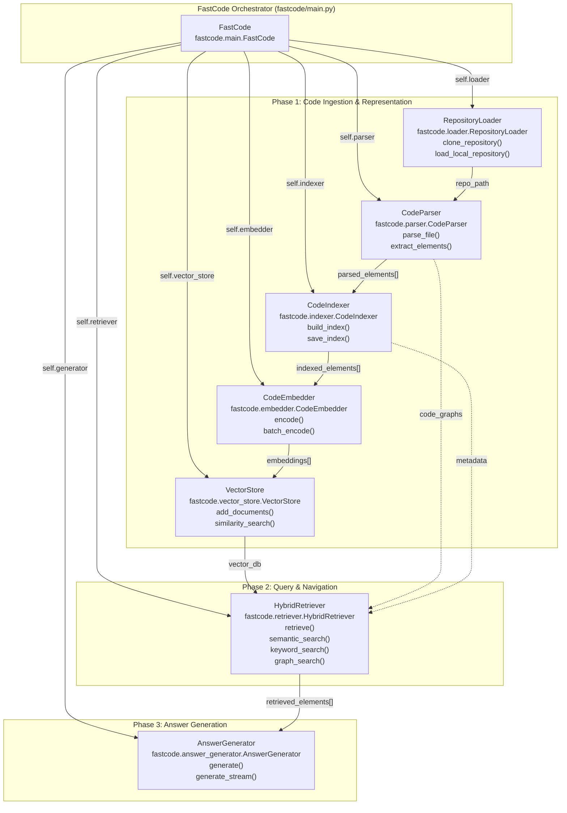
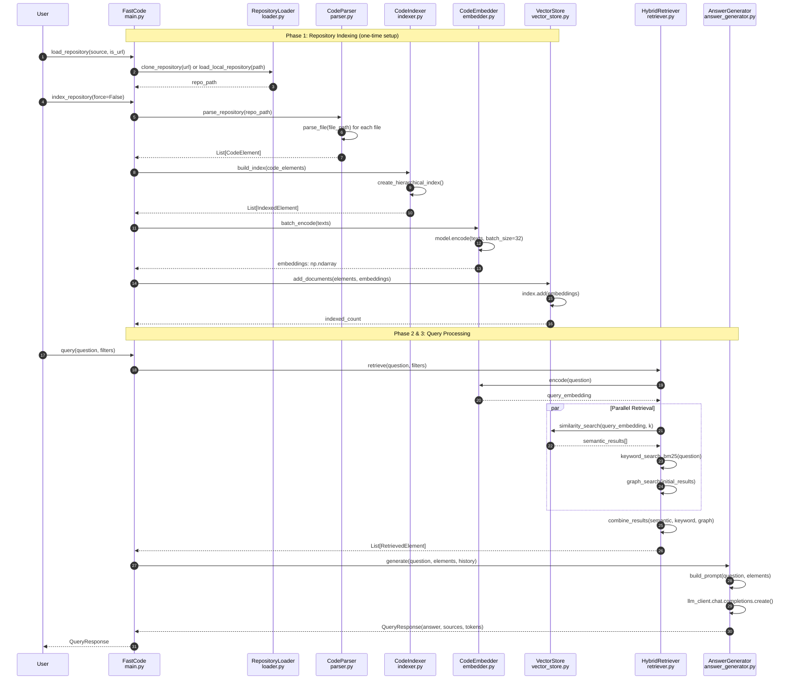
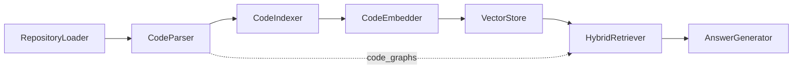

<!-- source: DeepWiki mcp.deepwiki.com · repo HKUDS/FastCode · page 4 Core Components · fetched 2026-11-09 -->

# Core Components

Relevant source files

The following files were used as context for generating this wiki page:

- [README.md](README.md)
- [config/config.yaml](config/config.yaml)
- [fastcode/embedder.py](fastcode/embedder.py)

This page provides an overview of the major subsystems that comprise the FastCode engine. These components work together to transform code repositories into queryable knowledge bases and generate accurate answers to code understanding questions.

**Purpose and Scope:** This page introduces the seven core components and their relationships. For detailed implementation of each component, see their dedicated subsections ([4.1](#4.1) through [4.7](#4.7)). For information on how these components fit into the broader system architecture, see [Architecture Overview](#1.2) and [System Architecture](#3).

---

## Component Overview

FastCode's core engine consists of seven primary subsystems, each responsible for a distinct phase of code understanding:

| Component | Class | File | Responsibility |
|-----------|-------|------|----------------|
| **Repository Loader** | `RepositoryLoader` | `fastcode/loader.py` | Clone, extract, and load repositories from various sources (Git URLs, local paths, ZIP files) |
| **Code Parser** | `CodeParser` | `fastcode/parser.py` | AST-based parsing across 8 languages to extract code structures, docstrings, comments, and complexity metrics |
| **Code Indexer** | `CodeIndexer` | `fastcode/indexer.py` | Multi-level indexing (file/class/function/doc) with context enrichment and metadata management |
| **Code Embedder** | `CodeEmbedder` | `fastcode/embedder.py` | Semantic embedding generation using SentenceTransformer models with batch processing |
| **Vector Store** | `VectorStore` | `fastcode/vector_store.py` | Vector storage backends (FAISS/ChromaDB/Qdrant) with HNSW indexing for similarity search |
| **Hybrid Retriever** | `HybridRetriever` | `fastcode/retriever.py` | Multi-strategy retrieval combining semantic search, keyword search (BM25), and graph traversal |
| **Answer Generator** | `AnswerGenerator` | `fastcode/answer_generator.py` | LLM integration for answer generation with streaming, token management, and multi-turn dialogue |

**Sources:** [fastcode/__init__.py:15-24](), [README.md:74-113]()

---

## Component Architecture

The following diagram illustrates how the seven core components are instantiated and connected within the `FastCode` orchestrator class, using actual class names and module paths from the codebase:

**Diagram: Core Component Instantiation and Dependencies**

This diagram shows the ownership structure within the `FastCode` class and the primary data flow between components. The `FastCode` orchestrator maintains references to all seven components and coordinates their interactions during indexing and query operations.

**Sources:** [fastcode/__init__.py:15-24](), [fastcode/main.py]() (implied from imports)

---

## Data Flow Pipeline

The following sequence diagram shows how components collaborate during a typical query operation, including the actual method calls and data structures exchanged:

**Diagram: Component Interaction During Query Pipeline**

This sequence shows the two-phase operation: (1) indexing transforms a repository into searchable representations, and (2) querying retrieves relevant code and generates answers. Each component processes and enriches the data before passing it to the next stage.

**Sources:** [README.md:76-113](), [fastcode/__init__.py:15-24]()

---

## Component Relationships

### Ownership Hierarchy

The `FastCode` orchestrator class (defined in `fastcode/main.py`) serves as the central coordinator and owns instances of all seven core components. This composition pattern ensures:

- **Single Source of Configuration:** All components receive their configuration from `config/config.yaml` through the `FastCode` constructor
- **Lifecycle Management:** Components are initialized in dependency order and cleaned up together
- **State Coordination:** The orchestrator manages shared state like loaded repositories and active sessions

### Component Dependencies

Components form a directed acyclic graph (DAG) of dependencies:

**Diagram: Component Dependency Graph**

- **Solid arrows** indicate mandatory data dependencies (output of one component is input to another)
- **Dashed arrows** indicate optional enrichment (code graphs enhance but aren't required for retrieval)

### Data Structures Exchanged

| From Component | To Component | Data Structure | Description |
|----------------|--------------|----------------|-------------|
| `RepositoryLoader` | `CodeParser` | `str` (repo_path) | File system path to cloned/loaded repository |
| `CodeParser` | `CodeIndexer` | `List[CodeElement]` | Parsed AST elements with metadata (file, line numbers, type, content) |
| `CodeIndexer` | `CodeEmbedder` | `List[IndexedElement]` | Hierarchically organized elements with enriched context |
| `CodeEmbedder` | `VectorStore` | `np.ndarray` | Dense embeddings (shape: [n_elements, embedding_dim]) |
| `VectorStore` | `HybridRetriever` | `List[Tuple[str, float]]` | Document IDs and similarity scores |
| `HybridRetriever` | `AnswerGenerator` | `List[RetrievedElement]` | Top-k relevant code elements with metadata and scores |
| `AnswerGenerator` | Client | `QueryResponse` | Generated answer, source references, token counts |

**Sources:** [fastcode/__init__.py:15-24]()

---

## Initialization and Lifecycle

### Component Instantiation Order

The `FastCode` class initializes components in dependency order during `__init__()`:

1. **Load Configuration:** Parse `config/config.yaml` and environment variables
2. **Initialize Embedder:** Load SentenceTransformer model (CPU/CUDA)
3. **Initialize Vector Store:** Create or load FAISS/ChromaDB/Qdrant index
4. **Initialize Parser:** Load Tree-sitter grammars for supported languages
5. **Initialize Indexer:** Configure multi-level indexing strategy
6. **Initialize Retriever:** Set up hybrid search weights and filters
7. **Initialize Generator:** Configure LLM client (OpenAI/Anthropic/Ollama)
8. **Initialize Loader:** Configure repository sources and clone settings

### Component State Management

Each component maintains its own internal state:

| Component | Stateful? | State Persisted? | Persistence Location |
|-----------|-----------|------------------|---------------------|
| `RepositoryLoader` | Stateless | N/A | - |
| `CodeParser` | Stateless | N/A | - |
| `CodeIndexer` | Yes (indexed elements) | Yes | `data/indexes/{repo_name}_index.pkl` |
| `CodeEmbedder` | Yes (loaded model) | Yes (model only) | HuggingFace cache |
| `VectorStore` | Yes (embeddings + index) | Yes | `data/vector_store/` |
| `HybridRetriever` | Stateless | N/A | - |
| `AnswerGenerator` | Yes (session history) | Yes | `data/sessions/` via CacheManager |

### Component Cleanup

The `FastCode` orchestrator provides cleanup methods:

- **`unload_repository()`:** Clears loaded repository data from memory without deleting persisted indexes
- **`delete_repository(repo_name)`:** Removes persisted indexes and vector stores for a specific repository
- **Component destructors:** Each component implements cleanup in `__del__()` if necessary (e.g., closing database connections)

**Sources:** [fastcode/__init__.py:1-42](), [README.md:162-223]()

---

## Component Integration Points

### Configuration Interface

All components accept a `config` dictionary during initialization, typically passed from `config/config.yaml`. Key configuration sections:

- **Repository Settings** → `RepositoryLoader`: `repo_root`, `clone_depth`, `max_file_size_mb`, `ignore_patterns`
- **Parser Settings** → `CodeParser`: `extract_docstrings`, `extract_comments`, `compute_complexity`
- **Embedding Settings** → `CodeEmbedder`: `model`, `device`, `batch_size`, `max_seq_length`
- **Indexing Settings** → `CodeIndexer`: `levels`, `include_imports`, `include_class_context`
- **Vector Store Settings** → `VectorStore`: `type`, `distance_metric`, `index_type`
- **Retrieval Settings** → `HybridRetriever`: `semantic_weight`, `keyword_weight`, `graph_weight`, `min_similarity`
- **Generation Settings** → `AnswerGenerator`: `provider`, `model`, `temperature`, `max_tokens`

See [Configuration](#8) for complete reference.

### Extension Points

Components are designed to be extensible:

- **Custom Parsers:** Extend `CodeParser` to add support for additional languages via Tree-sitter grammars (see [Adding Language Support](#10.4))
- **Custom Embedders:** Swap embedding models by implementing SentenceTransformer-compatible interface
- **Custom Vector Stores:** Implement the vector store interface to use alternative backends
- **Custom Retrieval Strategies:** Extend `HybridRetriever` to add new ranking algorithms
- **Custom Prompts:** Override prompt builders in `AnswerGenerator` for domain-specific formatting

See [Extension Points](#10.3) for implementation details.

**Sources:** [README.md:550-606](), [fastcode/__init__.py:1-42]()

---

## Performance Characteristics

### Component Bottlenecks

| Component | Bottleneck | Typical Time | Optimization Strategy |
|-----------|------------|--------------|----------------------|
| `RepositoryLoader` | Network I/O (cloning) | 10-60s | Shallow clone (`clone_depth=1`) |
| `CodeParser` | CPU (AST parsing) | 0.1-5s per file | Multi-threaded parsing |
| `CodeIndexer` | Memory (large repos) | 1-10s | Streaming indexing |
| `CodeEmbedder` | GPU/CPU (inference) | 50-200ms per batch | Batch processing, GPU acceleration |
| `VectorStore` | Disk I/O (persistence) | 1-5s | Memory-mapped indexes (FAISS) |
| `HybridRetriever` | Vector search | 10-100ms | HNSW indexing |
| `AnswerGenerator` | LLM API latency | 1-10s | Streaming responses, caching |

### Memory Footprint

- **Small Repository** (<1000 files): ~500MB RAM (embeddings + indexes)
- **Medium Repository** (1000-5000 files): ~2GB RAM
- **Large Repository** (5000+ files): ~5-10GB RAM
- **Multi-Repository Mode** (5 repos): ~3-8GB RAM (depending on repo sizes)

For production deployments, see [Production Considerations](#7.4).

**Sources:** [README.md:27-47]()

---

## Multi-Repository Support

### Repository Selection Components

FastCode includes two additional specialized components for multi-repository scenarios:

| Component | Class | File | Responsibility |
|-----------|-------|------|----------------|
| **Repository Overview Generator** | `RepositoryOverviewGenerator` | `fastcode/repo_overview.py` | Generate high-level summaries of repository structure and purpose |
| **Repository Selector** | `RepositorySelector` | `fastcode/repo_selector.py` | Select top-k relevant repositories for a given query using LLM or embedding-based methods |

These components enable FastCode to efficiently query across multiple codebases by performing two-stage retrieval: first selecting relevant repositories, then searching within selected repositories. See [Multi-Repository Support](#3.2) and [Two-Stage Retrieval](#9.5) for details.

**Sources:** [fastcode/__init__.py:21-22](), [README.md:50-53]()

---

## Agent System Components

### Iterative Retrieval Components

For enhanced accuracy, FastCode includes agent-based components that iterate on retrieval:

| Component | Class | File | Responsibility |
|-----------|-------|------|----------------|
| **Iterative Agent** | `IterativeAgent` | `fastcode/iterative_agent.py` | Multi-round retrieval with confidence thresholds and stopping conditions |
| **Agent Tools** | `AgentTools` | `fastcode/agent_tools.py` | Read-only file exploration tools (list_directory, search_codebase, etc.) |

These components enable the "agency mode" feature that achieves 95%+ confidence through iterative refinement. The agent uses up to 4 iterations with minimum 5% confidence gain per iteration. See [Agent System](#5) for complete documentation.

**Sources:** [fastcode/__init__.py:23-24](), [README.md:92-103]()

---

## Summary

The seven core components form a cohesive pipeline from repository ingestion to answer generation:

1. **RepositoryLoader** fetches and extracts code repositories
2. **CodeParser** transforms source code into structured AST elements
3. **CodeIndexer** organizes elements into a 4-level hierarchy with enriched context
4. **CodeEmbedder** generates semantic embeddings for similarity search
5. **VectorStore** persists embeddings and provides fast similarity search via HNSW indexing
6. **HybridRetriever** combines semantic, keyword, and graph-based search strategies
7. **AnswerGenerator** integrates with LLMs to produce accurate, well-sourced answers

These components are orchestrated by the `FastCode` class, which manages their lifecycle, coordinates data flow, and exposes a unified API. For detailed implementation of each component, refer to the subsections [4.1](#4.1) through [4.7](#4.7).

**Sources:** [fastcode/__init__.py:1-42](), [README.md:25-113]()

---

