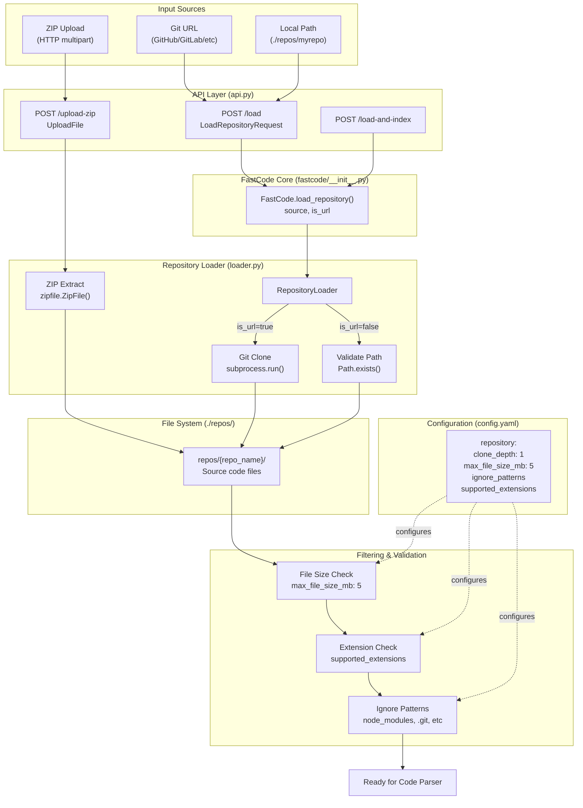
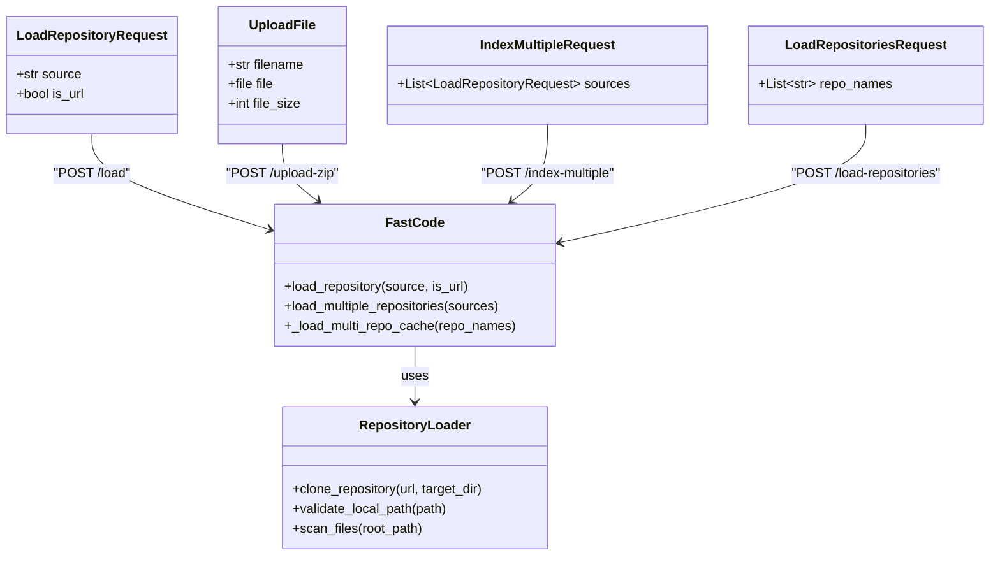
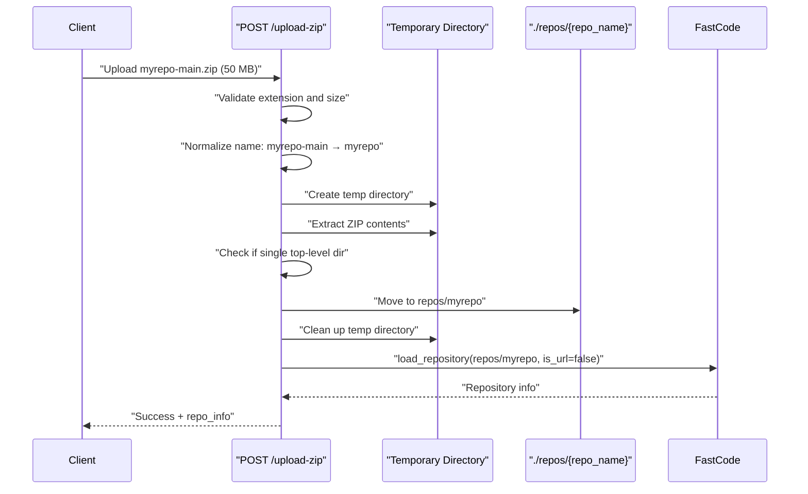
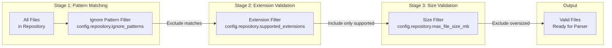

<!-- source: DeepWiki mcp.deepwiki.com · repo HKUDS/FastCode · page 4.1 Repository Loader · fetched 2026-11-09 -->

# Repository Loader

<details>
<summary>Relevant source files</summary>

The following files were used as context for generating this wiki page:

- [fastcode/loader.py](fastcode/loader.py)

</details>


## Purpose and Scope

The Repository Loader subsystem is responsible for acquiring repository source code and preparing it for indexing. It handles three primary input methods: cloning Git repositories from URLs, loading from local filesystem paths, and extracting uploaded ZIP archives. The loader performs initial filtering based on file size, extension, and ignore patterns before passing the repository to the Code Parser.

For information about what happens after loading (AST-based parsing and analysis), see [Code Parser](#4.2). For details on how multiple repositories are managed and selected, see [Multi-Repository Support](#3.2).

---

## Repository Sources

FastCode supports three distinct repository sources, each with its own loading mechanism:

### Git URL Cloning

Repositories can be cloned from Git hosting platforms (GitHub, GitLab, Bitbucket, etc.) using standard Git URLs. The loader performs shallow clones (`depth=1`) by default to minimize bandwidth and storage requirements.

**API Endpoint**: `POST /load` with `is_url=true`

**Configuration**: [config/config.yaml:10]()
```yaml
repository:
  clone_depth: 1  # Shallow clone for faster processing
```

### Local Filesystem Paths

Existing repositories on the local filesystem can be loaded directly without cloning. This is useful for development environments where the repository is already available or when working with repositories that cannot be cloned (e.g., private codebases without Git remotes).

**API Endpoint**: `POST /load` with `is_url=false`

### ZIP Archive Uploads

Repositories can be uploaded as ZIP archives via the REST API, which automatically extracts them to the `repos/` directory. The loader handles GitHub-style ZIP archives (which contain a single top-level directory with `-main` or `-master` suffix) by stripping the suffix and flattening the structure.

**API Endpoint**: `POST /upload-zip`

**Size Limit**: 100 MB (configurable in code)

Sources: [api.py:218-416](), [config/config.yaml:6-48]()

---

## Loading Process Flow

The following diagram illustrates the complete repository loading pipeline from source acquisition to readiness for indexing:

**Diagram: Repository Loading Pipeline**



Sources: [api.py:218-236](), [api.py:339-416](), [config/config.yaml:8-48]()

---

## REST API Integration

The Repository Loader is accessible through multiple REST API endpoints, each designed for specific use cases:

### Single Repository Loading

| Endpoint | Method | Purpose | Request Body | Returns |
|----------|--------|---------|--------------|---------|
| `/load` | POST | Load from URL or path | `LoadRepositoryRequest` | Repository info |
| `/upload-zip` | POST | Upload ZIP archive | Multipart file | Repository info |
| `/load-and-index` | POST | Load + index in one call | `LoadRepositoryRequest` | Index summary |
| `/upload-and-index` | POST | Upload + index in one call | Multipart file | Index summary |

### Multi-Repository Operations

| Endpoint | Method | Purpose | Request Body | Returns |
|----------|--------|---------|--------------|---------|
| `/index-multiple` | POST | Load and index multiple repos | `IndexMultipleRequest` | Aggregate stats |
| `/load-repositories` | POST | Load from existing indexes | `LoadRepositoriesRequest` | Loaded repo list |

Sources: [api.py:218-337]()

---

## Request Models

The API uses Pydantic models for request validation:

**Diagram: API Request Models and Code Entities**



Sources: [api.py:35-73](), [fastcode/__init__.py:16]()

---

## ZIP Upload Processing

The ZIP upload endpoint performs several normalization steps to handle GitHub-style archives:

**Processing Steps**:

1. **Validation**: Check file extension (`.zip` only) and size (≤ 100 MB)
2. **Name Normalization**: Strip `-main`, `-master`, `_main`, `_master` suffixes
3. **Temporary Extraction**: Extract to `tempfile.mkdtemp(prefix="fastcode_upload_")`
4. **Structure Flattening**: If ZIP contains single top-level directory, flatten it
5. **Repository Placement**: Move to `./repos/{normalized_name}`
6. **Cleanup**: Remove temporary directory

**Code Flow**:



Sources: [api.py:339-416]()

---

## Configuration Options

Repository loading behavior is controlled by the `repository` section in `config.yaml`:

### Repository Settings

| Parameter | Type | Default | Description |
|-----------|------|---------|-------------|
| `clone_depth` | int | 1 | Git clone depth for shallow cloning |
| `max_file_size_mb` | int | 5 | Skip files larger than this (MB) |
| `ignore_patterns` | list | See below | Patterns to exclude during scanning |
| `supported_extensions` | list | See below | File extensions to process |

### Default Ignore Patterns

```yaml
ignore_patterns:
  - "*.pyc"           # Python bytecode
  - "__pycache__"     # Python cache directories
  - "node_modules"    # Node.js dependencies
  - ".git"            # Git metadata
  - "*.min.js"        # Minified JavaScript
  - "*.bundle.js"     # Bundled JavaScript
  - "dist/*"          # Distribution directories
  - "build/*"         # Build artifacts
  - "*.lock"          # Lock files
```

### Supported Extensions

The loader processes **48 file types** across multiple categories:

**Code Files**: `.py`, `.js`, `.ts`, `.jsx`, `.tsx`, `.java`, `.go`, `.cpp`, `.c`, `.h`, `.rs`, `.rb`, `.php`, `.cs`, `.swift`, `.kt`, `.pyx`

**Configuration Files**: `.toml`, `.yaml`, `.json`, `.xml`

**Documentation Files**: `.md`, `.txt`, `.rst`, `.html`, `.css`

Sources: [config/config.yaml:8-48]()

---

## File Filtering Pipeline

The loader applies a three-stage filtering process to determine which files to include:

**Diagram: File Filtering Stages**



Sources: [config/config.yaml:12-48]()

---

## Multi-Repository Loading

FastCode supports loading multiple repositories simultaneously for cross-repository code understanding:

### Loading from Existing Indexes

The `/load-repositories` endpoint loads previously indexed repositories from disk cache without re-cloning or re-indexing:

```yaml
POST /load-repositories
{
  "repo_names": ["repo1", "repo2", "repo3"]
}
```

**Internal Method**: `FastCode._load_multi_repo_cache(repo_names)` [api.py:298]()

### Batch Indexing

The `/index-multiple` endpoint clones/loads and indexes multiple repositories in sequence:

```yaml
POST /index-multiple
{
  "sources": [
    {"source": "https://github.com/user/repo1", "is_url": true},
    {"source": "./repos/local_repo", "is_url": false}
  ]
}
```

**Internal Method**: `FastCode.load_multiple_repositories(sources)` [api.py:325]()

Sources: [api.py:288-337]()

---

## Repository Directory Structure

After loading, repositories are organized in a standardized structure:

```
./repos/
├── repo1/                  # Cloned/uploaded repository 1
│   ├── src/
│   ├── tests/
│   └── README.md
├── repo2/                  # Cloned/uploaded repository 2
│   └── ...
└── repo3/                  # Local repository 3
    └── ...

./data/vector_store/        # Indexed embeddings (per-repository)
├── repo1/
│   ├── faiss.index
│   ├── bm25.pkl
│   └── metadata.json
├── repo2/
│   └── ...
└── repo3/
    └── ...
```

Sources: [api.py:362-392]()

---

## Error Handling

The loader implements comprehensive error handling for common failure scenarios:

| Error Condition | HTTP Status | Error Message | Recovery Action |
|----------------|-------------|---------------|-----------------|
| Invalid ZIP file | 400 | "Invalid ZIP file" | Re-upload valid ZIP |
| File too large | 400 | "File too large. Maximum size is 100MB" | Split or reduce archive |
| Repository exists | Warning | Path removed and overwritten | Automatic cleanup |
| Clone failure | 500 | Git error details | Check URL/credentials |
| Extraction failure | 500 | Filesystem error details | Check permissions |

**Example Error Handling** [api.py:410-415]():

```python
except zipfile.BadZipFile:
    logger.error("Invalid ZIP file")
    raise HTTPException(status_code=400, detail="Invalid ZIP file")
except Exception as e:
    logger.error(f"Failed to upload and extract ZIP: {e}")
    raise HTTPException(status_code=500, detail=str(e))
```

Sources: [api.py:232-235](), [api.py:410-415]()

---

## Repository Information

After successful loading, the loader returns repository metadata:

**Response Structure**:

```python
{
    "status": "success",
    "message": "Repository loaded successfully",
    "repo_info": {
        "name": str,          # Repository name
        "path": str,          # Absolute path to repository
        "url": str or None,   # Source URL if cloned
        "size": int,          # Total repository size in bytes
        "files": int,         # Number of processable files
        "languages": dict     # File count per language
    },
    "repo_path": str          # For ZIP uploads
}
```

**Access via API**:
- `GET /status` - Full system status including repo info
- `GET /summary` - Detailed repository summary (after indexing)

Sources: [api.py:227-231](), [api.py:402-408]()

---

## Integration with Indexing

The Repository Loader is the first stage in the FastCode processing pipeline. After loading completes, the repository is ready for:

1. **Code Parsing** - AST-based extraction of code elements (see [Code Parser](#4.2))
2. **Code Indexing** - Multi-level hierarchical indexing (see [Code Indexer](#4.3))
3. **Embedding Generation** - Semantic vector creation (see [Code Embedder](#4.4))

**Combined Operations**:

Both `/load-and-index` and `/upload-and-index` endpoints combine loading and indexing into single atomic operations, which is the recommended approach for new repositories.

Sources: [api.py:263-286](), [api.py:418-443]()

---

## Repository Management Operations

### Listing Repositories

The `/repositories` endpoint provides information about available and loaded repositories:

```yaml
GET /repositories?full_scan=false
{
  "status": "success",
  "available": [        # Indexed repositories on disk
    {
      "name": "repo1",
      "path": "./data/vector_store/repo1",
      "files": 234,
      "size_mb": 5.2
    }
  ],
  "loaded": [          # Currently loaded in memory
    {
      "name": "repo1",
      "is_indexed": true
    }
  ]
}
```

The `full_scan` parameter forces a fresh directory scan (slower but accurate) versus using cached results.

### Deleting Repositories

The `/delete-repos` endpoint removes repository data:

```yaml
POST /delete-repos
{
  "repo_names": ["repo1", "repo2"],
  "delete_source": true    # Also delete ./repos/{name}
}
```

This removes:
- Vector store indexes (`./data/vector_store/{name}`)
- BM25 indexes
- Graph data structures
- Optionally: source code (`./repos/{name}`)

Sources: [api.py:194-216](), [api.py:669-697]()

---

## Lazy Initialization

The FastCode instance uses lazy initialization to improve startup time. The repository loader is not instantiated until the first API request that requires it.

**Code Pattern** [api.py:131-137]():

```python
def _ensure_fastcode_initialized():
    """Ensure FastCode is initialized (lazy initialization)"""
    global fastcode_instance
    if fastcode_instance is None:
        logger.info("Initializing FastCode system (lazy initialization)")
        fastcode_instance = FastCode()
    return fastcode_instance
```

This pattern is used by all API endpoints that interact with the repository loader.

Sources: [api.py:131-137]()

---

## Summary

The Repository Loader provides a flexible, multi-source system for acquiring repository code:

- **Three input methods**: Git URLs, local paths, ZIP uploads
- **Intelligent filtering**: Size limits, extension matching, pattern exclusion
- **Multi-repository support**: Load and manage multiple codebases simultaneously
- **REST API integration**: Complete endpoint coverage for all operations
- **Error resilience**: Comprehensive validation and error handling
- **Performance optimization**: Shallow cloning, lazy initialization, cached scans

The loader serves as the foundation for the entire FastCode pipeline, ensuring that only relevant, processable code reaches the downstream parsing and indexing stages.

Sources: [api.py:218-416](), [config/config.yaml:6-48](), [fastcode/__init__.py:16]()

---

