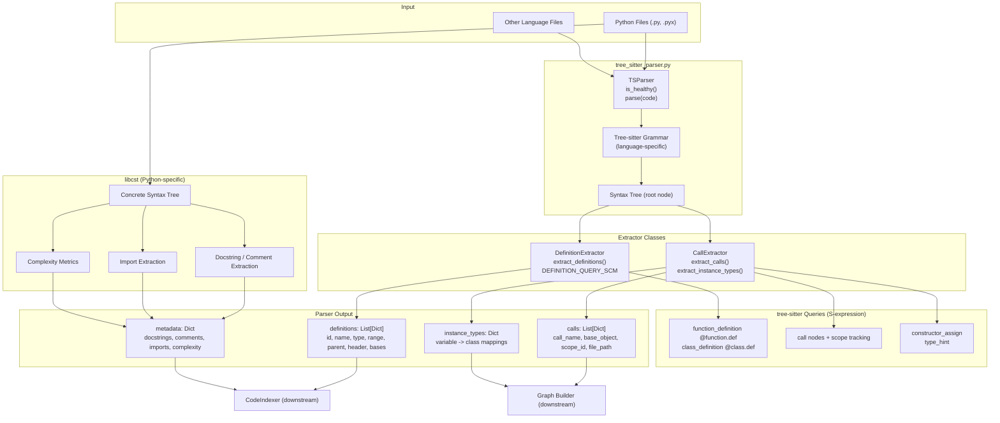
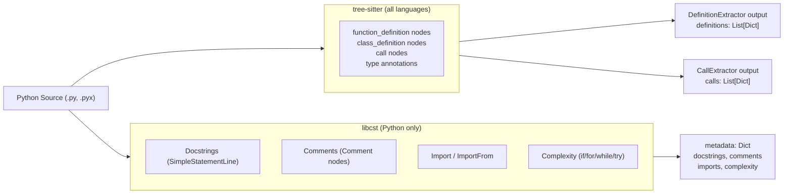
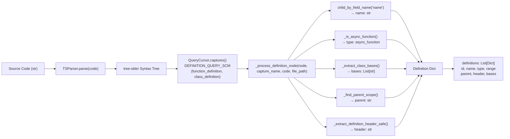
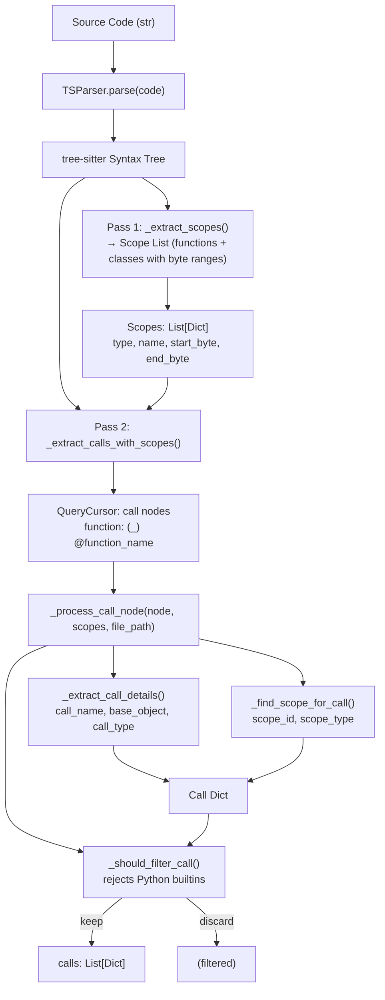
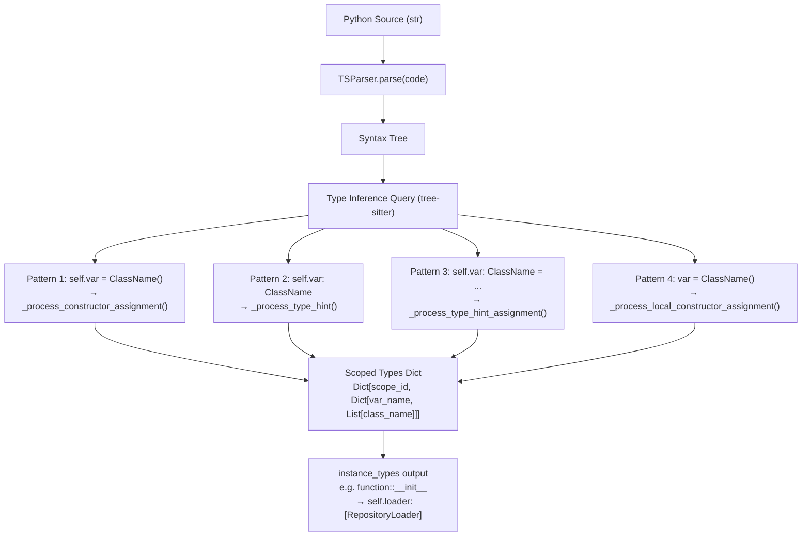
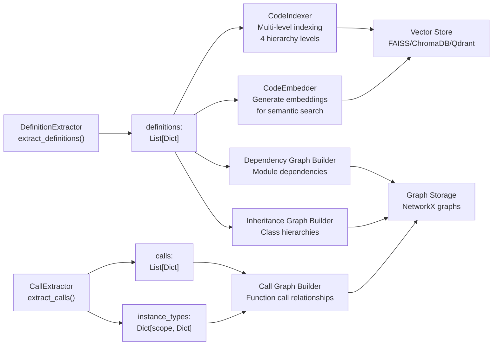

<!-- source: DeepWiki mcp.deepwiki.com · repo HKUDS/FastCode · page 4.2 Code Parser · fetched 2026-11-09 -->

# Code Parser

<details>
<summary>Relevant source files</summary>

The following files were used as context for generating this wiki page:

- [config/config.yaml](config/config.yaml)
- [fastcode/embedder.py](fastcode/embedder.py)
- [requirements.txt](requirements.txt)

</details>


## Purpose and Scope

The Code Parser is FastCode's static analysis engine for source code. It uses two complementary parsing libraries:

- **tree-sitter** — grammar-based AST parsing across multiple languages, used for definitions, call extraction, and type inference
- **libcst** — Python-specific Concrete Syntax Tree (CST) library used for precise docstring, comment, import, and complexity extraction in Python files

Together these libraries extract structured information from source code: class definitions, function signatures, docstrings, inline comments, import statements, function call relationships, and cyclomatic complexity metrics.

For information about how parsed code elements are organized into searchable indexes, see page 4.3. For details on how code graphs are constructed from parser output, see page 3.4.
</thinking>

Sources: [requirements.txt:10-21](), [config/config.yaml:50-56]()

## Architecture Overview

The Code Parser follows a modular extraction architecture. `TSParser` provides AST parsing via tree-sitter language grammars, while `libcst` handles Python-specific CST analysis. Specialized extractor classes (`DefinitionExtractor`, `CallExtractor`) use tree-sitter queries to locate and extract code structures.

**Code Parser: Module and Data Flow**



Sources: [fastcode/__init__.py:17](), [fastcode/call_extractor.py:1-46](), [fastcode/definition_extractor.py:1-34](), [requirements.txt:10-21]()

The parser operates in three phases:

1. **AST / CST Generation**: `TSParser` builds a tree-sitter syntax tree from source; for Python files, `libcst` additionally builds a concrete syntax tree
2. **Query Execution**: Extractor classes (`DefinitionExtractor`, `CallExtractor`) run compiled tree-sitter queries (`DEFINITION_QUERY_SCM`, call queries) against the AST to match patterns
3. **Data Extraction**: Extractors and libcst traversal produce structured dicts with positional metadata for downstream indexing and graph construction

## Supported Languages

Language support has two layers: the `supported_extensions` list in `config/config.yaml` controls which files are scanned, and `requirements.txt` determines which tree-sitter grammar packages are installed. Only languages with installed grammars get full AST-based extraction; other file types are scanned as plain text.

**Languages with tree-sitter grammars installed** (`requirements.txt`):

| Language | tree-sitter Package | Extensions |
|---|---|---|
| Python | `tree-sitter-python` | `.py`, `.pyx` |
| JavaScript | `tree-sitter-javascript` | `.js`, `.jsx` |
| TypeScript | `tree-sitter-typescript` | `.ts`, `.tsx` |
| Java | `tree-sitter-java` | `.java` |
| Go | `tree-sitter-go` | `.go` |
| C | `tree-sitter-c` | `.c`, `.h` |
| C++ | `tree-sitter-cpp` | `.cpp` |
| Rust | `tree-sitter-rust` | `.rs` |
| C# | `tree-sitter-c-sharp` | `.cs` |

Python files also receive `libcst`-based CST analysis for docstrings, comments, imports, and complexity metrics.

**Extensions in `supported_extensions` without installed grammars** (scanned as plain text):

| Extension | Language |
|---|---|
| `.rb` | Ruby |
| `.php` | PHP |
| `.swift` | Swift |
| `.kt` | Kotlin |

**Documentation and configuration file types** (plain text scan): `.md`, `.txt`, `.yaml`, `.json`, `.toml`, `.html`, `.css`, `.xml`, `.rst`

Sources: [requirements.txt:10-20](), [config/config.yaml:22-48]()

## tree-sitter Parser Core

### TSParser Class

The `TSParser` class (in `fastcode/tree_sitter_parser.py`) provides the foundational tree-sitter parsing capabilities. It initializes language-specific grammars and provides a health check mechanism.

**Key Methods**:

| Method | Description |
|---|---|
| `is_healthy()` | Validates parser initialization and language grammar availability |
| `parse(code: str)` | Parses source code string into a tree-sitter syntax tree |
| `get_language()` | Returns the configured tree-sitter language grammar object |

All extractor classes (`DefinitionExtractor`, `CallExtractor`) accept a `parser` argument for dependency injection, allowing a single `TSParser` instance to be shared across extraction operations on the same file.

Sources: [fastcode/call_extractor.py:23-36](), [fastcode/definition_extractor.py:26-33]()

### Query-Based Extraction

Tree-sitter queries use S-expression syntax to match AST patterns. Each extractor class stores its query schema as a class-level constant (e.g., `DEFINITION_QUERY_SCM`) and compiles it once during `__init__`. Queries are then executed via `QueryCursor`, which returns captured nodes matching the patterns.

The extractors handle both old (dict-based) and new (list-based) tree-sitter API formats for backward compatibility across tree-sitter versions:

- **Old API (pre-0.25)**: `captures()` returns `Dict[str, List[Node]]`
- **New API (0.25+)**: `captures()` returns `List[Tuple[Node, str]]`

Sources: [fastcode/definition_extractor.py:20-33](), [fastcode/call_extractor.py:74-154]()

## libcst Integration

`libcst` (LibCST — Concrete Syntax Tree) is used alongside tree-sitter for Python-specific parsing. Unlike tree-sitter's AST, libcst produces a full concrete syntax tree that preserves whitespace, comments, and formatting. This makes it well-suited for extracting:

- **Docstrings**: Full docstring text with accurate scope attribution
- **Inline and block comments**: Preserving position relative to code constructs
- **Import statements**: Precise module and alias extraction
- **Cyclomatic complexity**: Counting decision branches (if/for/while/try/except) within function bodies

The libcst analysis is applied only to `.py` and `.pyx` files. For all other languages, tree-sitter handles the full extraction pipeline without a CST fallback.

**Python Parsing: tree-sitter vs. libcst Responsibilities**



Sources: [requirements.txt:10-21](), [config/config.yaml:50-56]()

## Definition Extractor

### Overview

The `DefinitionExtractor` class extracts class and function definitions from source code, including signatures, parent relationships, inheritance information, and positional metadata.

**DefinitionExtractor: Internal Pipeline**



Sources: [fastcode/definition_extractor.py:35-79]()

### Extracted Definition Structure

Each definition returned by `extract_definitions()` contains:

```python
{
    "id": "relative/path.py::ParentClass::method_name",  # Unique identifier
    "name": "method_name",                               # Definition name
    "type": "function" | "async_function" | "class",    # Definition type
    "range": {
        "start_byte": 1234,
        "end_byte": 2345,
        "start_point": (row, column),
        "end_point": (row, column)
    },
    "parent": "ParentClass",                            # Parent scope (if method)
    "header": "def method_name(self, arg: str):",       # Signature/header
    "file_path": "/absolute/path/to/file.py",
    "bases": ["BaseClass1", "BaseClass2"]               # For classes only
}
```

Sources: [fastcode/definition_extractor.py:114-133]()

### Key Extraction Capabilities

**Async Function Detection**

The extractor uses text-based pattern matching to reliably detect async functions, handling even unusual formatting:

[fastcode/definition_extractor.py:135-154]()

This approach checks for the `async` keyword in the function header text, avoiding AST node type inconsistencies across Tree-sitter versions.

**Parent Scope Resolution**

Parent scope finding uses upward tree traversal to determine if a function is a class method:

[fastcode/definition_extractor.py:155-177]()

This `O(depth)` algorithm walks up the AST until finding a parent `class_definition` node or reaching module level.

**Inheritance Extraction**

For class definitions, base classes are extracted from the argument list:

[fastcode/definition_extractor.py:219-252]()

This handles both simple base names (`BaseModel`) and qualified names (`models.BaseModel`).

Sources: [fastcode/definition_extractor.py:81-133]()

## Call Extractor

### Overview

The `CallExtractor` class extracts function and method calls from source code while maintaining scope context (which function/class contains each call). This information is essential for building call graphs.

**CallExtractor: Two-Pass Pipeline**



Sources: [fastcode/call_extractor.py:155-188]()

### Extracted Call Structure

Each call returned by `extract_calls()` contains:

```python
{
    "call_name": "load_repository",              # Function/method being called
    "base_object": "self.loader",                # Object for method calls (optional)
    "call_type": "attribute",                    # "simple" | "attribute" | "method"
    "scope_id": "function::main",                # Containing scope
    "scope_type": "function",                    # "function" | "class" | None
    "file_path": "/absolute/path/to/file.py",
    "range": {
        "start_byte": 5678,
        "end_byte": 5712,
        "start_point": (row, column),
        "end_point": (row, column)
    },
    "node_text": "self.loader.load_repository()"
}
```

Sources: [fastcode/call_extractor.py:329-345]()

### Call Type Classification

The extractor classifies calls into three types:

1. **Simple Call**: Direct function invocation
   ```python
   parse_code()  # call_type: "simple", call_name: "parse_code"
   ```

2. **Attribute Call**: Method or module function call
   ```python
   obj.method()  # call_type: "attribute", call_name: "method", base_object: "obj"
   module.func() # call_type: "attribute", call_name: "func", base_object: "module"
   ```

3. **Subscript Call**: Indexed call (currently skipped)
   ```python
   funcs[0]()  # Not processed
   ```

Sources: [fastcode/call_extractor.py:347-388]()

### Scope Tracking

Scope tracking determines which function or class contains each call, enabling accurate call graph construction:

[fastcode/call_extractor.py:389-411]()

The scope finder performs reverse iteration through the sorted scope list to identify the innermost (most specific) containing scope. Scope identifiers use the format `"type::name"` (e.g., `"function::process_file"` or `"class::CodeParser"`).

### Built-in Function Filtering

The extractor maintains a set of 70+ Python built-in functions to filter out:

[fastcode/call_extractor.py:47-72]()

This filtering prevents call graphs from being cluttered with standard library calls, focusing on application-level call relationships.

Sources: [fastcode/call_extractor.py:155-455]()

## Instance Type Inference

### Overview

The `CallExtractor` includes instance type inference via `extract_instance_types()`. This identifies variable-to-class type mappings by analyzing constructor calls and type annotations, enabling more accurate call graph edges.

**CallExtractor.extract_instance_types(): Pattern Recognition**



Sources: [fastcode/call_extractor.py:475-536](), [fastcode/call_extractor.py:104-145]()

### Recognized Patterns

The type inference system recognizes four patterns:

**Pattern 1: Constructor Assignment**
```python
self.loader = RepositoryLoader(path)
# Infers: self.loader -> RepositoryLoader
```

**Pattern 2: Type Annotation**
```python
self.cache: CacheManager
# Infers: self.cache -> CacheManager
```

**Pattern 3: Type Annotation with Assignment**
```python
self.embedder: CodeEmbedder = CodeEmbedder()
# Infers: self.embedder -> CodeEmbedder
```

**Pattern 4: Local Variable Constructor**
```python
parser = CodeParser()
# Infers: parser -> CodeParser
```

Sources: [fastcode/call_extractor.py:104-145]()

### Scope-Aware Type Tracking

Type inference is scope-aware, tracking types within specific functions or classes:

```python
{
    "function::__init__": {
        "self.loader": ["RepositoryLoader"],
        "self.parser": ["CodeParser"]
    },
    "function::process_file": {
        "extractor": ["DefinitionExtractor", "CallExtractor"]
    },
    "global": {
        "config": ["Configuration"]
    }
}
```

This scoped tracking enables accurate type resolution in complex codebases where variable names are reused in different contexts.

Sources: [fastcode/call_extractor.py:505-536]()

### Type Annotation Processing

The extractor handles various type annotation node structures across Tree-sitter versions:

[fastcode/call_extractor.py:657-692]()

This recursive approach handles:
- Simple identifiers: `ClassName`
- Type wrappers: `type(ClassName)` 
- Attribute access: `module.ClassName`
- Nested structures: Recursively processes children until finding meaningful type content

Sources: [fastcode/call_extractor.py:475-718]()

## Configuration

The Code Parser is configured through the `parser` section in `config/config.yaml`:

```yaml
parser:
  extract_docstrings: true      # Extract function/class docstrings
  extract_comments: true         # Extract inline and block comments
  extract_imports: true          # Extract import statements
  compute_complexity: true       # Compute cyclomatic complexity
  max_function_lines: 3000       # Skip extremely long functions
```

Sources: [config/config.yaml:50-56]()

### Configuration Parameters

| Parameter | Type | Default | Description |
|-----------|------|---------|-------------|
| `extract_docstrings` | boolean | `true` | Enable docstring extraction from functions and classes |
| `extract_comments` | boolean | `true` | Enable inline and block comment extraction |
| `extract_imports` | boolean | `true` | Enable import statement extraction |
| `compute_complexity` | boolean | `true` | Enable cyclomatic complexity computation |
| `max_function_lines` | integer | `3000` | Skip parsing functions exceeding this line count |

These settings control which metadata the parser extracts during code analysis. Disabling unused features can improve parsing performance for large codebases.

Sources: [config/config.yaml:50-56]()

## Parser Integration

### Initialization and Dependency Injection

Extractors support dependency injection for parser reuse:

```python
# Option 1: Extractors create their own parser
def_extractor = DefinitionExtractor()
call_extractor = CallExtractor()

# Option 2: Share a parser instance (recommended)
shared_parser = TSParser()
def_extractor = DefinitionExtractor(parser=shared_parser)
call_extractor = CallExtractor(parser=shared_parser)
```

Shared parser instances reduce initialization overhead when multiple extractors process the same codebase.

Sources: [fastcode/call_extractor.py:23-36](), [fastcode/definition_extractor.py:26-33]()

### Usage Pattern

The typical usage pattern for code parsing:

```python
# 1. Initialize extractor(s)
definition_extractor = DefinitionExtractor()
call_extractor = CallExtractor()

# 2. Read source code
with open(file_path, 'r') as f:
    code = f.read()

# 3. Extract definitions
definitions = definition_extractor.extract_definitions(code, file_path)
# Returns: List[Dict] with function/class definitions

# 4. Extract calls
calls = call_extractor.extract_calls(code, file_path)
# Returns: List[Dict] with function call information

# 5. Extract type mappings (optional)
instance_types = call_extractor.extract_instance_types(code)
# Returns: Dict[scope_id, Dict[var_name, List[class_name]]]
```

Sources: [fastcode/definition_extractor.py:35-79](), [fastcode/call_extractor.py:155-188]()

### Downstream Consumers

The Code Parser's output is consumed by multiple downstream components:

**Parser Output Flow**



Sources: [fastcode/__init__.py:15-24]()

The structured output enables:
1. **Code Indexer** ([#4.3](#4.3)): Organizes definitions into searchable 4-level hierarchy
2. **Code Embedder** ([#4.4](#4.4)): Generates semantic embeddings for functions/classes
3. **Call Graph Builder**: Constructs function call relationships for graph traversal
4. **Dependency Graph Builder**: Maps module import relationships
5. **Inheritance Graph Builder**: Tracks class inheritance hierarchies

Sources: [fastcode/__init__.py:1-42]()

## Error Handling and Robustness

### Health Checks

All extractors perform health checks before processing:

```python
if not self.parser.is_healthy():
    self.logger.error("TSParser not healthy, cannot extract calls")
    return []
```

The `is_healthy()` check validates:
- Tree-sitter parser initialization
- Language grammar availability
- Query compilation success

Sources: [fastcode/call_extractor.py:166-168](), [fastcode/definition_extractor.py:30-33]()

### API Compatibility

The extractors handle both old and new Tree-sitter API formats:

[fastcode/definition_extractor.py:54-77]()

This dual-format support ensures compatibility across Tree-sitter versions:
- **Old API (pre-0.25)**: Returns `Dict[str, List[Node]]`
- **New API (0.25+)**: Returns `List[Tuple[Node, str]]`

### Graceful Degradation

The parser continues processing even when individual nodes fail:

```python
try:
    definition = self._process_definition_node(node, capture_name, code, file_path)
    if definition:
        definitions.append(definition)
except Exception as e:
    self.logger.warning(f"Failed to process definition node: {e}")
    continue  # Skip failed node, continue with others
```

This design prevents single parsing failures from blocking entire file analysis.

Sources: [fastcode/definition_extractor.py:62-77](), [fastcode/call_extractor.py:295-301]()

## Performance Characteristics

### Query-Based Efficiency

Tree-sitter queries provide `O(n)` parsing performance where `n` is the source code size. Query compilation happens once during initialization, with subsequent executions reusing compiled queries.

### Scope Finding Complexity

- **Scope extraction**: `O(n)` - Single tree traversal
- **Scope assignment per call**: `O(log n)` average case due to sorted scope list
- **Overall call extraction**: `O(n + m log n)` where `m` is the number of calls

### Built-in Function Filtering

The built-in function set uses a hash set for `O(1)` lookup, ensuring filtering adds negligible overhead.

Sources: [fastcode/call_extractor.py:221-273](), [fastcode/call_extractor.py:389-411]()

## Limitations and Future Extensions

### Current Limitations

1. **Python Focus**: Full implementation details provided only for Python. Other language support follows the same pattern but requires language-specific query definitions.

2. **Subscript Calls**: Currently skipped in call extraction [fastcode/call_extractor.py:381-384]()

3. **Complex Type Annotations**: Generic types like `List[ClassName]` or `Optional[ClassName]` are not fully parsed for type inference [fastcode/call_extractor.py:689-691]()

4. **Static Analysis Only**: Cannot resolve runtime type information or dynamic method calls

### Extension Points

The parser architecture supports extensions through:

1. **Custom Language Parsers**: Add new Tree-sitter grammars (see [Adding Language Support](#10.4))
2. **Custom Extractors**: Implement additional extractors following the query-based pattern
3. **Enhanced Type Inference**: Extend type annotation processing for generics and complex types
4. **Additional Queries**: Define new Tree-sitter queries for domain-specific patterns

Sources: [fastcode/call_extractor.py:1-718](), [fastcode/definition_extractor.py:1-252]()

---

