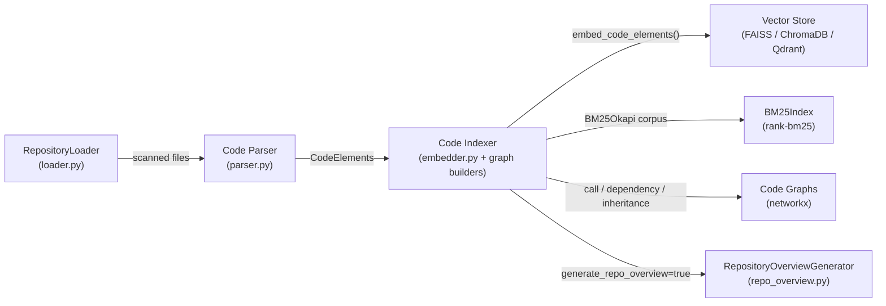

<!-- source: DeepWiki mcp.deepwiki.com · repo HKUDS/FastCode · page 4.3 Code Indexer · fetched 2026-11-09 -->

# Code Indexer

<details>
<summary>Relevant source files</summary>

The following files were used as context for generating this wiki page:

- [config/config.yaml](config/config.yaml)
- [fastcode/embedder.py](fastcode/embedder.py)
- [requirements.txt](requirements.txt)

</details>


This page covers the indexing pipeline: the stage that takes structured code elements produced by the parser and transforms them into the searchable data structures used at query time — specifically the vector store, BM25 index, graph models, and optional repository overviews.

For details on how raw source files are parsed into code elements, see the [Code Parser](#4.2). For details on the vector store backends that store the resulting index, see the [Vector Store](#4.5). For details on how the graphs produced here are used during retrieval, see the [Multi-Layer Graph Modeling](#3.4) and [Hybrid Retriever](#4.6) pages.

---

## Role in the Ingestion Pipeline

The indexer is the third stage in the four-stage code ingestion pipeline. It receives parsed code elements and is responsible for producing every data structure that retrieval depends on.

**Ingestion Pipeline — Code Indexer Stage**



Sources: Diagram 2 from the high-level architecture diagrams; [config/config.yaml:68-80]()

---

## Granularity Levels

The indexer processes code elements at up to four levels of granularity. Each level is independently toggled in configuration and results in a separate set of vector store entries and BM25 documents.

| Level | What it indexes | Config key |
|---|---|---|
| `file` | Full-file metadata, summary, imports | `indexing.levels: [file, ...]` |
| `class` | Class definitions, docstrings, method list | `indexing.levels: [..., class, ...]` |
| `function` | Function signatures, docstrings, body | `indexing.levels: [..., function, ...]` |
| `documentation` | Standalone docs, comments, markdown files | `indexing.levels: [..., documentation]` |

Two additional cross-cutting flags enrich each indexed element:

- `include_imports` — attaches the file's import list to the element's context, helping retrieval match dependency-aware queries.
- `include_class_context` — when indexing a method, also includes the enclosing class signature and docstring so the element is not context-free.

Sources: [config/config.yaml:68-80]()

---

## Vector Store Entry Construction

For each code element at each enabled granularity level, the indexer calls `CodeEmbedder.embed_code_elements()` ([fastcode/embedder.py:83-109]()). That method:

1. Calls `_prepare_code_text()` ([fastcode/embedder.py:111-147]()) on each element to concatenate its type, name, signature, docstring, summary, and code body into a single string.
2. Passes the resulting text list to `embed_batch()` ([fastcode/embedder.py:54-81]()), which runs the SentenceTransformer model in batches.
3. Writes the returned numpy vectors back onto each element dict under the `"embedding"` key.

The enriched element dicts are then passed to the vector store backend for insertion.

**Element → Embedding Text Construction**

```mermaid
flowchart TD
    ELEM["CodeElement dict"]
    TYPE["\"Type: function\""]
    NAME["\"Name: process_query\""]
    SIG["\"Signature: def process_query(...)\""]
    DOC["\"Documentation: ...\""]
    SUM["\"summary text\""]
    CODE["\"Code: def process_query(...):\\n  ...\""]
    CONCAT["joined text string\n(newline-separated)"]
    EMBED["embed_batch()\n→ numpy vector"]

    ELEM --> TYPE & NAME & SIG & DOC & SUM & CODE
    TYPE & NAME & SIG & DOC & SUM & CODE --> CONCAT
    CONCAT --> EMBED
```

Sources: [fastcode/embedder.py:83-147]()

---

## BM25 Index Construction

Alongside vector embeddings, a BM25 keyword index is built over the same corpus of element texts. This uses the `rank-bm25` library ([requirements.txt:27]()). The tokenized text from each element is added to a `BM25Okapi` corpus. At query time this corpus is searched in parallel with the vector store; results are merged by the Hybrid Retriever (see [Hybrid Retriever](#4.6)).

---

## Graph Construction

The indexer drives construction of three code graphs using `networkx` ([requirements.txt:29]()):

| Graph | What nodes and edges represent |
|---|---|
| Call graph | Function → function call relationships extracted by the parser |
| Dependency graph | File → file import relationships |
| Inheritance graph | Class → parent class relationships |

Each graph is controlled by its own boolean flag in the `graph` configuration section:

```yaml
graph:
  build_call_graph: true
  build_dependency_graph: true
  build_inheritance_graph: true
  max_depth: 5
```

The `max_depth` value caps how far the graph traversal expands during retrieval scoring. Graph edge weights contribute to the `graph_weight` component of the hybrid retrieval score (see [Hybrid Retriever](#4.6)).

Sources: [config/config.yaml:162-168]()

---

## Repository Overview Generation

When `indexing.generate_repo_overview` is `true`, the indexer also triggers `RepositoryOverviewGenerator` (documented fully in [Repository Overview Generator](#4.9)). The overview is a compact textual summary of the repository's purpose, key files, and language breakdown. It is stored separately from the per-element index and is used by the two-stage retrieval system to pre-select relevant repositories before fine-grained element search (see [Two-Stage Retrieval](#9.5)).

Sources: [config/config.yaml:80]()

---

## Persistence and Evaluation Mode

By default the indexer persists its outputs to disk so they can be reloaded on restart without re-running the full pipeline:

| Artifact | Default persist location |
|---|---|
| Vector store files | `./data/vector_store` |
| BM25 index | serialized alongside the vector store |
| Graph files | serialized alongside the vector store |
| Cache (embeddings) | `./data/cache` |

An evaluation mode overrides this behavior for benchmarking:

```yaml
evaluation:
  in_memory_index: false        # keep index in RAM only
  disable_persistence: false    # skip writing FAISS/BM25/graph files
  force_reindex: false          # always rebuild instead of loading cached artifacts
```

When `force_reindex: true`, the indexer ignores any existing persisted artifacts and rebuilds the entire index from scratch.

Sources: [config/config.yaml:193-199](), [config/config.yaml:82-96]()

---

## Configuration Reference

The table below summarizes all `config.yaml` keys that directly govern the Code Indexer's behavior.

| Key | Type | Default | Effect |
|---|---|---|---|
| `indexing.levels` | list | `[file, class, function, documentation]` | Which granularity levels to index |
| `indexing.include_imports` | bool | `true` | Attach import list to each element |
| `indexing.include_class_context` | bool | `true` | Attach enclosing class to method elements |
| `indexing.generate_repo_overview` | bool | `true` | Run RepositoryOverviewGenerator after indexing |
| `graph.build_call_graph` | bool | `true` | Build function call graph |
| `graph.build_dependency_graph` | bool | `true` | Build file dependency graph |
| `graph.build_inheritance_graph` | bool | `true` | Build class inheritance graph |
| `graph.max_depth` | int | `5` | Maximum graph traversal depth during retrieval |
| `vector_store.persist_directory` | string | `./data/vector_store` | Directory for persisted index files |
| `evaluation.force_reindex` | bool | `false` | Force full rebuild on startup |
| `evaluation.disable_persistence` | bool | `false` | Skip writing index to disk |
| `evaluation.in_memory_index` | bool | `false` | Hold index in RAM only |

Sources: [config/config.yaml:68-96](), [config/config.yaml:162-168](), [config/config.yaml:193-199]()

---

## Data Flow Summary

**Complete Indexer Output Data Flow**

```mermaid
flowchart TD
    subgraph "Input"
        ELEMENTS["CodeElement list\n(type / name / signature / docstring / code)"]
    end

    subgraph "CodeEmbedder\n(embedder.py)"
        PREP["_prepare_code_text()\nper element"]
        BATCH["embed_batch()\nSentenceTransformer"]
        ENRICH["element[\"embedding\"] = vector"]
    end

    subgraph "Indexes"
        VSTORE["Vector Store\n(FAISS / ChromaDB / Qdrant)"]
        BM25IDX["BM25Okapi\n(rank-bm25)"]
        CALLG["call_graph\n(networkx DiGraph)"]
        DEPG["dependency_graph\n(networkx DiGraph)"]
        INHG["inheritance_graph\n(networkx DiGraph)"]
        OVERVIEW["repo_overview\n(RepositoryOverviewGenerator)"]
    end

    subgraph "Consumers"
        HYBRID["HybridRetriever\nsemantic + keyword + graph"]
        TWOSTAGE["Two-Stage Retrieval\nrepo selection"]
    end

    ELEMENTS --> PREP --> BATCH --> ENRICH
    ENRICH --> VSTORE
    ELEMENTS --> BM25IDX
    ELEMENTS --> CALLG & DEPG & INHG
    ELEMENTS --> OVERVIEW

    VSTORE --> HYBRID
    BM25IDX --> HYBRID
    CALLG & DEPG & INHG --> HYBRID
    OVERVIEW --> TWOSTAGE
```

Sources: [fastcode/embedder.py:83-109](), [config/config.yaml:68-168](), [requirements.txt:27-30]()

---

