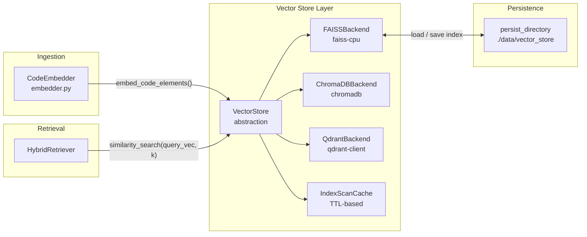
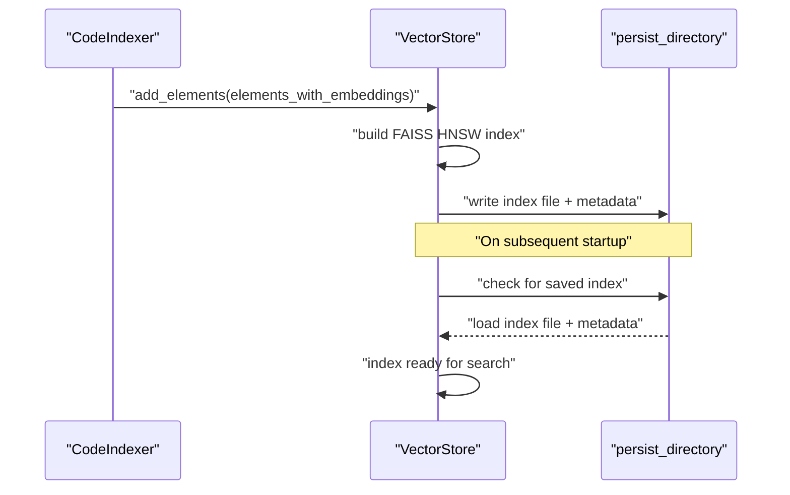
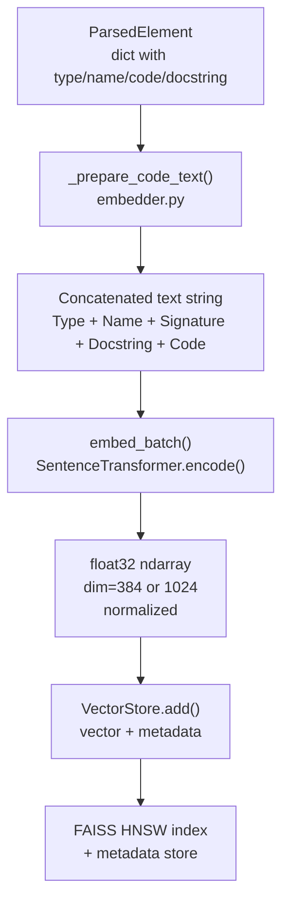

<!-- source: DeepWiki mcp.deepwiki.com · repo HKUDS/FastCode · page 4.5 Vector Store · fetched 2026-11-09 -->

# Vector Store

<details>
<summary>Relevant source files</summary>

The following files were used as context for generating this wiki page:

- [config/config.yaml](config/config.yaml)
- [fastcode/embedder.py](fastcode/embedder.py)
- [requirements.txt](requirements.txt)

</details>


This page documents the vector store abstraction layer in FastCode: the supported backends, how indexes are structured and persisted on disk, the index scan cache, and how similarity search is performed at query time.

For how embeddings are produced and fed into the store, see the [Code Embedder](#4.4) page. For how the vector store's results are combined with BM25 and graph scores at query time, see the [Hybrid Retriever](#4.6). For configuration knobs, see [Vector Store Configuration](#8.5).

---

## Role in the System

The vector store is the primary index for semantic (embedding-based) retrieval. After the `CodeEmbedder` generates floating-point vectors for each code element, those vectors are inserted into the store along with metadata. At query time, a query embedding is compared against all stored vectors and the top-k nearest neighbors are returned.

**System-level position:**



Sources: [config/config.yaml:82-96](), [fastcode/embedder.py:83-109]()

---

## Supported Backends

FastCode supports three vector store backends, selected by the `vector_store.type` key in `config/config.yaml`. All three expose the same interface to the rest of the engine.

| Backend | `type` value | Package | Notes |
|---|---|---|---|
| FAISS | `"faiss"` | `faiss-cpu` | Default. In-process, file-based persistence. Supports HNSW and flat indexes. |
| ChromaDB | `"chromadb"` | `chromadb` | Embedded document store with built-in metadata filtering. |
| Qdrant | `"qdrant"` | `qdrant-client` | Client-server model, suitable for large-scale deployments. |

Sources: [config/config.yaml:83-84](), [requirements.txt:25-26]()

### FAISS (Default)

FAISS is the default backend. It runs entirely in-process without a separate server. FastCode configures it with an **HNSW** (Hierarchical Navigable Small World) index, which provides fast approximate nearest-neighbor search.

The relevant HNSW parameters in `config/config.yaml`:

| Parameter | Key | Default | Meaning |
|---|---|---|---|
| Index type | `index_type` | `"HNSW"` | Algorithm used for ANN lookup |
| Graph degree | `m` | `16` | Connections per node in the HNSW graph; higher = better recall, more RAM |
| Construction beam width | `ef_construction` | `200` | Beam width at build time; higher = better recall, slower indexing |
| Search beam width | `ef_search` | `50` | Beam width at query time; higher = better recall, slower queries |
| Distance metric | `distance_metric` | `"cosine"` | Metric used to compare vectors |

Sources: [config/config.yaml:84-89]()

Because `CodeEmbedder` sets `normalize_embeddings: true` by default, all stored vectors are unit-normalized. Cosine similarity over unit vectors is equivalent to a dot product, which FAISS can compute efficiently.

Sources: [fastcode/embedder.py:25](), [fastcode/embedder.py:149-169](), [config/config.yaml:66]()

---

## Embedding Dimensions and Vector Format

Vectors stored in the index are `float32` NumPy arrays produced by `CodeEmbedder.embed_batch()`. The dimensionality depends on the SentenceTransformer model chosen:

- `paraphrase-multilingual-MiniLM-L12-v2` → **384 dimensions** (default)
- `all-MiniLM-L6-v2` → **384 dimensions**
- `BAAI/bge-large-en-v1.5` → **1024 dimensions**

The dimension is detected at startup from `model.get_sentence_embedding_dimension()` and used when creating the FAISS index.

Sources: [fastcode/embedder.py:33-34](), [config/config.yaml:60-63]()

---

## Index Persistence

**FAISS indexes** are written to and read from the directory specified by `vector_store.persist_directory` (default: `./data/vector_store`).



This means re-indexing the same repository on a server restart is not required if the persist directory is intact. The `evaluation.disable_persistence` flag in `config/config.yaml` can suppress writes, and `evaluation.force_reindex` forces a rebuild regardless of existing files.

Sources: [config/config.yaml:92](), [config/config.yaml:194-199]()

---

## Index Scan Cache

To avoid repeatedly scanning the full vector index on every status or listing request (which is expensive for large repositories), FastCode includes an **index scan cache**.

| Config key | Default | Purpose |
|---|---|---|
| `index_scan_cache_ttl` | `30` | Seconds to cache scan results. Set to `0` to disable. |
| `index_scan_sample_size` | `100` | Number of vectors to sample when estimating element counts. |

The TTL-based cache stores the result of index scans (e.g., file counts, repository element listings) so that the web interface and API status endpoints can respond quickly without reading the full FAISS index on every call.

When a cached result is still within its TTL, the scan is skipped entirely. When expired, a fresh scan is triggered and the result is stored again.

Sources: [config/config.yaml:94-96]()

---

## Similarity Search

At query time, the `HybridRetriever` calls into the vector store with a query embedding vector and a requested number of top results (`k`). The call is roughly:

```
similarity_search(query_embedding, k=max_results, filters={...})
```

The vector store computes distances from the query vector to all (or approximate, for HNSW) stored vectors and returns the top-k code elements along with their scores.

The raw similarity scores from the vector store feed into the hybrid scoring formula alongside BM25 and graph scores. See [Hybrid Retriever](#4.6) for that formula.

**Similarity score normalization:** Because `normalize_embeddings` is `true`, cosine similarity is used. Scores range from –1 to 1, but in practice all stored vectors are unit-normalized and embeddings of code text cluster in positive space, so scores are typically 0 to 1.

The `retrieval.min_similarity` threshold (default: `0.15`) filters out results below a minimum score before they are returned to the caller.

Sources: [config/config.yaml:99-108](), [fastcode/embedder.py:149-194](), [config/config.yaml:106]()

---

## Data Flow: Element to Index Entry

The diagram below maps the code-level transformations from a parsed code element to a stored index entry.



Sources: [fastcode/embedder.py:83-109](), [fastcode/embedder.py:111-147](), [fastcode/embedder.py:54-81]()

---

## Configuration Reference

All vector store settings live under the `vector_store` key in `config/config.yaml`:

```yaml
vector_store:
  type: "faiss"             # faiss | chromadb | qdrant
  distance_metric: "cosine"
  index_type: "HNSW"        # FAISS-specific
  ef_construction: 200      # FAISS HNSW - build quality
  ef_search: 50             # FAISS HNSW - query quality
  m: 16                     # FAISS HNSW - graph degree

  persist_directory: "./data/vector_store"

  index_scan_cache_ttl: 30      # seconds; 0 to disable
  index_scan_sample_size: 100   # elements sampled per estimation
```

Sources: [config/config.yaml:82-96]()

For the full description of each parameter with types and defaults, see [Vector Store Configuration](#8.5).

---

## Evaluation / In-Memory Mode

When running benchmarks, the `evaluation` section in `config/config.yaml` allows the vector store to operate in a mode that bypasses disk I/O entirely:

| Flag | Effect |
|---|---|
| `evaluation.in_memory_index: true` | Keeps the FAISS index in RAM only |
| `evaluation.disable_persistence: true` | Skips writing index files to disk |
| `evaluation.force_reindex: true` | Ignores any saved index and rebuilds from scratch |
| `evaluation.disable_cache: true` | Bypasses the index scan cache |

These flags are intended for benchmark repeatability and are all `false` by default.

Sources: [config/config.yaml:193-199]()

---

