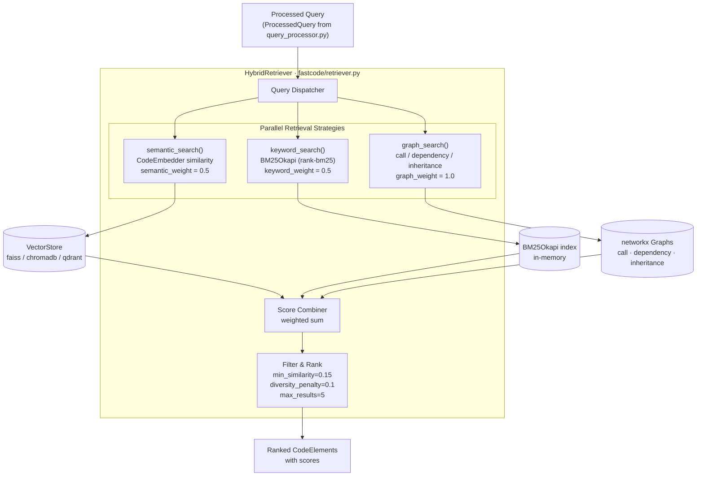
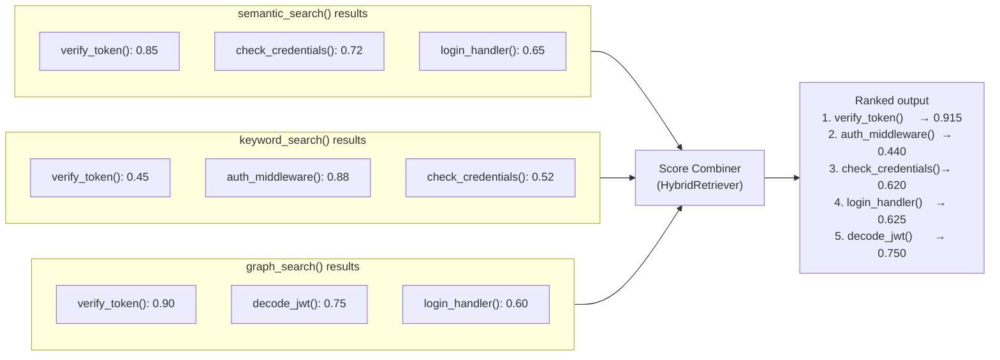
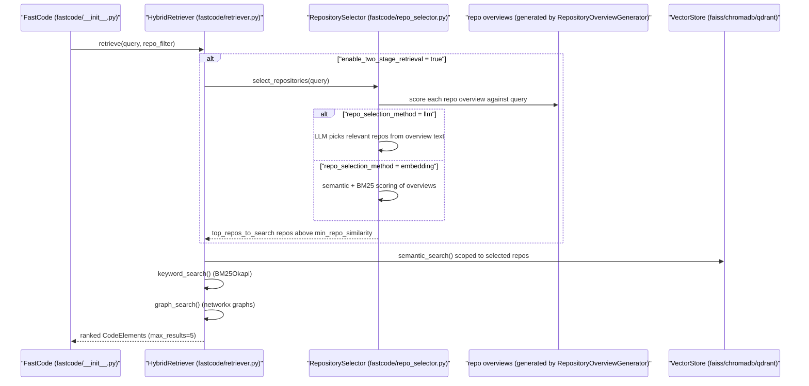
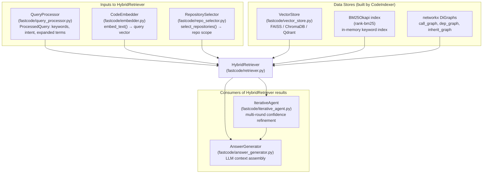

<!-- source: DeepWiki mcp.deepwiki.com · repo HKUDS/FastCode · page 4.6 Hybrid Retriever · fetched 2026-11-09 -->

# Hybrid Retriever

<details>
<summary>Relevant source files</summary>

The following files were used as context for generating this wiki page:

- [config/config.yaml](config/config.yaml)
- [fastcode/embedder.py](fastcode/embedder.py)
- [requirements.txt](requirements.txt)

</details>


## Purpose and Scope

The `HybridRetriever` is the core query execution component in FastCode's **Phase 2: Lightning-Fast Navigation** framework. It combines three complementary retrieval strategies—semantic search, keyword search (BM25), and graph traversal—to locate relevant code elements efficiently and accurately. This component operates after query processing and before answer generation, transforming user questions into ranked lists of code elements.

For information about the iterative refinement of retrieval results, see page 5.1. For the initial query understanding and enhancement, see page 8.6. For vector storage backends, see page 4.5.

---

## Architecture Overview

The `HybridRetriever` implements a parallel multi-strategy retrieval architecture where three independent search methods execute concurrently, then combine their results using weighted scoring.

**Hybrid Retrieval Pipeline — `HybridRetriever` (`fastcode/retriever.py`)**



Sources: [fastcode/retriever.py](), [config/config.yaml:98-120]()

---

## Three Retrieval Strategies

### Semantic Search

Semantic search uses dense vector embeddings to find code elements with similar meaning to the query, regardless of exact keyword matches. This handles synonyms, paraphrases, and conceptual similarities.

**Implementation:**
- Embeds the user query using the same `CodeEmbedder` model used for code indexing
- Searches the vector store using cosine similarity (or configured distance metric)
- Returns top-k most similar code elements based on embedding distance
- Default weight: **0.5** (configurable via `retrieval.semantic_weight`)

**Key Configuration:**
- `vector_store.distance_metric`: Distance function (default: `cosine`)
- `vector_store.index_type`: Index structure (default: `HNSW` for fast approximate search)
- `retrieval.semantic_weight`: Contribution to final score

**Example Scenarios:**
- Query: "authentication logic" → Finds `verify_token()`, `check_credentials()`, `login_handler()`
- Query: "database connection" → Finds `db_connect()`, `get_db_session()`, `DatabasePool`

Sources: [fastcode/retriever.py](), [fastcode/embedder.py](), [config/config.yaml:59-66](), [config/config.yaml:82-101]()

### Keyword Search (BM25)

BM25 (Best Matching 25) is a probabilistic ranking function that scores documents based on exact term matches, with adjustments for term frequency and document length. This handles precise technical terms and identifiers.

**Implementation:**
- Tokenizes query and code elements into terms
- Computes BM25 scores using term frequency (TF), inverse document frequency (IDF), and document length normalization
- Returns top-k elements with highest BM25 scores
- Default weight: **0.5** (configurable via `retrieval.keyword_weight`)

**Key Parameters:**
- `k1`: Term frequency saturation parameter (typically 1.5-2.0)
- `b`: Length normalization parameter (typically 0.75)
- `retrieval.keyword_weight`: Contribution to final score

**Example Scenarios:**
- Query: "UserModel class definition" → Prioritizes exact class name matches
- Query: "parse_json function" → Finds functions with exact name matches
- Query: "import tensorflow" → Locates import statements

Sources: [fastcode/retriever.py](), [config/config.yaml:99-102]()

### Graph Traversal

Graph traversal explores structural relationships between code elements using three types of graphs: call graphs (function invocations), dependency graphs (module imports), and inheritance graphs (class hierarchies). This finds contextually related code even if not semantically or lexically similar.

**Implementation:**
- Starts from semantically/keyword-matched "seed" elements
- Traverses graph edges up to `max_depth` steps (default: 2 hops)
- Collects connected elements: callers, callees, dependencies, subclasses, superclasses
- Default weight: **1.0** (configurable via `retrieval.graph_weight`)

**Key Configuration:**
- `graph.build_call_graph`: Enable call relationships
- `graph.build_dependency_graph`: Enable import relationships  
- `graph.build_inheritance_graph`: Enable class hierarchy relationships
- `graph.max_depth`: Maximum traversal depth
- `retrieval.graph_weight`: Contribution to final score

**Example Scenarios:**
- Query: "payment processing" → Finds `process_payment()` via semantic search, then traverses to find `validate_card()`, `charge_customer()`, `send_receipt()` via call graph
- Query: "User model" → Finds `UserModel` class, then traverses inheritance graph to find `AdminUser`, `GuestUser` subclasses

Sources: [fastcode/retriever.py](), [config/config.yaml:163-167](), [config/config.yaml:103]()

---

## Result Combination and Ranking

### Weighted Score Aggregation

The retriever combines scores from the three strategies using a weighted sum:

```
final_score = (semantic_score * semantic_weight) + 
              (keyword_score * keyword_weight) + 
              (graph_score * graph_weight)
```

Each strategy produces normalized scores in [0, 1], and weights determine relative importance.

**Score Combination — Weighted Sum Formula**

```
final_score(e) = semantic_score(e) × semantic_weight
              + keyword_score(e)  × keyword_weight
              + graph_score(e)    × graph_weight
```

Each per-strategy score is normalized to [0, 1] before combination.

**Score Aggregation Across Strategies**



**Default Weights** (from `config/config.yaml`):

| Config Key | Default | Strategy | Rationale |
|---|---|---|---|
| `retrieval.semantic_weight` | 0.5 | `semantic_search()` | Captures meaning and synonyms |
| `retrieval.keyword_weight` | 0.5 | `keyword_search()` (BM25) | Exact term and identifier matches |
| `retrieval.graph_weight` | 1.0 | `graph_search()` | Structural and relational context |

The higher graph weight (1.0 vs 0.5) means structurally connected code elements receive stronger promotion in the final ranking.

Sources: [fastcode/retriever.py](), [config/config.yaml:99-103]()

---

## Filtering and Diversity

### Minimum Similarity Filter

After scoring, results are filtered to remove low-relevance elements. Any element whose combined score falls below `retrieval.min_similarity` (default: `0.15`) is discarded. This prevents returning code that happened to share common tokens but is unrelated to the query.

### Diversity Penalty

To avoid returning multiple nearly-identical results from the same file, the retriever applies a same-file penalty. When an element shares a file with an already-selected result, its score is multiplied by `(1 - diversity_penalty)`.

**Configuration:** `retrieval.diversity_penalty` (default: `0.1`)

This 10% score reduction for same-file elements promotes broader code coverage across files.

### Result Limiting

| Config Key | Default | Scope |
|---|---|---|
| `retrieval.max_results` | 5 | Per query, single repo |
| `retrieval.max_files_to_search` | 15 | Across all selected repos (multi-repo) |

These caps prevent the context window from being overwhelmed, directly controlling token costs in answer generation.

Sources: [fastcode/retriever.py](), [config/config.yaml:105-108](), [config/config.yaml:116]()

---

## Two-Stage Retrieval for Multi-Repository Support

When multiple repositories are loaded, the retriever uses a two-stage process to avoid searching all repositories for every query.

**Two-Stage Multi-Repository Retrieval Flow**



### Stage 1: Repository Selection

**Purpose:** Identify the most relevant repositories for the query before detailed code search.

**Configuration:**
- `retrieval.enable_two_stage_retrieval`: Enable/disable (default: `true`)
- `retrieval.select_repos_by_overview`: Use overview-based selection (default: `true`)
- `retrieval.repo_selection_method`: Selection strategy (default: `"llm"`)
  - `"llm"`: LLM analyzes repository overviews and selects relevant ones
  - `"embedding"`: Semantic + BM25 scoring against overviews
- `retrieval.top_repos_to_search`: Maximum repositories to search (default: 5)
- `retrieval.min_repo_similarity`: Minimum relevance score for repository (default: 0.1)

**Process:**
1. Load all repository overviews (generated during indexing)
2. Score each repository against the query using selected method
3. Select top-k repositories above minimum similarity
4. Scope subsequent searches to selected repositories only

### Stage 2: Code-Level Search

**Purpose:** Perform detailed hybrid retrieval within selected repositories.

**Configuration:**
- `retrieval.max_files_to_search`: Maximum files to retrieve across all selected repos (default: 15)

**Process:**
1. Execute semantic, keyword, and graph searches within selected repositories
2. Combine and rank results as described in previous sections
3. Apply filtering, diversity penalty, and result limiting

### Selection Method Comparison

| Method | Speed | Accuracy | Use Case |
|--------|-------|----------|----------|
| `"llm"` | Slower | Higher | Complex queries, nuanced understanding |
| `"embedding"` | Faster | Good | Most queries, cost-sensitive scenarios |

Sources: [fastcode/retriever.py](), [fastcode/repo_selector.py](), [fastcode/repo_overview.py](), [config/config.yaml:110-116]()

---

## Configuration Reference

### Complete Retrieval Configuration Table

| Config Key | Type | Default | Description |
|---|---|---|---|
| `retrieval.semantic_weight` | float | 0.5 | Weight for `semantic_search()` scores |
| `retrieval.keyword_weight` | float | 0.5 | Weight for `BM25Okapi` keyword scores |
| `retrieval.graph_weight` | float | 1.0 | Weight for `graph_search()` scores |
| `retrieval.min_similarity` | float | 0.15 | Minimum combined score to include a result |
| `retrieval.max_results` | int | 5 | Maximum results returned per query |
| `retrieval.diversity_penalty` | float | 0.1 | Score reduction for same-file results (0–1) |
| `retrieval.enable_two_stage_retrieval` | bool | true | Enable `RepositorySelector` pre-filtering |
| `retrieval.select_repos_by_overview` | bool | true | Use repo overview text for selection |
| `retrieval.repo_selection_method` | string | `"llm"` | `"llm"` or `"embedding"` |
| `retrieval.top_repos_to_search` | int | 5 | Maximum repos to search after Stage 1 |
| `retrieval.min_repo_similarity` | float | 0.1 | Minimum repo relevance score to include |
| `retrieval.max_files_to_search` | int | 15 | Maximum files retrieved across all repos |
| `retrieval.enable_agency_mode` | bool | true | Pass results to `IterativeAgent` for refinement |

Configuration file: [config/config.yaml:98-120]()

---

## Integration with Other Components

**Component Dependency Map — `HybridRetriever` in context**



The `HybridRetriever` receives:
- **`ProcessedQuery`** from `QueryProcessor`: expanded keywords, detected intent, subqueries
- **Query vector** from `CodeEmbedder.embed_text()`: dense representation for semantic search
- **Repository scope** from `RepositorySelector.select_repositories()`: limits search to relevant repos in multi-repo mode

It queries:
- **`VectorStore`**: semantic similarity search via FAISS/ChromaDB/Qdrant
- **`BM25Okapi` index**: keyword-based term scoring
- **`networkx` graphs**: call, dependency, and inheritance graph traversal

It outputs to:
- **`IterativeAgent`**: for optional multi-round refinement (see page 5.1)
- **`AnswerGenerator`**: for final answer generation (see page 4.8)

Sources: [fastcode/retriever.py](), [fastcode/embedder.py](), [fastcode/query_processor.py](), [fastcode/repo_selector.py](), [fastcode/iterative_agent.py](), [fastcode/answer_generator.py]()

---

## Usage Patterns

### Direct Retrieval (Single-Shot)

When `enable_agency_mode` is `false`, the retriever executes once and returns results directly:

```python
# Conceptual usage (not actual code)
retriever = HybridRetriever(config)
results = retriever.retrieve(
    query="How does authentication work?",
    filters=None,
    repo_filter=["backend-api"]
)
# Returns: List[CodeElement] with scores
```

### Agent-Enhanced Retrieval (Multi-Round)

When `enable_agency_mode` is `true`, retrieval results are passed to `IterativeAgent` for confidence evaluation and potential refinement. The agent may call `search_codebase` (an `AgentTools` method) iteratively, with each round adjusting parameters based on confidence gain.

See page 5.1 for details on the refinement process.

### Multi-Repository Retrieval

When multiple repositories are loaded and `enable_two_stage_retrieval` is `true`:

1. **Stage 1** — `RepositorySelector.select_repositories()` scores each repo's overview against the query and returns the top `top_repos_to_search` candidates.
2. **Stage 2** — `HybridRetriever` runs all three search strategies scoped to only those repositories.

Sources: [fastcode/retriever.py](), [fastcode/iterative_agent.py](), [config/config.yaml:110-120]()

---

## Performance Characteristics

### Token Efficiency

The hybrid retrieval approach achieves FastCode's **10x token savings** through:

1. **Precise Targeting**: Graph traversal finds structurally related code without loading irrelevant files
2. **Diversity Filtering**: Reduces redundant same-file results
3. **Result Limiting**: Hard caps on results prevent excessive context
4. **Two-Stage Filtering**: Repository pre-selection avoids searching irrelevant codebases

### Speed Optimization

The retriever achieves FastCode's **3-4x speed advantage** through:

1. **Parallel Execution**: Three retrieval strategies run concurrently
2. **HNSW Indexing**: Fast approximate nearest neighbor search (see `vector_store.index_type`)
3. **Cached Embeddings**: Query embeddings reused across multiple searches
4. **Early Stopping**: Graph traversal stops at max depth

### Accuracy Balance

The weighted combination balances three complementary strengths:

- **Semantic**: Handles conceptual queries, synonyms
- **Keyword**: Ensures exact term matches, technical identifiers
- **Graph**: Discovers contextually related code, structural patterns

This multi-strategy approach delivers FastCode's **highest accuracy score** across benchmarks.

**Sources:** [README.md:25-47](), [config/config.yaml:86-89]()

---

## Advanced Features

### Custom Weight Tuning

For domain-specific optimization, weights can be adjusted:

**Example 1: Prioritize Exact Matches**
```yaml
retrieval:
  semantic_weight: 0.3
  keyword_weight: 0.7  # Increased
  graph_weight: 0.8
```
Use case: API endpoint lookups, class name searches

**Example 2: Prioritize Structural Context**
```yaml
retrieval:
  semantic_weight: 0.4
  keyword_weight: 0.3
  graph_weight: 1.5  # Increased
```
Use case: Impact analysis, dependency tracing

**Example 3: Semantic-First Retrieval**
```yaml
retrieval:
  semantic_weight: 0.8  # Increased
  keyword_weight: 0.2
  graph_weight: 0.9
```
Use case: Conceptual queries, architecture understanding

---

## Related Components

- [Code Indexer](#4.3) - Creates the multi-level indices that retrieval searches
- [Vector Store](#4.5) - Manages the FAISS/ChromaDB/Qdrant backends for semantic search
- [Iterative Agent](#5.1) - Refines retrieval results through multi-round exploration
- [Agent Tools](#5.2) - Provides file exploration tools used during iterative refinement
- [Retrieval Configuration](#8.6) - Complete configuration reference for tuning retrieval behavior

**Sources:** [fastcode/__init__.py](), [README.md:82-113]()

---

