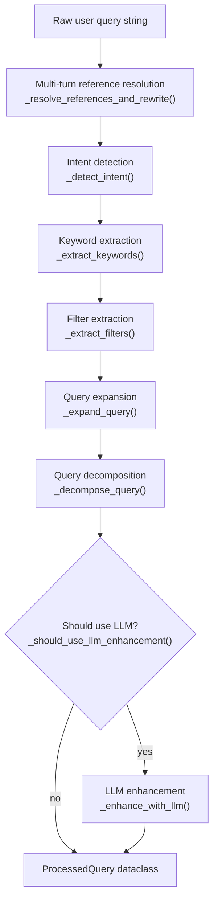
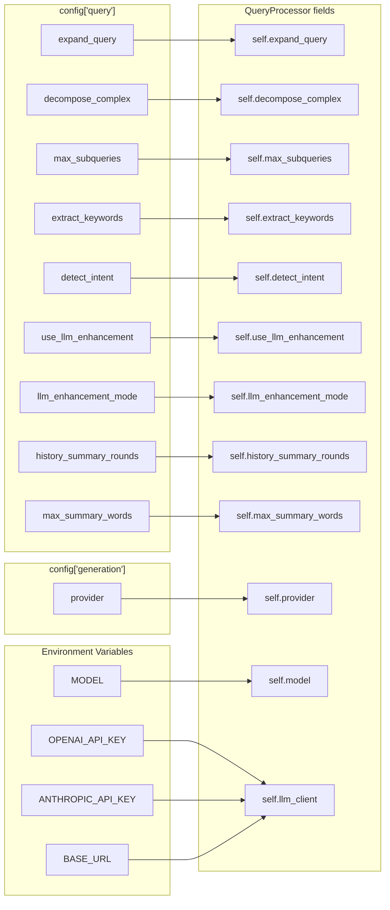
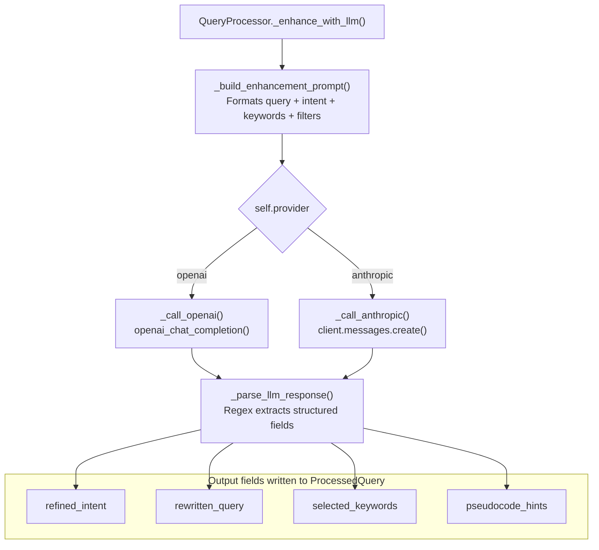
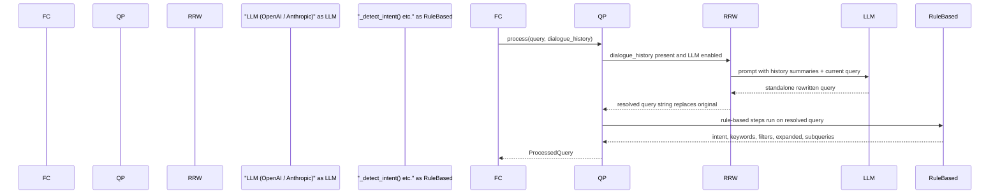

<!-- source: DeepWiki mcp.deepwiki.com · repo HKUDS/FastCode · page 4.7 Query Processor · fetched 2026-11-09 -->

# Query Processor

<details>
<summary>Relevant source files</summary>

The following files were used as context for generating this wiki page:

- [config/config.yaml](config/config.yaml)
- [fastcode/embedder.py](fastcode/embedder.py)
- [fastcode/query_processor.py](fastcode/query_processor.py)

</details>


This page covers the `QueryProcessor` class and `ProcessedQuery` dataclass defined in [fastcode/query_processor.py](). The query processor sits between the user-facing interface and the retrieval layer, transforming a raw user query into a structured object that downstream components — especially the Hybrid Retriever and Answer Generator — can use to fetch more relevant code. For details on how retrieval uses the output, see [4.6](#4.6); for how the generated answer is built from it, see [4.8](#4.8). For the configuration knobs that control query behavior, see [8.7](#8.7).

---

## Role in the Pipeline

The query processor is invoked by the `FastCode` core orchestrator before every retrieval operation. It produces a `ProcessedQuery` object that bundles together several enriched representations of the original question.

**Processing pipeline diagram**



Sources: [fastcode/query_processor.py:129-233]()

---

## ProcessedQuery Dataclass

`ProcessedQuery` is the output type of `QueryProcessor.process()`. Every field is consumed by at least one downstream component.

[fastcode/query_processor.py:17-43]()

| Field | Type | Description |
|---|---|---|
| `original` | `str` | The query string after whitespace trimming (or after reference resolution in multi-turn mode) |
| `expanded` | `str` | Query with synonym substitutions applied by `_expand_query()` |
| `keywords` | `List[str]` | Tokens extracted by `_extract_keywords()`, code-related terms prioritized first |
| `intent` | `str` | Rule-based intent label; may be overridden by LLM `refined_intent` |
| `subqueries` | `List[str]` | Sub-clauses from `_decompose_query()` for long or compound queries |
| `filters` | `Dict[str, Any]` | Extracted constraints: `extension`, `language`, or `file_path` |
| `rewritten_query` | `Optional[str]` | Semantically rewritten query from LLM, used as primary search text |
| `pseudocode_hints` | `Optional[str]` | LLM-generated pseudocode for implementation-type queries |
| `search_strategy` | `Optional[str]` | LLM-suggested retrieval strategy hint |

Sources: [fastcode/query_processor.py:17-43]()

---

## QueryProcessor Initialization

`QueryProcessor.__init__()` reads all settings from the `query` section of the config dict and the `generation` section for LLM provider details. It then optionally initializes an LLM client.

**Constructor parameters and config mappings**



The LLM client is created by `_initialize_llm_client()`, which returns an `OpenAI` or `Anthropic` object, or `None` if the relevant API key is missing. If the client is `None`, all LLM enhancement logic is skipped silently.

Sources: [fastcode/query_processor.py:46-103](), [config/config.yaml:122-141]()

---

## Rule-Based Processing Steps

These steps always run, regardless of the LLM enhancement mode.

### Intent Detection — `_detect_intent()`

Scores the query against pattern lists for each intent category. The category with the most matching terms wins. Returns `"general"` if no pattern matches.

[fastcode/query_processor.py:235-254]()

| Intent label | Trigger terms |
|---|---|
| `how` | how, implement, create, build, make |
| `what` | what, is, are, does, define, purpose |
| `where` | where, locate, find, which file |
| `debug` | error, bug, issue, problem, fix, why not, doesn't work |
| `explain` | explain, describe, tell me about, understand |
| `find` | find, search, locate, show me, list |
| `implement` | implement, write, code, develop, algorithm |
| `general` | (fallback, no match) |

### Keyword Extraction — `_extract_keywords()`

Tokenizes the query with a regex word boundary match, filters out a built-in stopword list, then splits results into two buckets: terms that appear in `self.code_keywords` (e.g. `function`, `class`, `api`, `auth`, `test`) go first, followed by all other non-stopword terms.

[fastcode/query_processor.py:256-275]()

### Filter Extraction — `_extract_filters()`

Uses regex patterns to populate a `filters` dict with up to three keys:

| Filter key | Detection mechanism |
|---|---|
| `extension` | Regex for `.py`, `.js`, `.ts`, `.java`, `.go`, `.cpp`, `.c`, `.rs`, `.rb`, `.php`, `.cs` |
| `language` | Context-aware patterns requiring surrounding words (e.g. `in Python`, `Python code`) to avoid false positives on library names |
| `file_path` | Quoted strings matching `[a-zA-Z0-9_/\.-]+` |

[fastcode/query_processor.py:277-348]()

### Query Expansion — `_expand_query()`

Replaces words that match a hard-coded synonym map with their expanded form. For example, `auth` becomes `authentication authorization auth login`. Duplicates are removed while preserving order.

[fastcode/query_processor.py:350-387]()

### Query Decomposition — `_decompose_query()`

Applies only to queries with 10 or more words. Splits on `" and "`, `" or "`, `", "`, and `"; "`. Keeps only fragments longer than 15 characters, up to `max_subqueries` (default 3).

[fastcode/query_processor.py:389-419]()

---

## LLM Enhancement

### Mode Selection — `_should_use_llm_enhancement()`

This function applies only when `use_llm_enhancement` is `True` and a client is available. Its behavior depends on `llm_enhancement_mode`.

[fastcode/query_processor.py:460-510]()

| Mode | Behavior |
|---|---|
| `"always"` | LLM is called for every query |
| `"off"` | LLM is never called; rule-based output is final |
| `"adaptive"` | LLM is called only if the query is classified as implementation-oriented, complex (≥3 technical terms or ≥15 words), or ambiguous (≤5 words with ≤1 technical term) |

### LLM Enhancement Flow — `_enhance_with_llm()`

When LLM enhancement is triggered, `_enhance_with_llm()` builds a structured prompt via `_build_enhancement_prompt()`, routes it to either `_call_openai()` or `_call_anthropic()`, then parses the structured text response with `_parse_llm_response()`.

[fastcode/query_processor.py:512-544]()

**LLM enhancement internal flow**



Sources: [fastcode/query_processor.py:512-727]()

### Prompt Format

The prompt sent to the LLM instructs it to respond in a strict line-oriented format. `_parse_llm_response()` uses regex patterns tolerant of markdown formatting (`**`, `` ` ``) that some models insert. Fields extracted:

```
REFINED_INTENT: <Code QA | Document QA | API Usage | Bug Fixing | Feature Addition | Architecture | Cross-repo>
REWRITTEN_QUERY: <single-line semantic query>
SELECTED_KEYWORDS: <kw1, kw2, kw3, ...>
PSEUDOCODE_HINTS: <3-7 line pseudocode or "N/A">
```

`REFINED_INTENT` values are normalized through `intent_mapping` to snake_case labels (`code_qa`, `document_qa`, `api_usage`, `bug_fixing`, `feature_addition`, `architecture`, `cross_repo`).

The `SELECTED_KEYWORDS` list is capped at 10 entries. If the LLM returns 3 or more keywords, they replace the rule-based keyword list entirely; otherwise they are appended.

Sources: [fastcode/query_processor.py:546-727]()

---

## Multi-Turn Reference Resolution

When `dialogue_history` is passed to `process()` and LLM enhancement is enabled, a reference resolution step runs **before** all other processing.

[fastcode/query_processor.py:155-163]()

> **Note:** If the iterative agent is active (`use_llm_enhancement=False` is passed by the caller), this step is skipped. The iterative agent handles dialogue history integration independently. See [5.1](#5.1) for details.

### How It Works

`_resolve_references_and_rewrite()` takes the `dialogue_history` list (each entry contains `turn_number`, `query`, and `summary` keys), slices it to the most recent `history_summary_rounds` entries, and sends it with the current query to the LLM via `_build_reference_resolution_prompt()`.

[fastcode/query_processor.py:729-827]()

The prompt asks the LLM to:
1. Identify ambiguous references such as `"that function"`, `"the class mentioned above"`, `"it"`.
2. Resolve them using the conversation history.
3. Return only the rewritten query as plain text.

`_parse_rewritten_query()` strips common prefixes (`"Rewritten Query:"`, `"Query:"`) and surrounding quotes from the raw LLM output.

**Multi-turn resolution sequence**



Sources: [fastcode/query_processor.py:129-165](), [fastcode/query_processor.py:729-827]()

---

## Utility Methods

| Method | Purpose |
|---|---|
| `is_code_query(query)` | Returns `True` if the query contains any of a fixed list of code indicators (e.g. `function`, `class`, `api`). Used by callers to decide whether to invoke retrieval at all. |
| `extract_code_entity(query)` | Returns `(entity_type, entity_name)` if the query contains patterns like `"class X"` or `"function named X"`, else `None`. |

Sources: [fastcode/query_processor.py:421-458]()

---

## Configuration Reference

All keys live under the `query:` section in `config/config.yaml`.

| Key | Default | Effect |
|---|---|---|
| `expand_query` | `true` | Enables `_expand_query()` synonym substitution |
| `decompose_complex` | `true` | Enables `_decompose_query()` clause splitting |
| `max_subqueries` | `3` | Max items in `ProcessedQuery.subqueries` |
| `extract_keywords` | `true` | Enables `_extract_keywords()` |
| `detect_intent` | `true` | Enables `_detect_intent()`; if false, intent is `"general"` |
| `use_llm_enhancement` | `true` | Master switch for all LLM calls in this class |
| `llm_enhancement_mode` | `"always"` | `"adaptive"`, `"always"`, or `"off"` |
| `history_summary_rounds` | `10` | How many prior-turn summaries are sent for reference resolution |
| `max_summary_words` | `500` | Word limit per round summary (informational; enforced upstream) |

Sources: [config/config.yaml:122-141](), [fastcode/query_processor.py:55-68]()

---

