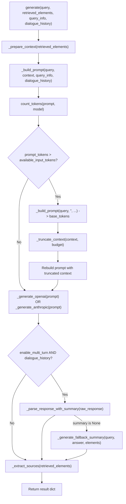
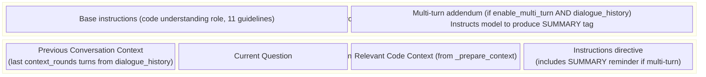
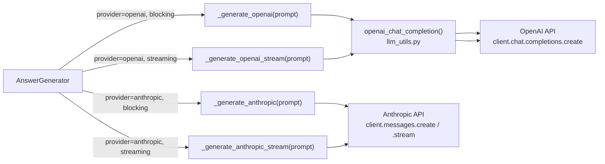

<!-- source: DeepWiki mcp.deepwiki.com · repo HKUDS/FastCode · page 4.8 Answer Generator · fetched 2026-11-09 -->

# Answer Generator

<details>
<summary>Relevant source files</summary>

The following files were used as context for generating this wiki page:

- [config/config.yaml](config/config.yaml)
- [fastcode/answer_generator.py](fastcode/answer_generator.py)
- [fastcode/embedder.py](fastcode/embedder.py)
- [fastcode/llm_utils.py](fastcode/llm_utils.py)

</details>


The `AnswerGenerator` class (`fastcode/answer_generator.py`) is responsible for the final step in the query pipeline: taking a user question and a list of retrieved code elements, building a structured prompt, managing token budgets, calling an LLM provider, and returning a formatted answer. It supports both blocking and streaming response modes, multi-turn dialogue with `<SUMMARY>` tag extraction, and both OpenAI-compatible and Anthropic API providers.

This page covers the internals of `AnswerGenerator` exclusively. For how retrieved code elements are produced, see the Hybrid Retriever ([4.6](#4.6)) and Query Processor ([4.7](#4.7)). For multi-turn dialogue session management, see Multi-Turn Dialogue ([9.2](#9.2)). For the LLM provider configuration variables, see Environment Variables ([12.3](#12.3)).

---

## Class Overview

`AnswerGenerator` is instantiated once by the core orchestrator with the global config dict. It reads settings from the `generation:` block of `config/config.yaml` and environment variables for secrets.

**Configuration mapping:**

| Config Key | Attribute | Default | Effect |
|---|---|---|---|
| `generation.provider` | `self.provider` | `"openai"` | Selects `openai` or `anthropic` |
| `generation.temperature` | `self.temperature` | `0.4` | LLM sampling temperature |
| `generation.max_tokens` | `self.max_tokens` | `20000` | Max output tokens |
| `generation.max_context_tokens` | `self.max_context_tokens` | `200000` | Total context window budget |
| `generation.reserve_tokens_for_response` | `self.reserve_tokens` | `10000` | Reserved for output + safety |
| `generation.enable_multi_turn` | `self.enable_multi_turn` | `False` | Enables SUMMARY tag mode |
| `generation.context_rounds` | `self.context_rounds` | `10` | Previous turns in prompt |
| `generation.include_file_paths` | `self.include_file_paths` | `True` | File paths in context blocks |
| `generation.include_line_numbers` | `self.include_line_numbers` | `True` | Line ranges in context blocks |
| `generation.include_related_code` | `self.include_related_code` | `True` | Code bodies in context blocks |

The `MODEL` and `BASE_URL` environment variables override model selection and the API base URL at runtime; `OPENAI_API_KEY` and `ANTHROPIC_API_KEY` supply the secrets. See [fastcode/answer_generator.py:43-51]().

Sources: `fastcode/answer_generator.py:18-51`, `config/config.yaml:142-160`

---

## Request Lifecycle

**Answer Generator — non-streaming flow**



Sources: `fastcode/answer_generator.py:71-194`

---

## Context Preparation

`_prepare_context()` ([fastcode/answer_generator.py:447-515]()) iterates the list of `retrieved_elements` dicts (each with an `"element"` key) and builds a Markdown block per element. The following fields are included when present and when the corresponding config flag is set:

| Field extracted from | Output label | Config flag |
|---|---|---|
| `elem["repo_name"]` | `**Repository**` | always |
| `elem["relative_path"]` | `**File**` | `include_file_paths` |
| `elem["type"]`, `elem["name"]` | `**Type**`, `**Name**` | always |
| `elem["start_line"]`, `elem["end_line"]` | `**Lines**` | `include_line_numbers` |
| `elem["code"]` | ` ```language … ``` ` | always (truncated at 100,000 chars) |
| `elem["metadata"]["complexity"]` | `**Metadata**` | when present |

Individual snippets are separated by `---` dividers. The resulting string is the `context` argument to prompt building.

Sources: `fastcode/answer_generator.py:447-515`

---

## Prompt Construction

`_build_prompt()` ([fastcode/answer_generator.py:517-629]()) assembles the final prompt string that is sent to the LLM.

**Prompt structure:**



Key points:
- The system prompt includes a hard rule to respond in the user's language.
- When `enable_multi_turn` is `True` and `dialogue_history` is not `None`, the system prompt appends the `<SUMMARY>` format specification.
- Only the most recent `self.context_rounds` turns from `dialogue_history` are injected into the user block.
- The full prompt is a single string: `"{system_prompt}\n\n{user_prompt}"`.

An optional `prompt_builder` callable may be passed to `generate()` and `generate_stream()` to override `_build_prompt` entirely. Its signature must be `(query: str, context: str, query_info: Optional[dict], dialogue_history: Optional[list]) -> str`. See [fastcode/answer_generator.py:74]().

Sources: `fastcode/answer_generator.py:517-629`

---

## Token Budgeting and Context Truncation

Before calling the LLM, the generator checks whether the prompt fits within the configured context window.

**Token budget calculation:**

```
available_input_tokens = max_context_tokens - max_tokens - reserve_tokens
```

If `prompt_tokens > available_input_tokens`:

1. Build the prompt again with an empty context string to measure `base_tokens`.
2. Compute `context_token_budget = available_input_tokens - base_tokens - 100`.
3. Call `_truncate_context(context, context_token_budget)`, which delegates to `truncate_to_tokens()` from `fastcode/utils.py`.
4. Rebuild the prompt with the truncated context.
5. Re-count tokens and log the final count.

If even the empty-context prompt exceeds the budget (i.e., `context_token_budget <= 0`), context is set to `""` as a last resort.

The same truncation logic is applied in both `generate()` ([fastcode/answer_generator.py:100-141]()) and `generate_stream()` ([fastcode/answer_generator.py:228-256]()).

Sources: `fastcode/answer_generator.py:100-141`, `fastcode/answer_generator.py:228-256`, `fastcode/answer_generator.py:631-633`

---

## Streaming vs Non-Streaming Generation

`AnswerGenerator` exposes two public entry points:

| Method | Return type | Use case |
|---|---|---|
| `generate()` | `Dict[str, Any]` | Blocking; returns full result dict |
| `generate_stream()` | Generator of `(chunk, metadata)` tuples | Server-sent events; yields chunks progressively |

**`generate_stream()` yield protocol:**

| Yield position | `chunk` value | `metadata` value |
|---|---|---|
| First (before LLM) | `None` | `{"prompt_tokens": int, "sources": [...], "context_elements": int, "query": str}` |
| During generation | `str` text fragment | `None` |
| Final | `None` | `{"complete": True, "summary": str or absent}` |

When `filter_summary` is `True` (multi-turn mode), streaming is routed through `_stream_with_summary_filter()` instead of the raw provider generators. See [fastcode/answer_generator.py:271-311]().

**Provider method mapping:**



Sources: `fastcode/answer_generator.py:196-319`, `fastcode/answer_generator.py:635-735`

---

## Multi-Turn Dialogue: SUMMARY Tag Mechanism

When `enable_multi_turn = True` and a `dialogue_history` list is provided, the generator instructs the LLM to append a structured `<SUMMARY>` block at the end of every response. This block is extracted by the system and stored in the session cache — it is never shown to the user.

### SUMMARY Format

The LLM is instructed to output:

```
<SUMMARY>
Files Read:
- [repo_name/file_path] - [what was found]

Missing Information:
- [what is still needed]

Key Facts:
- [stable conclusions]

Symbol Mappings:
- [user term] → [actual symbol]
</SUMMARY>
```

See [fastcode/answer_generator.py:542-573]() for the exact prompt text.

### Extraction — `_parse_response_with_summary()`

[fastcode/answer_generator.py:737-768]() applies a chain of regex patterns to locate and extract the SUMMARY block. The patterns, in priority order, are:

1. `<SUMMARY>...</SUMMARY>` with case/whitespace variants
2. `**<SUMMARY>**...**</SUMMARY>**`
3. `**SUMMARY**: ...` until the next section heading
4. `SUMMARY: ...` until the next section heading

The first matching pattern wins. The SUMMARY text is stripped from the raw response, leaving the clean user-visible answer. If no pattern matches, the full raw response is returned as the answer and `summary` is `None`.

### Fallback Summary — `_generate_fallback_summary()`

When SUMMARY parsing returns `None`, `_generate_fallback_summary()` ([fastcode/answer_generator.py:770-843]()) constructs a summary programmatically from the retrieved elements. It includes:

- **Files Read**: unique `repo_name/relative_path` values from retrieved elements (up to 10)
- **Code Elements Referenced**: `type`, `name`, `signature`, and first 150 chars of `docstring` (up to 15 elements)
- **Query**: first 200 characters
- **Answer Preview**: the full answer text

Sources: `fastcode/answer_generator.py:537-573`, `fastcode/answer_generator.py:737-843`

---

## Streaming Summary Filter

`_stream_with_summary_filter()` ([fastcode/answer_generator.py:321-445]()) wraps the provider's raw stream generator and transparently suppresses the `<SUMMARY>` section while passing through the answer text.

**State machine:**

```mermaid
stateDiagram-v2
    [*] --> "NotInSummary"
    "NotInSummary" --> "NotInSummary" : "chunk has no summary start\nyield (original_chunk, buffer+chunk)"
    "NotInSummary" --> "Buffering" : "chunk may have partial start tag\nyield (original_chunk, buffer) hold chunk"
    "NotInSummary" --> "InSummary" : "summary start detected\nyield (original_chunk, before_summary_text)"
    "InSummary" --> "InSummary" : "no end tag found\nyield (original_chunk, None)"
    "InSummary" --> "NotInSummary" : "end tag found\nyield (original_chunk, remaining_after_tag)"
    "Buffering" --> "NotInSummary" : "next chunk resolves ambiguity"
```

Detection uses compiled regex patterns (`summary_start_regex`, `summary_end_regex`) with exact string pattern fallback. The buffer window is 20 characters to handle partial tag detection across chunk boundaries.

Each iteration yields `(original_chunk, filtered_chunk)`:
- `original_chunk` is always the raw LLM output, used to accumulate `full_response` for summary parsing.
- `filtered_chunk` is `None` while inside the summary section, otherwise the display text.

Sources: `fastcode/answer_generator.py:321-445`

---

## Source Metadata Extraction

`_extract_sources()` ([fastcode/answer_generator.py:845-861]()) converts the `retrieved_elements` list into a flat list of source dicts included in the response:

```python
{
    "repository": str,   # elem["repo_name"]
    "file":       str,   # elem["relative_path"]
    "name":       str,   # elem["name"]
    "type":       str,   # elem["type"]
    "lines":      str,   # "{start_line}-{end_line}"
    "score":      float, # elem_data["total_score"]
}
```

These are returned in both `generate()` result dicts and in the initial metadata yield of `generate_stream()`.

`format_answer_with_sources()` ([fastcode/answer_generator.py:863-888]()) is a utility method that renders a complete Markdown string with an `## Answer` section followed by a numbered `## Sources` list, suitable for terminal or plain-text display.

Sources: `fastcode/answer_generator.py:845-888`

---

## OpenAI Compatibility Shim

`openai_chat_completion()` in `fastcode/llm_utils.py` is a thin wrapper around `client.chat.completions.create()`. Some models (e.g., `o1`, certain `gpt-5.x` variants) reject the `max_tokens` parameter and require `max_completion_tokens` instead. The shim handles this transparently:

1. Attempt the call with `max_tokens=max_tokens`.
2. If a `BadRequestError` is raised that mentions both `"max_tokens"` and `"max_completion_tokens"` in its message, retry using `max_completion_tokens=max_tokens`.
3. All other errors are re-raised unchanged.

Both `_generate_openai()` and `_generate_openai_stream()` go through this shim. Direct Anthropic calls use the Anthropic SDK and are not affected.

See [fastcode/llm_utils.py:1-17]().

Sources: `fastcode/llm_utils.py:1-17`, `fastcode/answer_generator.py:635-690`

---

## Result Structure

The dict returned by `generate()` has the following keys:

| Key | Type | Present when |
|---|---|---|
| `"answer"` | `str` | Always |
| `"query"` | `str` | Always |
| `"context_elements"` | `int` | Always |
| `"prompt_tokens"` | `int` | Always |
| `"sources"` | `List[Dict]` | Always |
| `"summary"` | `str` | Multi-turn mode only |
| `"error"` | `str` | Exception path only |

Sources: `fastcode/answer_generator.py:171-194`

---

