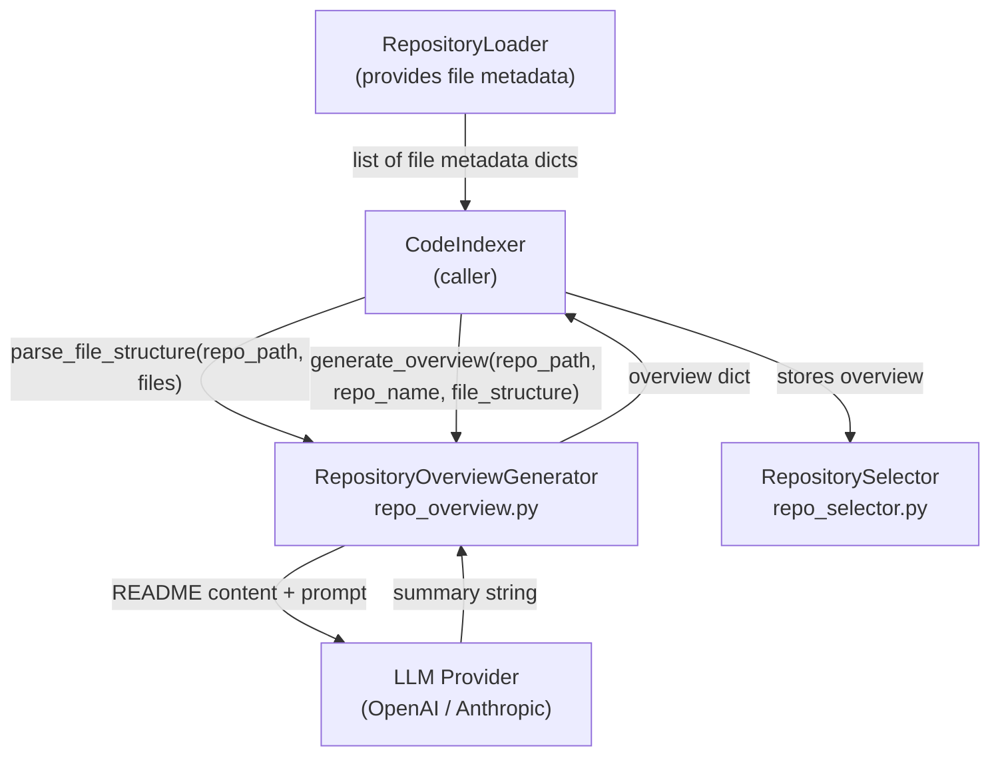
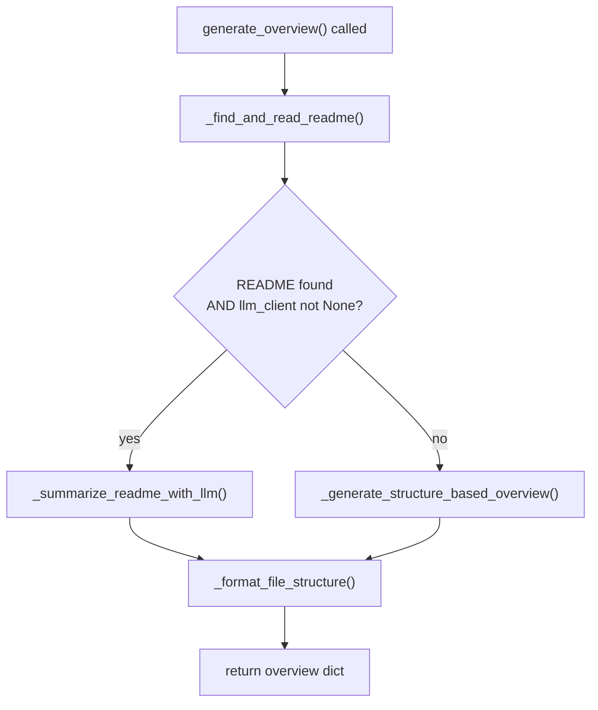
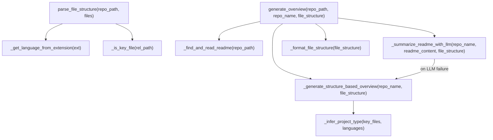

<!-- source: DeepWiki mcp.deepwiki.com · repo HKUDS/FastCode · page 4.9 Repository Overview Generator · fetched 2026-11-09 -->

# Repository Overview Generator

<details>
<summary>Relevant source files</summary>

The following files were used as context for generating this wiki page:

- [fastcode/llm_utils.py](fastcode/llm_utils.py)
- [fastcode/repo_overview.py](fastcode/repo_overview.py)

</details>


This page documents the `RepositoryOverviewGenerator` class in [fastcode/repo_overview.py](), which produces high-level natural language summaries and structured metadata for indexed repositories. This component is used during the indexing pipeline to create per-repository context that enables multi-repository query routing.

For details on how the overview is consumed during multi-repo query routing, see [Repository Selector](#5.4). For how the overview fits into the two-stage retrieval pipeline, see [Two-Stage Retrieval](#9.5). For the configuration flag that controls whether overviews are generated at all, see [Indexing Configuration](#8.4).

---

## Role in the System

`RepositoryOverviewGenerator` sits at the boundary between repository ingestion and LLM-based reasoning. During indexing, it generates a concise textual summary that is later used by `RepositorySelector` to determine which repositories are most relevant for a given query.

**Overview pipeline diagram: class interactions**



Sources: [fastcode/repo_overview.py:1-99]()

---

## Class Initialization

```
RepositoryOverviewGenerator(config: Dict[str, Any])
```

The constructor reads LLM settings from the `generation` section of `config` and from environment variables.

| Attribute | Source | Default |
|---|---|---|
| `provider` | `config["generation"]["provider"]` | `"openai"` |
| `model` | `os.getenv("MODEL")` | — |
| `api_key` | `os.getenv("OPENAI_API_KEY")` | — |
| `anthropic_api_key` | `os.getenv("ANTHROPIC_API_KEY")` | — |
| `base_url` | `os.getenv("BASE_URL")` | — |
| `temperature` | hardcoded | `0.3` |
| `max_tokens` | hardcoded | `1000` |

The LLM client is constructed immediately by `_initialize_client()`. If no API key is present for the configured provider, the client is set to `None` and the generator falls back to structure-based summaries.

Sources: [fastcode/repo_overview.py:16-60]()

---

## Primary Entry Points

### `generate_overview()`

[fastcode/repo_overview.py:62-99]()

```
generate_overview(repo_path, repo_name, file_structure) -> Dict[str, Any]
```

This is the main method called by the indexer. It returns a dictionary with the following keys:

| Key | Type | Description |
|---|---|---|
| `repo_name` | `str` | Name of the repository |
| `summary` | `str` | Natural language summary (LLM-generated or structure-based) |
| `readme_content` | `str \| None` | Raw README text, truncated to 10,000 characters |
| `file_structure` | `Dict` | Parsed structure dict from `parse_file_structure()` |
| `structure_text` | `str` | Formatted text representation of the file structure |
| `has_readme` | `bool` | Whether a README was found |

**Decision logic for summary generation:**



Sources: [fastcode/repo_overview.py:62-99]()

---

### `parse_file_structure()`

[fastcode/repo_overview.py:128-192]()

```
parse_file_structure(repo_path, files) -> Dict[str, Any]
```

Accepts the list of file metadata dicts produced by `RepositoryLoader` and builds a structured representation. This method is typically called before `generate_overview()` so the result can be passed in.

Returned structure keys:

| Key | Type | Content |
|---|---|---|
| `total_files` | `int` | Count of all scanned files |
| `languages` | `Dict[str, int]` | Language name → file count |
| `directories` | `Dict[str, List[str]]` | Directory path → list of direct child filenames |
| `file_types` | `Dict[str, int]` | File extension → count |
| `all_files` | `List[str]` | All relative file paths |
| `key_files` | `List[str]` | Files identified by `_is_key_file()` |

Language detection is done via `_get_language_from_extension()`. Directory entries are accumulated incrementally — every ancestor directory of each file gets an entry, not just the immediate parent.

Sources: [fastcode/repo_overview.py:128-192]()

---

## Internal Methods

### README Detection: `_find_and_read_readme()`

[fastcode/repo_overview.py:101-126]()

Scans the repository root for README files using a fixed priority list of 19 filename variants, covering case variations and common extensions (`.md`, `.rst`, `.txt`, `.markdown`, `.mdown`, and bare `README`). Returns the content of the first match, or `None` if none is found.

README name candidates (in order):

```
README.md, readme.md, README.MD, Readme.md,
README.rst, readme.rst, README.RST, Readme.rst,
README.txt, readme.txt, README.TXT,
README.markdown, readme.markdown, README.MARKDOWN,
README.mdown, readme.mdown,
README, readme
```

Only the repository root is searched — subdirectory READMEs are not considered.

Sources: [fastcode/repo_overview.py:101-126]()

---

### LLM Summarization: `_summarize_readme_with_llm()`

[fastcode/repo_overview.py:228-281]()

Constructs a prompt containing the repository name, total file count, detected languages, and up to 8,000 characters of README content (truncated if longer). The prompt instructs the LLM to produce a 3–5 sentence summary covering:

1. Main purpose of the repository
2. Key technologies or frameworks
3. Primary use cases or target users
4. Main components or modules

Provider dispatch:

| Provider | API call |
|---|---|
| `"openai"` | `openai_chat_completion()` from `llm_utils.py` |
| `"anthropic"` | `self.llm_client.messages.create()` |

If the LLM call raises an exception, `_generate_structure_based_overview()` is called as a fallback.

Sources: [fastcode/repo_overview.py:228-281]()

---

### Structure-Based Fallback: `_generate_structure_based_overview()`

[fastcode/repo_overview.py:283-309]()

Used when no README is available or the LLM client is not initialized. Produces a deterministic summary by:

1. Identifying the primary language (the one with the highest file count)
2. Calling `_infer_project_type()` to guess the project type from key file names
3. Appending a language list if multiple languages are present
4. Listing up to 5 key entry point files

Example output:
> `fastcode is a python Python application with 42 files. It uses multiple languages: python, javascript. Key entry points include: setup.py, requirements.txt, main.py.`

Sources: [fastcode/repo_overview.py:283-309]()

---

### Project Type Inference: `_infer_project_type()`

[fastcode/repo_overview.py:311-344]()

Performs keyword matching against the joined list of key file names to classify the project type. The detection rules, in priority order:

| Condition | Inferred type |
|---|---|
| `package.json` + `tsx` language | `"React web application"` |
| `package.json` + `react` or `vue` | `"Vue.js web application"` or `"React web application"` |
| `package.json` (generic) | `"Node.js application"` |
| `requirements.txt` or `setup.py` + `django` | `"Django web application"` |
| `requirements.txt` or `setup.py` + `flask` | `"Flask web application"` |
| `requirements.txt` or `setup.py` (generic) | `"Python application"` |
| `android` or `java` language | `"Android application"` |
| `dockerfile` | `"containerized application"` |
| (default) | `"software project"` |

Sources: [fastcode/repo_overview.py:311-344]()

---

### Language Detection: `_get_language_from_extension()`

[fastcode/repo_overview.py:194-211]()

Maps file extensions to language names. Extensions not in the map return `"unknown"` and are excluded from the language count.

| Extension | Language |
|---|---|
| `.py` | `python` |
| `.js`, `.jsx` | `javascript` |
| `.ts`, `.tsx` | `typescript` |
| `.java` | `java` |
| `.go` | `go` |
| `.cpp` | `cpp` |
| `.c` | `c` |
| `.rs` | `rust` |
| `.rb` | `ruby` |
| `.php` | `php` |
| `.cs` | `csharp` |

Sources: [fastcode/repo_overview.py:194-211]()

---

### Key File Detection: `_is_key_file()`

[fastcode/repo_overview.py:213-226]()

Returns `True` if the lowercase filename contains any of these substrings:

```
main, index, app, init, config, setup,
package.json, requirements.txt, go.mod, cargo.toml,
dockerfile, makefile, cmakelists.txt
```

This is a substring match, so `__init__.py`, `config.yaml`, and `app.py` all qualify.

Sources: [fastcode/repo_overview.py:213-226]()

---

### File Structure Formatting: `_format_file_structure()`

[fastcode/repo_overview.py:346-378]()

Converts the `file_structure` dict into a human-readable string. The output includes:

- Total file count
- Language breakdown (sorted descending by count)
- Full sorted file list
- Top-level directories with child file counts (capped at 15 entries)

This text is stored in the `structure_text` key of the overview dict and can be used in prompts sent to the `RepositorySelector`.

Sources: [fastcode/repo_overview.py:346-378]()

---

## Complete Data Flow

**Diagram: `RepositoryOverviewGenerator` method call graph**



Sources: [fastcode/repo_overview.py:62-381]()

---

## LLM Client and `openai_chat_completion` Shim

For the `"openai"` provider, `_summarize_readme_with_llm()` calls `openai_chat_completion()` from [fastcode/llm_utils.py:4-17](). This shim first tries the `max_tokens` parameter, and if the model returns a `BadRequestError` indicating it requires `max_completion_tokens` instead (e.g., newer `o1`-series models), it retries with that parameter. This ensures compatibility across OpenAI model generations without requiring configuration changes.

Sources: [fastcode/llm_utils.py:1-17](), [fastcode/repo_overview.py:258-265]()

---

## Configuration Interaction

The `generate_repo_overview` flag in `config.yaml` under the `indexing` section controls whether the indexer calls `RepositoryOverviewGenerator` at all. When set to `false`, no overview is generated and multi-repository routing must rely solely on repository names and file paths. See [Indexing Configuration](#8.4) for details.

The LLM provider, model, and API credentials used by this class come from the same `generation` configuration block and environment variables used by `AnswerGenerator`. See [Generation Configuration](#8.8) for full details.

---

