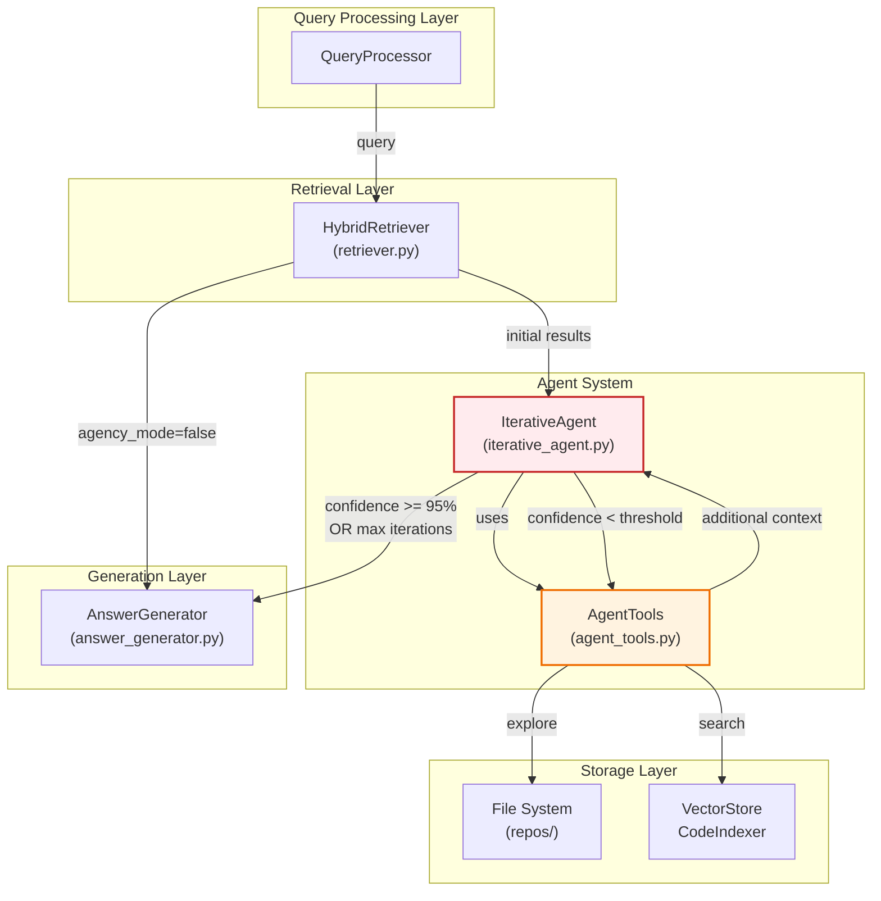
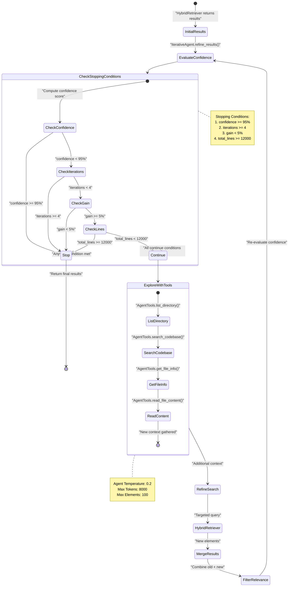
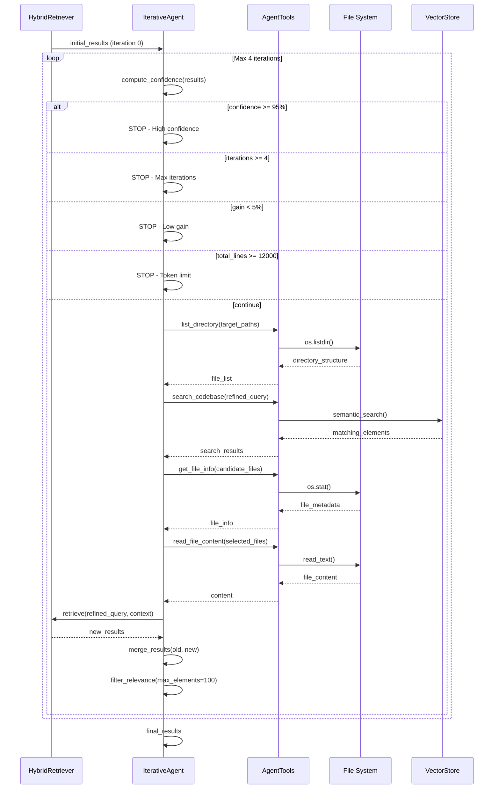
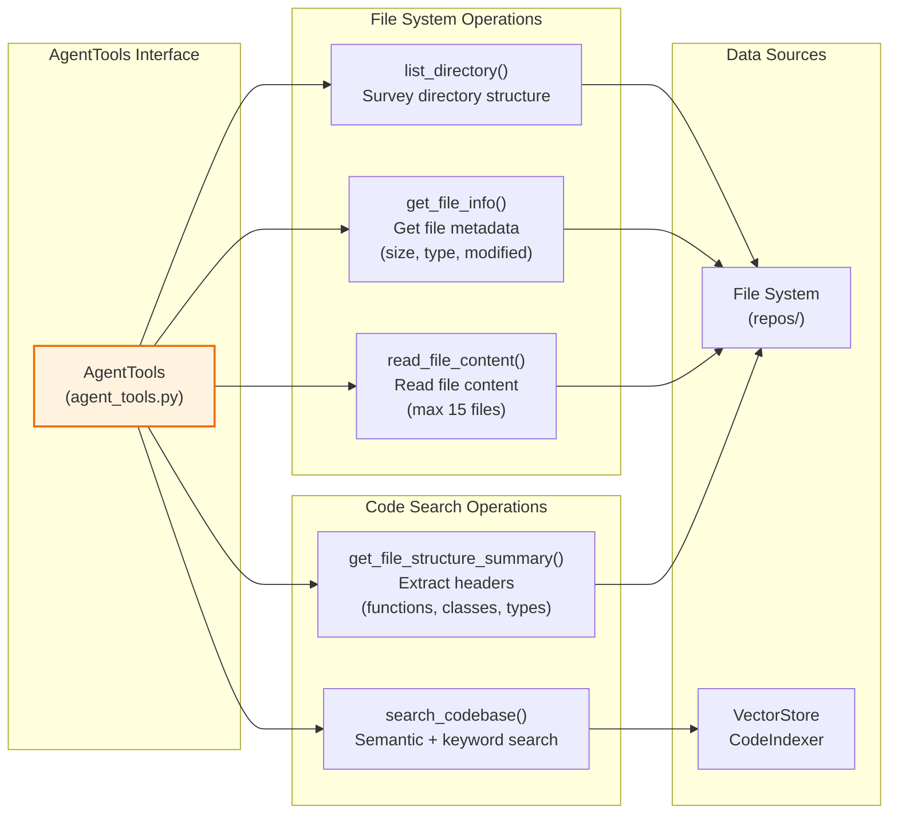
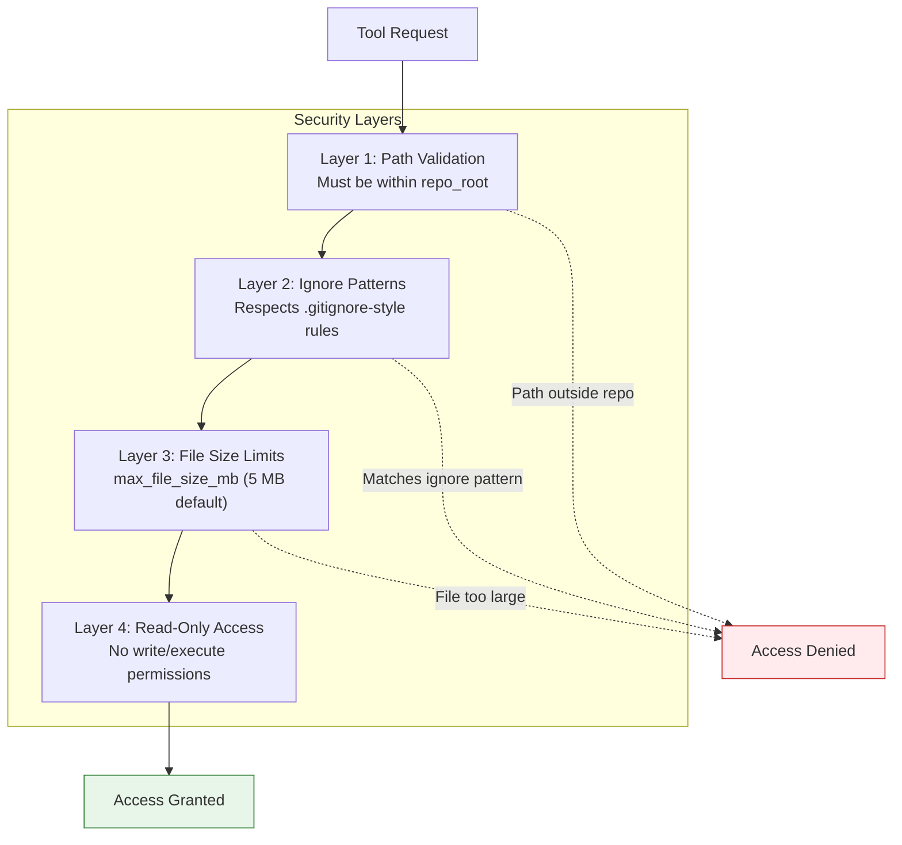
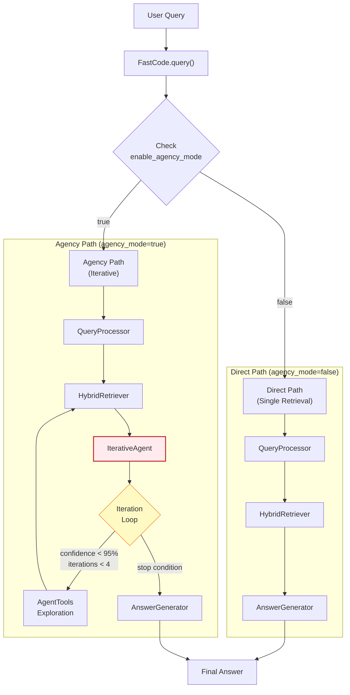
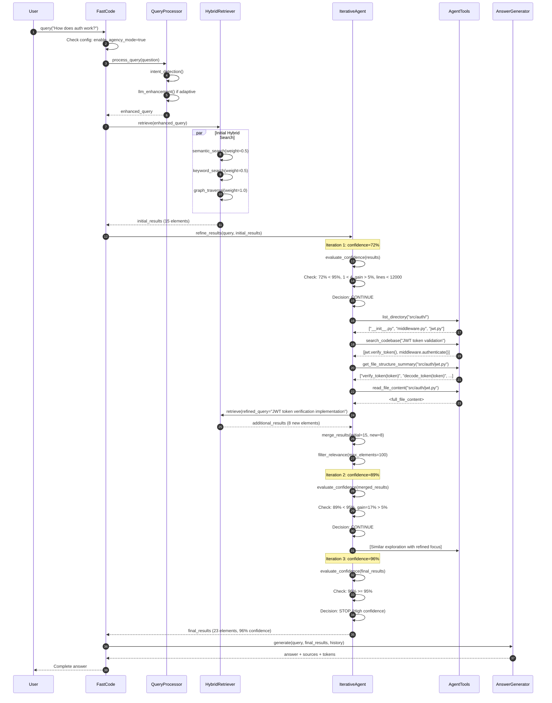
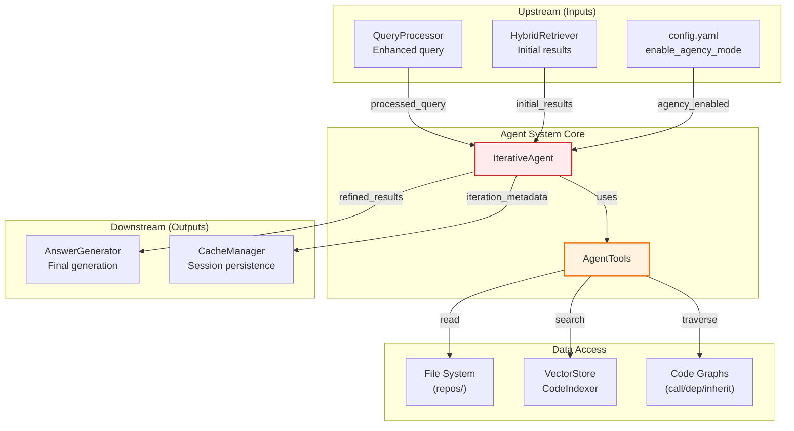

<!-- source: DeepWiki mcp.deepwiki.com · repo HKUDS/FastCode · page 5 Agent System · fetched 2026-11-09 -->

# Agent System

<details>
<summary>Relevant source files</summary>

The following files were used as context for generating this wiki page:

- [config/config.yaml](config/config.yaml)
- [fastcode/embedder.py](fastcode/embedder.py)
- [fastcode/iterative_agent.py](fastcode/iterative_agent.py)

</details>


The Agent System is FastCode's iterative, confidence-driven retrieval component that enhances code search accuracy and comprehensiveness through multi-round exploration. It operates as part of Phase 2 (Lightning-Fast Navigation) in the three-phase framework, enabling the system to autonomously refine search results until reaching high confidence thresholds or resource limits.

This page covers the agent-based retrieval architecture, including the `IterativeAgent` class that orchestrates multi-round searches and the `AgentTools` class that provides read-only file exploration capabilities. For information about basic retrieval without agency, see [Hybrid Retriever](#4.6). For query processing that precedes agent invocation, see [Query Configuration](#8.7).

**Sources:** [README.md:76-113](), [config/config.yaml:169-180](), [fastcode/__init__.py:23-24]()

---

## System Architecture

The Agent System sits between the `HybridRetriever` and `AnswerGenerator` components, acting as an intelligent intermediary that can iteratively refine search results based on confidence evaluation.

### Agent System Position in FastCode



**Sources:** [fastcode/__init__.py:19-24](), [config/config.yaml:119-120]()

### Component Relationships

| Component | File | Role | Interface |
|-----------|------|------|-----------|
| `IterativeAgent` | `iterative_agent.py` | Orchestrates multi-round retrieval with confidence tracking | `refine_results(query, initial_results, ...)` |
| `AgentTools` | `agent_tools.py` | Provides read-only file exploration capabilities | `list_directory()`, `search_codebase()`, `read_file_content()`, etc. |
| `HybridRetriever` | `retriever.py` | Initial semantic + keyword + graph search | `retrieve(query, ...)` |
| `AnswerGenerator` | `answer_generator.py` | Final answer generation with LLM | `generate(query, elements, ...)` |

**Sources:** [fastcode/__init__.py:19-24](), [config/config.yaml:98-120]()

---

## IterativeAgent

The `IterativeAgent` class implements a confidence-based feedback loop that iteratively refines retrieval results. It evaluates result quality after each round and decides whether to continue exploration or terminate based on multiple stopping conditions.

### Core Behavior



**Sources:** [config/config.yaml:171-180](), [README.md:96-103]()

### Confidence Evaluation

The agent computes a confidence score (0-100) based on multiple factors:

- **Coverage**: How many relevant code elements were found
- **Relevance**: Semantic similarity between query and results
- **Completeness**: Whether all query aspects are addressed
- **Structural Coherence**: Presence of connected code paths (call graphs, dependencies)

The confidence threshold is configurable via `agent.iterative.confidence_threshold` (default: 95%).

**Sources:** [config/config.yaml:174]()

### Stopping Conditions

The `IterativeAgent` terminates iteration when any of these conditions are met:

| Condition | Configuration Key | Default | Rationale |
|-----------|------------------|---------|-----------|
| High Confidence | `confidence_threshold` | 95% | Results sufficiently comprehensive |
| Max Iterations | `max_iterations` | 4 | Prevent infinite loops |
| Low Gain | `min_confidence_gain` | 5% | Diminishing returns |
| Token Limit | `max_total_lines` | 12000 lines | Cost management |

**Sources:** [config/config.yaml:173-176]()

### Iteration Process



**Sources:** [config/config.yaml:173-180]()

---

## AgentTools

The `AgentTools` class provides a secure, read-only interface for file system exploration and code search. All operations are constrained to the repository root directory and implement safety checks to prevent unauthorized access.

### Available Tools

The agent has access to five exploration tools:



**Sources:** [fastcode/__init__.py:24](), [README.md:96-102]()

### Tool Capabilities

#### 1. `list_directory(path)`

Lists files and subdirectories within a given path, respecting ignore patterns.

**Purpose**: Survey project structure without reading file contents  
**Returns**: List of file paths with types (file/directory)  
**Safety**: Path must be within `repo_root`, respects `ignore_patterns`

#### 2. `search_codebase(query, max_results=10)`

Performs semantic and keyword search across indexed code elements.

**Purpose**: Find relevant code elements by natural language query  
**Returns**: List of code elements (classes, functions) with similarity scores  
**Backed by**: `HybridRetriever` (semantic + BM25)

#### 3. `get_file_info(file_path)`

Retrieves metadata for a file without reading its content.

**Purpose**: Check file size, type, and modification time  
**Returns**: Dictionary with `size_bytes`, `type`, `last_modified`  
**Safety**: Read-only, no content access

#### 4. `get_file_structure_summary(file_path)`

Extracts structural information (function signatures, class definitions, type hints) without loading full content.

**Purpose**: "Skim" code structure efficiently (implements "Code Skimming" from Phase 2)  
**Returns**: Headers-only view of code organization  
**Benefit**: Massive token savings - reads chapter titles instead of full pages

#### 5. `read_file_content(file_path)`

Reads the full content of a file.

**Purpose**: Load targeted files after structure exploration  
**Returns**: Complete file text  
**Limit**: Maximum 15 files per agent invocation (`max_files_to_search`)

**Sources:** [README.md:96-102](), [config/config.yaml:116]()

### Security Model

All `AgentTools` operations are read-only and implement defense-in-depth:



**Sources:** [config/config.yaml:9-21](), [config/config.yaml:56]()

### Tool Usage Pattern

The agent typically follows this exploration pattern:

1. **Survey**: `list_directory()` to understand folder structure
2. **Search**: `search_codebase()` to find potentially relevant elements
3. **Filter**: `get_file_info()` to check file sizes and types
4. **Skim**: `get_file_structure_summary()` to preview code organization
5. **Load**: `read_file_content()` for targeted, high-value files

This pattern minimizes token usage by deferring full content loading until confidence in relevance is high.

**Sources:** [README.md:96-102]()

---

## Configuration

The Agent System is configured through `config/config.yaml` under the `agent` and `retrieval` sections.

### Core Agent Configuration

```yaml
# config/config.yaml
agent:
  iterative:
    max_iterations: 4              # Maximum retrieval rounds
    confidence_threshold: 95       # Stop if confidence >= 95%
    min_confidence_gain: 5         # Minimum gain to continue (%)
    max_total_lines: 12000         # Token limit (lines of code)
    temperature_agent: 0.2         # LLM temperature for agent reasoning
    max_tokens_agent: 8000         # Max tokens for agent LLM calls
    max_elements: 100              # Max elements after relevance filtering
    max_candidates_display: 200    # Max candidates in formatted output
```

**Sources:** [config/config.yaml:169-180]()

### Agency Mode Toggle

```yaml
# config/config.yaml
retrieval:
  enable_agency_mode: true         # Enable/disable agent-based retrieval
  max_files_to_search: 15          # Max files agent can read per query
```

**Key Behavior**:
- When `enable_agency_mode: true` → `IterativeAgent` is invoked after initial retrieval
- When `enable_agency_mode: false` → Results go directly from `HybridRetriever` to `AnswerGenerator`

**Sources:** [config/config.yaml:119-120](), [config/config.yaml:116]()

### Configuration Parameters Explained

| Parameter | Range | Default | Impact |
|-----------|-------|---------|--------|
| `max_iterations` | 1-10 | 4 | More iterations = higher accuracy but slower |
| `confidence_threshold` | 0-100 | 95 | Lower threshold = faster termination, lower quality |
| `min_confidence_gain` | 0-100 | 5 | Higher gain requirement = earlier termination |
| `max_total_lines` | 1000-50000 | 12000 | Balances accuracy vs. token cost |
| `temperature_agent` | 0.0-1.0 | 0.2 | Low temperature = more deterministic reasoning |
| `max_elements` | 10-500 | 100 | Prevents context overflow in later stages |

**Sources:** [config/config.yaml:173-180]()

### Environment Variables

The agent uses the same LLM configuration as other components:

```bash
# .env
OPENAI_API_KEY=sk-...        # API key for LLM provider
MODEL=gpt-4-turbo            # Model for agent reasoning
BASE_URL=https://...         # API endpoint
```

The agent uses `temperature_agent: 0.2` (lower than generation temperature `0.4`) for more focused reasoning.

**Sources:** [config/config.yaml:177](), [config/config.yaml:146]()

---

## Agency Mode Operation

Agency mode transforms FastCode from a single-shot retrieval system into an iterative exploration system. This section describes the complete operational flow.

### Activation Flow



**Sources:** [config/config.yaml:119]()

### Complete Query Flow with Agency



**Sources:** [config/config.yaml:119-120](), [config/config.yaml:173-176]()

### Performance Characteristics

#### Token Savings

Agency mode achieves up to **10x token savings** through:

1. **Code Skimming**: `get_file_structure_summary()` reads headers instead of full files
2. **Targeted Loading**: Only loads high-confidence files after structural exploration
3. **Early Termination**: Stops when confidence is sufficient, avoiding unnecessary exploration
4. **Relevance Filtering**: Keeps only top `max_elements` (100) most relevant items

**Example Token Usage**:
- **Without Agency**: Load 50 files × 500 lines = 25,000 lines ≈ 100,000 tokens
- **With Agency**: Skim 50 files × 50 headers = 2,500 lines, load 10 files × 500 lines = 5,000 lines ≈ 30,000 tokens
- **Savings**: 70% reduction

**Sources:** [README.md:47](), [README.md:102]()

#### Accuracy Improvement

Agency mode improves accuracy by:

- **Multi-round refinement**: Corrects initial retrieval mistakes
- **Contextual exploration**: Follows code relationships discovered during exploration
- **Confidence-driven search**: Continues until high confidence is reached
- **Structural awareness**: Uses directory structure and code graphs to guide search

**Sources:** [README.md:29-34]()

### When to Use Agency Mode

| Scenario | Recommendation | Rationale |
|----------|---------------|-----------|
| Simple queries ("where is X?") | Disable | Single retrieval sufficient |
| Implementation questions | Enable | Requires comprehensive context |
| Debugging tasks | Enable | Needs multiple code paths |
| Impact analysis | Enable | Must trace dependencies |
| Large codebases (>100k LOC) | Enable | Navigation crucial |
| Small scripts (<1k LOC) | Disable | Overhead not justified |
| Cost-sensitive environments | Configure carefully | Balance accuracy vs. cost |

**Configuration Strategy**:
- **Default**: `enable_agency_mode: true` for best accuracy
- **Fast/Cheap**: `enable_agency_mode: false` + increase `max_results: 10`
- **Balanced**: `enable_agency_mode: true` + `max_iterations: 2` + `confidence_threshold: 85`

**Sources:** [config/config.yaml:119](), [config/config.yaml:99-107]()

---

## Cost Management

The Agent System implements multiple cost control mechanisms to prevent runaway token usage while maintaining accuracy.

### Cost Control Mechanisms

```mermaid
graph TB
    subgraph "Before Iteration"
        BC1["max_iterations: 4<br/>Hard limit on rounds"]
        BC2["max_files_to_search: 15<br/>Limit file reads per query"]
    end
    
    subgraph "During Iteration"
        DC1["min_confidence_gain: 5%<br/>Stop if diminishing returns"]
        DC2["max_total_lines: 12000<br/>Token budget enforcement"]
        DC3["max_elements: 100<br/>Context size limit"]
        DC4["confidence_threshold: 95%<br/>Early termination on success"]
    end
    
    subgraph "Tool-Level Controls"
        TC1["get_file_structure_summary()<br/>Headers instead of full content"]
        TC2["max_file_size_mb: 5<br/>Skip huge files"]
        TC3["Read-only access<br/>No expensive write operations"]
    end
    
    subgraph "LLM Call Optimization"
        LC1["temperature_agent: 0.2<br/>Deterministic, fewer retries"]
        LC2["max_tokens_agent: 8000<br/>Limit per agent call"]
    end
    
    BC1 --> Cost["Total Cost<br/>Bounded"]
    BC2 --> Cost
    DC1 --> Cost
    DC2 --> Cost
    DC3 --> Cost
    DC4 --> Cost
    TC1 --> Cost
    TC2 --> Cost
    TC3 --> Cost
    LC1 --> Cost
    LC2 --> Cost
    
    style Cost fill:#e8f5e9,stroke:#2e7d32,stroke-width:2px
```



**Sources:** [config/config.yaml:171-180](), [config/config.yaml:11-21](), [config/config.yaml:116]()

### Token Budget Calculation

The agent tracks cumulative token usage across iterations:

```python
# Pseudo-code for token tracking
total_lines = 0
for iteration in range(max_iterations):
    # Add new elements
    total_lines += sum(len(element.content.split('\n')) for element in new_elements)
    
    # Check budget
    if total_lines >= 12000:  # max_total_lines
        logger.info(f"Token limit reached: {total_lines} lines")
        break
```

**Approximate Token Conversion**:
- 1 line of code ≈ 4 tokens (average)
- 12,000 lines ≈ 48,000 tokens
- With context and prompts ≈ 60,000-80,000 total tokens per query

**Sources:** [config/config.yaml:176]()

### Cost Optimization Strategies

#### Strategy 1: Aggressive Early Termination

```yaml
agent:
  iterative:
    confidence_threshold: 85      # Lower bar (faster)
    min_confidence_gain: 10       # Higher gain requirement
    max_iterations: 2             # Fewer rounds
```

**Impact**: ~50% cost reduction, ~10% accuracy reduction

#### Strategy 2: Balanced (Recommended)

```yaml
agent:
  iterative:
    confidence_threshold: 95      # Default
    min_confidence_gain: 5
    max_iterations: 4
```

**Impact**: Best accuracy-cost tradeoff

#### Strategy 3: Maximum Accuracy

```yaml
agent:
  iterative:
    confidence_threshold: 98      # High bar
    min_confidence_gain: 2        # Continue on small gains
    max_iterations: 6             # More rounds
    max_total_lines: 20000        # Higher budget
```

**Impact**: Best accuracy, 2-3x cost increase

**Sources:** [config/config.yaml:173-176]()

---

## Integration with Other Components

The Agent System integrates tightly with other FastCode components:

### Integration Points



**Sources:** [fastcode/__init__.py:15-24]()

### Data Flow Between Components

| From | To | Data | Format |
|------|-----|------|--------|
| `QueryProcessor` | `IterativeAgent` | Enhanced query | String + metadata |
| `HybridRetriever` | `IterativeAgent` | Initial results | List of `CodeElement` objects |
| `IterativeAgent` | `AgentTools` | Exploration directives | Tool calls with parameters |
| `AgentTools` | `File System` | Path requests | String paths |
| `AgentTools` | `VectorStore` | Search queries | String + filters |
| `IterativeAgent` | `AnswerGenerator` | Final results | List of `CodeElement` + metadata |

**Sources:** [fastcode/__init__.py:15-24]()

---

## Usage Examples

### Example 1: Enabling Agency Mode

```yaml
# config/config.yaml
retrieval:
  enable_agency_mode: true  # Enable agent-based retrieval
  max_files_to_search: 15

agent:
  iterative:
    max_iterations: 4
    confidence_threshold: 95
```

**Python API**:
```python
from fastcode import FastCode

# Agency mode is controlled by config, not API parameters
fc = FastCode(config_path="config/config.yaml")
result = fc.query("How does authentication work?")

# Agent automatically invoked if enable_agency_mode: true
print(f"Confidence: {result.get('metadata', {}).get('confidence', 'N/A')}")
print(f"Iterations: {result.get('metadata', {}).get('iterations', 'N/A')}")
```

**Sources:** [config/config.yaml:119-120](), [config/config.yaml:171-174]()

### Example 2: Disabling for Simple Queries

For simple lookups where speed is critical:

```yaml
# config/config.yaml
retrieval:
  enable_agency_mode: false  # Direct retrieval only
  max_results: 10            # Return more initial results
```

**Use case**: "Where is function X defined?"

**Sources:** [config/config.yaml:119]()

### Example 3: Multi-Turn Dialogue with Agency

Agency mode works seamlessly with multi-turn dialogue:

```python
from fastcode import FastCode

fc = FastCode(config_path="config/config.yaml")

# Turn 1: Agent explores broadly
result1 = fc.query(
    "How is user authentication implemented?",
    multi_turn=True,
    session_id="auth_investigation"
)

# Turn 2: Agent uses previous context + new exploration
result2 = fc.query(
    "What about password hashing?",
    multi_turn=True,
    session_id="auth_investigation"
)

# Agent references previous iteration's findings
# Confidence builds across turns
```

**Sources:** [config/config.yaml:159-161]()

### Example 4: Monitoring Agent Behavior

Check iteration metadata in responses:

```python
result = fc.query("Explain the payment flow")

metadata = result.get('metadata', {})
print(f"Iterations: {metadata.get('iterations', 0)}")
print(f"Initial confidence: {metadata.get('initial_confidence', 0):.1f}%")
print(f"Final confidence: {metadata.get('final_confidence', 0):.1f}%")
print(f"Total lines retrieved: {metadata.get('total_lines', 0)}")
print(f"Files explored: {len(metadata.get('files_explored', []))}")
print(f"Agent stopped reason: {metadata.get('stop_reason', 'N/A')}")
```

**Possible `stop_reason` values**:
- `"high_confidence"`: Reached 95% threshold
- `"max_iterations"`: Hit iteration limit
- `"low_gain"`: Confidence gain < 5%
- `"token_limit"`: Exceeded max_total_lines

**Sources:** [config/config.yaml:173-176]()

---

## Summary

The Agent System enables FastCode to achieve **superior accuracy** (highest among benchmarks) while maintaining **10x token savings** through intelligent, iterative exploration. Key characteristics:

**Core Components**:
- `IterativeAgent` (orchestration) + `AgentTools` (exploration)

**Key Features**:
- Confidence-based iteration (threshold: 95%)
- Multi-round refinement (max: 4 iterations)
- Read-only file exploration (5 tools)
- Token budget enforcement (max: 12,000 lines)

**When to Use**:
- ✅ Complex implementation questions
- ✅ Debugging and impact analysis
- ✅ Large codebases requiring navigation
- ❌ Simple lookups ("where is X?")
- ❌ Extremely cost-sensitive scenarios

**Configuration**:
- Toggle: `retrieval.enable_agency_mode` (default: `true`)
- Tune: `agent.iterative.*` parameters for accuracy-cost tradeoff

For detailed configuration options, see [Agent Configuration](#8.9). For retrieval without agency, see [Hybrid Retriever](#4.6). For query processing settings, see [Query Configuration](#8.7).

**Sources:** [README.md:25-47](), [config/config.yaml:169-180]()

---

