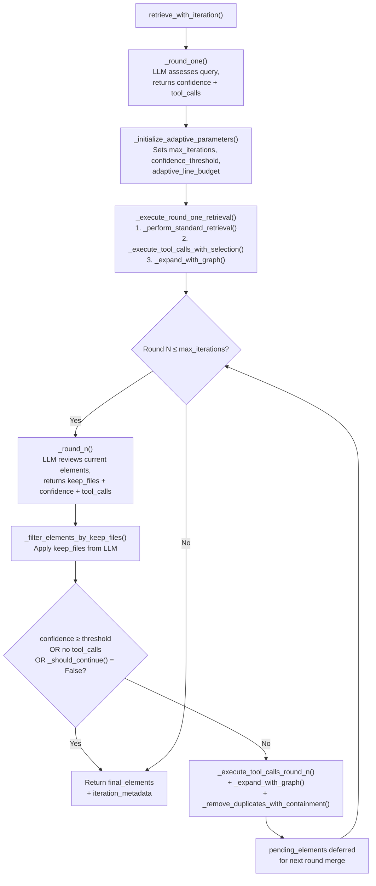
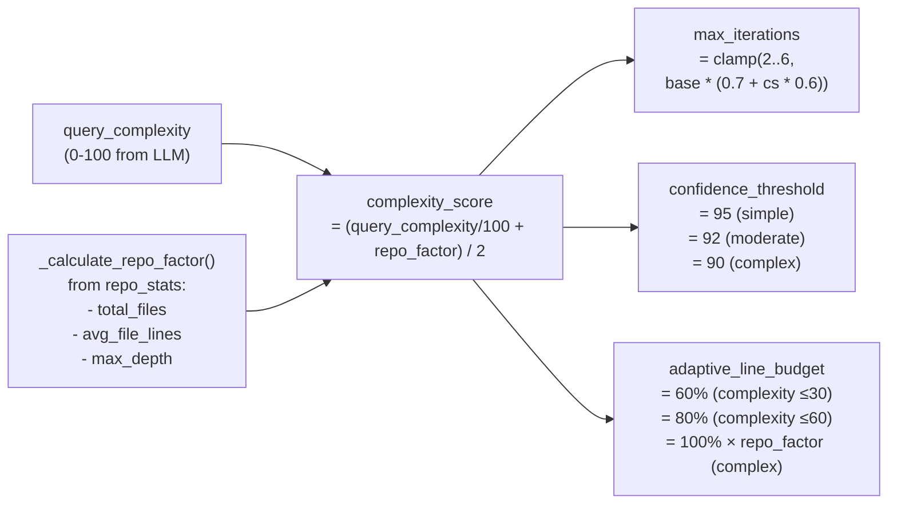
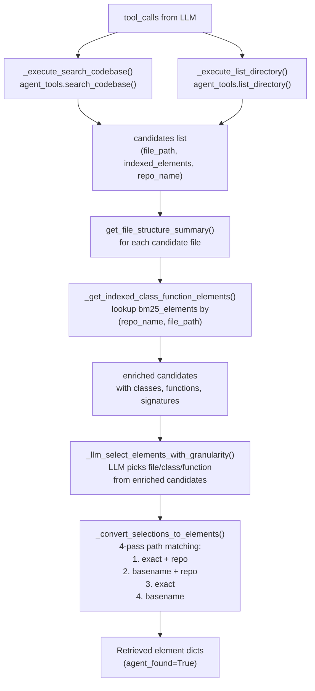
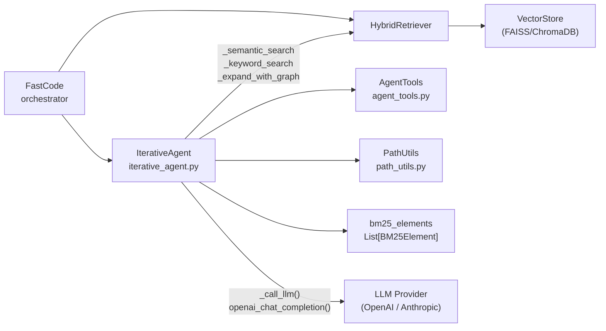

<!-- source: DeepWiki mcp.deepwiki.com · repo HKUDS/FastCode · page 5.1 Iterative Agent · fetched 2026-11-09 -->

# Iterative Agent

<details>
<summary>Relevant source files</summary>

The following files were used as context for generating this wiki page:

- [config/config.yaml](config/config.yaml)
- [fastcode/embedder.py](fastcode/embedder.py)
- [fastcode/iterative_agent.py](fastcode/iterative_agent.py)

</details>


This page documents the `IterativeAgent` class in [fastcode/iterative_agent.py](), which implements multi-round, confidence-driven retrieval for complex queries when agency mode is enabled. It covers the retrieval loop structure, per-round LLM interactions, adaptive parameter tuning, deduplication, and smart pruning.

For information on enabling agency mode via configuration, see [5.3](#5.3). For the `AgentTools` sub-system (`search_codebase`, `list_directory`, `get_file_structure_summary`) that the agent calls, see [5.2](#5.2). For the `RepositorySelector` used in multi-repo scenarios, see [5.4](#5.4).

---

## Overview

Standard hybrid retrieval (see [4.6](#4.6)) performs a single-pass search. For complex queries—cross-file analysis, architectural questions, debugging—a single pass often misses important context. `IterativeAgent` addresses this by running multiple retrieval rounds, each guided by an LLM assessment of how confident it is that the current set of retrieved code elements can answer the query.

The agent balances three competing concerns:

| Concern | Mechanism |
|---|---|
| Answer completeness | Confidence score (0–100) drives continuation |
| Token/compute cost | Line budget (`adaptive_line_budget`) caps total code retrieved |
| Iteration overhead | `max_iterations` and ROI checks stop diminishing rounds |

---

## Class Structure

**Class:** `IterativeAgent` — [fastcode/iterative_agent.py:20-84]()

```
IterativeAgent
├── __init__(config, retriever, repo_root, bm25_elements)
├── retrieve_with_iteration()        ← Main entry point
│
├── Round 1
│   ├── _round_one()
│   ├── _build_round_one_prompt()
│   ├── _parse_round_one_response()
│   └── _execute_round_one_retrieval()
│
├── Round N (2+)
│   ├── _round_n()
│   ├── _build_round_n_prompt()
│   └── _parse_round_n_response()
│
├── Tool Execution
│   ├── _execute_tool_calls_with_selection()
│   ├── _execute_search_codebase()
│   ├── _execute_list_directory()
│   └── _execute_tool_calls_round_n()
│
├── Element Management
│   ├── _smart_prune_elements()
│   ├── _remove_duplicates_with_containment()
│   ├── _filter_elements_by_keep_files()
│   └── _limit_elements_by_relevance()
│
└── Adaptive Control
    ├── _initialize_adaptive_parameters()
    ├── _should_continue_iteration()
    └── _calculate_repo_factor()
```

Sources: [fastcode/iterative_agent.py:20-84]()

---

## Initialization

`IterativeAgent.__init__` accepts four arguments:

| Parameter | Type | Role |
|---|---|---|
| `config` | `Dict` | Full YAML config dict |
| `retriever` | `HybridRetriever` | Used for standard retrieval passes and graph expansion |
| `repo_root` | `str` | Filesystem root of all repositories |
| `bm25_elements` | `List` | Indexed BM25 elements; used to look up specific file/class/function elements |

It also constructs two helper objects:
- `AgentTools(repo_root)` — file system tools for searching and listing
- `PathUtils(repo_root)` — path normalization and repo detection utilities

Agent-specific settings are read from the `agent.iterative` section of config:

| Config Key | Default | Purpose |
|---|---|---|
| `max_iterations` | `4` | Maximum number of retrieval rounds |
| `confidence_threshold` | `95` | Stop when confidence ≥ this value |
| `min_confidence_gain` | `5` | Minimum gain required per round |
| `max_total_lines` | `12000` | Total line budget across all rounds |
| `temperature_agent` | `0.2` | LLM temperature for agent reasoning |
| `max_tokens_agent` | `8000` | Max response tokens per LLM call |
| `max_elements` | `100` | Cap on elements after relevance filtering |
| `max_candidates_display` | `200` | Candidates shown to LLM during selection |

Sources: [fastcode/iterative_agent.py:46-84](), [config/config.yaml:170-180]()

---

## Retrieval Loop

The main entry point is `retrieve_with_iteration()` [fastcode/iterative_agent.py:154-343](). It orchestrates the full multi-round process and returns a `(final_elements, iteration_metadata)` tuple.

**Iterative Retrieval Loop Diagram**



Sources: [fastcode/iterative_agent.py:154-343]()

---

## Round 1: Initial Assessment

`_round_one()` [fastcode/iterative_agent.py:446-471]() runs before any file content has been retrieved. The LLM receives:

- The user query (and optional dialogue history context)
- A directory tree of selected repositories (generated by `_generate_directory_tree()`)
- Confidence scoring rules

The LLM responds with JSON. The two possible response shapes are:

**If confidence ≥ 95** (very simple query, can answer from general knowledge):
```json
{"confidence": 97, "reasoning": "..."}
```

**If confidence < 95** (retrieval needed):
```json
{
  "confidence": 60,
  "query_complexity": 55,
  "reasoning": "...",
  "query_enhancement": {
    "needed": true,
    "refined_intent": "code_qa",
    "rewritten_query": "...",
    "selected_keywords": ["keyword1", "keyword2"],
    "pseudocode_hints": null
  },
  "tool_calls": [
    {"tool": "search_codebase", "parameters": {"search_term": "...", "file_pattern": "**/*.py"}},
    {"tool": "list_directory", "parameters": {"path": "repo/src/core"}}
  ]
}
```

Note: Even when `should_answer_directly` is `True` (confidence ≥ 95), the agent currently forces at least two rounds by not returning early [fastcode/iterative_agent.py:187-196]().

After parsing, `_execute_round_one_retrieval()` performs:
1. `_perform_standard_retrieval()` — calls the retriever's internal `_semantic_search`, `_keyword_search`, `_combine_results`, `_rerank`, and `_diversify` methods directly (avoiding recursive calls to `retrieve()`)
2. `_execute_tool_calls_with_selection()` — runs each tool call then asks the LLM to select specific elements at file/class/function granularity
3. `retriever._expand_with_graph()` — graph expansion with up to 2 hops
4. `_remove_duplicates_with_containment()` — deduplication
5. `_limit_elements_by_relevance()` — caps to `max_elements`

Sources: [fastcode/iterative_agent.py:446-884]()

---

## Round N: Iterative Assessment

`_round_n()` [fastcode/iterative_agent.py:1267-1309]() runs for rounds 2 and beyond. The LLM now sees the current retrieved elements and must decide what to keep and whether more retrieval is needed.

The prompt [fastcode/iterative_agent.py:1311-1472]() includes:

- The user query and optional dialogue context
- Repository directory tree
- Current resource usage: lines used vs. budget, current round vs. max
- All current retrieved elements formatted with source, line count, and signatures
- History of all prior tool calls (to prevent repetition)
- Stopping criteria and cost-aware guidelines

The LLM response structure:

**Stopping** (confidence ≥ threshold):
```json
{"keep_files": ["path/to/file.py", "path/to/file.py:ClassName"], "confidence": 96, "reasoning": "..."}
```

**Continuing** (more retrieval needed):
```json
{"keep_files": [...], "confidence": 72, "reasoning": "...", "tool_calls": [...]}
```

`keep_files` entries can refer to files, classes, or functions:
- File-level: `"path/to/file.py"`
- Class-level: `"path/to/file.py:ClassName"`
- Function-level: `"path/to/file.py:function_name"`

Sources: [fastcode/iterative_agent.py:1267-1472]()

---

## Adaptive Parameters

`_initialize_adaptive_parameters()` [fastcode/iterative_agent.py:109-152]() runs once after Round 1, using `query_complexity` (0–100, LLM-assessed) and `repo_factor` (calculated from repo statistics).

**Adaptive Parameter Derivation**



`_calculate_repo_factor()` [fastcode/iterative_agent.py:2432-2459]() produces a value in `[0.5, 2.0]` using:
- `file_factor`: log-scaled count of total files
- `complexity_factor`: average file line count / 200
- `depth_factor`: directory depth / 5

Sources: [fastcode/iterative_agent.py:109-152](), [fastcode/iterative_agent.py:2432-2459]()

---

## Stopping Criteria

`_should_continue_iteration()` [fastcode/iterative_agent.py:2268-2390]() evaluates several conditions in order:

| Priority | Check | Condition |
|---|---|---|
| 1 | Confidence threshold | `confidence >= confidence_threshold` → stop |
| 2 | Max iterations | `current_round >= max_iterations` → stop |
| 3 | Line budget | `total_lines >= adaptive_line_budget` → stop |
| 4 | Stagnation | Consecutive rounds with `\|gain\| < 1.0` → stop |
| 5 | Consecutive low performance | Two rounds of low ROI or negative gain → stop |
| 6 | Cost-benefit | Estimated lines needed > 1.5× remaining budget → stop |

**ROI** (return on investment) per round is computed as:
```
roi = confidence_gain / lines_added * 1000
```

The minimum acceptable ROI is determined by `_get_min_roi_threshold()` [fastcode/iterative_agent.py:2404-2430](), which lowers the bar for complex queries and raises it when confidence is already high (≥ 85).

When iteration ends, `_determine_stopping_reason()` [fastcode/iterative_agent.py:420-432]() classifies the outcome into one of: `confidence_threshold_reached`, `max_iterations_reached`, `line_budget_exceeded`, `diminishing_returns`, or `other`.

Sources: [fastcode/iterative_agent.py:2268-2432]()

---

## Element Selection and Tool Execution

**Tool Execution and Element Selection Flow**



The 4-pass matching in `_convert_selections_to_elements()` [fastcode/iterative_agent.py:1065-1248]() handles cases where the LLM may return slightly different paths than what is stored in the index.

Path normalization is handled by `PathUtils.normalize_path_with_repo()` and `PathUtils.detect_repo_name_from_path()`.

Sources: [fastcode/iterative_agent.py:886-1265]()

---

## Deduplication

`_remove_duplicates_with_containment()` [fastcode/iterative_agent.py:2177-2266]() applies two-phase deduplication:

1. **Exact deduplication** via `_remove_duplicates()` — groups by `(repo_name, file_path)`, keeps file-level elements over class/function elements from the same file, and removes exact element ID duplicates.

2. **Containment removal** — within each `(repo_name, file_path)` group, sorts elements by coverage (file > class > function, then by line range size), then removes any element whose line range is entirely within an already-kept element's range.

For example, if a class spans lines 116–2561 and a function spans 150–200, the function is discarded because it is fully contained by the class.

Sources: [fastcode/iterative_agent.py:2177-2266](), [fastcode/iterative_agent.py:3262-3335]()

---

## Smart Pruning

`_smart_prune_elements()` [fastcode/iterative_agent.py:1971-2014]() is called when the total line count of retained elements exceeds `adaptive_line_budget`. It scores each element using `_calculate_element_priority_score()` [fastcode/iterative_agent.py:2016-2076]() and greedily selects elements until the budget is filled.

Priority scoring factors:

| Factor | Weight | Description |
|---|---|---|
| `total_score` | 0.40 | Retrieval relevance from hybrid search |
| Source bonus | up to 0.30 | `agent_found` (tool) > `llm_file_selected` > high semantic score |
| Element type | up to 0.20 | `function` (0.20) > `class` (0.15) > `file` (0.00) |
| Size score | 0.20 | Ideal 50–200 lines; penalizes very large elements |
| Granularity bonus | up to 0.15 | Class/function-level selections over file-level |

A minimum of 1 element is always kept regardless of budget.

Sources: [fastcode/iterative_agent.py:1971-2076]()

---

## Tool Call Deduplication

To avoid the LLM repeating tool calls across rounds, the agent maintains `tool_call_history` (a list of `{round, tool, parameters}` records).

`_filter_redundant_tool_calls()` [fastcode/iterative_agent.py:1658-1712]() normalizes each proposed tool call (using `_resolve_tool_call_parameters()` to match the resolved paths that were actually executed) and removes any that already appear in prior rounds. Both same-round duplicates and cross-round duplicates are filtered.

The resolved tool call history is injected into each Round N prompt via `_format_tool_call_history()` [fastcode/iterative_agent.py:1714-1728]() so the LLM is aware of what has already been searched.

Sources: [fastcode/iterative_agent.py:1474-1712]()

---

## Iteration Metadata

After the loop completes, `_generate_iteration_metadata()` [fastcode/iterative_agent.py:345-418]() assembles a summary dict returned alongside the final elements:

| Field | Description |
|---|---|
| `rounds` | Number of rounds executed |
| `initial_confidence` | Confidence from round 1 |
| `final_confidence` | Confidence at termination |
| `total_elements` | Number of elements in final result set |
| `total_lines` | Total lines of code retrieved |
| `budget_used_pct` | Percentage of `adaptive_line_budget` consumed |
| `overall_roi` | `confidence_gain / total_lines * 1000` |
| `round_efficiencies` | Per-round `confidence_gain`, `lines_added`, `roi` |
| `adaptive_params` | The computed `max_iterations`, `confidence_threshold`, `line_budget` |
| `stopping_reason` | Enum string: `confidence_threshold_reached`, etc. |
| `efficiency_rating` | `excellent` / `good` / `acceptable` / `inefficient` |
| `history` | Full per-round stats list |

Sources: [fastcode/iterative_agent.py:345-444]()

---

## LLM Interaction

`_call_llm()` [fastcode/iterative_agent.py:2472-2524]() dispatches to either the OpenAI or Anthropic client depending on `generation.provider` in config. It uses `openai_chat_completion()` from `llm_utils.py` for the OpenAI path (which handles the `max_completion_tokens` shim for some models).

The system prompt used for all agent calls is:
```
You are a precise code analysis agent. Respond in specified format only.
```

JSON parsing of LLM responses uses `_extract_json_from_response()` followed by `_robust_json_parse()` [fastcode/iterative_agent.py:2590-2841](), which tries five strategies in sequence:
1. Direct `json.loads()`
2. After `_sanitize_json_string()` (fixes unescaped control chars, trailing commas)
3. After fixing unquoted keys with regex
4. `ast.literal_eval()` for Python-style dicts
5. Incremental brace-matching parse

Sources: [fastcode/iterative_agent.py:2472-2841]()

---

## Integration with FastCode Engine

`IterativeAgent` is instantiated and managed by the `FastCode` core orchestrator. It is invoked from the retriever when `enable_agency_mode` is `true` in config. The retriever detects this flag and calls `retrieve_with_iteration()` instead of its standard single-pass `retrieve()` method.

**Component Relationships**



Sources: [fastcode/iterative_agent.py:20-84](), [config/config.yaml:118-119]()

---

