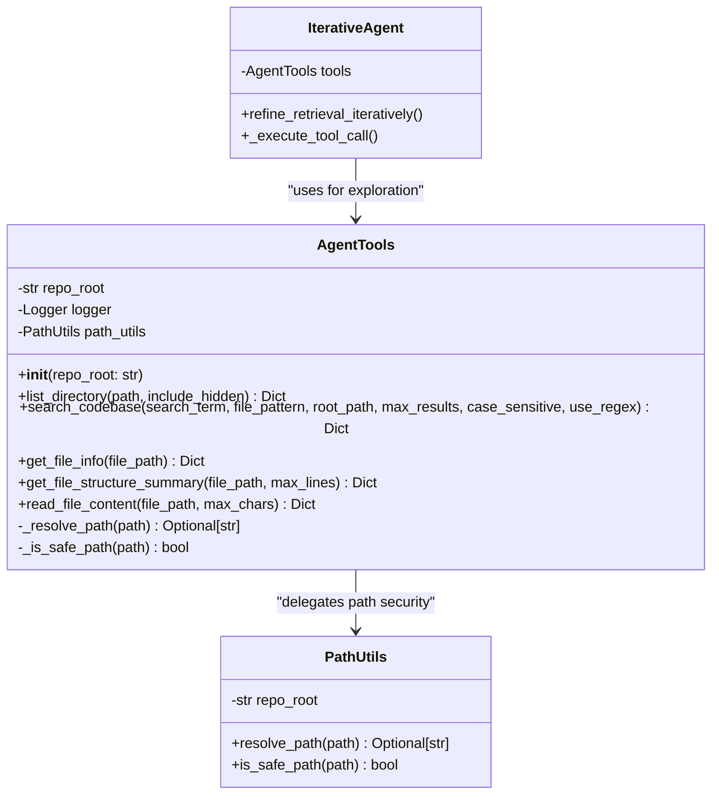
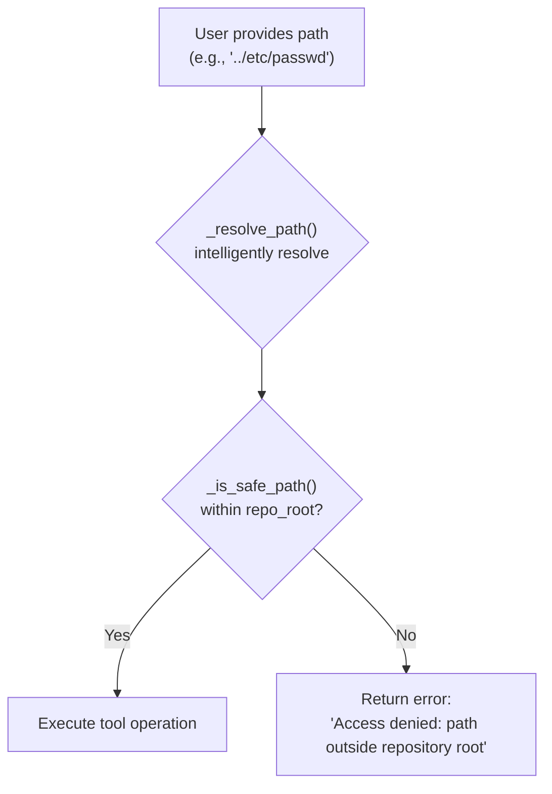
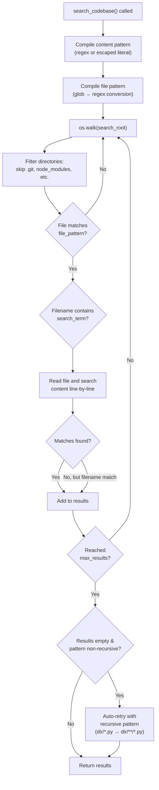
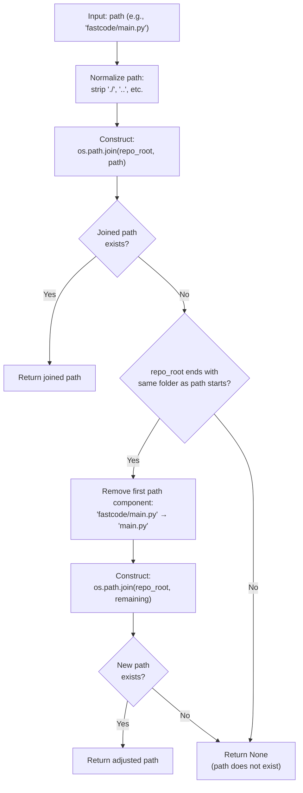
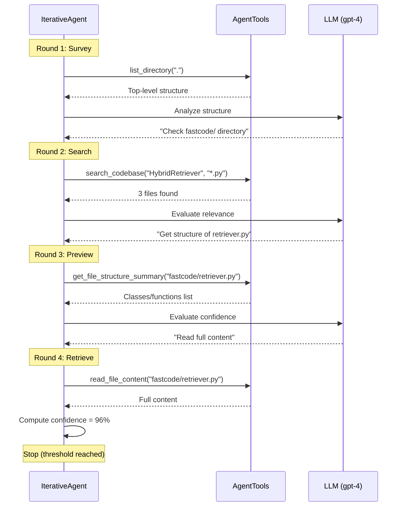
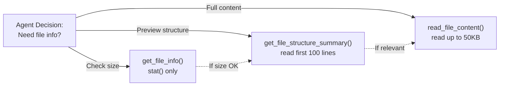

<!-- source: DeepWiki mcp.deepwiki.com · repo HKUDS/FastCode · page 5.2 Agent Tools · fetched 2026-11-09 -->

# Agent Tools

<details>
<summary>Relevant source files</summary>

The following files were used as context for generating this wiki page:

- [fastcode/iterative_agent.py](fastcode/iterative_agent.py)

</details>


## Purpose and Scope

The `AgentTools` class provides a suite of **read-only file exploration capabilities** that enable the iterative agent to intelligently navigate and inspect code repositories during the retrieval process. These tools form the foundation of FastCode's agency mode, allowing the agent to make informed decisions about which files to retrieve without loading entire codebases into memory.

Agent Tools implements a **security-first design** with path sandboxing to ensure agents can only read files within the repository boundary. All operations are read-only; no modifications to the codebase are possible.

For information about how these tools are orchestrated during multi-round retrieval, see [Iterative Agent](#5.1). For configuring and enabling the agent system, see [Agency Mode](#5.3).

**Sources:** [fastcode/agent_tools.py:1-16]()

## Tool Catalog

The `AgentTools` class provides five primary exploration tools, each designed for specific information-gathering needs during iterative retrieval:

| Tool | Purpose | Max Results | Typical Use Case |
|------|---------|-------------|------------------|
| `list_directory` | Enumerate directory contents | Unlimited | Survey repository structure |
| `search_codebase` | Find files by content/pattern | 30 matches | Locate relevant implementations |
| `get_file_info` | Get file metadata | Single file | Check file size before reading |
| `get_file_structure_summary` | Extract headers (classes, functions) | 100 lines | Preview file contents cheaply |
| `read_file_content` | Read full file content | 50,000 chars | Retrieve targeted files |

**Sources:** [fastcode/agent_tools.py:48-542]()

---

## Class Architecture



**Diagram: AgentTools class structure and relationships**

The `AgentTools` class is instantiated with a `repo_root` parameter that defines the security boundary. All path operations are delegated to `PathUtils` for consistent path resolution and security validation across the system.

**Sources:** [fastcode/agent_tools.py:15-46](), [fastcode/__init__.py:24]()

---

## Security Architecture

### Path Sandboxing

All agent tools enforce a strict security boundary to prevent directory traversal attacks and unauthorized file access:



**Diagram: Path security validation flow**

The two-stage security model:
1. **Path Resolution** ([fastcode/agent_tools.py:31-38]()): Intelligently resolves relative paths, handling cases where `repo_root` ends with the same folder name that the path starts with
2. **Safety Validation** ([fastcode/agent_tools.py:40-46]()): Verifies the resolved absolute path remains within `repo_root`

**Example Security Boundary:**
```python
# repo_root = "/workspace/repos/fastcode"
# All paths must resolve to subdirectories of repo_root

✓ "src/main.py"           → /workspace/repos/fastcode/src/main.py
✓ "./fastcode/parser.py"  → /workspace/repos/fastcode/fastcode/parser.py  
✗ "../../../etc/passwd"   → Access denied
✗ "/tmp/malicious.py"     → Access denied
```

**Sources:** [fastcode/agent_tools.py:31-46]()

---

## Tool Reference

### 1. list_directory

Enumerates directory contents with optional filtering of hidden files.

**Function Signature:**
```python
def list_directory(self, path: str = ".", include_hidden: bool = False) -> Dict[str, Any]
```

**Parameters:**
| Parameter | Type | Default | Description |
|-----------|------|---------|-------------|
| `path` | `str` | `"."` | Relative path from repo root |
| `include_hidden` | `bool` | `False` | Include files/directories starting with `.` |

**Return Structure:**
```json
{
  "success": true,
  "path": "src",
  "contents": [
    {
      "name": "main.py",
      "path": "src/main.py",
      "type": "file",
      "size": 4823
    },
    {
      "name": "utils",
      "path": "src/utils",
      "type": "directory"
    }
  ]
}
```

**Use Case:** Survey repository structure to identify relevant directories before drilling down.

**Sources:** [fastcode/agent_tools.py:48-106]()

---

### 2. search_codebase

Searches for files containing specific strings or regex patterns, with intelligent file pattern matching.

**Function Signature:**
```python
def search_codebase(self, search_term: str, file_pattern: str = "*", 
                   root_path: str = ".", max_results: int = 30,
                   case_sensitive: bool = False, use_regex: bool = False) -> Dict[str, Any]
```

**Parameters:**
| Parameter | Type | Default | Description |
|-----------|------|---------|-------------|
| `search_term` | `str` | - | String or regex pattern to search for |
| `file_pattern` | `str` | `"*"` | Glob pattern (supports `**` for recursive) |
| `root_path` | `str` | `"."` | Search root relative to repo root |
| `max_results` | `int` | `30` | Maximum matches to return |
| `case_sensitive` | `bool` | `False` | Case-sensitive search |
| `use_regex` | `bool` | `False` | Treat `search_term` as regex |

**Search Algorithm Flow:**



**Diagram: search_codebase execution flow with auto-retry logic**

**Return Structure:**
```json
{
  "success": true,
  "search_term": "FastCode",
  "file_pattern": "*.py",
  "files_searched": 45,
  "matches_found": 3,
  "results": [
    {
      "file": "fastcode/main.py",
      "match_count": 5,
      "match_type": "content",
      "matches": [
        {
          "line_number": 12,
          "line_content": "class FastCode:"
        }
      ]
    }
  ]
}
```

**Advanced Features:**

1. **OR Operation Support** ([fastcode/agent_tools.py:159-165]()): Use `|` to search multiple terms: `"FastCode|CodeParser"`
2. **Recursive Auto-Retry** ([fastcode/agent_tools.py:305-326]()): If no results found with `dir/*.py`, automatically retries with `dir/**/*.py`
3. **Filename + Content Matching** ([fastcode/agent_tools.py:244-257]()): Returns files that match in filename OR content
4. **Directory Filtering** ([fastcode/agent_tools.py:203-204]()): Automatically skips `.git`, `node_modules`, `__pycache__`, etc.

**Sources:** [fastcode/agent_tools.py:108-354]()

---

### 3. get_file_info

Retrieves file metadata without reading content, useful for checking file size before deciding to read.

**Function Signature:**
```python
def get_file_info(self, file_path: str) -> Dict[str, Any]
```

**Return Structure:**
```json
{
  "success": true,
  "path": "fastcode/main.py",
  "size": 15420,
  "is_file": true,
  "is_directory": false,
  "extension": ".py"
}
```

**Use Case:** Check file size before calling `read_file_content()` to avoid loading unexpectedly large files.

**Sources:** [fastcode/agent_tools.py:356-398]()

---

### 4. get_file_structure_summary

Extracts structural information (classes, functions, imports) by reading only the first N lines, implementing **code skimming** for efficient previews.

**Function Signature:**
```python
def get_file_structure_summary(self, file_path: str, max_lines: int = 100) -> Dict[str, Any]
```

**Parameters:**
| Parameter | Type | Default | Description |
|-----------|------|---------|-------------|
| `file_path` | `str` | - | Relative path to file |
| `max_lines` | `int` | `100` | Maximum lines to scan |

**Return Structure:**
```json
{
  "success": true,
  "path": "fastcode/main.py",
  "total_lines_scanned": 100,
  "classes": [
    {"name": "FastCode", "line": 15}
  ],
  "functions": [
    {"name": "query", "line": 45},
    {"name": "load_repository", "line": 78, "is_async": true}
  ],
  "imports": [
    {"line": 3, "statement": "import os"}
  ]
}
```

**Pattern Detection** ([fastcode/agent_tools.py:446-483]()):
- **Classes:** Matches `class ClassName` syntax
- **Functions:** Matches `def function_name` and `function function_name` 
- **Async Functions:** Detects `async def` and `async function`
- **Imports:** Captures `import` and `from` statements

**Cost Efficiency:** Reading only 100 lines vs. entire file reduces token usage by ~90% for large files while still providing structural overview.

**Sources:** [fastcode/agent_tools.py:400-491]()

---

### 5. read_file_content

Reads full file content with character limit to prevent memory exhaustion.

**Function Signature:**
```python
def read_file_content(self, file_path: str, max_chars: int = 50000) -> Dict[str, Any]
```

**Parameters:**
| Parameter | Type | Default | Description |
|-----------|------|---------|-------------|
| `file_path` | `str` | - | Relative path to file |
| `max_chars` | `int` | `50000` | Maximum characters to read |

**Return Structure:**
```json
{
  "success": true,
  "path": "fastcode/main.py",
  "content": "\"\"\"FastCode 2.0\"\"\"\n\nimport os\n...",
  "total_lines": 342,
  "truncated": false
}
```

**Safety Limits:**
- Default `max_chars=50000` (~50KB) prevents loading extremely large files
- Works with agent's `max_total_lines` limit ([config/config.yaml:176]()) to control total retrieval size
- UTF-8 decoding with `errors='ignore'` handles binary files gracefully

**Sources:** [fastcode/agent_tools.py:493-542]()

---

## Intelligent Path Resolution

The `_resolve_path()` method implements **context-aware path resolution** to handle edge cases where the repository root ends with the same folder name that appears in the path.

### Path Resolution Algorithm



**Diagram: Intelligent path resolution handling duplicate folder names**

### Example Scenarios

**Scenario 1: Standard Resolution**
```
repo_root = "/workspace/repos/myproject"
path = "src/main.py"

→ /workspace/repos/myproject/src/main.py ✓
```

**Scenario 2: Duplicate Folder Name Resolution**
```
repo_root = "/workspace/repos/fastcode"
path = "fastcode/main.py"

Standard join: /workspace/repos/fastcode/fastcode/main.py ✗ (doesn't exist)
Smart adjust:  /workspace/repos/fastcode/main.py ✓ (exists!)
```

This handles the common case where an agent receives a path like `fastcode/parser.py` but the repository root already ends with `/fastcode`.

**Sources:** [fastcode/agent_tools.py:31-38](), [fastcode/path_utils.py]() (referenced but not provided)

---

## Integration with Iterative Agent

The `IterativeAgent` uses these tools during multi-round retrieval to progressively build confidence about which files are relevant.

### Tool Usage Pattern



**Diagram: Typical 4-round agent exploration using tools**

### Configuration Integration

Agent tools behavior is influenced by configuration settings:

| Config Parameter | Location | Effect on Tools |
|------------------|----------|-----------------|
| `agent.iterative.max_iterations` | [config/config.yaml:173]() | Maximum times tools can be called |
| `agent.iterative.max_total_lines` | [config/config.yaml:176]() | Limits cumulative `read_file_content()` output |
| `agent.iterative.max_elements` | [config/config.yaml:179]() | Maximum files to retrieve with tools |
| `retrieval.max_files_to_search` | [config/config.yaml:116]() | Limits files returned per query |

**Sources:** [config/config.yaml:169-181](), [fastcode/iterative_agent.py]() (referenced)

---

## Error Handling

All tools return dictionaries with a `success` boolean and optional `error` field for consistent error handling:

### Common Error Patterns

| Error Type | Example Trigger | Return Structure |
|------------|----------------|------------------|
| Path Security | `"../../../etc/passwd"` | `{"success": false, "error": "Access denied: path outside repository root"}` |
| Path Not Found | `"nonexistent/file.py"` | `{"success": false, "error": "Path does not exist: ..."}` |
| Not a Directory | `list_directory("file.py")` | `{"success": false, "error": "Path is not a directory: ..."}` |
| Read Error | Binary file read as text | `{"success": false, "error": "...", "content": ""}` |

### Graceful Degradation

- **Binary files:** UTF-8 decoding with `errors='ignore'` ([fastcode/agent_tools.py:261](), [fastcode/agent_tools.py:428](), [fastcode/agent_tools.py:523]())
- **Permission errors:** Caught and returned in error field
- **Search limits:** Enforced silently without errors (e.g., `max_results=30`)

**Sources:** [fastcode/agent_tools.py:62-106]()

---

## Performance Characteristics

### Token Efficiency

| Tool | Typical Output Size | Use Case |
|------|-------------------|----------|
| `list_directory` | ~100 tokens | Survey 20-30 items |
| `search_codebase` | ~500 tokens | 5-10 matches with context |
| `get_file_info` | ~50 tokens | Single file metadata |
| `get_file_structure_summary` | ~300 tokens | Structure of 1 file |
| `read_file_content` | ~2000-5000 tokens | Full file (50KB limit) |

**Cost Savings:** Using `get_file_structure_summary()` before `read_file_content()` reduces unnecessary token usage by ~90% when the structure indicates a file is irrelevant.

### Disk I/O Optimization



**Diagram: Progressive file inspection reduces I/O**

- **Lazy loading:** Agent only reads full content after confirming relevance
- **Capped reads:** `max_chars` and `max_lines` prevent memory exhaustion
- **Filtered walks:** `search_codebase()` skips `.git`, `node_modules` automatically

**Sources:** [fastcode/agent_tools.py:203-204](), [config/config.yaml:169-181]()

---

## Usage Example

```python
from fastcode.agent_tools import AgentTools

# Initialize tools with security boundary
tools = AgentTools(repo_root="/workspace/repos/fastcode")

# Survey repository structure
result = tools.list_directory(".")
for item in result["contents"]:
    print(f"{item['type']}: {item['path']}")

# Search for authentication code
result = tools.search_codebase(
    search_term="authenticate|verify_token",
    file_pattern="**/*.py",
    max_results=10,
    use_regex=True
)
print(f"Found {result['matches_found']} files with auth code")

# Preview file structure before reading
result = tools.get_file_structure_summary("fastcode/api.py")
print(f"Classes: {[c['name'] for c in result['classes']]}")
print(f"Functions: {[f['name'] for f in result['functions']]}")

# Read targeted file
if "authenticate" in [f['name'] for f in result['functions']]:
    result = tools.read_file_content("fastcode/api.py")
    print(f"Read {result['total_lines']} lines")
```

**Sources:** [fastcode/agent_tools.py:15-542]()

---

## Summary

The `AgentTools` class provides five specialized tools that enable intelligent code exploration:

1. **list_directory** - Survey repository structure
2. **search_codebase** - Find files by content/pattern with auto-retry
3. **get_file_info** - Check metadata before reading
4. **get_file_structure_summary** - Preview file structure (code skimming)
5. **read_file_content** - Retrieve full content with limits

All tools enforce **read-only access** within a **security-sandboxed** repository boundary, making them safe for autonomous agent use. The progressive inspection pattern (info → structure → content) enables **10x token savings** by avoiding unnecessary full file reads.

**Sources:** [fastcode/agent_tools.py:1-542](), [config/config.yaml:169-181]()

---

