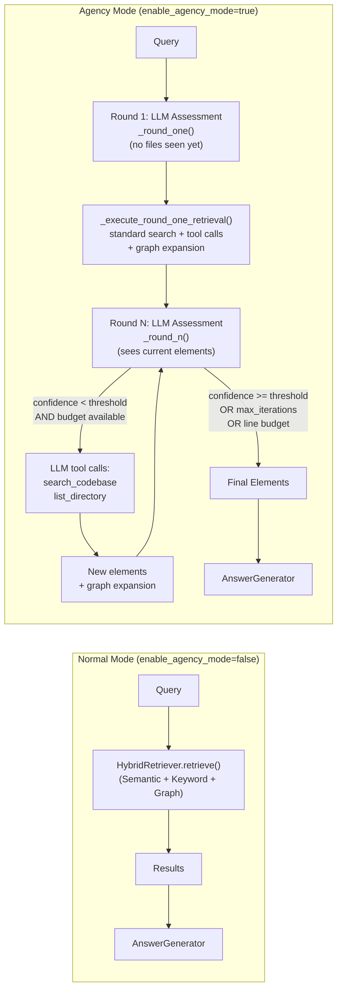
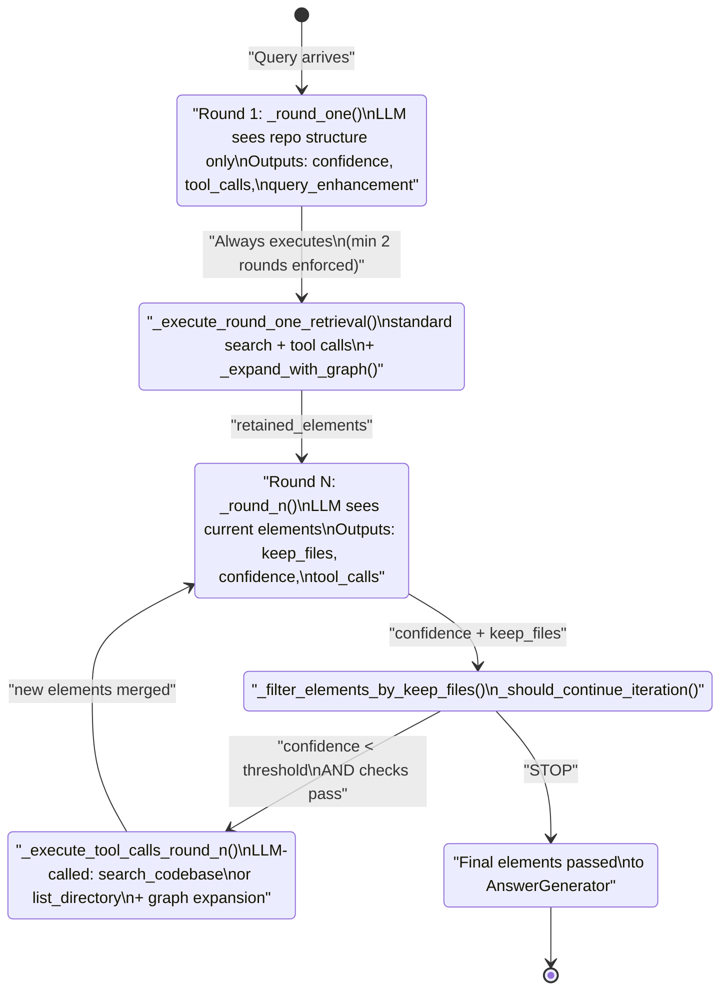
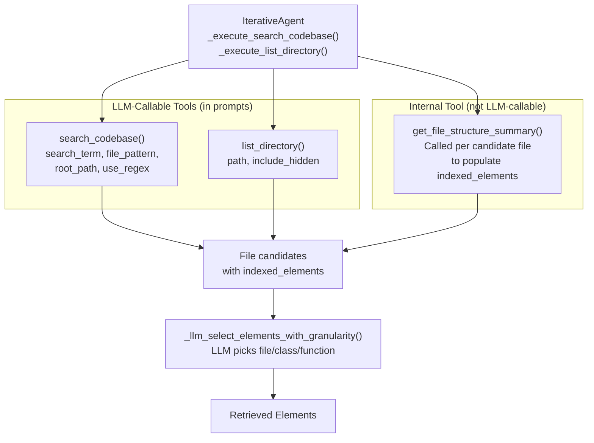
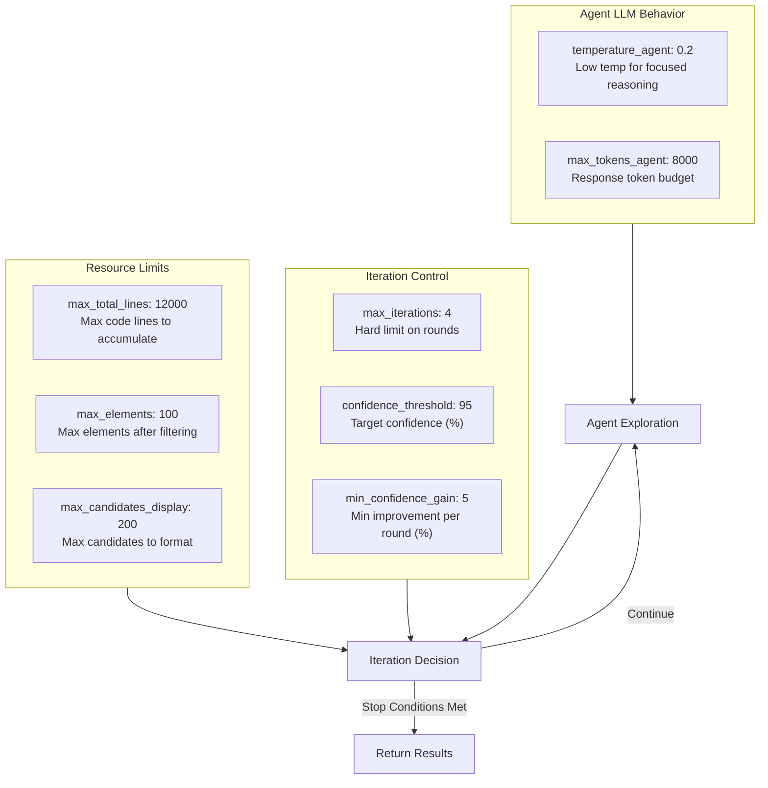

<!-- source: DeepWiki mcp.deepwiki.com · repo HKUDS/FastCode · page 5.3 Agency Mode · fetched 2026-11-09 -->

# Agency Mode

<details>
<summary>Relevant source files</summary>

The following files were used as context for generating this wiki page:

- [config/config.yaml](config/config.yaml)
- [fastcode/embedder.py](fastcode/embedder.py)
- [fastcode/iterative_agent.py](fastcode/iterative_agent.py)

</details>


## Purpose and Scope

This document explains how to enable and configure **agency mode** in FastCode—an optional iterative retrieval strategy that uses autonomous agent-based exploration to achieve higher accuracy and comprehensiveness for complex queries. Agency mode enables multi-round retrieval with intelligent file exploration through read-only tools, stopping automatically when confidence thresholds are met or resource limits are reached.

For details on the underlying iterative agent implementation, see [Iterative Agent](#5.1). For information about the specific tools available to the agent, see [Agent Tools](#5.2). For complete agent configuration options, see [Agent Configuration](#8.9).

---

## What is Agency Mode?

Agency mode transforms FastCode's retrieval process from a single-pass search into an iterative exploration loop. Instead of returning results from one hybrid search, the agent evaluates confidence, explores the codebase using read-only tools, refines the search, and repeats until it achieves high confidence or reaches iteration limits.

### Normal Mode vs Agency Mode

**Diagram: Normal Mode vs Agency Mode Retrieval Flow**



Sources: [config/config.yaml:119](), [fastcode/iterative_agent.py:154-343]()

---

## Enabling Agency Mode

### Configuration File

Agency mode is controlled by a single flag in the configuration file:

**Location:** `config/config.yaml`

```yaml
# Retrieval Settings
retrieval:
  # ... other retrieval settings ...
  
  # Agency mode for accurate and comprehensive retrieval
  enable_agency_mode: true  # Enable agent-based retrieval
```

**To enable:** Set `enable_agency_mode: true` (default: `true`)  
**To disable:** Set `enable_agency_mode: false`

Sources: [config/config.yaml:119]()

### Runtime Override

When using the API or CLI, agency mode respects the configuration file setting but can be combined with other retrieval parameters. The `enable_agency_mode` flag in `config.yaml` is the primary control mechanism.

---

## Agency Mode Behavior

When agency mode is enabled, the retrieval process follows this pattern:

**Diagram: Agency Mode Iteration State Machine**



> **Minimum 2 Rounds**: Even if the Round 1 LLM assessment returns confidence ≥ 95%, the code does not return early. Retrieval always runs for at least 2 rounds. See [fastcode/iterative_agent.py:187-196]().

> **Adaptive Parameters**: The configuration values (`max_iterations`, `confidence_threshold`, `max_total_lines`) are starting points. `_initialize_adaptive_parameters()` adjusts them per query based on `query_complexity` (0–100) and a `repo_factor` derived from file count, average file length, and directory depth. See [fastcode/iterative_agent.py:109-152]().

| Adaptive Parameter | Config Default | Adaptive Range |
|---|---|---|
| `max_iterations` | 4 | 2–6 |
| `confidence_threshold` | 95 | 90–95 |
| `adaptive_line_budget` | 12,000 | 60%–100% of `max_total_lines` |

### Key Characteristics

| Aspect | Value | Configuration Key |
|--------|-------|-------------------|
| Maximum Iterations | 4 | `agent.iterative.max_iterations` |
| Confidence Threshold | 95% | `agent.iterative.confidence_threshold` |
| Minimum Confidence Gain | 5% | `agent.iterative.min_confidence_gain` |
| Maximum Total Lines | 12,000 | `agent.iterative.max_total_lines` |
| Maximum Elements | 100 | `agent.iterative.max_elements` |
| Agent Temperature | 0.2 | `agent.iterative.temperature_agent` |
| Agent Max Tokens | 8,000 | `agent.iterative.max_tokens_agent` |

Sources: [config/config.yaml:169-181]()

---

## Agent Tools Available

When agency mode is active, the `IterativeAgent` directs the LLM to call two tools from the `AgentTools` class (`fastcode/agent_tools.py`). A third tool, `get_file_structure_summary`, is called internally by the agent's execution code to enrich candidate metadata shown to the LLM — it is not directly invocable by the LLM.

**Diagram: Agent Tool Roles in IterativeAgent**



### Tool Summary

| Tool | Callable By | Purpose | Key Parameters |
|------|-------------|---------|----------------|
| `search_codebase()` | LLM | Search file contents by term or regex | `search_term`, `file_pattern`, `root_path`, `max_results`, `case_sensitive`, `use_regex` |
| `list_directory()` | LLM | List files in a directory | `path`, `include_hidden` |
| `get_file_structure_summary()` | Agent internally | Extract class/function signatures from a file | `file_path` |

The LLM prompts in `_build_round_one_prompt` and `_build_round_n_prompt` explicitly describe only `search_codebase` and `list_directory` as available tools, with format examples for each. See [fastcode/iterative_agent.py:546-587]() and [fastcode/iterative_agent.py:1450-1465]().

After the LLM's tool calls return file candidates, `_execute_search_codebase` and `_execute_list_directory` call `get_file_structure_summary` for each candidate to populate `indexed_elements` (class/function names and signatures). This enriched candidate list is then passed to `_llm_select_elements_with_granularity` for element-level selection. See [fastcode/iterative_agent.py:2962-2981]() and [fastcode/iterative_agent.py:3101-3121]().

Sources: [fastcode/iterative_agent.py:886-940](), [fastcode/iterative_agent.py:2843-3032](), [fastcode/iterative_agent.py:3034-3159]()

---

## Configuration Reference

### Complete Agency Mode Configuration

All agency mode settings are located under the `agent.iterative` section in `config/config.yaml`:

```yaml
# Agent Settings
agent:
  # Iterative Agent - Multi-round retrieval with confidence control
  iterative:
    max_iterations: 4           # Maximum number of retrieval rounds
    confidence_threshold: 95    # Stop if confidence >= this value (0-100)
    min_confidence_gain: 5      # Min confidence gain to continue (0-100)
    max_total_lines: 12000      # Maximum total lines of code to retrieve
    temperature_agent: 0.2      # Temperature for agent reasoning (lower = more focused)
    max_tokens_agent: 8000      # Max tokens for agent responses
    max_elements: 100           # Maximum elements after relevance filtering
    max_candidates_display: 200 # Maximum candidates to display in formatting
```

Sources: [config/config.yaml:169-181]()

### Configuration Parameter Details



**Diagram: Configuration Parameters Flow**

#### Iteration Control

- **`max_iterations`**: Hard limit on the number of exploration rounds. Prevents infinite loops while allowing thorough exploration.
  - **Default:** `4`
  - **Range:** 1-10 (practical limit)
  - **Impact:** Higher values allow more comprehensive results but increase latency and cost.

- **`confidence_threshold`**: Target confidence percentage. Agent stops when this confidence is reached.
  - **Default:** `95`
  - **Range:** 0-100
  - **Impact:** Higher thresholds demand more thorough exploration before stopping.

- **`min_confidence_gain`**: Minimum improvement required per iteration to continue.
  - **Default:** `5`
  - **Range:** 0-100
  - **Impact:** Prevents diminishing returns by stopping if progress is too small.

#### Resource Limits

- **`max_total_lines`**: Maximum total lines of code to accumulate across all iterations.
  - **Default:** `12000`
  - **Range:** 1000-50000 (depends on LLM context window)
  - **Impact:** Prevents context overflow and controls token costs.

- **`max_elements`**: Maximum code elements to retain after relevance filtering.
  - **Default:** `100`
  - **Range:** 10-500
  - **Impact:** Balances comprehensiveness with performance.

- **`max_candidates_display`**: Maximum candidates to display when formatting results.
  - **Default:** `200`
  - **Range:** 50-1000
  - **Impact:** Controls output verbosity for debugging.

#### Agent LLM Behavior

- **`temperature_agent`**: Temperature parameter for the agent's LLM reasoning.
  - **Default:** `0.2`
  - **Range:** 0.0-1.0
  - **Impact:** Lower values make the agent more focused and deterministic; higher values increase exploration diversity.

- **`max_tokens_agent`**: Token budget for each agent response.
  - **Default:** `8000`
  - **Range:** 1000-32000 (depends on model)
  - **Impact:** Controls the verbosity and detail of agent reasoning.

Sources: [config/config.yaml:169-181]()

---

## When to Use Agency Mode

### Use Cases for Agency Mode

Agency mode is particularly effective for:

1. **Complex Cross-Repository Questions** - Questions that span multiple files or modules
   - Example: "How does authentication flow from login to session validation?"
   
2. **Debugging and Root Cause Analysis** - Finding the source of issues that may involve multiple components
   - Example: "Why does the API timeout when processing large files?"
   
3. **Implementation Planning** - Understanding dependencies before making changes
   - Example: "What would be affected if I change the User model schema?"
   
4. **Architecture Understanding** - Comprehensive exploration of system design
   - Example: "Explain the dependency graph between the API, database, and cache layers"

### When to Disable Agency Mode

Consider disabling agency mode (`enable_agency_mode: false`) for:

1. **Simple Lookup Questions** - Direct questions with obvious answers
   - Example: "Where is the main() function?"
   
2. **High-Volume Queries** - Batch processing where speed matters more than comprehensiveness
   
3. **Cost-Sensitive Scenarios** - When minimizing LLM API costs is critical
   
4. **Quick Exploratory Queries** - When you need fast initial insights

### Performance Trade-offs

| Aspect | Normal Mode | Agency Mode |
|--------|-------------|-------------|
| **Latency** | 1-3 seconds | 5-20 seconds |
| **Accuracy** | Good (single-pass) | Excellent (iterative refinement) |
| **Token Cost** | Lower (single retrieval) | Higher (multiple rounds) |
| **Comprehensiveness** | Limited to initial search | Explores until confident |
| **Best For** | Simple queries, batch processing | Complex queries, debugging |

Sources: [README.md:29](), [config/config.yaml:119]()

---

## Configuration Examples

### High Accuracy Configuration

For maximum accuracy at the cost of higher latency and token usage:

```yaml
retrieval:
  enable_agency_mode: true

agent:
  iterative:
    max_iterations: 6              # More rounds for thorough exploration
    confidence_threshold: 98       # Very high confidence target
    min_confidence_gain: 3         # Accept smaller gains
    max_total_lines: 20000         # Larger context window
    temperature_agent: 0.1         # More focused reasoning
    max_tokens_agent: 10000        # More detailed agent responses
    max_elements: 150              # Retain more candidates
```

### Balanced Configuration (Default)

For balanced accuracy and performance:

```yaml
retrieval:
  enable_agency_mode: true

agent:
  iterative:
    max_iterations: 4              # Reasonable exploration depth
    confidence_threshold: 95       # High confidence target
    min_confidence_gain: 5         # Stop if gains diminish
    max_total_lines: 12000         # Moderate context size
    temperature_agent: 0.2         # Focused but flexible
    max_tokens_agent: 8000         # Reasonable response size
    max_elements: 100              # Good candidate pool
```

### Fast Exploration Configuration

For faster queries with acceptable accuracy:

```yaml
retrieval:
  enable_agency_mode: true

agent:
  iterative:
    max_iterations: 2              # Quick exploration
    confidence_threshold: 90       # Lower threshold for faster exit
    min_confidence_gain: 10        # Require significant gains
    max_total_lines: 8000          # Smaller context
    temperature_agent: 0.3         # More exploratory
    max_tokens_agent: 5000         # Shorter responses
    max_elements: 50               # Fewer candidates
```

### Disabled Agency Mode

For simple queries or high-volume processing:

```yaml
retrieval:
  enable_agency_mode: false        # Use single-pass retrieval only
  
  # Agent settings are ignored when agency mode is disabled
```

Sources: [config/config.yaml:119](), [config/config.yaml:169-181]()

---

## Integration with Other Features

### Multi-Repository Mode

Agency mode works seamlessly with multi-repository retrieval. When `enable_two_stage_retrieval` is enabled, the agent explores across selected repositories:

```yaml
retrieval:
  enable_two_stage_retrieval: true
  select_repos_by_overview: true
  repo_selection_method: "llm"     # or "embedding"
  top_repos_to_search: 5
  enable_agency_mode: true         # Agent explores within selected repos
```

**Flow:** Repository Selection → Agency Mode Exploration → Final Results

Sources: [config/config.yaml:111-119]()

### Caching

Agency mode respects the caching configuration. Intermediate retrieval results are cached when `cache.enabled: true`:

```yaml
cache:
  enabled: true
  backend: "disk"                  # or "redis"
  ttl: 3600                        # Cache embeddings and queries
  dialogue_ttl: 2592000            # Cache session history
```

**Note:** Each iteration's search results are cached independently, improving performance on repeated queries.

Sources: [config/config.yaml:183-192]()

### Multi-Turn Dialogue

Agency mode is fully compatible with multi-turn dialogue. Session history is preserved across iterations:

```yaml
query:
  use_llm_enhancement: true
  llm_enhancement_mode: "adaptive"
  history_summary_rounds: 10       # Include conversation context

generation:
  enable_multi_turn: true
  context_rounds: 10               # Include previous rounds

retrieval:
  enable_agency_mode: true         # Agent can use dialogue context
```

**Benefit:** The agent can use conversation history to refine its exploration strategy.

Sources: [config/config.yaml:123-161]()

---

## Environment Variables

Agency mode uses the same LLM configuration as the main answer generation. The agent's model is controlled by environment variables:

```bash
# .env file
OPENAI_API_KEY=sk-...
MODEL=gpt-4-turbo              # Model for both agent and answer generation
BASE_URL=https://api.openai.com/v1
```

**Note:** The agent uses `temperature_agent` and `max_tokens_agent` from config, but the model itself comes from the `MODEL` environment variable.

To use a different model for the agent vs answer generation, you would need to modify the agent initialization code (currently not configurable separately).

Sources: [README.md:203-213]()

---

## Monitoring and Debugging

### Log Output

When agency mode is active, FastCode logs additional information about the iterative process:

```
INFO - Starting iterative agent retrieval (max_iterations=4, confidence_threshold=95)
INFO - Iteration 1: confidence=72%, gain=N/A, total_lines=3245
INFO - Agent exploring with tools: list_directory, search_codebase
INFO - Iteration 2: confidence=86%, gain=14%, total_lines=7891
INFO - Agent exploring with tools: get_file_structure_summary, read_file_content
INFO - Iteration 3: confidence=96%, gain=10%, total_lines=11234
INFO - Stopping: confidence threshold met (96% >= 95%)
```

### Cache Statistics

Check agency mode performance with cache statistics:

```bash
# API endpoint
GET /cache-stats

# Returns:
{
  "query_cache": {
    "hits": 42,
    "misses": 15,
    "hit_rate": 0.737
  },
  "embedding_cache": {
    "hits": 1523,
    "misses": 87,
    "hit_rate": 0.946
  }
}
```

Sources: [README.md:512-513]()

---

## Related Configuration

For complete details on related configuration sections:

- [Iterative Agent Implementation](#5.1) - Deep dive into the agent's retrieval loop
- [Agent Tools](#5.2) - Detailed documentation of exploration tools
- [Agent Configuration](#8.9) - All agent-related configuration options
- [Retrieval Configuration](#8.6) - Hybrid search and filtering settings
- [Query Configuration](#8.7) - Query processing and enhancement options

---

## Summary

Agency mode transforms FastCode from a single-pass retrieval system into an iterative, confidence-driven exploration framework. By enabling `enable_agency_mode: true` in the configuration file, you activate a sophisticated agent that:

1. **Evaluates confidence** after each retrieval round
2. **Explores the codebase** using five read-only tools
3. **Refines the search** based on findings
4. **Stops automatically** when confidence, iteration, or resource limits are met

The trade-off is higher latency and token costs in exchange for significantly improved accuracy and comprehensiveness—especially valuable for complex queries, debugging, and architectural understanding.

Sources: [config/config.yaml:119](), [config/config.yaml:169-181](), [fastcode/agent_tools.py:15-542]()

---

