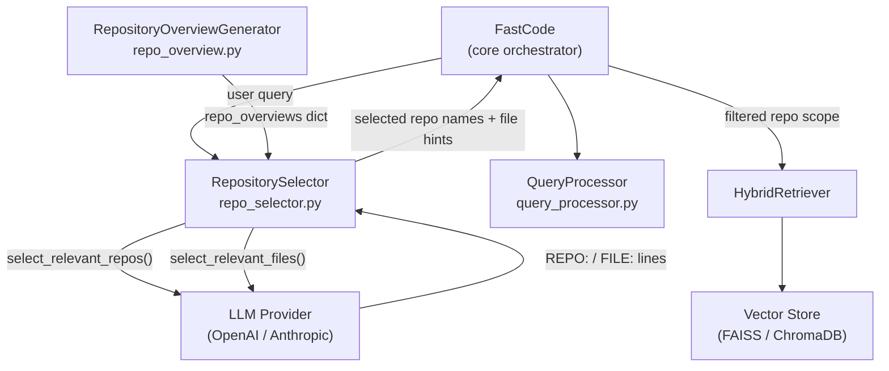
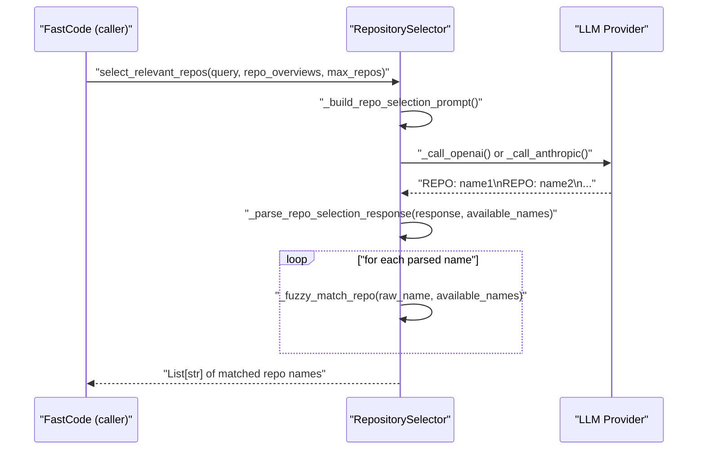
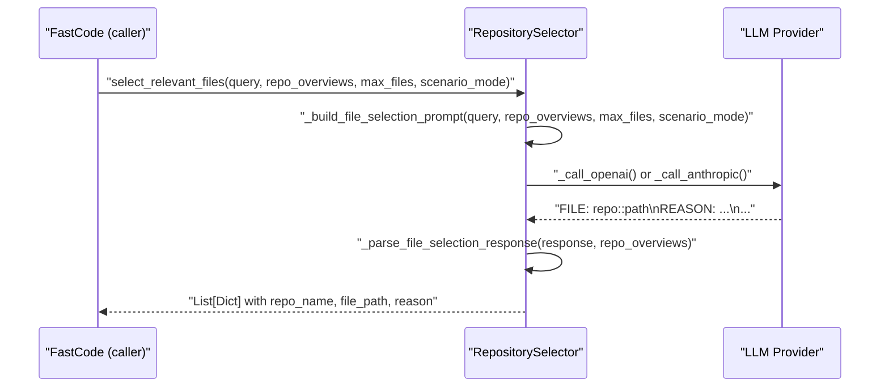
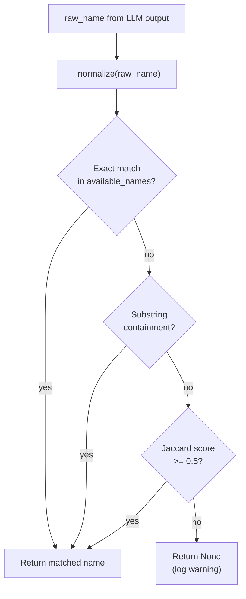
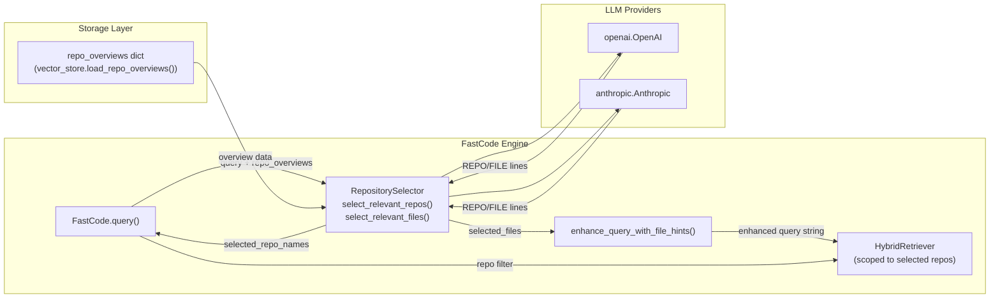

<!-- source: DeepWiki mcp.deepwiki.com · repo HKUDS/FastCode · page 5.4 Repository Selector · fetched 2026-11-09 -->

# Repository Selector

<details>
<summary>Relevant source files</summary>

The following files were used as context for generating this wiki page:

- [config/config.yaml](config/config.yaml)
- [fastcode/embedder.py](fastcode/embedder.py)
- [fastcode/repo_selector.py](fastcode/repo_selector.py)

</details>


This page documents the `RepositorySelector` class (`fastcode/repo_selector.py`), which is responsible for LLM-driven selection of relevant repositories and files in multi-repository scenarios. It is invoked during the two-stage retrieval process before fine-grained code element search begins. For a broader description of how two-stage retrieval fits into the overall query pipeline, see [9.5](#9.5). For an overview of multi-repository support at the architecture level, see [3.2](#3.2).

---

## Role in the System

When FastCode has multiple repositories indexed simultaneously, searching all of them for every query is wasteful. `RepositorySelector` narrows the search space in two ways:

1. **Repository selection** — given repository-level overviews and a user query, it asks an LLM which repositories are likely relevant and returns a filtered list of repository names.
2. **File selection** — given those overviews and the same query, it asks the LLM to pick the specific files most likely to contain the answer.

The output is then used by the retrieval layer to restrict embedding and BM25 search to only the selected repositories and files, reducing both token cost and noise.

**Component diagram — where `RepositorySelector` fits:**



Sources: [fastcode/repo_selector.py:1-60]()

---

## Configuration

`RepositorySelector` reads its LLM provider from the `generation` block of `config/config.yaml` and its API credentials from environment variables.

| Config key | Source | Description |
|---|---|---|
| `generation.provider` | `config.yaml` | `"openai"` or `"anthropic"` |
| `MODEL` | env var | Model name to use for selection calls |
| `OPENAI_API_KEY` | env var | OpenAI API key |
| `ANTHROPIC_API_KEY` | env var | Anthropic API key |
| `BASE_URL` | env var | Optional custom base URL |
| `retrieval.select_repos_by_overview` | `config.yaml` | Enables repo overview–based selection |
| `retrieval.repo_selection_method` | `config.yaml` | `"llm"` routes to this class |
| `retrieval.top_repos_to_search` | `config.yaml` | `max_repos` cap passed to selector |
| `retrieval.max_files_to_search` | `config.yaml` | `max_files` cap passed to selector |

Temperature is fixed at `0.2` and `max_tokens` at `2000` inside the class constructor ([fastcode/repo_selector.py:34-35]()) — these are not exposed in `config.yaml`.

Sources: [fastcode/repo_selector.py:19-60](), [config/config.yaml:110-116]()

---

## Initialization

```
RepositorySelector(config: Dict[str, Any])
```

The constructor ([fastcode/repo_selector.py:19-60]()) does the following:

1. Reads `generation.provider` and environment variables.
2. Calls `_initialize_client()`, which returns an `openai.OpenAI` or `anthropic.Anthropic` client, or `None` if credentials are missing.
3. Sets `self.temperature = 0.2` and `self.max_tokens = 2000`.

If the client cannot be initialized (missing key or unknown provider), all public methods log a warning and return empty results rather than raising.

Sources: [fastcode/repo_selector.py:19-60]()

---

## Public API

### `select_relevant_repos()`

[fastcode/repo_selector.py:280-353]()

```
select_relevant_repos(
    query: str,
    repo_overviews: Dict[str, Dict[str, Any]],
    max_repos: int = 5,
) -> List[str]
```

Takes a dict mapping `repo_name -> overview_data` (as loaded from the vector store) and returns a list of repository name strings. Internally:

1. Builds a prompt listing each repository with its summary (truncated to 1 000 chars).
2. Instructs the LLM to respond with `REPO: <name>` lines, at most `max_repos`.
3. Calls `_parse_repo_selection_response()` which delegates to `_fuzzy_match_repo()` for each line.

**Fallback instruction in the prompt**: the LLM is told to return *all* repository names if the query is too general to narrow down — preventing silent empty results.

### `select_relevant_files()`

[fastcode/repo_selector.py:62-112]()

```
select_relevant_files(
    query: str,
    repo_overviews: List[Dict[str, Any]],
    max_files: int = 10,
    scenario_mode: str = "multi",
) -> List[Dict[str, str]]
```

Takes a list of repository overview dicts (each with `repo_name`, `summary`, `structure_text`) and returns a list of `{"repo_name": ..., "file_path": ..., "reason": ...}` dicts.

`scenario_mode`:
- `"single"` — one repository is in scope; the prompt instructs the LLM to ignore irrelevance filtering.
- `"multi"` (default) — the LLM is told to first identify relevant repositories, then pick files only from those.

The prompt instructs the LLM to select the *fewest* files sufficient to answer the query, not simply the maximum allowed.

### `enhance_query_with_file_hints()`

[fastcode/repo_selector.py:457-478]()

```
enhance_query_with_file_hints(
    query: str,
    selected_files: List[Dict[str, str]],
) -> str
```

Appends a `[Relevant files: repo/path, ...]` suffix to the query string using the top 5 selected files. This enriched string is passed to the hybrid retriever so that BM25 and semantic search are biased toward the identified paths.

---

## Internal Processing Pipeline

**Sequence diagram — `select_relevant_repos()` call:**



**Sequence diagram — `select_relevant_files()` call:**



Sources: [fastcode/repo_selector.py:62-112](), [fastcode/repo_selector.py:280-353]()

---

## Prompt Structure

### Repository Selection Prompt

The prompt built for `select_relevant_repos()` ([fastcode/repo_selector.py:311-333]()) follows this structure:

```
You are a code repository selection assistant.
User Query: "<query>"

Below are the available repositories with their summaries.
Select the repositories that are most relevant to the query.
Return at most <max_repos> repository names.

Repository #1: <name>
Summary: <summary[:1000]>

Repository #2: ...

Respond with ONLY the selected repository names, one per line, using the format:
REPO: <repository_name>

If you cannot determine which repositories are relevant, return ALL repository names listed above.
Do NOT add any other text.
```

### File Selection Prompt

The prompt built for `select_relevant_files()` ([fastcode/repo_selector.py:114-187]()) varies by `scenario_mode`:

| Section | `"single"` mode | `"multi"` mode |
|---|---|---|
| Opening | "Select only files from **this** repository" | "Multiple repositories are in scope…identify relevant repos first" |
| Task | "Select fewest files…from this repository" | "Select fewest files…from the relevant repositories" |
| File structure | Full `structure_text` per repo | Full `structure_text` per repo |
| Output format | `FILE: <repo_name>::<file_path>` then `REASON: …` | Same |

---

## Fuzzy Repository Name Matching

LLMs do not always reproduce repository names verbatim. `_fuzzy_match_repo()` ([fastcode/repo_selector.py:365-418]()) applies three heuristics in order:

| Priority | Strategy | Condition to accept |
|---|---|---|
| 1 | Exact match (case-insensitive) | `normalize(candidate) == normalize(name)` |
| 2 | Substring containment | candidate is inside name, or name is inside candidate |
| 3 | Jaccard token overlap | `|A ∩ B| / |A ∪ B| >= 0.5` on alphanumeric tokens |

`_normalize()` ([fastcode/repo_selector.py:359-363]()) strips whitespace, backticks, asterisks, and quotes, then lowercases the string before comparison.

**Matching flow diagram:**



Sources: [fastcode/repo_selector.py:355-418]()

---

## Response Parsing

### Repo Response Parser

`_parse_repo_selection_response()` ([fastcode/repo_selector.py:420-455]()) iterates over lines of the LLM response and accepts lines in any of these formats:

- `REPO: <name>`
- `**REPO:** <name>`
- `- <name>`
- `• <name>`
- Bare `<name>` (any non-blank, non-`#` line)

Each raw name is passed to `_fuzzy_match_repo()`. Duplicates are deduplicated via a `seen` set.

### File Response Parser

`_parse_file_selection_response()` ([fastcode/repo_selector.py:210-278]()) uses two regex patterns:

- `file_pattern`: matches `FILE: <repo_name>::<file_path>` with optional markdown bold/code markers
- `reason_pattern`: matches `REASON: <text>`

Post-processing handles cases where the LLM omits or mis-states the repository name:
1. If the `repo_name` portion is not in the set of valid repo names, it checks whether the first path segment of `file_path` matches a known repo name (case-insensitive).
2. If only one repository is in scope, it assigns that repo by default.
3. If no match is found, the file entry is skipped.

Markdown formatting artefacts (backticks, bold markers) are stripped from both `repo_name` and `file_path` before validation.

Sources: [fastcode/repo_selector.py:210-278](), [fastcode/repo_selector.py:420-455]()

---

## LLM Call Layer

Both `_call_openai()` ([fastcode/repo_selector.py:189-198]()) and `_call_anthropic()` ([fastcode/repo_selector.py:200-208]()) are thin wrappers:

- **OpenAI**: delegates to `openai_chat_completion()` from `fastcode/llm_utils.py`, which handles the `max_completion_tokens` compatibility shim. Returns `response.choices[0].message.content`.
- **Anthropic**: calls `self.llm_client.messages.create()` directly and returns `response.content[0].text`.

Both use `temperature=0.2` and `max_tokens=2000`. These values are fixed in the constructor and are not configurable via `config.yaml`.

Sources: [fastcode/repo_selector.py:189-208]()

---

## Interaction with the Rest of the Engine

The diagram below shows the full data flow from a multi-repo query arriving at FastCode through to the `RepositorySelector` output being used by the retriever.



Sources: [fastcode/repo_selector.py:457-478](), [config/config.yaml:110-116]()

---

