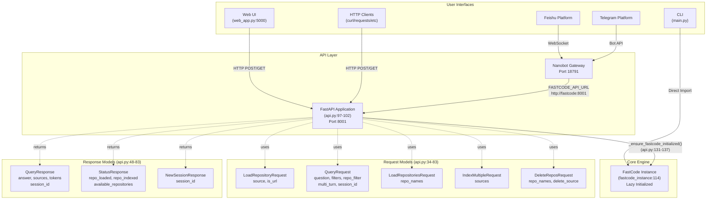
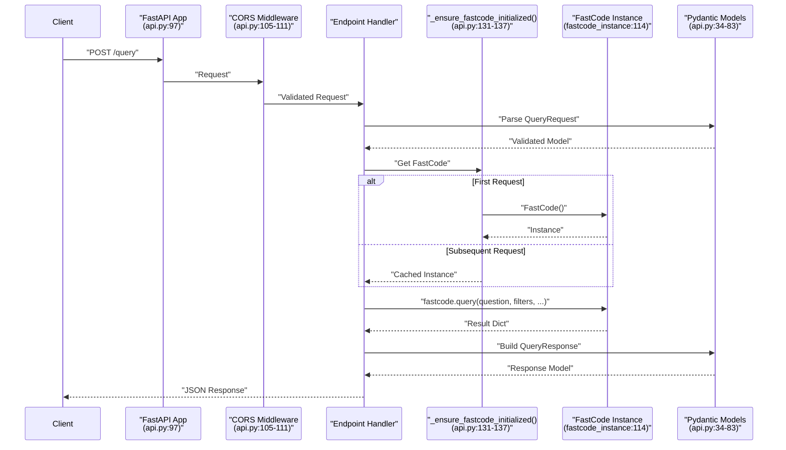
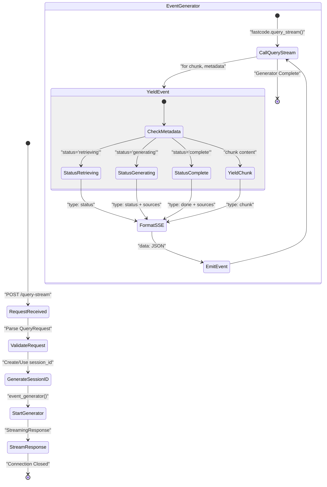
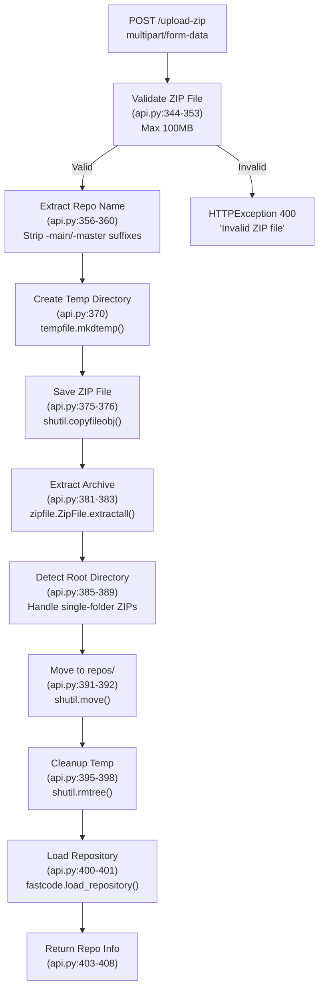
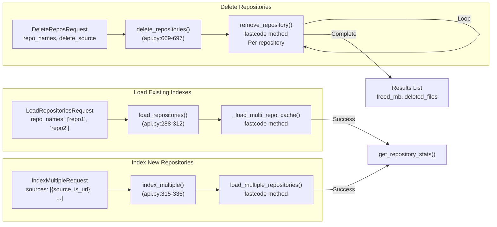

<!-- source: DeepWiki mcp.deepwiki.com · repo HKUDS/FastCode · page 6 Interfaces & APIs · fetched 2026-11-09 -->

# Interfaces & APIs

<details>
<summary>Relevant source files</summary>

The following files were used as context for generating this wiki page:

- [README.md](README.md)
- [mcp_server.py](mcp_server.py)
- [web_app.py](web_app.py)
- [web_interface.html](web_interface.html)

</details>


This document describes all methods for interacting with FastCode. The system provides four distinct interfaces: a REST API for programmatic integration, a Web UI for interactive exploration, a Command Line Interface for scripting, and Nanobot integration for messaging platform connectivity. Each interface exposes the full capabilities of the FastCode core system while optimizing for different use cases.

For detailed documentation of specific interface components, see:
- REST API endpoint specifications: [REST API](#6.1)
- Web interface usage: [Web Interface](#6.2)
- CLI commands and options: [Command Line Interface](#6.3)
- Messaging platform integration: [Nanobot Integration](#6.4)

## Interface Architecture Overview

FastCode implements a layered architecture where all user-facing interfaces communicate with the same `FastCode` core engine. The REST API serves as the primary integration point, with both the Web UI and Nanobot gateway consuming it.



**Sources:** [api.py:1-797](), [README.md:352-546]()

The `FastCode` instance is lazily initialized through `_ensure_fastcode_initialized()` at [api.py:131-137](), creating the engine only when the first request arrives. This reduces startup time and memory usage for container deployments.

## REST API Architecture

The REST API is implemented using FastAPI and provides comprehensive access to all FastCode capabilities. The API organizes endpoints into five functional groups: repository management, query operations, session management, system operations, and cache management.

### API Endpoint to Handler Mapping

```mermaid
graph LR
    subgraph "Repository Management Endpoints"
        E1["/repositories<br/>GET"]
        E2["/load<br/>POST"]
        E3["/index<br/>POST"]
        E4["/load-and-index<br/>POST"]
        E5["/load-repositories<br/>POST"]
        E6["/index-multiple<br/>POST"]
        E7["/upload-zip<br/>POST"]
        E8["/upload-and-index<br/>POST"]
        E9["/delete-repos<br/>POST"]
    end
    
    subgraph "Query Endpoints"
        E10["/query<br/>POST"]
        E11["/query-stream<br/>POST"]
        E12["/summary<br/>GET"]
    end
    
    subgraph "Session Endpoints"
        E13["/new-session<br/>POST"]
        E14["/sessions<br/>GET"]
        E15["/session/{id}<br/>GET"]
        E16["/session/{id}<br/>DELETE"]
    end
    
    subgraph "System Endpoints"
        E17["/health<br/>GET"]
        E18["/status<br/>GET"]
        E19["/clear-cache<br/>POST"]
        E20["/cache-stats<br/>GET"]
        E21["/refresh-index-cache<br/>POST"]
        E22["/repository<br/>DELETE"]
    end
    
    subgraph "Handler Functions (api.py)"
        H1["list_repositories()<br/>194-216"]
        H2["load_repository()<br/>218-235"]
        H3["index_repository()<br/>238-260"]
        H4["load_and_index()<br/>263-285"]
        H5["load_repositories()<br/>288-312"]
        H6["index_multiple()<br/>315-336"]
        H7["upload_repository_zip()<br/>339-415"]
        H8["upload_and_index()<br/>418-442"]
        H9["delete_repositories()<br/>669-697"]
        H10["query_repository()<br/>445-493"]
        H11["query_repository_stream()<br/>496-568"]
        H12["get_repository_summary()<br/>571-592"]
        H13["new_session()<br/>595-604"]
        H14["list_sessions()<br/>607-628"]
        H15["get_session()<br/>631-641"]
        H16["delete_session()<br/>644-666"]
        H17["health_check()<br/>152-168"]
        H18["get_status()<br/>171-191"]
        H19["clear_cache()<br/>700-710"]
        H20["get_cache_stats()<br/>713-719"]
        H21["refresh_index_cache()<br/>722-738"]
        H22["unload_repository()<br/>742-750"]
    end
    
    E1 --> H1
    E2 --> H2
    E3 --> H3
    E4 --> H4
    E5 --> H5
    E6 --> H6
    E7 --> H7
    E8 --> H8
    E9 --> H9
    E10 --> H10
    E11 --> H11
    E12 --> H12
    E13 --> H13
    E14 --> H14
    E15 --> H15
    E16 --> H16
    E17 --> H17
    E18 --> H18
    E19 --> H19
    E20 --> H20
    E21 --> H21
    E22 --> H22
```



**Sources:** [api.py:141-750]()

### Request/Response Flow

The API implements a consistent flow pattern across all endpoints, with specialized handling for streaming responses and file uploads.



**Sources:** [api.py:131-137](), [api.py:445-493]()

### Pydantic Model Structure

All API requests and responses use Pydantic models for validation and serialization. The models are defined at [api.py:34-83]().

| Model | Purpose | Key Fields |
|-------|---------|------------|
| `LoadRepositoryRequest` | Load repo from URL/path | `source`, `is_url` |
| `QueryRequest` | Submit code query | `question`, `filters`, `repo_filter`, `multi_turn`, `session_id` |
| `QueryResponse` | Query results | `answer`, `sources`, `prompt_tokens`, `completion_tokens`, `session_id` |
| `LoadRepositoriesRequest` | Load multiple indexed repos | `repo_names` |
| `IndexMultipleRequest` | Index multiple repos | `sources` (list) |
| `DeleteReposRequest` | Delete repositories | `repo_names`, `delete_source` |
| `StatusResponse` | System status | `repo_loaded`, `repo_indexed`, `available_repositories`, `loaded_repositories` |
| `NewSessionResponse` | New session created | `session_id` |

**Sources:** [api.py:34-83]()

### Server-Sent Events (SSE) for Streaming

The `/query-stream` endpoint implements Server-Sent Events for real-time streaming of query results. The implementation uses an async generator pattern to yield events as they are produced.



**Sources:** [api.py:496-568]()

The event generator at [api.py:512-558]() yields SSE-formatted events:
- `{"type": "status", "status": "retrieving"}` - Code retrieval in progress
- `{"type": "status", "status": "generating", "sources": [...]}` - LLM generation started
- `{"type": "chunk", "content": "..."}` - Streaming text chunk
- `{"type": "done", "sources": [...], "context_elements": N}` - Query complete

### File Upload Handling

ZIP file uploads are handled through a multi-stage process at [api.py:339-415]() that extracts, validates, and loads repositories.



**Sources:** [api.py:339-415]()

### Multi-Repository Operations

The API supports batch operations for managing multiple repositories simultaneously through specialized endpoints.



**Sources:** [api.py:288-336](), [api.py:669-697]()

### Error Handling and Serialization

The API implements defensive serialization through `_safe_jsonable()` at [api.py:753-777]() to handle complex Python objects that cannot be directly serialized to JSON.

**Serialization Strategy:**
1. Primitives (None, bool, int, float, str) - Return as-is
2. Dicts - Recursively serialize values with string keys
3. Lists/tuples/sets - Recursively serialize elements
4. Objects with `to_dict()` - Call method and serialize result
5. Objects with `__dict__` - Serialize `vars(obj)`
6. Fallback - Return `repr(obj)`

**Sources:** [api.py:753-777]()

## Interface Communication Patterns

All interfaces follow consistent patterns for interacting with the FastCode core, but with different entry points and communication mechanisms.

```mermaid
graph TB
    subgraph "Entry Points"
        RestAPI["REST API<br/>(api.py)<br/>Port 8001"]
        WebUI["Web UI<br/>(web_app.py)<br/>Port 5000"]
        CLI["CLI<br/>(main.py)"]
        Nanobot["Nanobot<br/>Port 18791"]
    end
    
    subgraph "Communication Layer"
        HTTP["HTTP/REST<br/>JSON Requests"]
        DirectImport["Direct Import<br/>Python Function Calls"]
        NanobotHTTP["HTTP via FASTCODE_API_URL<br/>Environment Variable"]
    end
    
    subgraph "FastCode Core Methods"
        LoadRepo["load_repository(source, is_url)"]
        IndexRepo["index_repository(force)"]
        Query["query(question, filters, repo_filter,<br/>session_id, enable_multi_turn)"]
        QueryStream["query_stream(question, filters,<br/>repo_filter, session_id,<br/>enable_multi_turn)"]
        LoadMulti["load_multiple_repositories(sources)"]
        GetSummary["get_repository_summary()"]
        GetStats["get_repository_stats()"]
        ListRepos["list_repositories()"]
        RemoveRepo["remove_repository(repo_name,<br/>delete_source)"]
        NewSession["Session via session_id parameter"]
        GetHistory["get_session_history(session_id)"]
        DeleteSession["delete_session(session_id)"]
        ListSessions["list_sessions()"]
    end
    
    RestAPI -->|"async handlers"| HTTP
    WebUI -->|"route handlers"| HTTP
    Nanobot -->|"tool functions"| NanobotHTTP
    CLI -->|"argparse + direct call"| DirectImport
    
    HTTP --> RestAPI
    NanobotHTTP --> RestAPI
    
    RestAPI --> LoadRepo
    RestAPI --> IndexRepo
    RestAPI --> Query
    RestAPI --> QueryStream
    RestAPI --> LoadMulti
    RestAPI --> GetSummary
    RestAPI --> GetStats
    RestAPI --> ListRepos
    RestAPI --> RemoveRepo
    RestAPI --> NewSession
    RestAPI --> GetHistory
    RestAPI --> DeleteSession
    RestAPI --> ListSessions
    
    DirectImport --> LoadRepo
    DirectImport --> IndexRepo
    DirectImport --> Query
    DirectImport --> GetSummary
```



**Sources:** [api.py:1-797](), [README.md:352-387]()

### Lazy Initialization Pattern

The API uses lazy initialization to minimize resource usage during container startup. The `fastcode_instance` global variable at [api.py:114]() remains `None` until the first request requiring FastCode functionality.

```python
# Initialization check pattern used throughout api.py
def _ensure_fastcode_initialized():
    """Ensure FastCode is initialized (lazy initialization)"""
    global fastcode_instance
    if fastcode_instance is None:
        logger.info("Initializing FastCode system (lazy initialization)")
        fastcode_instance = FastCode()
    return fastcode_instance
```

This pattern is called by all endpoint handlers at [api.py:131-137](), ensuring the system initializes only when needed.

**Sources:** [api.py:114](), [api.py:131-137]()

## Configuration and Environment

The API server is configured through multiple layers: FastAPI application settings, CORS middleware, and environment variables passed through to the FastCode core.

### FastAPI Application Setup

The FastAPI application is initialized at [api.py:97-102]() with a lifespan context manager for startup/shutdown hooks.

```python
app = FastAPI(
    title="FastCode API",
    description="Repository-Level Code Understanding System API",
    version="2.0.0",
    lifespan=lifespan,
)
```

The `lifespan` context manager at [api.py:87-94]() logs initialization and shutdown events without blocking startup.

**Sources:** [api.py:87-111]()

### CORS Configuration

Cross-Origin Resource Sharing (CORS) is configured at [api.py:105-111]() to allow web UI access:

```python
app.add_middleware(
    CORSMiddleware,
    allow_origins=["*"],
    allow_credentials=True,
    allow_methods=["*"],
    allow_headers=["*"],
)
```

**Sources:** [api.py:105-111]()

### Environment Variables

The API reads environment variables for LLM configuration:

| Variable | Purpose | Example |
|----------|---------|---------|
| `OPENAI_API_KEY` | API key for LLM provider | `sk-...` or `ollama` |
| `MODEL` | Model identifier | `gpt-4`, `google/gemini-flash-1.5` |
| `BASE_URL` | Provider base URL | `https://api.openai.com/v1` |
| `NANOBOT_MODEL` | Nanobot-specific model | `minimax/minimax-m2.1` |

**Sources:** [README.md:203-213](), [README.md:643-654]()

### Server Startup

The server can be started programmatically via `start_api()` at [api.py:780-784]() or through command-line arguments at [api.py:788-796]():

```bash
python api.py --host 0.0.0.0 --port 8000 --reload
```

**Sources:** [api.py:780-796]()

## Logging and Monitoring

The API implements structured logging to both file and console at [api.py:120-128]():

```python
logging.basicConfig(
    level=logging.INFO,
    format="%(asctime)s - %(name)s - %(levelname)s - %(message)s",
    handlers=[
        logging.FileHandler(log_dir / "api.log"),
        logging.StreamHandler()
    ]
)
```

Log files are written to `./logs/api.log`. The logger instance at [api.py:128]() is used throughout the module for operation tracking.

**Health Check Endpoint:** The `/health` endpoint at [api.py:152-168]() provides lightweight status without triggering initialization:

```json
{
  "status": "healthy",
  "repo_loaded": true,
  "repo_indexed": true,
  "multi_repo_mode": false
}
```

**Status Endpoint:** The `/status` endpoint at [api.py:171-191]() provides comprehensive system information including available and loaded repositories.

**Sources:** [api.py:117-128](), [api.py:152-191]()

## Interactive API Documentation

FastAPI automatically generates interactive API documentation accessible at:
- **Swagger UI:** `http://localhost:8001/docs`
- **ReDoc:** `http://localhost:8001/redoc`

These interfaces allow testing endpoints directly in the browser with automatic request/response validation based on Pydantic models.

**Sources:** [api.py:97-102](), [README.md:398]()

---

