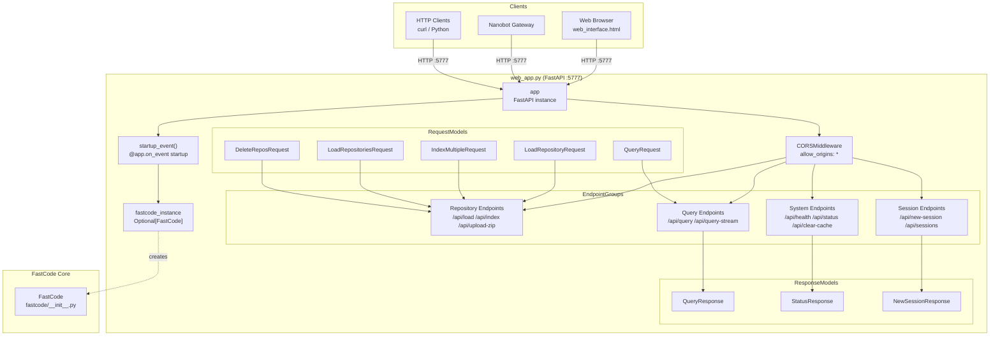
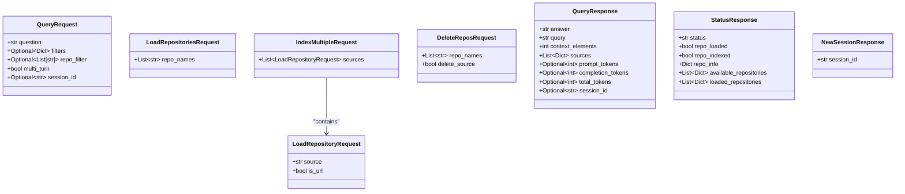
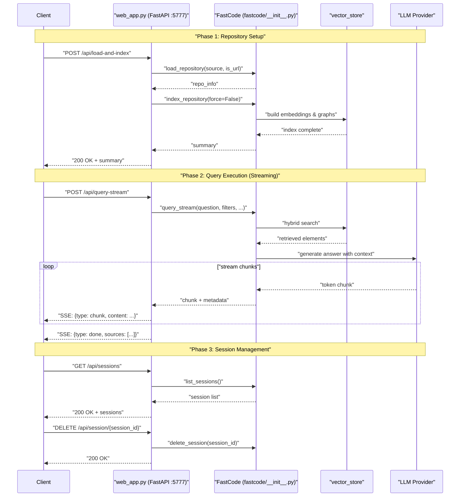

<!-- source: DeepWiki mcp.deepwiki.com · repo HKUDS/FastCode · page 6.1 REST API · fetched 2026-11-09 -->

# REST API

<details>
<summary>Relevant source files</summary>

The following files were used as context for generating this wiki page:

- [web_app.py](web_app.py)

</details>


The FastCode REST API provides programmatic access to all code understanding and analysis capabilities through HTTP endpoints. The API is built with FastAPI and serves as the backend for the Web UI (`web_interface.html`) and bot integrations (Nanobot/Feishu). It exposes endpoints for repository management, code querying with streaming support, multi-turn conversation sessions, and system administration.

For the web UI that consumes this API, see page 6.2. For the MCP server interface, see page 6.3. For bot platform integration, see page 6.4. For detailed endpoint documentation, see the sub-pages for Repository Endpoints (6.1.1), Query Endpoints (6.1.2), Session Management Endpoints (6.1.3), and System Endpoints (6.1.4).

## API Architecture

The REST API is implemented in `web_app.py` using FastAPI. A single `FastCode` instance is created at startup and shared across all requests.

**Application-level components:**

| Symbol | Role | Location |
|---|---|---|
| `app` | `FastAPI` application instance | [web_app.py:83-87]() |
| `fastcode_instance` | Global `FastCode` singleton | [web_app.py:104]() |
| `startup_event()` | Initializes `fastcode_instance` on server startup | [web_app.py:123-128]() |
| `CORSMiddleware` | Allows all origins, methods, and headers | [web_app.py:95-101]() |
| `start_web_app()` | Entry point; runs `uvicorn` on the configured host/port | [web_app.py:814-817]() |

Sources: [web_app.py:83-128]()

**Application component map (`web_app.py`):**



Sources: [web_app.py:83-128](), [web_app.py:814-817]()

### Startup Initialization

`fastcode_instance` is created eagerly when the server starts, not lazily on first request. The `startup_event` function decorated with `@app.on_event("startup")` calls `FastCode()` with no arguments, using the values from `config/config.yaml`.

Sources: [web_app.py:123-128]()

### CORS Configuration

The API is configured with permissive CORS settings to support web-based clients:

```
allow_origins=["*"]
allow_credentials=True
allow_methods=["*"]
allow_headers=["*"]
```

Sources: [web_app.py:95-101]()

## Request and Response Models

The API uses Pydantic models for type-safe request validation and response serialization, all defined in `web_app.py`.

**Pydantic models — request and response types:**



Sources: [web_app.py:36-80]()

## Endpoint Categories

The API organizes its endpoints under the `/api/` prefix into four functional categories:

| Category | Purpose | Key Endpoints | Documentation |
|---|---|---|---|
| **Repository Management** | Load, index, upload, and delete repositories | `/api/load`, `/api/index`, `/api/upload-zip`, `/api/delete-repos` | Page 6.1.1 |
| **Query Operations** | Execute code queries with optional streaming | `/api/query`, `/api/query-stream` | Page 6.1.2 |
| **Session Management** | Manage multi-turn conversation sessions | `/api/new-session`, `/api/sessions`, `/api/session/{id}` | Page 6.1.3 |
| **System Operations** | Health checks, status, cache management | `/api/health`, `/api/status`, `/api/clear-cache` | Page 6.1.4 |

The root path `GET /` serves `web_interface.html` directly. All API routes are prefixed with `/api/`.

Sources: [web_app.py:131-811]()

## API Workflow

The typical API usage follows a three-phase workflow:

**Typical three-phase interaction sequence:**



Sources: [web_app.py:279-303](), [web_app.py:515-592](), [web_app.py:703-811]()

## Server-Sent Events (SSE) Streaming

The `POST /api/query-stream` endpoint returns a `StreamingResponse` with `media_type="text/event-stream"`. Each line is formatted as `data: <JSON>\n\n`. The response headers set `Cache-Control: no-cache`, `Connection: keep-alive`, and `X-Accel-Buffering: no` to prevent buffering by proxies.

The inner `event_generator()` async generator iterates over `fastcode_instance.query_stream(...)` and maps each `(chunk, metadata)` pair to an SSE event:

| Event `type` | When emitted | Key fields |
|---|---|---|
| `"status"` (`retrieving`) | Retrieval phase begins | `status` |
| `"status"` (`generating`) | Generation phase begins | `status`, `sources`, `session_id` |
| `"chunk"` | Each incremental LLM token | `content` |
| `"done"` | Generation complete | `sources`, `context_elements`, `session_id` |
| `"error"` | Exception during generation | `error` |

Sources: [web_app.py:515-592]()

## Error Handling

All endpoints raise `HTTPException` for expected error conditions. Unhandled exceptions inside endpoint handlers are caught, logged, and re-raised as `HTTPException(status_code=500, ...)`.

| HTTP Status | Condition | Example endpoint |
|---|---|---|
| `400` | Repository not indexed when querying | `POST /api/query` |
| `400` | Invalid file format (non-ZIP) | `POST /api/upload-zip` |
| `400` | File exceeds 100 MB limit | `POST /api/upload-zip` |
| `400` | Empty repo list provided | `POST /api/load-repositories` |
| `404` | Session ID not found | `DELETE /api/session/{session_id}` |
| `500` | `fastcode_instance` is `None` | Any endpoint |
| `500` | Internal processing failure | Indexing, LLM errors |

Sources: [web_app.py:205-223](), [web_app.py:340-352](), [web_app.py:460-512](), [web_app.py:788-811]()

## JSON Serialization

The helper function `_safe_jsonable(obj)` recursively converts any value to a JSON-serializable structure. It is applied to all `sources` lists before returning them to clients.

Handled types in order of priority:

| Input type | Output |
|---|---|
| `None`, `bool`, `int`, `float`, `str` | Returned as-is |
| `dict` | Keys coerced to `str`; values recursed |
| `list`, `tuple`, `set` | Converted to `list`; values recursed |
| Object with `.to_dict()` | Called and recursed |
| Object with `.__dict__` | `vars()` called and recursed |
| Anything else | `repr()` string |

Sources: [web_app.py:670-700]()

## Starting the API Server

The server entry point is `start_web_app()` in `web_app.py`. The default bind address is `127.0.0.1:5777`.

### Command line

```
python web_app.py
python web_app.py --host 0.0.0.0 --port 5777
python web_app.py --reload
```

### Programmatic

```
from web_app import start_web_app
start_web_app(host="0.0.0.0", port=5777, reload=False)
```

Sources: [web_app.py:814-829]()

## Auto-Generated API Documentation

FastAPI automatically generates interactive API documentation at the following paths when the server is running:

| Path | Purpose | Format |
|---|---|---|
| `/docs` | Swagger UI (interactive testing) | OpenAPI 3.0 |
| `/redoc` | ReDoc (readable documentation) | OpenAPI 3.0 |
| `/openapi.json` | OpenAPI schema | JSON |

Sources: [web_app.py:83-87]()

## Integration with FastCode Core

`web_app.py` acts as a thin HTTP wrapper around the `FastCode` class. Every endpoint accesses the shared `fastcode_instance` global directly.

**Endpoint-to-`FastCode` method mapping:**

```mermaid
graph TB
    subgraph "web_app.py endpoints"
        EP_LOAD["POST /api/load"]
        EP_INDEX["POST /api/index"]
        EP_QUERY["POST /api/query"]
        EP_STREAM["POST /api/query-stream"]
        EP_MULTI["POST /api/index-multiple"]
        EP_LOADREPOS["POST /api/load-repositories"]
        EP_DEL["POST /api/delete-repos"]
        EP_SESSIONS["GET /api/sessions"]
        EP_SESSION["GET /api/session/{session_id}"]
        EP_DELSESS["DELETE /api/session/{session_id}"]
    end

    subgraph "FastCode (fastcode/__init__.py)"
        M_LOAD["load_repository(source, is_url)"]
        M_INDEX["index_repository(force)"]
        M_QUERY["query(question, filters, repo_filter, session_id, enable_multi_turn)"]
        M_STREAM["query_stream(question, filters, repo_filter, session_id, enable_multi_turn)"]
        M_MULTI["load_multiple_repositories(sources)"]
        M_LOADCACHE["_load_multi_repo_cache(repo_names)"]
        M_DEL["remove_repository(repo_name, delete_source)"]
        M_SESSIONS["list_sessions()"]
        M_HISTORY["get_session_history(session_id)"]
        M_DELSESS["delete_session(session_id)"]
    end

    EP_LOAD --> M_LOAD
    EP_INDEX --> M_INDEX
    EP_QUERY --> M_QUERY
    EP_STREAM --> M_STREAM
    EP_MULTI --> M_MULTI
    EP_LOADREPOS --> M_LOADCACHE
    EP_DEL --> M_DEL
    EP_SESSIONS --> M_SESSIONS
    EP_SESSION --> M_HISTORY
    EP_DELSESS --> M_DELSESS
```



| API Endpoint | `FastCode` method called |
|---|---|
| `POST /api/load` | `load_repository(source, is_url)` |
| `POST /api/index` | `index_repository(force)` |
| `POST /api/load-and-index` | `load_repository()` then `index_repository()` |
| `POST /api/index-multiple` | `load_multiple_repositories(sources)` |
| `POST /api/load-repositories` | `_load_multi_repo_cache(repo_names)` |
| `POST /api/upload-zip` | `load_repository(repo_path, is_url=False)` |
| `POST /api/upload-and-index` | delegates to `upload_repository_zip()` then `index_repository()` |
| `POST /api/query` | `query(question, filters, repo_filter, session_id, enable_multi_turn)` |
| `POST /api/query-stream` | `query_stream(question, filters, repo_filter, session_id, enable_multi_turn)` |
| `POST /api/delete-repos` | `remove_repository(repo_name, delete_source)` per name |
| `GET /api/sessions` | `list_sessions()` |
| `GET /api/session/{session_id}` | `get_session_history(session_id)` |
| `DELETE /api/session/{session_id}` | `delete_session(session_id)` |
| `POST /api/new-session` | `delete_session(clear_session_id)` (optional) + UUID generation |
| `GET /api/status` | `vector_store.scan_available_indexes()`, `list_repositories()` |
| `POST /api/clear-cache` | `cache_manager.clear()` |
| `POST /api/refresh-index-cache` | `vector_store.invalidate_scan_cache()` + `scan_available_indexes()` |

Sources: [web_app.py:205-811]()

## Session ID Handling

Both `POST /api/query` and `POST /api/query-stream` share the same session ID derivation logic. If `session_id` is not provided in the request, an 8-character UUID is generated for the request automatically. When `multi_turn` is `True`, the generated or provided `session_id` is used to accumulate turn history in the cache. When `multi_turn` is `False`, a session is still created but history is not fed back into the query.

The `session_id` is always included in the response — in `QueryResponse.session_id` for `/api/query`, and in the `"generating"` and `"done"` SSE events for `/api/query-stream`.

Sources: [web_app.py:460-512](), [web_app.py:515-592]()

## Configuration

The API respects the same configuration as the FastCode core:

| Configuration Source | Purpose | Location |
|---------------------|---------|----------|
| `config/config.yaml` | FastCode core settings (retrieval, indexing, agent) | Loaded by FastCode |
| `.env` | LLM API keys and model selection | Loaded by FastCode |
| Command-line args | API server host/port | `--host`, `--port` |
| Environment variables | Docker integration | `FASTCODE_API_URL` (for Nanobot) |

**Sources:** [api.py:787-796](), [README.md:639-677]()

---

