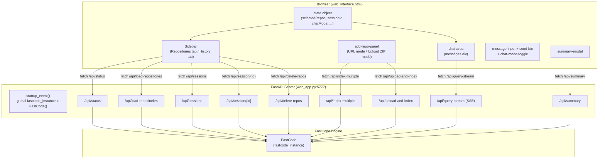
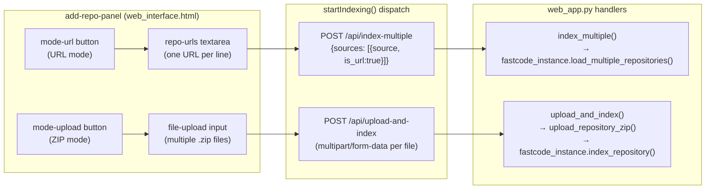
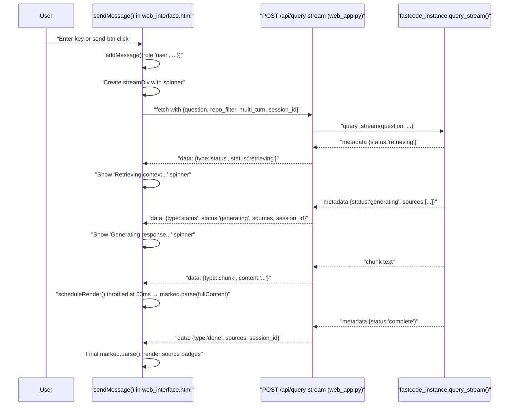
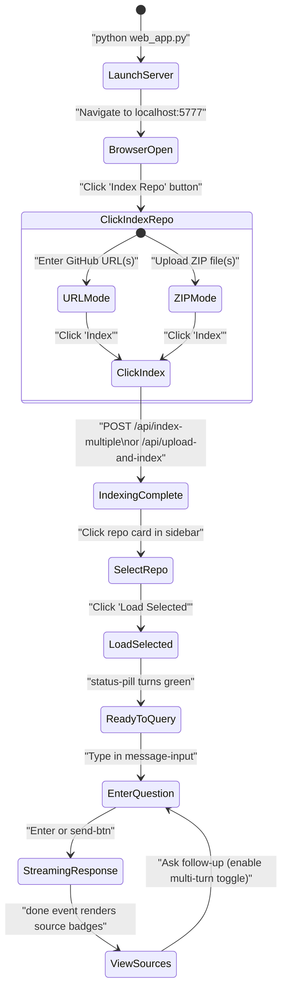
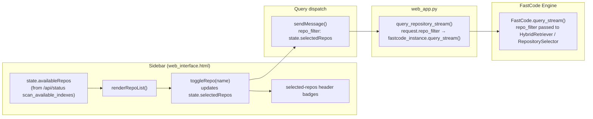
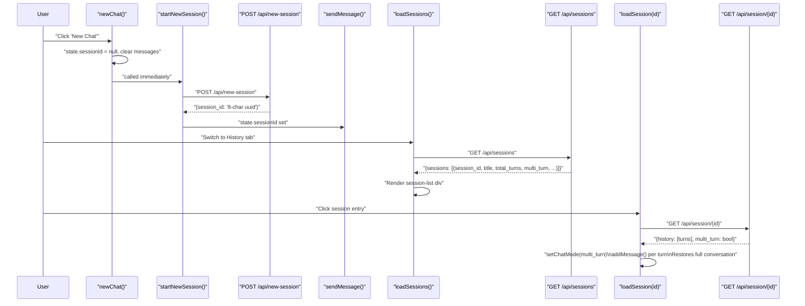
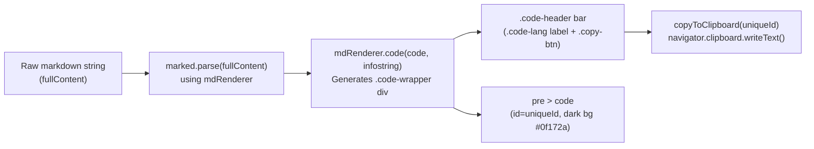

<!-- source: DeepWiki mcp.deepwiki.com · repo HKUDS/FastCode · page 6.2 Web Interface · fetched 2026-11-09 -->

# Web Interface

<details>
<summary>Relevant source files</summary>

The following files were used as context for generating this wiki page:

- [web_app.py](web_app.py)
- [web_interface.html](web_interface.html)

</details>


The Web Interface is a single-page application (SPA) that provides a browser-based GUI for interacting with FastCode. It is served by `web_app.py` (FastAPI) on port **5777** by default, and the frontend is implemented entirely in `web_interface.html`.

For programmatic access, see page 6.1 (REST API). For AI coding assistant integration, see page 6.3 (MCP Server). For messaging platform integration, see page 6.4 (Nanobot Integration).
</thinking>
</old_str>
<new_str>
# Web Interface

The Web Interface is a single-page application (SPA) that provides a browser-based GUI for interacting with FastCode. It is served by `web_app.py` (FastAPI) on port **5777** by default, and the frontend is implemented entirely in `web_interface.html`.

For programmatic access, see page 6.1 (REST API). For AI coding assistant integration, see page 6.3 (MCP Server). For messaging platform integration, see page 6.4 (Nanobot Integration).

---

## Starting the Web Server

The web interface is launched using the `web_app.py` script:

```bash
python web_app.py --host 127.0.0.1 --port 5777
```

**Command-line Options:**

| Option | Default | Description |
|--------|---------|-------------|
| `--host` | `127.0.0.1` | Host address to bind the server to |
| `--port` | `5777` | Port number to run the server on |
| `--reload` | `False` | Enable auto-reload on code changes |

Once started, the interface is accessible at `http://localhost:5777` in any web browser. On startup, FastAPI calls `startup_event()` which initializes a global `FastCode` instance.

Sources: [web_app.py:814-829]()

---

## Architecture

The web interface follows a client-server architecture. The browser frontend (`web_interface.html`) communicates with the FastAPI backend (`web_app.py`) over HTTP and Server-Sent Events (SSE).

**Component Topology**



Sources: [web_app.py:82-137](), [web_interface.html:404-468]()

---

## Core Functionality

### Repository Management Panel

Clicking **Index Repo** in the sidebar header toggles the `add-repo-panel` div, which presents two input modes selectable via `setRepoMode()`:

**Repository Input Modes**



After indexing, `refreshStatus()` is called, which polls `/api/status` and calls `renderRepoList()` to display all available repositories.

**Sidebar Repository List**

Each repository card in `repos-list` shows the repository name, file count, and size in MB. Clicking a card calls `toggleRepo(name)`, which adds or removes the repo from `state.selectedRepos`. Selected repos appear as teal badge chips in the main header's `selected-repos` div.

The **Load Selected** button calls `loadSelectedRepos()`, which posts to `/api/load-repositories` to load pre-indexed repos from disk into the active `FastCode` instance without re-indexing.

The **delete** (trash) button calls `deleteSelectedRepos()`, which posts to `/api/delete-repos` with `delete_source: true`, permanently removing index files and cloned source.

Sources: [web_interface.html:317-348](), [web_interface.html:504-569](), [web_interface.html:1012-1070](), [web_app.py:253-331]()

---

### Chat Interface and Streaming

All queries are sent via `sendMessage()` to `POST /api/query-stream`, which returns a Server-Sent Events (SSE) stream. The UI never uses the non-streaming `/api/query` endpoint.

**SSE Event Flow**



The `scheduleRender()` function throttles Markdown re-rendering to every 50 ms to avoid excessive DOM updates during streaming. When `type: 'done'` arrives, a final render is forced.

**Query Modes**

| Mode | `chatMode` state | `multi_turn` in request | Behavior |
|------|-----------------|------------------------|----------|
| Single-turn | `false` | `false` | Each query is independent |
| Multi-turn | `true` | `true` | History loaded from `CacheManager` per `session_id` |

The toggle is controlled by `toggleChatMode()` / `setChatMode()`, which updates the visual toggle track color and knob position.

Sources: [web_interface.html:571-764](), [web_interface.html:822-843](), [web_app.py:515-592]()

---

## User Workflow

**Basic Usage Workflow**



Sources: [web_interface.html:222-294](), [web_interface.html:449-467]()

---

## Features

### Multi-Repository Support

Multiple repositories can be indexed and then selectively loaded via the sidebar. The `state.selectedRepos` array drives the `repo_filter` field sent with every query.



If `state.selectedRepos` is empty and repos are indexed, the query will run against all loaded repositories.

Sources: [web_interface.html:536-553](), [web_interface.html:647-657](), [web_app.py:536-542]()

---

### Session Management

The **History** tab in the sidebar lists all persisted dialogue sessions. Sessions are created automatically on the first message if `state.sessionId` is null.

**Session Lifecycle in the UI**



**Session Display Fields**

| Field | Source | Display |
|-------|--------|---------|
| `title` | First query text (set by backend) | Session entry heading |
| `total_turns` | Count of turns in history | Badge pill |
| `multi_turn` | Session index flag | `multi` badge if true |
| `last_updated` | Timestamp | Formatted date string |

Sessions can be deleted from the History tab via the trash icon, which calls `deleteSession(sessionId)` → `DELETE /api/session/{id}`. If the active session is deleted, `newChat()` is invoked.

Sources: [web_interface.html:924-980](), [web_interface.html:982-997](), [web_interface.html:1072-1087](), [web_app.py:657-811]()

---

### Repository Summary Modal

The document icon button in the top-right header calls `showSummary()`, which fetches `GET /api/summary` and renders the response as preformatted text inside the `summary-modal` overlay.

- Single repository: `web_app.py` calls `fastcode_instance.get_repository_summary()`
- Multi-repo mode: calls `fastcode_instance.get_repository_stats()`

The modal is dismissed by `closeSummary()` which re-hides the `summary-modal` div.

Sources: [web_interface.html:390-400](), [web_app.py:595-617]()

---

## Response Rendering

### Markdown and Code Block Rendering

Answer content is rendered with `marked.js` using a custom `mdRenderer`. Code blocks receive IDE-like styling with a language label and a **Copy** button.

**Custom Code Block Renderer**



The `uniqueId` per code block is generated as `'code-' + Math.random().toString(36).substr(2, 9)` to allow clipboard access via `document.getElementById(id).innerText`.

During streaming, `scheduleRender()` batches DOM updates using a 50 ms `setTimeout`. On the `done` event, any pending timeout is cleared and a final `marked.parse()` is called.

Sources: [web_interface.html:418-446](), [web_interface.html:671-678](), [web_interface.html:715-721](), [web_interface.html:853-856]()

### Source Citation Badges

When a `done` SSE event arrives (or for non-streaming history replay), source citations are rendered below the answer as monospace badges. Each badge displays:

```
{repository}: {file_path} ({line_range})
```

The label is assembled from `s.repository`, `s.display || s.file || s.name`, and `s.lines` fields of each source object. Badges are rendered inside the `{streamId}-sources-list` div, which is revealed by removing the `hidden` class from `{streamId}-sources`.

Sources: [web_interface.html:724-735](), [web_interface.html:781-798]()

---

## Status Indicator

The `status-pill` element in the sidebar header shows system readiness. `refreshStatus()` is called on page load and then every 8 seconds via `setInterval`.

| State | `repo_indexed` value | Dot color | Label |
|-------|---------------------|-----------|-------|
| Ready | `true` | Green (`bg-green-500`) | "Ready" |
| Not Ready | `false` | Amber (`bg-amber-500`) | "Not Ready" |

The send button (`send-btn`) and `message-input` textarea are disabled unless `state.ready && state.selectedRepos.length > 0 && !state.isSending` — controlled by `updateUIStatus()`.

Sources: [web_interface.html:470-502]()

---

## Comparison with Other Interfaces

| Feature | Web Interface | REST API (page 6.1) | MCP Server (page 6.3) |
|---------|---------------|----------|-----|
| **Access Method** | Browser (port 5777) | HTTP (port 5777) | stdio / SSE (port 8080) |
| **User Experience** | Visual, interactive | Programmatic | AI assistant tool calls |
| **Repository Management** | Sidebar with buttons | `POST /api/load`, `/api/index-multiple` | `list_indexed_repos`, `delete_repo_metadata` |
| **Query Method** | Text input + send button | `POST /api/query` or `/api/query-stream` | `code_qa` tool |
| **Streaming** | Yes (SSE via `/api/query-stream`) | Yes (SSE) | No (returns full answer) |
| **Session Management** | Visual History tab | `/api/sessions`, `/api/session/{id}` | `list_sessions`, `get_session_history` |
| **Multi-turn Dialogue** | Yes (toggle switch) | Yes (`multi_turn` field) | Yes (`session_id` param) |
| **Best For** | Interactive exploration | Tool integration | Claude Code / Cursor |

---

## Technical Implementation

### Backend Framework

The web server is built using either Flask or FastAPI (implementation details in `web_app.py`), providing:

- HTTP route handlers for repository operations
- Server-Sent Events (SSE) for streaming responses
- Static file serving for frontend assets
- Session cookie management for multi-turn dialogues
- CORS support for cross-origin requests

The backend maintains a single `FastCode` instance per server process, similar to the REST API architecture.

**Sources:** [api.py:87-102]()

---

### Port Configuration

Default ports used by FastCode interfaces:

| Service | Default Port | Protocol | Purpose |
|---------|-------------|----------|---------|
| Web Interface | 5000 | HTTP | Browser UI |
| REST API | 8001 | HTTP | Programmatic access |
| Nanobot Gateway | 18791 | HTTP | Messaging platform integration |

To change the web interface port:
```bash
python web_app.py --host 0.0.0.0 --port 8080
```

**Sources:** [README.md:358-361](), [README.md:616-623]()

---

## Browser Compatibility

The web interface is compatible with modern browsers supporting:
- ES6 JavaScript features
- Server-Sent Events (SSE) for streaming
- Fetch API for HTTP requests
- CSS Grid and Flexbox for layout

Tested browsers include:
- Chrome/Chromium 90+
- Firefox 88+
- Safari 14+
- Edge 90+

**Sources:** Inferred from modern web standards

---

