<!-- source: DeepWiki mcp.deepwiki.com · repo HKUDS/FastCode · page 6.3 MCP Server · fetched 2026-11-09 -->

# Command Line Interface

<details>
<summary>Relevant source files</summary>

The following files were used as context for generating this wiki page:

- [mcp_server.py](mcp_server.py)

</details>


## Purpose and Scope

The Command Line Interface (CLI) provides a scriptable, non-interactive interface for querying codebases using FastCode. It is designed for automation, batch processing, CI/CD integration, and single-shot queries without the overhead of a web server or API service.

For interactive web-based queries, see [Web Interface](#6.2). For programmatic API integration, see [REST API](#6.1). For messaging platform integration, see [Nanobot Integration](#6.4).

**Sources:** [README.md:373-386]()

---

## CLI Architecture

The CLI operates as a thin wrapper around the FastCode core engine, initializing all components for a single query execution and then terminating. Unlike the Web UI or REST API which maintain persistent state, the CLI creates a fresh FastCode instance for each invocation.

### CLI Execution Flow

```mermaid
graph TB
    Start["python main.py"]
    ParseArgs["Parse Command Arguments<br/>--repo, --repos, --query, --model"]
    LoadEnv["Load Environment Variables<br/>.env file<br/>OPENAI_API_KEY, MODEL, BASE_URL"]
    LoadConfig["Load Configuration<br/>config/config.yaml"]
    InitFC["Initialize FastCode Core<br/>FastCode(config, repo_paths)"]
    
    CheckCache{"Index Cache<br/>Exists?"}
    LoadRepo["RepositoryLoader.load()"]
    ParseCode["CodeParser.parse()<br/>8 languages"]
    BuildIndex["CodeIndexer.build_index()<br/>4-level hierarchy"]
    BuildGraphs["GraphBuilder<br/>Call/Dependency/Inheritance"]
    BuildEmbeddings["CodeEmbedder.embed()<br/>SentenceTransformer"]
    BuildVector["VectorStore.add()<br/>FAISS/ChromaDB/Qdrant"]
    
    LoadCache["Load Cached Index<br/>data/vector_store/"]
    
    ProcessQuery["QueryProcessor.process()<br/>Intent detection, enhancement"]
    HybridSearch["HybridRetriever.search()<br/>Semantic + Keyword + Graph"]
    
    AgencyCheck{"agency_mode<br/>enabled?"}
    IterativeAgent["IterativeAgent.refine()<br/>Max 4 iterations"]
    DirectGen["Direct to generation"]
    
    Generate["AnswerGenerator.generate()<br/>LLM integration"]
    Output["Print Answer<br/>Sources, tokens, confidence"]
    Exit["Exit"]
    
    Start --> ParseArgs
    ParseArgs --> LoadEnv
    LoadEnv --> LoadConfig
    LoadConfig --> InitFC
    InitFC --> CheckCache
    
    CheckCache -->|"No"| LoadRepo
    LoadRepo --> ParseCode
    ParseCode --> BuildIndex
    BuildIndex --> BuildGraphs
    BuildGraphs --> BuildEmbeddings
    BuildEmbeddings --> BuildVector
    BuildVector --> ProcessQuery
    
    CheckCache -->|"Yes"| LoadCache
    LoadCache --> ProcessQuery
    
    ProcessQuery --> HybridSearch
    HybridSearch --> AgencyCheck
    
    AgencyCheck -->|"Yes"| IterativeAgent
    AgencyCheck -->|"No"| DirectGen
    
    IterativeAgent --> Generate
    DirectGen --> Generate
    
    Generate --> Output
    Output --> Exit
```



**Sources:** [README.md:373-386](), [config/config.yaml:1-207]()

---

## Installation and Setup

### Prerequisites

Before using the CLI, ensure FastCode is properly installed and configured:

```bash
# Clone and install
git clone https://github.com/HKUDS/FastCode.git
cd FastCode
pip install -r requirements.txt

# Configure environment variables
cp env.example .env
# Edit .env with your API keys
```

### Environment Configuration

The CLI reads configuration from two sources:

1. **`.env` file** - API credentials and model selection
2. **`config/config.yaml`** - System behavior and retrieval settings

Required environment variables in `.env`:

| Variable | Description | Example |
|----------|-------------|---------|
| `OPENAI_API_KEY` | API key for LLM provider | `sk-...` |
| `MODEL` | Model identifier | `gpt-4`, `gemini-flash-1.5`, `qwen3-coder-30b_fastcode` |
| `BASE_URL` | LLM API endpoint | `https://api.openai.com/v1` |

**Sources:** [README.md:203-213](), [README.md:260-271](), [README.md:320-331]()

---

## Command Line Arguments

The `main.py` script accepts the following arguments:

### Core Arguments

| Argument | Type | Required | Description |
|----------|------|----------|-------------|
| `--repo` | String | Yes* | Path to single repository (local path or Git URL) |
| `--repos` | List[String] | Yes* | Paths to multiple repositories for multi-repo queries |
| `--query` | String | Yes | Natural language question about the codebase |
| `--model` | String | No | Override MODEL from .env (e.g., `gpt-4-turbo`) |
| `--base-url` | String | No | Override BASE_URL from .env |
| `--config` | String | No | Path to custom config.yaml (default: `config/config.yaml`) |
| `--output` | String | No | Output format: `text` (default), `json`, `markdown` |
| `--session-id` | String | No | Session ID for multi-turn dialogue continuation |
| `--verbose` | Flag | No | Enable verbose output with retrieval details |

\* Either `--repo` or `--repos` is required, but not both.

### Behavioral Flags

| Flag | Description | Config Equivalent |
|------|-------------|-------------------|
| `--no-agency` | Disable iterative agent mode | `retrieval.enable_agency_mode: false` |
| `--no-cache` | Disable query result caching | `cache.enabled: false` |
| `--force-reindex` | Rebuild index from scratch, ignoring cache | `evaluation.force_reindex: true` |
| `--multi-turn` | Enable multi-turn dialogue mode | `generation.enable_multi_turn: true` |

**Sources:** [README.md:373-386]()

---

## Usage Modes

### Single Repository Query

The most common usage pattern queries a single codebase:

```bash
python main.py \
  --repo /path/to/repository \
  --query "How is authentication implemented?"
```

**Local Repository Example:**
```bash
python main.py \
  --repo ./my-project \
  --query "Where is the database connection initialized?"
```

**Remote Repository Example:**
```bash
python main.py \
  --repo https://github.com/user/project \
  --query "What files handle payment processing?"
```

### Multi-Repository Query

For cross-repository analysis, provide multiple repository paths:

```bash
python main.py \
  --repos /path/to/repo1 /path/to/repo2 /path/to/repo3 \
  --query "How do these microservices communicate?"
```

The CLI uses the two-stage retrieval process:
1. **Repository Selection** - Selects top 5 most relevant repositories based on overview embeddings
2. **Code Search** - Performs hybrid search within selected repositories

Configuration in `config.yaml`:

```yaml
retrieval:
  enable_two_stage_retrieval: true
  top_repos_to_search: 5
  min_repo_similarity: 0.1
  repo_selection_method: "llm"  # or "embedding"
```

**Sources:** [README.md:378-386](), [config/config.yaml:111-116]()

### Custom Model Configuration

Override the default model from `.env`:

```bash
python main.py \
  --repo ./my-project \
  --query "Explain the caching strategy" \
  --model gpt-4-turbo \
  --base-url https://api.openai.com/v1
```

**Local Model Example (Ollama):**
```bash
python main.py \
  --repo ./my-project \
  --query "List all API endpoints" \
  --model qwen3-coder-30b_fastcode \
  --base-url http://localhost:11434/v1
```

**Sources:** [README.md:385-386](), [README.md:590-593]()

---

## Output Formats

### Text Output (Default)

Standard human-readable output with answer, sources, and metadata:

```
==================================================
Query: How is authentication implemented?
==================================================

Answer:
--------
The authentication system uses JWT tokens with a two-layer approach:

1. AuthenticationMiddleware (auth/middleware.py:45-120) validates tokens
2. UserService (services/user_service.py:78-95) manages user sessions
3. TokenGenerator (utils/token.py:12-40) creates signed tokens

The flow is: Request → Middleware → TokenValidator → UserResolver

Sources:
--------
1. auth/middleware.py:45-120 (AuthenticationMiddleware.validate_token)
2. services/user_service.py:78-95 (UserService.get_user_by_token)
3. utils/token.py:12-40 (TokenGenerator.generate)

Metadata:
--------
Confidence: 98%
Total Tokens: 8,542
Prompt Tokens: 6,891
Completion Tokens: 1,651
Repositories Searched: 1
Files Retrieved: 3
Iterations: 2
```

### JSON Output

Machine-readable structured output for scripting:

```bash
python main.py --repo ./project --query "..." --output json
```

```json
{
  "query": "How is authentication implemented?",
  "answer": "The authentication system uses JWT tokens...",
  "sources": [
    {
      "file_path": "auth/middleware.py",
      "start_line": 45,
      "end_line": 120,
      "element_type": "class",
      "element_name": "AuthenticationMiddleware.validate_token",
      "similarity": 0.89
    }
  ],
  "metadata": {
    "confidence": 98,
    "total_tokens": 8542,
    "prompt_tokens": 6891,
    "completion_tokens": 1651,
    "repositories_searched": 1,
    "files_retrieved": 3,
    "iterations": 2,
    "agency_mode": true,
    "execution_time_seconds": 4.52
  },
  "session_id": "cli_20240115_123456"
}
```

### Markdown Output

Formatted output for documentation:

```bash
python main.py --repo ./project --query "..." --output markdown > answer.md
```

**Sources:** Based on standard CLI output patterns

---

## Advanced Features

### Multi-Turn Dialogue

Enable conversational queries by maintaining session state:

```bash
# First query - creates session
python main.py \
  --repo ./project \
  --query "Where is the User model defined?" \
  --multi-turn \
  --session-id myproject_session

# Follow-up query - uses context
python main.py \
  --repo ./project \
  --query "Show me where it's used in authentication" \
  --multi-turn \
  --session-id myproject_session
```

The CLI stores dialogue history in the cache directory (`data/cache/`). Each session maintains up to 10 previous rounds of context.

**Configuration:**
- `generation.enable_multi_turn: true`
- `generation.context_rounds: 10`
- `cache.dialogue_ttl: 2592000` (30 days)

**Sources:** [config/config.yaml:158-161](), [config/config.yaml:186-187]()

### Verbose Mode

Enable detailed logging to understand retrieval decisions:

```bash
python main.py \
  --repo ./project \
  --query "..." \
  --verbose
```

Output includes:
- Query expansion and decomposition
- Repository selection decisions (multi-repo mode)
- Hybrid search scores (semantic, keyword, graph)
- Agent iteration details (agency mode)
- Confidence progression
- Token usage per step

### Force Reindexing

Rebuild the vector index from scratch, ignoring cached data:

```bash
python main.py \
  --repo ./project \
  --query "..." \
  --force-reindex
```

Useful when:
- Repository code has changed significantly
- Testing different embedding models
- Troubleshooting search quality issues

**Sources:** [config/config.yaml:194-199]()

---

## Scripting Examples

### Batch Query Processing

Process multiple queries from a file:

```bash
#!/bin/bash
REPO="/path/to/project"

while IFS= read -r query; do
  echo "Processing: $query"
  python main.py --repo "$REPO" --query "$query" --output json >> results.jsonl
done < queries.txt
```

### CI/CD Integration

Check for breaking changes in pull requests:

```bash
#!/bin/bash
# ci_check.sh - Verify impact of code changes

REPO_PATH="${CI_PROJECT_DIR}"
CHANGES=$(git diff --name-only HEAD~1)

# Query impact of changed files
for file in $CHANGES; do
  python main.py \
    --repo "$REPO_PATH" \
    --query "What components depend on $file and would be affected by changes?" \
    --output json \
    >> impact_analysis.json
done
```

### Automated Documentation Generation

Generate architectural overview:

```bash
#!/bin/bash
# generate_docs.sh

QUERIES=(
  "List all API endpoints and their purposes"
  "Describe the database schema and relationships"
  "Explain the authentication and authorization flow"
  "Document the caching strategy"
)

for query in "${QUERIES[@]}"; do
  python main.py \
    --repo ./project \
    --query "$query" \
    --output markdown \
    >> architecture.md
  echo -e "\n---\n" >> architecture.md
done
```

### Cross-Repository Dependency Analysis

Analyze dependencies across multiple microservices:

```bash
#!/bin/bash
# analyze_dependencies.sh

SERVICES=(
  "/services/auth-service"
  "/services/payment-service"
  "/services/notification-service"
  "/services/user-service"
)

python main.py \
  --repos ${SERVICES[@]} \
  --query "How do these services communicate? Show all inter-service dependencies and API calls." \
  --verbose \
  --output json \
  > dependency_graph.json
```

**Sources:** Based on CLI usage patterns

---

## Performance Characteristics

### Execution Time

| Operation | Typical Duration | Notes |
|-----------|------------------|-------|
| First-time indexing (small repo <100 files) | 30-60 seconds | Includes parsing, embedding, graph building |
| First-time indexing (large repo 1000+ files) | 3-5 minutes | Parallelized processing |
| Cached query (agency mode disabled) | 2-4 seconds | Vector search + LLM generation |
| Cached query (agency mode enabled) | 4-8 seconds | Iterative refinement (1-4 rounds) |
| Subsequent queries (warm cache) | <1 second | Index loading from disk |

### Token Usage

The CLI benefits from FastCode's cost-efficient context management:

| Query Type | Traditional Approach | FastCode CLI | Savings |
|------------|---------------------|--------------|---------|
| Simple lookup ("Where is X?") | 15,000-25,000 tokens | 2,000-4,000 tokens | 80-85% |
| Complex analysis ("How does Y work?") | 50,000-100,000 tokens | 8,000-15,000 tokens | 80-85% |
| Multi-repo query | 200,000+ tokens | 15,000-30,000 tokens | 85-90% |

**Sources:** [README.md:29-47]()

---

## CLI vs Other Interfaces

### Comparison Matrix

| Feature | CLI (main.py) | Web UI (web_app.py) | REST API (api.py) |
|---------|---------------|---------------------|-------------------|
| **Use Case** | Scripting, automation | Interactive exploration | Application integration |
| **State Management** | Stateless (per-invocation) | Session-based | Stateless (HTTP) |
| **Multi-turn Dialogue** | Via session ID | Native support | Via session endpoints |
| **Repository Management** | Load per query | Load once, query many | Persistent loaded repos |
| **Port/Network** | None (local process) | 5000 (HTTP) | 8001 (HTTP) |
| **Output Format** | text, json, markdown | HTML/Interactive | JSON (REST) |
| **Performance** | Cold start per query | Warm index in memory | Warm index in memory |
| **Best For** | CI/CD, batch jobs, scripts | Development, exploration | Tools, integrations, bots |

### When to Use the CLI

**Advantages:**
- No server infrastructure required
- Easy integration with shell scripts and CI/CD pipelines
- Deterministic behavior (no persistent state)
- Supports all output formats (text, JSON, markdown)
- Lower resource footprint (terminates after query)

**Disadvantages:**
- Slower for repeated queries (cold start each time)
- No interactive feedback during processing
- Limited to single-shot or explicit multi-turn via session IDs
- No repository persistence (must specify repo each time)

**Ideal Scenarios:**
- Automated code review workflows
- Documentation generation scripts
- CI/CD impact analysis
- Batch query processing
- Command-line power users

**Sources:** [README.md:354-387](), [README.md:393-544]()

---

## Execution Flow Diagram

```mermaid
sequenceDiagram
    autonumber
    participant User
    participant CLI as main.py
    participant ArgParser as Argument Parser
    participant EnvLoader as Environment Loader
    participant ConfigLoader as Config Loader
    participant FC as FastCode Core
    participant Cache as Cache Manager
    participant RL as RepositoryLoader
    participant CI as CodeIndexer
    participant VS as VectorStore
    participant QP as Query Processor
    participant HR as HybridRetriever
    participant IA as IterativeAgent
    participant AG as AnswerGenerator
    participant Output as Output Formatter
    
    User->>CLI: python main.py --repo ./project --query "..."
    CLI->>ArgParser: parse_arguments()
    ArgParser-->>CLI: repo, query, model, flags
    
    CLI->>EnvLoader: load_dotenv()
    EnvLoader-->>CLI: OPENAI_API_KEY, MODEL, BASE_URL
    
    CLI->>ConfigLoader: load_config(config.yaml)
    ConfigLoader-->>CLI: config dict
    
    CLI->>FC: FastCode(config, repo_paths)
    FC->>Cache: check_index_cache(repo_hash)
    
    alt Index Not Cached
        Cache-->>FC: Cache miss
        FC->>RL: load_repository(repo_path)
        RL-->>FC: repo_metadata
        FC->>CI: build_index(repo)
        CI-->>FC: indexed_elements
        FC->>VS: build_vector_store(elements)
        VS-->>FC: vector_index
        FC->>Cache: save_index(vector_index)
    else Index Cached
        Cache-->>FC: Cached index
        FC->>VS: load_vector_store(cached_path)
        VS-->>FC: vector_index
    end
    
    FC->>QP: process_query(query)
    QP-->>FC: processed_query
    
    FC->>HR: search(processed_query)
    HR-->>FC: initial_results
    
    alt agency_mode enabled
        FC->>IA: refine(query, initial_results)
        loop Max 4 iterations (until confidence ≥ 95%)
            IA->>IA: evaluate_confidence()
            IA->>HR: refined_search()
            HR-->>IA: additional_results
        end
        IA-->>FC: final_results (confidence: 98%)
    else agency_mode disabled
        FC->>FC: Use initial_results
    end
    
    FC->>AG: generate(query, results)
    AG-->>FC: answer, sources, tokens
    
    FC->>Output: format_output(answer, format)
    Output-->>CLI: formatted_string
    
    CLI->>User: Print answer + sources + metadata
```



**Sources:** [README.md:373-386](), [config/config.yaml:169-180]()

---

## Error Handling

### Common Errors and Solutions

| Error | Cause | Solution |
|-------|-------|----------|
| `Repository not found` | Invalid path or URL | Verify path exists or URL is accessible |
| `No API key found` | Missing `.env` or `OPENAI_API_KEY` | Copy `env.example` to `.env` and configure |
| `Model not supported` | Invalid model identifier | Check provider documentation for valid models |
| `Index build failed` | Unsupported language or parse error | Check `parser.max_function_lines` in config.yaml |
| `Token limit exceeded` | Context too large | Reduce `generation.max_context_tokens` or enable agency mode |
| `Connection timeout` | LLM API unreachable | Verify `BASE_URL` and network connectivity |

### Debug Mode

Enable detailed logging:

```bash
python main.py \
  --repo ./project \
  --query "..." \
  --verbose 2>&1 | tee debug.log
```

Logs include:
- Repository loading progress
- Parsing statistics (files processed, elements extracted)
- Embedding batch progress
- Vector store operations
- Query processing steps
- Retrieval scores and filtering
- Agent iteration decisions
- Token usage breakdown

**Sources:** [config/config.yaml:201-206]()

---

## Configuration Override

The CLI respects the following configuration precedence (highest to lowest):

1. **Command-line arguments** (`--model`, `--base-url`, etc.)
2. **Environment variables** (`.env` file)
3. **Configuration file** (`config/config.yaml`)
4. **Default values** (hardcoded in FastCode)

### Example: Temporary Configuration Override

Run with different settings without modifying `config.yaml`:

```bash
# Use custom config file
python main.py \
  --repo ./project \
  --query "..." \
  --config ./custom_config.yaml

# Override model for one query
python main.py \
  --repo ./project \
  --query "..." \
  --model gpt-4o \
  --base-url https://api.openai.com/v1
```

**Sources:** [config/config.yaml:1-207]()

---

## Integration with Build Systems

### Make Integration

```makefile
# Makefile
.PHONY: analyze-changes

analyze-changes:
	@echo "Analyzing code changes..."
	@python main.py \
		--repo . \
		--query "What are the impacts of recent changes to the User model?" \
		--output json > analysis.json
	@echo "Analysis complete. See analysis.json"

.PHONY: generate-docs

generate-docs:
	@python main.py --repo . --query "List all public API endpoints" --output markdown > API.md
	@python main.py --repo . --query "Describe the authentication flow" --output markdown >> API.md
	@echo "Documentation generated: API.md"
```

### GitHub Actions Integration

```yaml
# .github/workflows/code-analysis.yml
name: Code Analysis

on: [pull_request]

jobs:
  analyze:
    runs-on: ubuntu-latest
    steps:
      - uses: actions/checkout@v3
      
      - name: Setup Python
        uses: actions/setup-python@v4
        with:
          python-version: '3.12'
      
      - name: Install FastCode
        run: |
          pip install -r requirements.txt
      
      - name: Analyze Changes
        env:
          OPENAI_API_KEY: ${{ secrets.OPENAI_API_KEY }}
          MODEL: gpt-4-turbo
        run: |
          python main.py \
            --repo . \
            --query "What files are affected by changes in this PR?" \
            --output json > impact.json
      
      - name: Post Results
        uses: actions/upload-artifact@v3
        with:
          name: analysis-results
          path: impact.json
```

**Sources:** Based on CLI usage patterns and CI/CD integration examples

---

## Summary

The FastCode CLI provides a lightweight, scriptable interface for code understanding queries. It is optimized for automation workflows, batch processing, and scenarios where a persistent server is unnecessary. The CLI leverages the full power of FastCode's three-phase framework—semantic-structural representation, lightning-fast navigation, and cost-efficient context management—while maintaining a simple command-line interface suitable for scripting and integration with existing development tools.

For interactive exploration, use the [Web Interface](#6.2). For programmatic integration, use the [REST API](#6.1).

**Sources:** [README.md:373-386](), [README.md:354-387]()

---

