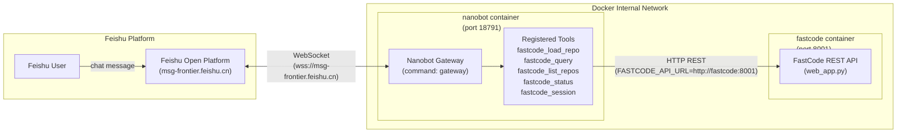
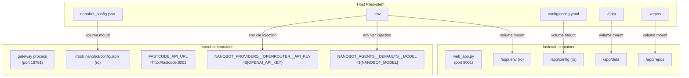
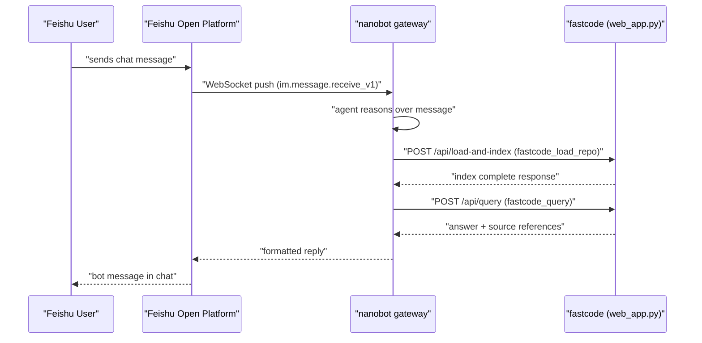
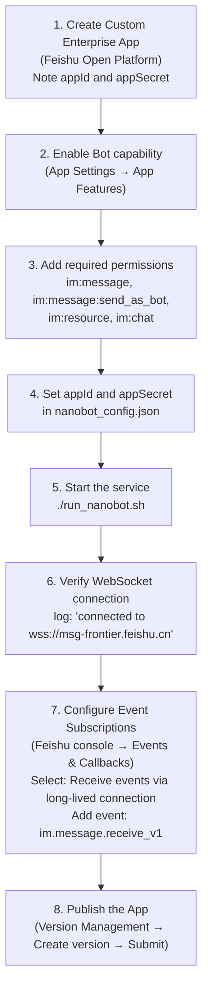

<!-- source: DeepWiki mcp.deepwiki.com · repo HKUDS/FastCode · page 6.4 Nanobot Integration · fetched 2026-11-09 -->

# Nanobot Integration

<details>
<summary>Relevant source files</summary>

The following files were used as context for generating this wiki page:

- [README.md](README.md)

</details>


This page covers the Feishu (Lark) chat bot integration for FastCode, which is delivered as a Docker Compose deployment pairing FastCode's REST API with the [Nanobot](https://github.com/nanobot-ai/nanobot) gateway. It explains the container architecture, configuration files, Feishu app prerequisites, and the set of FastCode tools exposed through Nanobot.

For the REST API that Nanobot calls internally, see [REST API](#6.1). For the MCP server integration used by coding assistants like Cursor and Claude Code, see [MCP Server](#6.3). For general Docker deployment, see [Docker Deployment](#7.1).

---

## Overview

The Nanobot integration allows Feishu users to interact with FastCode through a conversational bot interface. Nanobot acts as a gateway: it receives Feishu messages over a persistent WebSocket connection and invokes FastCode tools by calling FastCode's internal REST API.

Both services run as Docker containers on the same internal Docker network, so no public IP address or inbound webhook configuration is required on the FastCode side.

**Architecture diagram: Nanobot + FastCode deployment**



Sources: [README.md:731-744]()

---

## Container Roles

| Container | Build Context | Exposed Port | Role |
|-----------|--------------|-------------|------|
| `fastcode` | `.` (repo root) | `8001` | FastCode REST API — code indexing and querying |
| `nanobot` | `./nanobot` | `18791 → 18790` | Nanobot gateway — Feishu WebSocket bridge and tool dispatch |

The `nanobot` container depends on `fastcode` being healthy before it starts. All communication between them uses the Docker internal hostname `fastcode` as the host, configured via the `FASTCODE_API_URL=http://fastcode:8001` environment variable passed to the Nanobot container.

Sources: [README.md:840-866]()

---

## Configuration

Configuration is split across three files. The `.env` file is the single source of truth for all API keys and model selections; settings are injected into both containers at runtime.

### `.env` — Shared environment

```
# Shared API credentials (used by both services)
OPENAI_API_KEY=sk-or-v1-xxx
BASE_URL=https://openrouter.ai/api/v1

# FastCode model (code analysis and retrieval)
MODEL=google/gemini-3-flash-preview

# Nanobot model (Feishu conversation reasoning)
NANOBOT_MODEL=minimax/minimax-m2.1
```

The `OPENAI_API_KEY` is injected into the Nanobot container as `NANOBOT_PROVIDERS__OPENROUTER__API_KEY`. There is no need to duplicate the key inside `nanobot_config.json`.

Sources: [README.md:765-777]()

### `nanobot_config.json` — Feishu credentials

This file is auto-generated by `run_nanobot.sh` on first run. It is mounted read-only into the Nanobot container at `/root/.nanobot/config.json`. Only Feishu-specific credentials and the `systemPrompt` need to be set here manually:

```json
{
  "channels": {
    "feishu": {
      "enabled": true,
      "appId": "cli_xxxxxxxxx",
      "appSecret": "your_app_secret"
    }
  }
}
```

Sources: [README.md:783-797]()

### `config/config.yaml` — FastCode retrieval settings

The standard FastCode configuration file (see [Configuration](#8)) is mounted read-only into the `fastcode` container and controls indexing, retrieval, embedding, and generation behavior. It is not Nanobot-specific.

Sources: [README.md:779-781]()

---

## Docker Compose Structure

**Diagram: Docker Compose volume and environment wiring**



Sources: [README.md:840-866]()

---

## Registered FastCode Tools

On startup, Nanobot registers the following tools by calling FastCode's REST API via `FASTCODE_API_URL`. These tools are made available to the Nanobot agent for dispatching user requests.

| Tool Name | Underlying FastCode Function | Description |
|-----------|------------------------------|-------------|
| `fastcode_load_repo` | `POST /api/load-and-index` | Load and index a repository from a GitHub URL or local path |
| `fastcode_query` | `POST /api/query` | Ask a natural language question about indexed code; supports multi-turn sessions |
| `fastcode_list_repos` | `GET /api/status` | List all loaded and available repositories |
| `fastcode_status` | `GET /api/status` | View FastCode system status |
| `fastcode_session` | `/api/sessions`, `/api/session/{id}` | Create, list, retrieve history for, or delete conversation sessions |

Sources: [README.md:886-899]()

**Diagram: Tool call flow from Feishu message to FastCode API**



Sources: [README.md:731-744](), [README.md:886-914]()

---

## Quick Start

The entire deployment is controlled by `run_nanobot.sh`. On first run it builds Docker images, auto-generates `nanobot_config.json`, and starts both containers.

```bash
# First launch — builds images and starts containers
./run_nanobot.sh

# On subsequent runs the script auto-detects state:
#   Running  → prints status and health check
#   Stopped  → restarts containers
#   No image → builds and starts
```

> **Windows note:** `run_nanobot.sh` must be run in Git Bash or WSL. The repository enforces LF line endings for `*.sh` files via `.gitattributes`.

Sources: [README.md:748-757](), [README.md:344-350]()

### Management Commands

| Command | Effect |
|---------|--------|
| `./run_nanobot.sh` | Smart launch — auto-detects current state |
| `./run_nanobot.sh --build` | Force rebuild both Docker images |
| `./run_nanobot.sh --fg` | Run in foreground with live log output |
| `./run_nanobot.sh stop` | Stop all services |
| `./run_nanobot.sh restart` | Restart all services |
| `./run_nanobot.sh logs` | Stream live logs from both containers |
| `./run_nanobot.sh status` | Show container status and health check |
| `./run_nanobot.sh config` | Re-check or regenerate `nanobot_config.json` |
| `./run_nanobot.sh clean` | Stop containers and remove images |

Sources: [README.md:868-884]()

---

## Feishu App Setup

Nanobot communicates with Feishu using a persistent WebSocket long-lived connection. This means no public IP or inbound webhook endpoint is needed on the server running FastCode.

### Required App Permissions

| Permission | Purpose |
|-----------|---------|
| `im:message` | Read incoming messages |
| `im:message:send_as_bot` | Send replies as the bot |
| `im:resource` | Access files attached to messages |
| `im:chat` | Read group chat metadata |

Sources: [README.md:816-824]()

### Setup Sequence

The order of operations matters: Nanobot must establish its WebSocket connection before you configure event subscriptions in the Feishu admin console.



Sources: [README.md:800-838]()

---

## Usage Example

Once the bot is published and the service is running, Feishu users interact with it directly in chat:

```
User: https://github.com/user/repo
Bot:  ✓ Repository loaded and indexed (152 files, 3847 code elements)

User: How is the authentication logic implemented in this project?
Bot:  This project uses JWT for authentication... [detailed analysis]

User: Which files would be affected by changes to the User model?
Bot:  The following 8 files would be affected... [impact analysis]
```

Multi-turn context is maintained automatically using session IDs managed by `fastcode_session` / `fastcode_query` under the hood, corresponding to the same session mechanism described in [Multi-Turn Dialogue](#9.2).

Sources: [README.md:901-914]()

---

