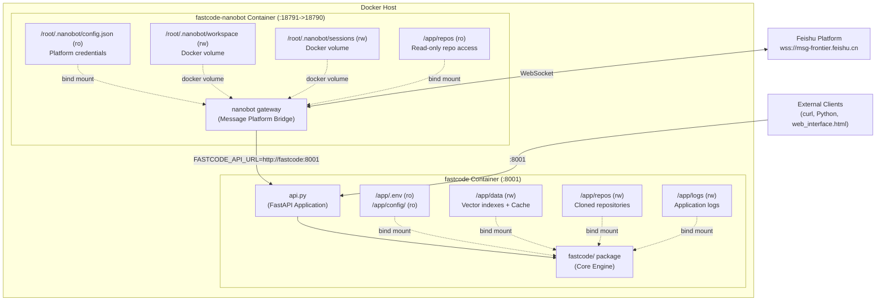
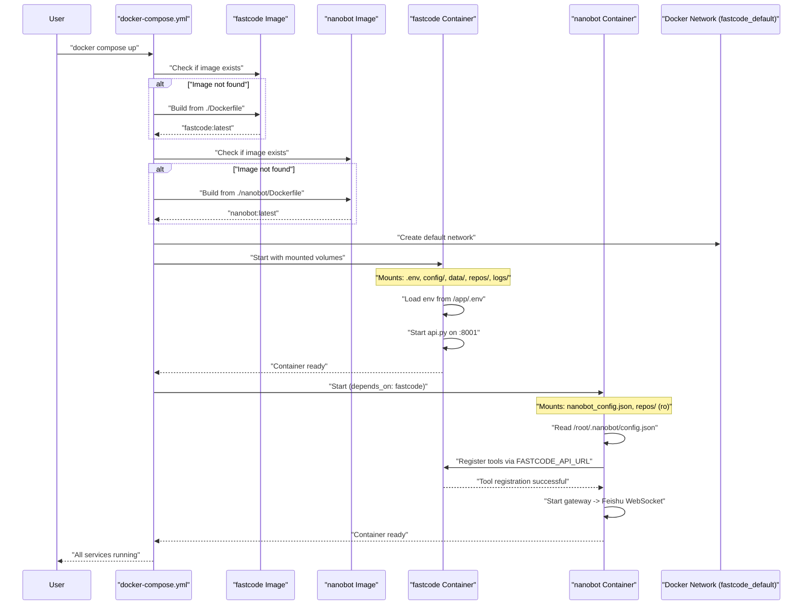

<!-- source: DeepWiki mcp.deepwiki.com · repo HKUDS/FastCode · page 7 Deployment · fetched 2026-11-09 -->

# Deployment

<details>
<summary>Relevant source files</summary>

The following files were used as context for generating this wiki page:

- [README.md](README.md)

</details>


This section covers deploying FastCode in production environments. FastCode can be run as a standalone process or as a multi-container Docker application. The sub-pages below address each deployment concern in detail.

| Sub-page | Topic |
|----------|-------|
| 7.1 | Docker Deployment — building and running the `fastcode` container |
| 7.2 | Docker Compose Setup — orchestrating `fastcode` + `nanobot` services |
| 7.3 | Volume Management — persisting indexes, repos, and cache across restarts |
| 7.4 | Production Considerations — security, performance, monitoring, scaling |

**Related pages**: For local development setup, see page 10.1. For REST API details, see page 6.1. For Feishu/Nanobot bot integration, see page 6.4.

---

## 7.1 Docker Deployment

FastCode uses a multi-container architecture where the core API service runs independently from optional integration services like Nanobot. Each container has a specific role and isolated dependencies.

### Container Architecture

**FastCode Multi-Container Topology**



Sources: [Dockerfile:1-39](), [docker-compose.yml:10-60](), [README.md:843-866]()

### FastCode Container Structure

The primary `fastcode` container is built from [Dockerfile:1-39]() and provides the code analysis REST API.

**Image Build Process**:

1. **Base Image**: Uses `python:3.12-slim-bookworm` for minimal footprint [Dockerfile:1]()
2. **System Dependencies**: Installs `git`, `build-essential`, `curl` for Tree-sitter and repository operations [Dockerfile:4-11]()
3. **Python Dependencies**: Installs requirements with retry logic [Dockerfile:16-17]()
4. **Embedding Model Pre-download**: Caches `paraphrase-multilingual-MiniLM-L12-v2` (~470MB) before copying application code to optimize layer caching [Dockerfile:21]()
5. **Directory Creation**: Pre-creates `/app/repos`, `/app/data`, `/app/logs` [Dockerfile:24]()
6. **Application Code**: Copies `fastcode/`, `api.py`, `config/` [Dockerfile:27-29]()

**Container Runtime Configuration**:

| Environment Variable | Purpose | Default |
|---------------------|---------|---------|
| `PYTHONUNBUFFERED` | Disable Python output buffering for real-time logs | `1` |
| `TOKENIZERS_PARALLELISM` | Disable tokenizer parallelism warnings | `false` |
| `OPENAI_API_KEY` | LLM provider API key (from `.env`) | Required |
| `MODEL` | Model identifier for code analysis | Required |
| `BASE_URL` | LLM provider base URL | Required |

The container exposes port `8001` [Dockerfile:32]() and runs `api.py` with the command `["python", "api.py", "--host", "0.0.0.0", "--port", "8001"]` [Dockerfile:38]().

Sources: [Dockerfile:1-39](), [docker-compose.yml:11-30]()

### Nanobot Container Structure

The optional `fastcode-nanobot` container bridges FastCode with messaging platforms (Feishu/Telegram). It communicates with FastCode via internal Docker networking.

**Key Characteristics**:

- **Base Directory**: `/root/.nanobot/` for all Nanobot data
- **Configuration**: `config.json` mounted read-only from host [docker-compose.yml:42]()
- **Command**: Runs `["gateway"]` mode to establish platform connections [docker-compose.yml:37]()
- **Port Mapping**: External `18791` → Internal `18790` [docker-compose.yml:39]()
- **FastCode Communication**: Environment variable `FASTCODE_API_URL=http://fastcode:8001` enables tool registration [docker-compose.yml:53]()

The container has **read-only access** to `/app/repos` [docker-compose.yml:49]() to reference repository metadata without modifying FastCode's working directory.

Sources: [docker-compose.yml:32-56](), [README.md:749-868]()

### Building Docker Images

**Single Container Build** (FastCode only):

```bash
# Build from repository root
docker build -t fastcode:latest .

# Build with custom tag
docker build -t fastcode:v2.0.0 .

# Build with no cache (force re-download embedding model)
docker build --no-cache -t fastcode:latest .
```

**Multi-Container Build** (FastCode + Nanobot):

```bash
# Build all services defined in docker-compose.yml
docker compose build

# Build specific service
docker compose build fastcode
docker compose build nanobot

# Force rebuild without cache
docker compose build --no-cache
```

Sources: [Dockerfile:1-39](), [docker-compose.yml:12-14]()

### Running Individual Containers

**FastCode Container (Standalone)**:

```bash
# Run with mounted volumes
docker run -d \
  --name fastcode \
  -p 8001:8001 \
  -v $(pwd)/.env:/app/.env:ro \
  -v $(pwd)/config:/app/config:ro \
  -v $(pwd)/data:/app/data \
  -v $(pwd)/repos:/app/repos \
  -v $(pwd)/logs:/app/logs \
  fastcode:latest

# View logs
docker logs -f fastcode

# Stop and remove
docker stop fastcode
docker rm fastcode
```

**Port Exposure**: The container binds `8001:8001` [docker-compose.yml:17]() to accept external API requests. The API server (`api.py`) listens on `0.0.0.0:8001` [Dockerfile:38]() inside the container. Note: `web_app.py` (the interactive web UI) runs on port 5777 when started directly outside Docker; the Docker image uses `api.py` on port 8001 instead.

Sources: [Dockerfile:32-38](), [docker-compose.yml:16-17]()

---

## 7.2 Docker Compose Setup

Docker Compose orchestrates the multi-service architecture, managing dependencies, networking, and volume sharing between FastCode and Nanobot.

### Service Orchestration Flow

**`docker compose up` Startup Sequence**



Sources: [docker-compose.yml:1-60](), [README.md:749-763]()

### Starting the System

**Background Mode** (recommended for production):

```bash
# Start all services in background
docker compose up -d

# Verify services are running
docker compose ps

# Expected output:
# NAME                 IMAGE            STATUS          PORTS
# fastcode             fastcode         Up 10 seconds   0.0.0.0:8001->8001/tcp
# fastcode-nanobot     nanobot          Up 10 seconds   0.0.0.0:18791->18790/tcp
```

**Foreground Mode** (useful for debugging):

```bash
# Start and view live logs
docker compose up

# Press Ctrl+C to stop
```

**Selective Service Start**:

```bash
# Start only FastCode (no Nanobot)
docker compose up -d fastcode

# Start with forced rebuild
docker compose up -d --build
```

Sources: [docker-compose.yml:10-56](), [README.md:749-763]()

### Configuration File Flow

| Configuration File | Host Path | Container Path | Purpose |
|-------------------|-----------|----------------|---------|
| `.env` | `./.env` | `/app/.env` (ro) | API keys, model selection [docker-compose.yml:20]() |
| `config.yaml` | `./config/` | `/app/config/` (ro) | FastCode retrieval/indexing settings [docker-compose.yml:21]() |
| `nanobot_config.json` | `./nanobot_config.json` | `/root/.nanobot/config.json` (ro) | Feishu/Telegram credentials [docker-compose.yml:42]() |

**Environment Variable Injection**:

The `.env` file is mounted read-only into the FastCode container [docker-compose.yml:20](). The `api.py` server loads environment variables using `os.getenv()` / `dotenv` to configure LLM providers.

**Nanobot API URL Resolution**:

Nanobot receives `FASTCODE_API_URL=http://fastcode:8001` via [docker-compose.yml:53](). Docker's internal DNS resolves `fastcode` to the FastCode container's IP on the `fastcode_default` network.

Sources: [docker-compose.yml:19-21](), [docker-compose.yml:42](), [docker-compose.yml:51-53]()

### Viewing Logs

**All Services**:

```bash
# Stream logs from all containers
docker compose logs -f

# Last 100 lines
docker compose logs --tail=100
```

**Individual Services**:

```bash
# FastCode API logs only
docker compose logs -f fastcode

# Nanobot gateway logs only
docker compose logs -f nanobot
```

**Log Files on Disk**:

FastCode writes application logs to the mounted `/app/logs` directory [docker-compose.yml:26](), which maps to `./logs` on the host. These files persist across container restarts.

Sources: [docker-compose.yml:26]()

### Stopping and Restarting

**Stop Services** (preserves data):

```bash
# Stop all containers
docker compose stop

# Stop specific service
docker compose stop fastcode
docker compose stop nanobot
```

**Full Shutdown** (stop and remove containers):

```bash
# Stop and remove containers (keeps volumes/networks)
docker compose down

# Remove containers, networks, and volumes
docker compose down -v
```

**Restart Services**:

```bash
# Restart all services
docker compose restart

# Restart specific service
docker compose restart fastcode
```

**Health Check Example**:

```bash
# Check FastCode API health
curl http://localhost:8001/health

# Check Nanobot status
curl http://localhost:18791/health
```

Sources: [docker-compose.yml:10-60](), [README.md:749-763]()

---

## 7.3 Volume Management

FastCode uses persistent volumes to maintain state across container restarts. The volume strategy separates read-only configuration from read-write data.

### Volume Types and Access Patterns

| Volume Path (Host) | Container Path | Access | Purpose | Managed By |
|-------------------|----------------|--------|---------|------------|
| `./.env` | `/app/.env` | Read-only | API keys, model config | FastCode |
| `./config/` | `/app/config/` | Read-only | System configuration | FastCode |
| `./data/` | `/app/data` | Read-write | Vector indexes, cache | FastCode |
| `./repos/` | `/app/repos` | Read-write (FastCode)<br/>Read-only (Nanobot) | Cloned repositories | FastCode (write)<br/>Nanobot (read) |
| `./logs/` | `/app/logs` | Read-write | Application logs | FastCode |
| `nanobot_config.json` | `/root/.nanobot/config.json` | Read-only | Nanobot credentials | Nanobot |
| `nanobot-workspace` | `/root/.nanobot/workspace` | Read-write | Nanobot workspace | Nanobot (Docker volume) |
| `nanobot-sessions` | `/root/.nanobot/sessions` | Read-write | Nanobot sessions | Nanobot (Docker volume) |

Sources: [docker-compose.yml:19-26](), [docker-compose.yml:41-49](), [docker-compose.yml:58-60]()

### Data Persistence Architecture

**Host-to-Container Volume Mapping**

```mermaid
graph TB
    subgraph "Host File System"
        HostEnv[".env\n(API keys)"]
        HostConfig["config/config.yaml"]
        HostData["data/\n(indexes + cache)"]
        HostRepos["repos/\n(cloned repos)"]
        HostLogs["logs/\n(app logs)"]
        HostNanobotConfig["nanobot_config.json\n(Feishu credentials)"]
    end

    subgraph "Named Docker Volumes"
        WorkspaceVol["nanobot-workspace\n(Docker managed)"]
        SessionsVol["nanobot-sessions\n(Docker managed)"]
    end

    subgraph "fastcode Container"
        AppEnv["/app/.env"]
        AppConfig["/app/config/"]
        AppData["/app/data"]
        AppRepos["/app/repos"]
        AppLogs["/app/logs"]

        FastCodeCore["fastcode/ modules\n(CodeEmbedder, QueryProcessor, etc.)"]
        APIP["api.py"]

        FastCodeCore -->|"read"| AppEnv
        FastCodeCore -->|"read"| AppConfig
        FastCodeCore -->|"read/write"| AppData
        FastCodeCore -->|"read/write"| AppRepos
        FastCodeCore -->|"write"| AppLogs
        APIP --> FastCodeCore
    end

    subgraph "nanobot Container"
        NanobotConfigMount["/root/.nanobot/config.json"]
        NanobotWorkspace["/root/.nanobot/workspace"]
        NanobotSessions["/root/.nanobot/sessions"]
        NanobotReposRO["/app/repos (read-only)"]

        NanobotGateway["nanobot gateway"]

        NanobotGateway -->|"read"| NanobotConfigMount
        NanobotGateway -->|"read/write"| NanobotWorkspace
        NanobotGateway -->|"read/write"| NanobotSessions
        NanobotGateway -->|"read-only"| NanobotReposRO
    end

    HostEnv -. "bind (ro)" .-> AppEnv
    HostConfig -. "bind (ro)" .-> AppConfig
    HostData -. "bind (rw)" .-> AppData
    HostRepos -. "bind (rw)" .-> AppRepos
    HostLogs -. "bind (rw)" .-> AppLogs

    HostNanobotConfig -. "bind (ro)" .-> NanobotConfigMount
    HostRepos -. "bind (ro)" .-> NanobotReposRO

    WorkspaceVol -. "volume" .-> NanobotWorkspace
    SessionsVol -. "volume" .-> NanobotSessions
```



Sources: [docker-compose.yml:19-26](), [docker-compose.yml:41-49]()

### Repository Volume Sharing Strategy

The `./repos/` directory is mounted with **different access modes** in each container:

**FastCode Container** [docker-compose.yml:25]():
- **Mode**: Read-write (`./repos:/app/repos`)
- **Purpose**: Clone repositories, create indexes, modify repo metadata
- **Operations**: `git clone`, index building, file parsing

**Nanobot Container** [docker-compose.yml:49]():
- **Mode**: Read-only (`./repos:/app/repos:ro`)
- **Purpose**: Reference repository metadata for tool operations
- **Operations**: List repositories, read summaries, check existence

This design prevents Nanobot from accidentally modifying repositories while allowing it to query FastCode about available codebases.

Sources: [docker-compose.yml:25](), [docker-compose.yml:49]()

### Data Directory Contents

The `/app/data` volume [docker-compose.yml:24]() stores multiple types of persistent data:

```
data/
├── cache/                    # CacheManager disk cache
│   ├── embeddings/          # Cached embeddings by content hash
│   ├── queries/             # Cached query results
│   └── dialogue/            # Cached multi-turn sessions
├── faiss_index/             # FAISS vector index files
│   └── {repo_name}.index
├── chromadb/                # ChromaDB persistence (if configured)
└── qdrant/                  # Qdrant storage (if configured)
```

**Cache Management**: The `CacheManager` class writes to `./data/cache` based on `config.yaml` cache configuration. See page 8.10 for TTL and size limits.

**Vector Store Persistence**: Vector stores persist indexes to subdirectories based on the `vector_store.type` configuration (`faiss`/`chromadb`/`qdrant`). See page 8.5 for configuration options.

Sources: [docker-compose.yml:24]()

### Docker Volume Management Commands

**Inspect Volumes**:

```bash
# List all volumes
docker volume ls

# Inspect Nanobot workspace volume
docker volume inspect fastcode_nanobot-workspace

# Inspect Nanobot sessions volume
docker volume inspect fastcode_nanobot-sessions
```

**Backup Docker Volumes**:

```bash
# Backup Nanobot workspace
docker run --rm \
  -v fastcode_nanobot-workspace:/data \
  -v $(pwd):/backup \
  alpine tar czf /backup/nanobot-workspace-backup.tar.gz -C /data .

# Backup Nanobot sessions
docker run --rm \
  -v fastcode_nanobot-sessions:/data \
  -v $(pwd):/backup \
  alpine tar czf /backup/nanobot-sessions-backup.tar.gz -C /data .
```

**Restore Docker Volumes**:

```bash
# Restore Nanobot workspace
docker run --rm \
  -v fastcode_nanobot-workspace:/data \
  -v $(pwd):/backup \
  alpine sh -c "cd /data && tar xzf /backup/nanobot-workspace-backup.tar.gz"
```

Sources: [docker-compose.yml:58-60]()

### Volume Cleanup

**Remove Unused Volumes**:

```bash
# Remove all volumes when stopping services
docker compose down -v

# Remove specific volume
docker volume rm fastcode_nanobot-workspace
docker volume rm fastcode_nanobot-sessions
```

**Clean Host-Mounted Directories** (use with caution):

```bash
# Remove cached data (indexes remain)
rm -rf ./data/cache/*

# Remove all indexes (forces re-indexing)
rm -rf ./data/*

# Remove cloned repositories (loses all repo data)
rm -rf ./repos/*

# Remove logs
rm -rf ./logs/*
```

Sources: [docker-compose.yml:19-26]()

---

## 7.4 Production Considerations

Deploying FastCode in production requires attention to security, performance, monitoring, and operational procedures.

### Security Best Practices

**1. API Key Protection**:

The `.env` file contains sensitive credentials [docker-compose.yml:20](). Ensure proper file permissions:

```bash
# Restrict .env to owner read-only
chmod 600 .env

# Verify permissions
ls -la .env
# Expected: -rw------- (600)
```

**2. Volume Mount Permissions**:

Configuration files are mounted **read-only** (`ro` flag) [docker-compose.yml:20-21]() to prevent container processes from modifying secrets.

**3. Network Isolation**:

By default, Docker Compose creates an isolated network (`fastcode_default`). External access is only possible through exposed ports `8001` and `18791` [docker-compose.yml:17]() [docker-compose.yml:39]().

**4. Remove Development Tools in Production**:

The production `Dockerfile` [Dockerfile:4-11]() includes `build-essential` for Tree-sitter compilation. Consider a multi-stage build to strip development tools from the runtime image. The current single-stage image includes all build tools in the final layer.

**5. Non-Root User Execution**:

The current `Dockerfile` [Dockerfile:13]() sets `WORKDIR /app` but runs as root. For hardened deployments, add a non-privileged user and `chown /app` before the `USER` directive.

Sources: [Dockerfile:1-39](), [docker-compose.yml:19-21]()

### Performance Tuning

**1. Resource Limits**:

Add resource constraints to prevent resource exhaustion:

```yaml
services:
  fastcode:
    # ... existing config ...
    deploy:
      resources:
        limits:
          cpus: '4.0'
          memory: 8G
        reservations:
          cpus: '2.0'
          memory: 4G
```

**2. Embedding Model Caching**:

The Dockerfile pre-downloads the embedding model [Dockerfile:21]() to optimize container startup. Verify the model is cached:

```bash
# Check model cache size in image
docker run --rm fastcode:latest du -sh /root/.cache/torch/sentence_transformers
# Expected: ~470M
```

**3. Vector Store Performance**:

For FAISS, use HNSW indexing with appropriate M/efConstruction parameters in `config/config.yaml`. See page 8.5 for configuration details.

**4. Cache Backend Selection**:

For multi-container deployments, use Redis instead of disk cache by adding a `redis` service to `docker-compose.yml` and setting `cache.backend: redis` with `redis_url: redis://redis:6379/0` in `config/config.yaml`. See page 8.10 for all cache configuration options.

Sources: [Dockerfile:21](), [docker-compose.yml:10-56]()

### Monitoring and Health Checks

**Health Check Endpoints**:

The FastCode API provides health monitoring endpoints:

```bash
# Basic health check
curl http://localhost:8001/health

# Detailed system status
curl http://localhost:8001/status?full_scan=true
```

**Add Docker Health Checks**:

```yaml
services:
  fastcode:
    # ... existing config ...
    healthcheck:
      test: ["CMD", "curl", "-f", "http://localhost:8001/health"]
      interval: 30s
      timeout: 10s
      retries: 3
      start_period: 40s
```

**Log Monitoring**:

Aggregate logs using Docker's logging drivers:

```yaml
services:
  fastcode:
    # ... existing config ...
    logging:
      driver: "json-file"
      options:
        max-size: "100m"
        max-file: "10"
```

**Cache Statistics**:

Monitor cache performance:

```bash
# Get cache hit rates
curl http://localhost:8001/cache-stats
```

Sources: [README.md:502-520]()

### Scaling Considerations

**1. Horizontal Scaling**:

Run multiple FastCode instances behind a load balancer:

```yaml
services:
  fastcode:
    # ... existing config ...
    deploy:
      replicas: 3
```

**Shared State Requirements**:
- Use Redis cache backend for shared cache [docker-compose.yml:24]()
- Use Qdrant or external vector store for shared indexes
- Mount `./repos` on shared network storage (NFS/EFS)

**2. Vertical Scaling**:

Increase container resources for large codebases:

```yaml
deploy:
  resources:
    limits:
      memory: 16G  # For large repositories (>10k files)
```

**3. Repository Sharding**:

For multi-repository deployments, consider running separate FastCode instances per repository cluster with a routing layer.

Sources: [docker-compose.yml:11-30]()

### Backup and Recovery

**Backup Strategy**:

| Data Type | Location | Backup Frequency | Recovery Priority |
|-----------|----------|------------------|-------------------|
| Configuration | `.env`, `config/` | On change | Critical |
| Vector Indexes | `./data/faiss_index/` | Daily | High |
| Cache | `./data/cache/` | Not required (regenerable) | Low |
| Repositories | `./repos/` | Weekly | Medium |
| Logs | `./logs/` | Optional | Low |
| Nanobot Sessions | Docker volume | Daily | Medium |

**Automated Backup Script**:

```bash
#!/bin/bash
# backup-fastcode.sh

BACKUP_DIR="/backups/fastcode/$(date +%Y%m%d_%H%M%S)"
mkdir -p "$BACKUP_DIR"

# Backup configuration
cp -r .env config/ "$BACKUP_DIR/"

# Backup indexes
tar czf "$BACKUP_DIR/data.tar.gz" ./data/

# Backup repositories
tar czf "$BACKUP_DIR/repos.tar.gz" ./repos/

# Backup Nanobot volumes
docker run --rm \
  -v fastcode_nanobot-sessions:/data \
  -v "$BACKUP_DIR":/backup \
  alpine tar czf /backup/nanobot-sessions.tar.gz -C /data .

echo "Backup completed: $BACKUP_DIR"
```

**Recovery Procedure**:

1. Stop services: `docker compose down`
2. Restore configuration: `cp -r backup/.env backup/config/ .`
3. Restore data: `tar xzf backup/data.tar.gz`
4. Restore repositories: `tar xzf backup/repos.tar.gz`
5. Restore Nanobot volumes using volume restore commands
6. Start services: `docker compose up -d`

Sources: [docker-compose.yml:19-26](), [docker-compose.yml:58-60]()

### Production Deployment Checklist

| Task | Verification |
|------|--------------|
| ✅ Set secure file permissions on `.env` | `ls -la .env` shows `600` |
| ✅ Configure resource limits in `docker-compose.yml` | Limits defined for CPU/memory |
| ✅ Enable health checks | `docker compose ps` shows healthy status |
| ✅ Configure log rotation | Logging driver options set |
| ✅ Set up backup automation | Cron job or scheduled task configured |
| ✅ Test disaster recovery | Successfully restore from backup |
| ✅ Configure external vector store (optional) | Qdrant/ChromaDB for shared state |
| ✅ Set up Redis for caching (optional) | Redis container running |
| ✅ Document service dependencies | README includes infrastructure requirements |
| ✅ Configure monitoring/alerting | Health check alerts configured |

Sources: [Dockerfile:1-39](), [docker-compose.yml:1-60]()

### Troubleshooting Production Issues

**Container Won't Start**:

```bash
# Check container logs
docker compose logs fastcode

# Common issues:
# - Missing .env file: Mount .env with correct path
# - Invalid config.yaml: Validate YAML syntax
# - Port conflict: Check if 8001 is already in use
```

**High Memory Usage**:

```bash
# Monitor container resources
docker stats

# Solutions:
# - Reduce batch_size in config/config.yaml
# - Reduce max_context_tokens
# - Enable cache to avoid re-indexing
```

**Slow Query Performance**:

```bash
# Check cache statistics
curl http://localhost:8001/cache-stats

# Solutions:
# - Enable Redis cache backend
# - Reduce min_similarity threshold
# - Optimize HNSW index parameters
```

See [Performance Issues](#11.3) for detailed troubleshooting.

**Sources**: [docker-compose.yml:1-60](), [Dockerfile:1-39]()

---

