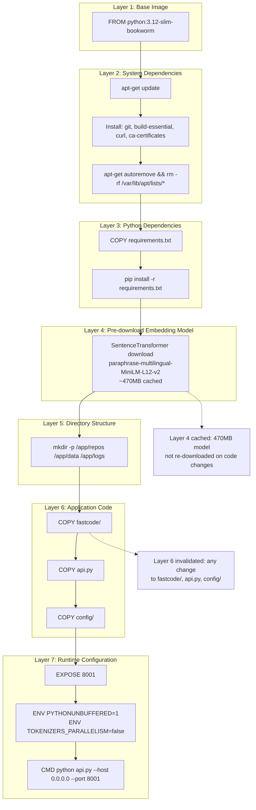
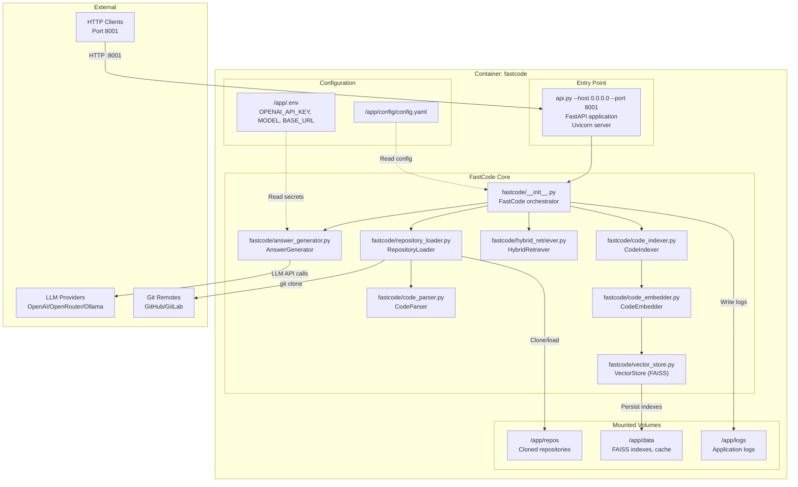
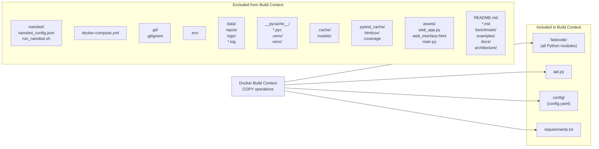
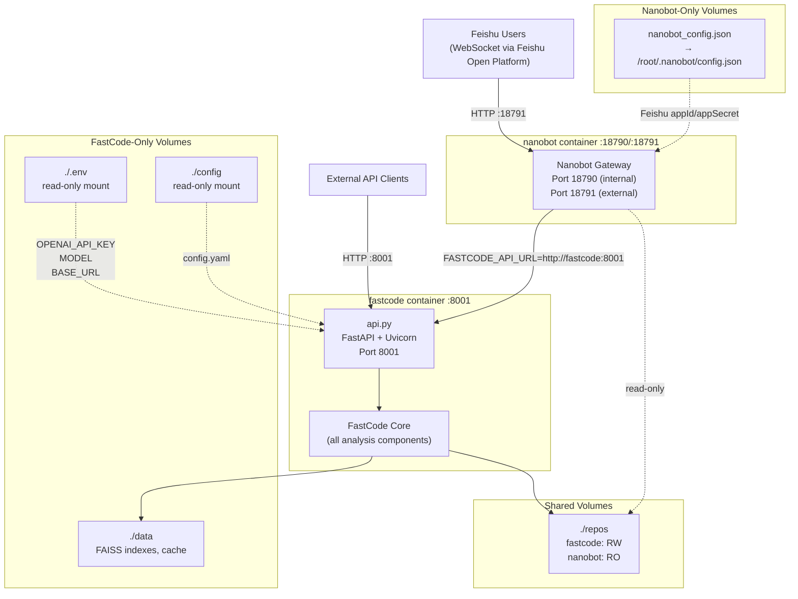

<!-- source: DeepWiki mcp.deepwiki.com · repo HKUDS/FastCode · page 7.1 Docker Deployment · fetched 2026-11-09 -->

# Docker Deployment

<details>
<summary>Relevant source files</summary>

The following files were used as context for generating this wiki page:

- [README.md](README.md)

</details>


This page documents the FastCode Docker container architecture, build process, and single-container deployment. It covers the `Dockerfile` structure, layer caching strategy, build context management, and how to build and run the FastCode container independently.

> **Note:** The Docker container uses `api.py` as its entry point (port `8001`). This is distinct from `web_app.py` (port `5777`), which is the standalone server used outside Docker. The `.dockerignore` file explicitly excludes `web_app.py` from the image.

For deploying the complete multi-service system with Nanobot integration, see [Docker Compose Setup](#7.2). For understanding persistent storage patterns, see [Volume Management](#7.3). For production deployment best practices, see [Production Considerations](#7.4).

## Purpose and Scope

This documentation covers:
- FastCode `Dockerfile` structure and build stages
- Layer caching strategy for efficient rebuilds
- Build context exclusions via `.dockerignore`
- Building and running individual FastCode containers
- Container entry point (`api.py`) and exposed ports
- Environment variable configuration
- Relationship to multi-service architecture via `run_nanobot.sh`

Sources: [README.md:730-900]()

---

## Dockerfile Architecture

The FastCode `Dockerfile` implements a multi-stage build process optimized for Docker layer caching. The build strategy separates dependency installation, model pre-downloading, and application code to minimize rebuild times when code changes.

### Build Stages and Layer Caching

**Dockerfile Layer Strategy**



**Sources:** [Dockerfile:1-39]()

The Dockerfile implements a strategic layer ordering where expensive operations (embedding model download) are placed before frequently-changed application code. This ensures that modifications to `fastcode/`, `api.py`, or `config/` do not trigger re-downloading the 470MB `paraphrase-multilingual-MiniLM-L12-v2` model.

### Base Image and System Dependencies

The container uses `python:3.12-slim-bookworm` as the base image and installs minimal system dependencies required for FastCode's core functionality:

| Dependency | Purpose | Used By |
|------------|---------|---------|
| `git` | Clone repositories from URLs | RepositoryLoader |
| `build-essential` | Compile tree-sitter grammars | CodeParser (AST parsing) |
| `curl` | HTTP requests (optional) | Health checks, external APIs |
| `ca-certificates` | SSL/TLS verification | Git cloning, LLM provider APIs |

**Sources:** [Dockerfile:1-11]()

The system dependencies are installed in a single `RUN` layer with cleanup (`apt-get autoremove`, `rm -rf /var/lib/apt/lists/*`) to minimize image size.

### Python Dependencies and Model Pre-download

Python dependencies are installed from `requirements.txt` before copying application code, enabling Docker to cache this layer across code changes:

```dockerfile
COPY requirements.txt ./
RUN pip install --no-cache-dir --retries 5 --timeout 60 -r requirements.txt
```

**Sources:** [Dockerfile:16-17]()

The embedding model is pre-downloaded in a separate layer using a direct Python import:

```python
# Executed at build time (Layer 4)
from sentence_transformers import SentenceTransformer
SentenceTransformer('sentence-transformers/paraphrase-multilingual-MiniLM-L12-v2')
```

**Sources:** [Dockerfile:21]()

This 470MB download is cached independently of application code changes, as documented in the inline comment at [Dockerfile:19-20]().

---

## Container Runtime Architecture

The FastCode container exposes a REST API via `api.py` and mounts three persistent volumes for repositories, indexes, and logs.

**FastCode Container Runtime**



**Sources:** [Dockerfile:24-38](), [docker-compose.yml:11-30]()

The container runs `api.py` as the entry point, which initializes the FastCode system and exposes REST API endpoints on port 8001. The application requires three mounted volumes for persistence:
- `/app/repos` - Repository storage (read-write)
- `/app/data` - Vector indexes and cache (read-write)
- `/app/logs` - Application logs (write-only)

Configuration is provided through two mounted files:
- `/app/config/config.yaml` - FastCode configuration (see [Configuration](#8))
- `/app/.env` - LLM provider credentials and model selection (see [Environment Configuration](#2.2))

---

## Building the Docker Image

### Basic Build Command

Build the FastCode Docker image using the repository root as the build context:

```bash
docker build -t fastcode:latest .
```

The build process takes approximately 5-10 minutes on first run, with the embedding model download (~470MB) being the most time-consuming step.

### Build Context Exclusions

The `.dockerignore` file defines build context exclusions to prevent unnecessary files from being copied into the image:

**Build Context Exclusion Strategy**



**Sources:** [.dockerignore:1-32]()

Key exclusions:
- **Nanobot components** ([.dockerignore:2-4]()) - Nanobot has its own Dockerfile in `nanobot/`
- **Runtime data** ([.dockerignore:9-11]()) - `data/`, `repos/`, `logs/` are mounted as volumes, not built into the image
- **Secrets** ([.dockerignore:8]()) - `.env` file must be mounted at runtime, not baked into the image
- **Development files** ([.dockerignore:23-31]()) - `web_app.py`, `main.py`, documentation, and examples are not needed in the API container

The `.dockerignore` file reduces build context size by excluding approximately 80-90% of repository files, significantly speeding up Docker builds when using remote builders or CI/CD systems.

### Build Arguments and Tags

Build with custom tags for versioning:

```bash
docker build -t fastcode:2.0.0 -t fastcode:latest .
```

The Dockerfile does not define any `ARG` directives, so all configuration is provided at runtime via environment variables and mounted volumes.

---

## Running the Container

### Standalone Container

Run the FastCode container with minimal volume mounts:

```bash
docker run -d \
  --name fastcode \
  -p 8001:8001 \
  -v $(pwd)/.env:/app/.env:ro \
  -v $(pwd)/config:/app/config:ro \
  -v $(pwd)/data:/app/data \
  -v $(pwd)/repos:/app/repos \
  -e PYTHONUNBUFFERED=1 \
  -e TOKENIZERS_PARALLELISM=false \
  fastcode:latest
```

**Volume Mount Requirements:**

| Path | Mode | Purpose | Required |
|------|------|---------|----------|
| `./.env` | `ro` | LLM provider API keys (`OPENAI_API_KEY`, `MODEL`, `BASE_URL`) | Yes |
| `./config` | `ro` | FastCode `config.yaml` | Yes |
| `./data` | `rw` | FAISS vector indexes, cache files | Yes |
| `./repos` | `rw` | Cloned/uploaded repositories | Yes |

Sources: [Dockerfile:24](), [docker-compose.yml:18-26](), [README.md:843-851]()

### Environment Variables

The container requires specific environment variables for operation:

| Variable | Default | Purpose | Source |
|----------|---------|---------|--------|
| `PYTHONUNBUFFERED` | `1` | Disable Python output buffering for real-time logs | [Dockerfile:35]() |
| `TOKENIZERS_PARALLELISM` | `false` | Disable tokenizer parallelism warnings | [Dockerfile:36]() |
| `OPENAI_API_KEY` | - | OpenAI/OpenRouter API key | `.env` file |
| `MODEL` | - | LLM model identifier | `.env` file |
| `BASE_URL` | - | LLM provider API endpoint | `.env` file |

See [Environment Configuration](#2.2) for detailed LLM provider setup.

### Verifying Container Health

Check if the FastCode API is responding:

```bash
curl http://localhost:8001/health
```

Expected response:
```json
{
  "status": "healthy",
  "version": "2.0.0",
  "timestamp": "2024-01-15T10:30:00Z"
}
```

View container logs:
```bash
docker logs -f fastcode
```

---

## Container Entry Point

The FastCode container executes `api.py` as its entry point, which launches a Uvicorn ASGI server serving the FastAPI application.

**Container Entry Point Flow**

```mermaid
sequenceDiagram
    autonumber
    participant Docker
    participant CMD["CMD: python api.py"]
    participant APIModule["api.py"]
    participant FastAPIApp["FastAPI() app instance"]
    participant Uvicorn["uvicorn.run()"]
    participant FastCode["FastCode() singleton"]
    participant ConfigLoader["Config loader"]
    
    Docker->>CMD: Container start
    CMD->>APIModule: Execute api.py
    APIModule->>ConfigLoader: Load config/config.yaml
    ConfigLoader-->>APIModule: Configuration object
    APIModule->>FastCode: Initialize FastCode()
    FastCode->>FastCode: Initialize RepositoryLoader, CodeParser, etc.
    FastCode-->>APIModule: Singleton instance
    APIModule->>FastAPIApp: Define routes
    Note over FastAPIApp: /load, /index, /query, /upload, etc.
    APIModule->>Uvicorn: uvicorn.run(app, host=0.0.0.0, port=8001)
    Uvicorn->>Uvicorn: Bind to port 8001
    Note over Uvicorn: Server ready for HTTP requests
    Uvicorn-->>Docker: Container running (healthy)
```

**Sources:** [Dockerfile:38]()

The `CMD` directive at [Dockerfile:38]() executes:
```bash
python api.py --host 0.0.0.0 --port 8001
```

This command:
1. Imports the `fastcode` package, initializing the FastCode singleton
2. Loads configuration from `/app/config/config.yaml`
3. Reads LLM provider credentials from `/app/.env`
4. Creates a FastAPI application instance with all REST endpoints
5. Starts Uvicorn server on `0.0.0.0:8001` (listening on all interfaces)

The container exposes port 8001 ([Dockerfile:32]()), which must be mapped to a host port using `-p` or docker-compose `ports` directive.

---

## Multi-Service Architecture Context

While this page focuses on the standalone FastCode container, the production deployment typically involves two services orchestrated by Docker Compose, managed via `run_nanobot.sh`.

**Two-Service Architecture**



Sources: [README.md:843-866](), [docker-compose.yml:10-60]()

Key architectural points:
1. **Service Separation**: `fastcode` and `nanobot` run in separate containers with independent lifecycles
2. **Network Communication**: Nanobot references FastCode via internal DNS name `fastcode:8001` using the `FASTCODE_API_URL` environment variable ([docker-compose.yml:53]())
3. **Volume Sharing**: The `./repos` directory is mounted read-write in FastCode and read-only in Nanobot ([docker-compose.yml:25,49]())
4. **Secret Injection**: `OPENAI_API_KEY` from `.env` is forwarded to Nanobot as `NANOBOT_PROVIDERS__OPENROUTER__API_KEY` ([README.md:860-861]())

### `run_nanobot.sh` Management Commands

The `run_nanobot.sh` script provides smart lifecycle management for the multi-container deployment, auto-detecting the current state (running, stopped, images missing) on each invocation.

| Command | Description |
|---------|-------------|
| `./run_nanobot.sh` | Smart launch: auto-detects state and starts/restarts |
| `./run_nanobot.sh --build` | Force rebuild of container images |
| `./run_nanobot.sh --fg` | Run in foreground (view live logs) |
| `./run_nanobot.sh stop` | Stop all services |
| `./run_nanobot.sh restart` | Restart all services |
| `./run_nanobot.sh logs` | View live logs |
| `./run_nanobot.sh status` | View service status + health check |
| `./run_nanobot.sh config` | Re-check / regenerate Nanobot config |
| `./run_nanobot.sh clean` | Stop and remove containers and images |

Sources: [README.md:872-884](), [run_nanobot.sh]()

For complete multi-service setup including Nanobot configuration and inter-service communication, see [Docker Compose Setup](#7.2).

For understanding persistent storage patterns and access modes (read-write vs read-only), see [Volume Management](#7.3).

---

## Summary

The FastCode Docker container provides a self-contained deployment unit with optimized layer caching for fast rebuilds. The build strategy separates expensive operations (embedding model download) from frequently-changed application code, reducing rebuild times from minutes to seconds when only code changes.

Key characteristics:
- **Base**: Python 3.12 slim Debian Bookworm
- **Entry Point**: `api.py --host 0.0.0.0 --port 8001`
- **Exposed Port**: 8001 (REST API)
- **Required Mounts**: `.env`, `config/`, `data/`, `repos/`, `logs/`
- **Build Context**: ~10-20% of repository (via `.dockerignore`)
- **Image Size**: ~2.5GB (base + dependencies + embedding model)
- **First Build Time**: 5-10 minutes (includes model download)
- **Rebuild Time**: 30-60 seconds (with layer cache)

For production deployments, the FastCode container is typically deployed alongside Nanobot using Docker Compose ([Docker Compose Setup](#7.2)) with appropriate volume management ([Volume Management](#7.3)) and production configuration ([Production Considerations](#7.4)).

**Sources:** [Dockerfile:1-39](), [.dockerignore:1-32](), [docker-compose.yml:11-30]()

---

