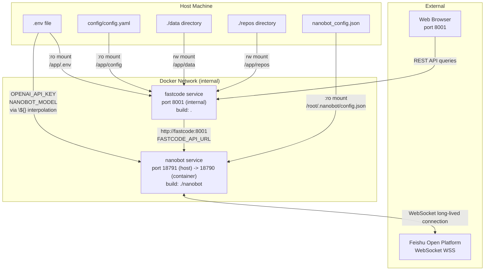
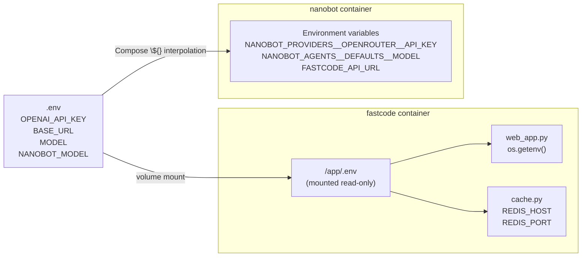

<!-- source: DeepWiki mcp.deepwiki.com · repo HKUDS/FastCode · page 7.2 Docker Compose Setup · fetched 2026-11-09 -->

# Docker Compose Setup

<details>
<summary>Relevant source files</summary>

The following files were used as context for generating this wiki page:

- [README.md](README.md)
- [fastcode/cache.py](fastcode/cache.py)

</details>


This page documents the Docker Compose configuration used to run FastCode together with its optional services, particularly the Nanobot gateway for Feishu integration. It covers service definitions, volume mounts, inter-service networking, environment variable injection, and stack management via the `run_nanobot.sh` helper script.

For building and running the FastCode container in isolation (without Compose), see [Docker Deployment](#7.1). For details on persistent volume configuration across restarts, see [Volume Management](#7.3). For Redis vs disk cache configuration tradeoffs, see [Production Considerations](#7.4).

---

## Overview

The Compose stack defines two services that communicate over Docker's internal network:

- **`fastcode`** — the FastCode REST API, built from the root `Dockerfile`, listening on port `8001`
- **`nanobot`** — the Feishu (Lark) bot gateway, built from `./nanobot/`, listening on port `18791`

The `nanobot` service depends on `fastcode` and calls it via the internal DNS name `http://fastcode:8001`. No public IP or webhook exposure is required for the Feishu connection; Nanobot uses a WebSocket long-lived connection to the Feishu Open Platform.

Sources: [README.md:843-866]()

---

## Service Architecture

**Diagram: Docker Compose Service Topology**



Sources: [README.md:736-866]()

---

## Service Definitions

### `fastcode` Service

The `fastcode` service runs `web_app.py` (FastAPI on port `8001`) and is the core engine for all code analysis operations.

| Property | Value |
|---|---|
| Build context | `.` (repository root) |
| Internal port | `8001` |
| Config source | `/app/.env` (from `.env`), `/app/config` (from `./config`) |
| Data persistence | `/app/data`, `/app/repos` |

**Volume mounts:**

| Host path | Container path | Mode | Purpose |
|---|---|---|---|
| `./.env` | `/app/.env` | `:ro` | API keys, model settings |
| `./config` | `/app/config` | `:ro` | `config.yaml` retrieval/indexing settings |
| `./data` | `/app/data` | read-write | FAISS indexes, BM25 indexes, cache |
| `./repos` | `/app/repos` | read-write | Cloned/uploaded repository sources |

Sources: [README.md:844-851]()

---

### `nanobot` Service

The `nanobot` service is a gateway that connects Feishu to the FastCode API. It registers FastCode tools at startup using the `FASTCODE_API_URL` environment variable to locate the `fastcode` service.

| Property | Value |
|---|---|
| Build context | `./nanobot` |
| Command | `["gateway"]` |
| Host port | `18791` → container port `18790` |
| Depends on | `fastcode` |

**Environment variables injected into `nanobot`:**

| Variable | Source | Description |
|---|---|---|
| `FASTCODE_API_URL` | Hardcoded `http://fastcode:8001` | Internal address of the FastCode service |
| `NANOBOT_PROVIDERS__OPENROUTER__API_KEY` | `${OPENAI_API_KEY}` from `.env` | LLM API key shared from the host `.env` |
| `NANOBOT_AGENTS__DEFAULTS__MODEL` | `${NANOBOT_MODEL}` from `.env` | Model used by Nanobot's own reasoning |

The `nanobot_config.json` file is mounted read-only at `/root/.nanobot/config.json` inside the container. This file holds Feishu credentials (`appId`, `appSecret`) and the system prompt. It is auto-generated by `run_nanobot.sh` on first run.

Sources: [README.md:853-866]()

---

## Environment Variable Flow

All configuration is centralized in a single `.env` file on the host. It is consumed by both services — directly mounted into `fastcode`, and interpolated by Docker Compose into `nanobot`'s environment.

**Diagram: Environment Variable Injection**



The `CacheManager` class in `fastcode/cache.py` reads `REDIS_HOST` and `REDIS_PORT` from the environment when `backend: redis` is configured in `config/config.yaml`. If you add a Redis service to the Compose stack, those variables should be added to the `fastcode` service's environment block or `.env` file.

Sources: [README.md:763-798](), [fastcode/cache.py:52-65]()

---

## Inter-Service Networking

Docker Compose places both services on the same internal bridge network. The `nanobot` service resolves the `fastcode` hostname via Docker's embedded DNS — no additional network configuration is needed.

```
nanobot → http://fastcode:8001 → FastCode REST API
```

The `depends_on: fastcode` directive ensures the `fastcode` container starts before `nanobot` attempts to register its tools.

Sources: [README.md:857-864]()

---

## Optional Redis Service

The default `fastcode` service uses disk-based caching (`DiskCache` via `diskcache`). To switch to Redis, add a `redis` service to the Compose file and update `config/config.yaml` accordingly.

The `CacheManager._initialize_cache` method [fastcode/cache.py:41-68]() connects to Redis using:

- `REDIS_HOST` environment variable (default: `localhost`)
- `REDIS_PORT` environment variable (default: `6379`)

A minimal Redis addition to the Compose file would look like:

```
services:
  redis:
    image: redis:7-alpine
    volumes:
      - ./data/redis:/data

  fastcode:
    ...
    environment:
      - REDIS_HOST=redis
      - REDIS_PORT=6379
    depends_on:
      - redis
```

Then set `cache.backend: redis` in `config/config.yaml`. See [Cache Configuration](#8.10) for all cache options.

Sources: [fastcode/cache.py:52-65](), [README.md:763-798]()

---

## Stack Management via `run_nanobot.sh`

The `run_nanobot.sh` script wraps `docker compose` with state-detection logic. It inspects whether containers are running, stopped, or images are missing, and takes the appropriate action automatically.

**Available commands:**

| Command | Effect |
|---|---|
| `./run_nanobot.sh` | Auto-detects state: start, restart, or show status |
| `./run_nanobot.sh --build` | Force rebuild of both images before starting |
| `./run_nanobot.sh --fg` | Run in foreground, streaming logs to terminal |
| `./run_nanobot.sh stop` | Stop all containers |
| `./run_nanobot.sh restart` | Restart all containers |
| `./run_nanobot.sh logs` | Stream live logs from all services |
| `./run_nanobot.sh status` | Show container status and health check output |
| `./run_nanobot.sh config` | Re-check or regenerate `nanobot_config.json` |
| `./run_nanobot.sh clean` | Stop and remove all containers and built images |

On first run, `run_nanobot.sh` auto-generates `nanobot_config.json` if it does not exist.

**Note for Windows users:** `run_nanobot.sh` is a bash script. Run it via Git Bash or WSL. The repository enforces LF line endings for `*.sh` files via `.gitattributes`.

Sources: [README.md:748-756](), [README.md:872-883]()

---

## Registered FastCode Tools in Nanobot

At startup, Nanobot queries `FASTCODE_API_URL` and registers the following tools, making them available to Feishu users:

| Tool Name | FastCode API Function |
|---|---|
| `fastcode_load_repo` | Load and index a repository via URL or local path |
| `fastcode_query` | Natural language query with multi-turn support |
| `fastcode_list_repos` | List indexed repositories |
| `fastcode_status` | System status and health |
| `fastcode_session` | Session management (create / list / history / delete) |

These correspond to endpoints documented in [REST API](#6.1). The Nanobot agent calls them on behalf of Feishu users, translating chat messages into structured API calls.

Sources: [README.md:889-898]()

---

