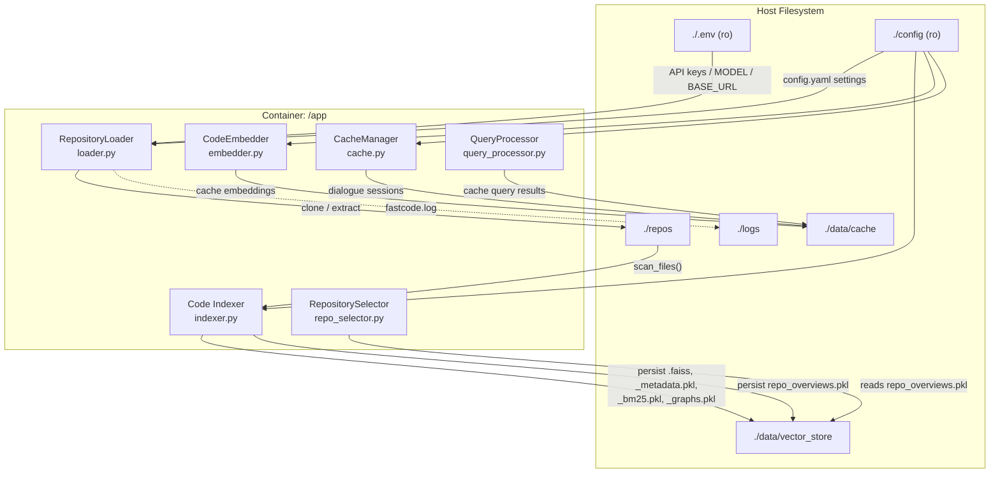
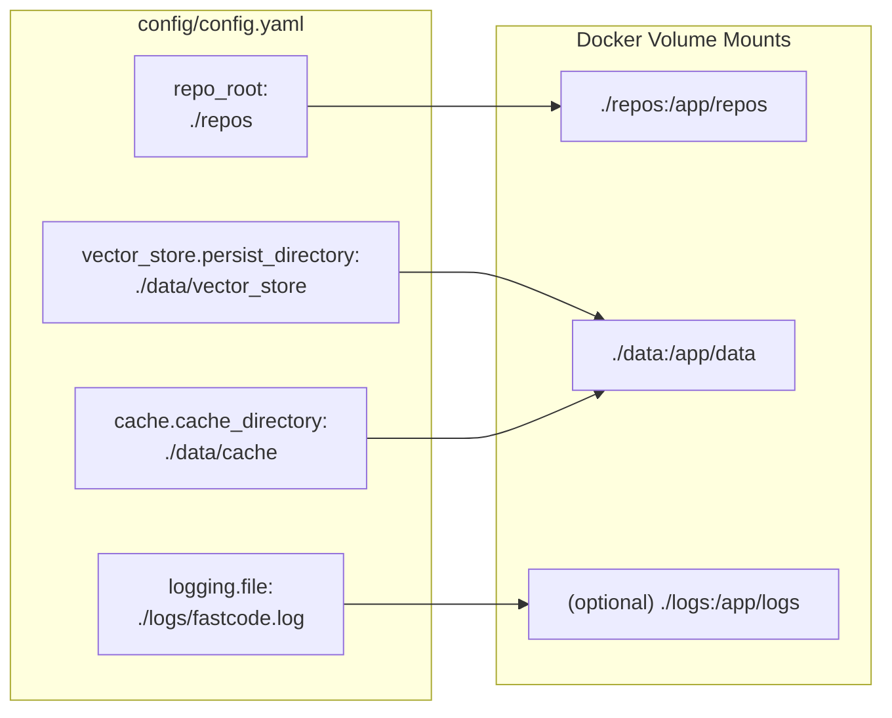

<!-- source: DeepWiki mcp.deepwiki.com · repo HKUDS/FastCode · page 7.3 Volume Management · fetched 2026-11-09 -->

# Volume Management

<details>
<summary>Relevant source files</summary>

The following files were used as context for generating this wiki page:

- [README.md](README.md)
- [config/config.yaml](config/config.yaml)
- [fastcode/embedder.py](fastcode/embedder.py)

</details>


This page covers persistent volume configuration for FastCode when running inside Docker or Docker Compose. It explains what data lives in each directory, which container paths to mount, and how volumes relate to the configurable directory settings in `config/config.yaml`.

For general Docker setup, see [7.1](#7.1). For the full Docker Compose service definition, see [7.2](#7.2). For cache backend selection (disk vs. Redis), see [9.1](#9.1).

---

## Persistent Data Overview

FastCode produces four categories of persistent data that must survive container restarts:

| Category | Default host path | Default container path | Config key |
|---|---|---|---|
| Repository source files | `./repos` | `/app/repos` | `repo_root` |
| Vector store index files | `./data/vector_store` | `/app/data/vector_store` | `vector_store.persist_directory` |
| Disk cache (embeddings, queries, sessions) | `./data/cache` | `/app/data/cache` | `cache.cache_directory` |
| Log files | `./logs` | `/app/logs` | `logging.file` |

The `.env` and `config/` files are also mounted, but read-only — they hold no runtime-generated state.

Sources: [README.md:841-867](), [config/config.yaml:1-207]()

---

## Volume Mount Configuration

The following mounts appear in the Docker Compose service definition for the `fastcode` container:

```yaml
volumes:
  - ./.env:/app/.env:ro
  - ./config:/app/config:ro
  - ./data:/app/data
  - ./repos:/app/repos
```

The `./data` mount covers both `vector_store` and `cache` subdirectories, since both are children of `./data` by default.

Sources: [README.md:847-851]()

---

## Directory Breakdown

### `./repos` — Repository Source Files

**Container path:** `/app/repos`  
**Config key:** `repo_root` ([config/config.yaml:6]())

This directory holds repository content that has been:
- Cloned from a Git URL via the `RepositoryLoader`
- Extracted from a ZIP archive upload
- Copied from a local path

When the `delete_source` flag is set to `true` in a delete-repos request, FastCode removes files from this directory. If `delete_source` is `false`, only the index artifacts are removed but the source files remain here.

The MCP tool `delete_repo_metadata` explicitly preserves this directory, removing only index files.

**Approximate size:** Varies entirely with the size of indexed repositories. No built-in size cap is enforced on this directory.

---

### `./data/vector_store` — Index Artifacts

**Container path:** `/app/data/vector_store`  
**Config key:** `vector_store.persist_directory` ([config/config.yaml:92]())

This directory contains all per-repository index artifacts. For each indexed repository, four files are written:

| File pattern | Contents |
|---|---|
| `<repo_name>.faiss` | FAISS vector index |
| `<repo_name>_metadata.pkl` | Code element metadata (file paths, line numbers, element types) |
| `<repo_name>_bm25.pkl` | BM25 keyword index |
| `<repo_name>_graphs.pkl` | Call, dependency, and inheritance graphs |

An additional shared file `repo_overviews.pkl` stores the LLM-generated summaries used for multi-repository selection. This file is updated whenever a new repository is indexed and is read by `RepositorySelector` during query time.

**Approximate size per repository:** Depends on codebase size, embedding dimension (384 for the default multilingual model), and number of indexed elements. Expect tens of MB per medium-sized repository.

Sources: [README.md:626-627](), [config/config.yaml:83-96]()

---

### `./data/cache` — Disk Cache

**Container path:** `/app/data/cache`  
**Config key:** `cache.cache_directory` ([config/config.yaml:192]())

When `cache.backend` is set to `"disk"` ([config/config.yaml:185]()), the `CacheManager` writes three categories of data here:

| Subcategory | Config flag | TTL |
|---|---|---|
| Embedding vectors | `cache.cache_embeddings: true` | `cache.ttl` (default 3600 s) |
| Query results | `cache.cache_queries: false` | `cache.ttl` |
| Dialogue session history | always stored | `cache.dialogue_ttl` (default 2592000 s = 30 days) |

The `cache.max_size_mb` setting (default 1000 MB) controls disk usage. When using Redis as the backend, this directory is not written to, but the volume can remain mounted without consequence.

Sources: [config/config.yaml:183-192]()

---

### `./logs` — Application Logs

**Container path:** `/app/logs`  
**Config key:** `logging.file` ([config/config.yaml:203]())

The default log file path is `./logs/fastcode.log`. This directory is not explicitly declared in the example Compose configuration from the README but can be added as a named or bind-mount volume if log persistence or forwarding is required.

---

## Data Flow Through Volumes

**Volume-to-component relationship diagram:**



Sources: [README.md:841-867](), [config/config.yaml:1-207]()

---

## Configuration Keys That Drive Volume Paths

**Mapping from config keys to filesystem paths:**



If `persist_directory` or `cache_directory` are changed to paths outside `./data`, the volume mount must be updated to match, or separate bind mounts must be declared for each subdirectory.

Sources: [config/config.yaml:6](), [config/config.yaml:92](), [config/config.yaml:192](), [config/config.yaml:203]()

---

## Index Artifact Lifecycle

```mermaid
stateDiagram-v2
    [*] --> "Not indexed"
    "Not indexed" --> "Indexed": "POST /api/index or /api/load-and-index\nWrites .faiss, _metadata.pkl,\n_bm25.pkl, _graphs.pkl"
    "Indexed" --> "Loaded in memory": "POST /api/load-repositories\nReads from persist_directory"
    "Loaded in memory" --> "Indexed": "Container restart\n(files remain on volume)"
    "Indexed" --> "Not indexed": "POST /api/delete-repos (delete_source=false)\nor MCP delete_repo_metadata\nRemoves .faiss, _metadata.pkl,\n_bm25.pkl, _graphs.pkl"
    "Indexed" --> "Not indexed (source removed)": "POST /api/delete-repos (delete_source=true)\nRemoves index files AND ./repos/<name>/"
```

Sources: [README.md:455-459](), [README.md:624-627]()

---

## Minimal Volume Declaration (Standalone Docker)

When running with plain `docker run` rather than Compose:

```bash
docker run -d \
  --env-file .env \
  -v "$(pwd)/repos:/app/repos" \
  -v "$(pwd)/data:/app/data" \
  -v "$(pwd)/config:/app/config:ro" \
  -p 5777:5777 \
  fastcode
```

The `config` mount is read-only. The `data` mount must be writable — it covers both `vector_store` and `cache`.

Sources: [README.md:843-851](), [config/config.yaml:83-96](), [config/config.yaml:183-192]()

---

## Backup Considerations

| Directory | Required for full recovery | Notes |
|---|---|---|
| `./repos` | Optional | Re-indexable from original source URL or re-upload |
| `./data/vector_store` | **Yes** | Losing this forces re-indexing of all repositories |
| `./data/cache` | No | Rebuilt automatically; losing it causes a cold-cache startup |
| `./logs` | No | Operational only |

The minimum backup set is `./data/vector_store`. This contains FAISS indices, BM25 indices, graph files, metadata, and repository overviews. Without it, all repositories must be re-indexed from scratch.

Dialogue session history stored under `./data/cache` has a `dialogue_ttl` of 30 days by default. If conversation continuity across incidents is important, include the cache directory in backups as well.

For Redis cache backend configuration, see [9.1](#9.1). When Redis is used, no session data is written to `./data/cache`, but `./data/vector_store` remains file-backed and still requires a volume mount.

Sources: [config/config.yaml:183-192](), [config/config.yaml:83-96]()

---

