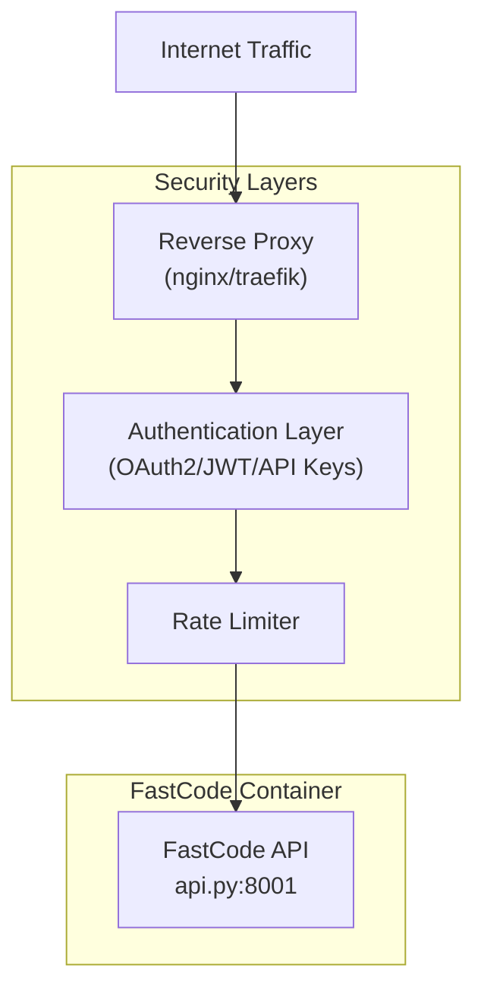
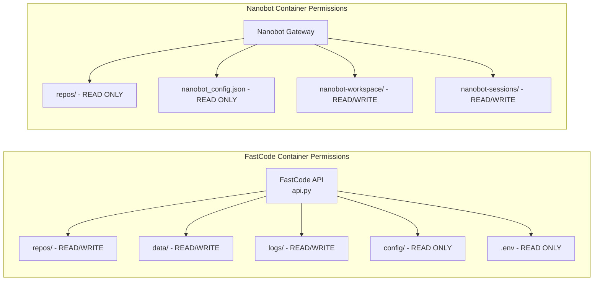
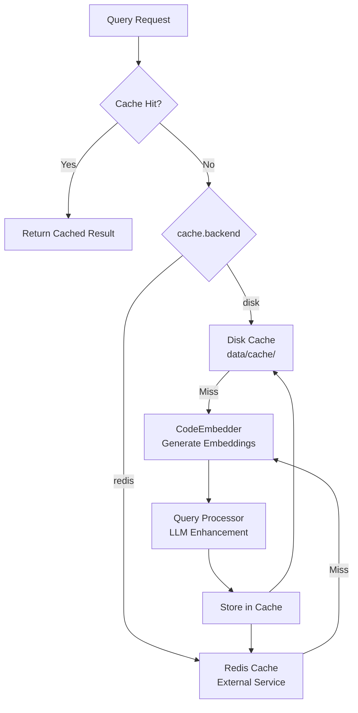
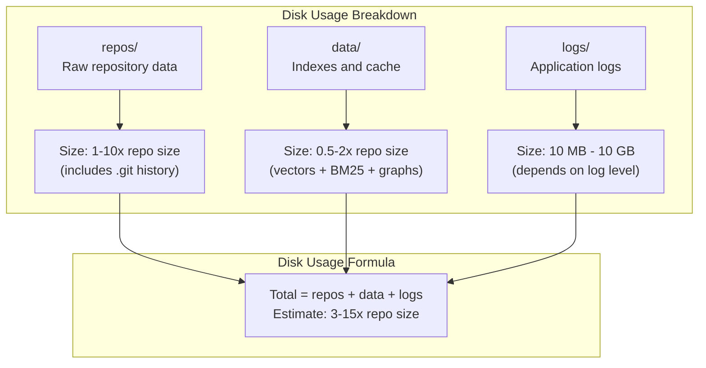
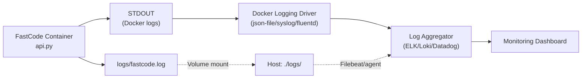
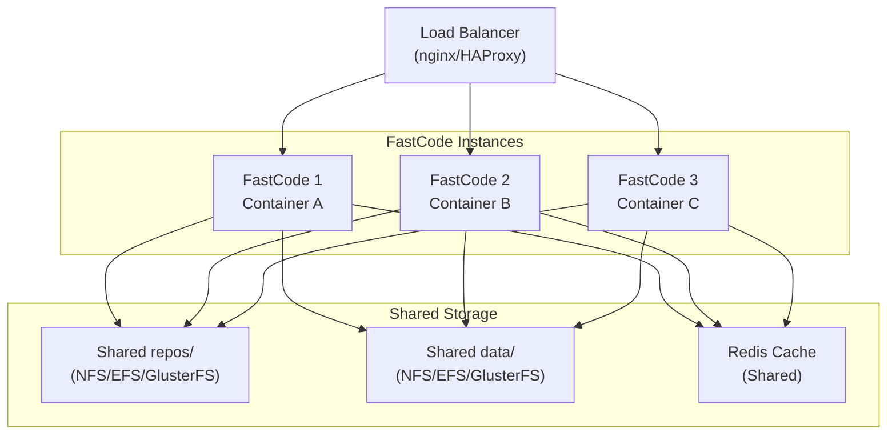

<!-- source: DeepWiki mcp.deepwiki.com · repo HKUDS/FastCode · page 7.4 Production Considerations · fetched 2026-11-09 -->

# Production Considerations

<details>
<summary>Relevant source files</summary>

The following files were used as context for generating this wiki page:

- [README.md](README.md)
- [config/config.yaml](config/config.yaml)
- [fastcode/cache.py](fastcode/cache.py)
- [fastcode/embedder.py](fastcode/embedder.py)

</details>


This document covers security, performance tuning, resource management, and operational best practices for deploying FastCode in production environments. It focuses on the operational aspects of running FastCode at scale, including monitoring, backup strategies, and configuration hardening.

For basic Docker deployment setup, see [Docker Deployment](#7.1). For docker-compose configuration, see [Docker Compose Setup](#7.2). For storage volume setup, see [Volume Management](#7.3).

---

## Security Hardening

### API Security

FastCode's REST API ([api.py]()) runs without built-in authentication by default. Production deployments should implement security layers:



**Recommended Security Measures:**

| Layer | Implementation | Configuration |
|-------|---------------|---------------|
| **Reverse Proxy** | nginx/Caddy/Traefik | HTTPS termination, request filtering |
| **Authentication** | OAuth2 proxy/JWT validation | Bearer token validation before forwarding |
| **Rate Limiting** | nginx limit_req/traefik middleware | Prevent abuse, e.g., 100 req/minute per IP |
| **Network Isolation** | Docker networks | Internal-only communication between services |
| **Secret Management** | Docker secrets/Vault | Never commit `.env` files to git |

**Sources:** [docker-compose.yml:10-56](), [Dockerfile:32-38]()

---

### Environment Variable Protection

The `.env` file contains sensitive API keys. In production:

1. **Mount as read-only**: [docker-compose.yml:20]() shows `.env:/app/.env:ro`
2. **Use secrets management**: Replace file mounting with Docker secrets or external secret stores
3. **Restrict file permissions**: `chmod 600 .env` on host system
4. **Rotate keys regularly**: Especially `OPENAI_API_KEY` values

**Critical Environment Variables:**

| Variable | Purpose | Security Risk |
|----------|---------|---------------|
| `OPENAI_API_KEY` | OpenAI API authentication | **HIGH** - API cost abuse |
| `MODEL` | LLM model selection | Medium - determines costs |
| `BASE_URL` | LLM provider endpoint | Low - but can redirect traffic |
| `NANOBOT_MODEL` | Nanobot's LLM model | Medium - affects bot behavior |

**Sources:** [docker-compose.yml:20](), [config/config.yaml:143-151]()

---

### File System Access Controls

FastCode has read/write access to multiple directories. Minimize attack surface:



**Directory Security:**

| Directory | Purpose | FastCode Access | Nanobot Access | Production Recommendation |
|-----------|---------|-----------------|----------------|--------------------------|
| `repos/` | Repository storage | RW | RO | Limit size quotas, scan for malicious code |
| `data/` | Vector indexes, cache | RW | None | Regular backups, monitor disk usage |
| `logs/` | Application logs | RW | None | Log rotation, centralized logging |
| `config/` | Configuration files | RO | None | Version-controlled, immutable in runtime |
| `.env` | API secrets | RO | None | Mount as Docker secret, not file |

**Sources:** [docker-compose.yml:19-26](), [docker-compose.yml:42-49](), [config/config.yaml:6]()

---

## Performance Tuning

### Resource Allocation

FastCode's performance depends heavily on available CPU, memory, and I/O resources:

**CPU and Memory Requirements:**

| Workload | CPU Cores | Memory | Justification |
|----------|-----------|--------|---------------|
| **Minimal** | 2 cores | 4 GB | Small repos (<1000 files), CPU embeddings |
| **Standard** | 4 cores | 8 GB | Medium repos (<10k files), FAISS indexing |
| **High Volume** | 8+ cores | 16+ GB | Large repos (>10k files), concurrent queries |
| **GPU Accelerated** | 4+ cores + GPU | 8+ GB | `embedding.device: "cuda"` for faster embeddings |

**Docker Resource Limits:**

```yaml
# Add to docker-compose.yml services.fastcode
deploy:
  resources:
    limits:
      cpus: '4'
      memory: 8G
    reservations:
      cpus: '2'
      memory: 4G
```

**Sources:** [config/config.yaml:63](), [docker-compose.yml:11-30]()

---

### Embedding Model Selection

The embedding model significantly impacts startup time and memory:

| Model | Size | Language Support | Memory | Startup Time | Quality |
|-------|------|-----------------|--------|--------------|---------|
| `paraphrase-multilingual-MiniLM-L12-v2` | 470 MB | Multilingual (50+ languages) | ~1.5 GB | ~30s | **High** |
| `all-MiniLM-L6-v2` | 90 MB | English only | ~500 MB | ~10s | Medium |
| `BAAI/bge-large-en-v1.5` | ~1.3 GB | English only | ~4 GB | ~60s | **Highest** |

**Model Download Strategy:**

The Dockerfile pre-downloads the model during image build ([Dockerfile:19-21]()):

```dockerfile
# Pre-download the embedding model BEFORE copying app code
# so that code changes don't invalidate this ~470MB cached layer
RUN python -c "from sentence_transformers import SentenceTransformer; SentenceTransformer('sentence-transformers/paraphrase-multilingual-MiniLM-L12-v2')"
```

**Production Recommendations:**
- Use multilingual model if supporting non-English codebases
- Use `all-MiniLM-L6-v2` for English-only codebases to save memory
- GPU acceleration (`cuda` device) reduces embedding time by 5-10x

**Sources:** [config/config.yaml:59-66](), [Dockerfile:19-21]()

---

### Caching Strategy

FastCode supports disk-based and Redis caching. Production deployments should optimize cache configuration:



**Cache Configuration Matrix:**

| Setting | Development | Production (Single Node) | Production (Multi Node) |
|---------|-------------|--------------------------|-------------------------|
| `cache.enabled` | `true` | `true` | `true` |
| `cache.backend` | `disk` | `disk` | `redis` |
| `cache.ttl` | `3600` (1 hour) | `86400` (24 hours) | `86400` (24 hours) |
| `cache.dialogue_ttl` | `2592000` (30 days) | `7776000` (90 days) | `7776000` (90 days) |
| `cache.max_size_mb` | `1000` | `10000` (10 GB) | Unlimited (Redis) |
| `cache.cache_embeddings` | `true` | `true` | `true` |
| `cache.cache_queries` | `false` | `true` | `true` |

**Disk Cache Considerations:**
- Location: [config/config.yaml:191]() sets `cache_directory: "./data/cache"`
- Size limit enforced by `max_size_mb` setting
- LRU eviction when limit reached
- Persists across container restarts when using volumes

**Redis Cache Considerations:**
- Requires external Redis service (not included in docker-compose)
- No size limits by default
- Shared across multiple FastCode instances
- Requires connection configuration (host, port, password)

**Sources:** [config/config.yaml:182-192]()

---

### Vector Store Optimization

FAISS index performance depends on configuration:

**HNSW Index Parameters:**

| Parameter | Config Key | Development | Production | Trade-off |
|-----------|-----------|-------------|------------|-----------|
| **ef_construction** | `vector_store.ef_construction` | `200` | `400-600` | Build time vs search quality |
| **ef_search** | `vector_store.ef_search` | `50` | `100-200` | Search time vs recall |
| **M** | `vector_store.m` | `16` | `32-48` | Memory usage vs search speed |

**Index Type Selection:**

| Index Type | Use Case | Search Speed | Memory | Build Time |
|-----------|----------|--------------|--------|-----------|
| `HNSW` | **Production default** | Very Fast | High | Medium |
| `Flat` | Small repos (<5k elements) | Slow | Low | Instant |
| `IVF` | Large repos (>100k elements) | Fast | Medium | Long |

**Production Recommendation:**
- Use HNSW with higher `ef_construction` (400-600) for better recall
- Increase `ef_search` (100-200) for critical queries
- Monitor index size in `data/vector_store/` directory

**Sources:** [config/config.yaml:82-96]()

---

### Query Performance Optimization

Several configuration options impact query latency:

**Performance vs Accuracy Trade-offs:**

| Feature | Config Key | Performance Impact | Accuracy Impact | Production Setting |
|---------|-----------|-------------------|-----------------|-------------------|
| **LLM Enhancement** | `query.llm_enhancement_mode` | High latency | High accuracy | `"adaptive"` |
| **Agency Mode** | `retrieval.enable_agency_mode` | 2-4x latency | 20-30% accuracy gain | `true` (critical queries) |
| **Max Iterations** | `agent.iterative.max_iterations` | Linear scaling | Diminishing returns | `3-4` |
| **Two-Stage Retrieval** | `retrieval.enable_two_stage_retrieval` | +0.5s latency | Better multi-repo | `true` |
| **Graph Traversal** | `graph.build_call_graph` | +10-20% indexing | Better context | `true` |

**LLM Enhancement Modes:**

| Mode | Behavior | Use Case | Expected Latency |
|------|----------|----------|------------------|
| `"always"` | Use LLM for every query | Maximum accuracy | 1-3s per query |
| `"adaptive"` | LLM only for complex queries | **Recommended** | 0.5-2s per query |
| `"off"` | No LLM enhancement | High throughput | 0.1-0.5s per query |

**Sources:** [config/config.yaml:122-140](), [config/config.yaml:169-180](), [config/config.yaml:98-120]()

---

## Resource Management

### Disk Space Planning

FastCode writes to three main directories. Plan capacity accordingly:



**Storage Requirements Table:**

| Repository Size | repos/ Volume | data/ Volume | logs/ Volume | Total |
|----------------|---------------|--------------|--------------|-------|
| 100 MB | 500 MB | 200 MB | 100 MB | ~800 MB |
| 1 GB | 5 GB | 2 GB | 500 MB | ~7.5 GB |
| 10 GB | 50 GB | 20 GB | 2 GB | ~72 GB |
| 100 GB | 500 GB | 200 GB | 10 GB | ~710 GB |

**Volume Cleanup Strategies:**

| Directory | Cleanup Method | Automation |
|-----------|---------------|------------|
| `repos/` | Delete unused repositories via API DELETE `/repositories/{name}` | Manual or scheduled job |
| `data/vector_store/` | Removed automatically when repository deleted | Automatic |
| `data/cache/` | LRU eviction based on `cache.max_size_mb` | Automatic |
| `logs/` | Log rotation (daily/weekly) | Configure in [config/config.yaml:201-206]() |

**Sources:** [config/config.yaml:6](), [config/config.yaml:92](), [config/config.yaml:191](), [docker-compose.yml:23-26]()

---

### Memory Management

FastCode's memory usage scales with repository size and configuration:

**Memory Components:**

| Component | Typical Size | Configuration Impact |
|-----------|-------------|---------------------|
| **Python Runtime** | 200-500 MB | Base overhead |
| **Embedding Model** | 500 MB - 4 GB | Model choice [config/config.yaml:60]() |
| **FAISS Index** | 10-50 MB per 10k elements | Index type, dimensionality |
| **BM25 Index** | 5-20 MB per 10k docs | Vocabulary size |
| **Code Graphs** | 50-200 MB per large repo | Graph complexity |
| **Query Context** | 10-100 MB per query | `max_context_tokens` setting |
| **Cache (in-memory)** | 0-2 GB | Disk cache preferred |

**Memory Leak Prevention:**

1. **Enable garbage collection monitoring**: Add `PYTHONMALLOC=debug` to environment
2. **Use disk cache instead of Redis**: Redis client maintains connections
3. **Limit concurrent queries**: Implement queue at reverse proxy level
4. **Monitor with health checks**: Add memory metrics to `/health` endpoint

**Sources:** [Dockerfile:35-36](), [config/config.yaml:59-66](), [config/config.yaml:149-151]()

---

### Network Bandwidth

Multi-node deployments should consider network costs:

**Network Traffic Patterns:**

| Traffic Type | Volume per Query | Optimization |
|-------------|------------------|--------------|
| **LLM API (OpenAI)** | 10-200 KB request, 5-50 KB response | Use `max_context_tokens` limit |
| **Redis Cache (if enabled)** | 5-100 KB per cache operation | Enable compression |
| **Nanobot ↔ FastCode** | 5-20 KB per query | Internal Docker network |
| **Vector Store I/O** | 1-50 MB per index load | Use `persist_directory` on fast SSD |

**Sources:** [config/config.yaml:149-151](), [docker-compose.yml:50-53]()

---

## Monitoring and Observability

### Logging Configuration

FastCode uses Python's logging module. Production deployments should centralize logs:

**Log Levels by Environment:**

| Environment | Log Level | File Output | Console Output | Centralized |
|-------------|-----------|-------------|----------------|-------------|
| Development | `DEBUG` | Yes | Yes | No |
| Staging | `INFO` | Yes | Yes | Optional |
| Production | `WARNING` | Yes | No | **Required** |

**Log Aggregation Architecture:**



**Critical Log Events to Monitor:**

| Event | Log Pattern | Severity | Action |
|-------|------------|----------|--------|
| **Repository indexing failure** | `ERROR - RepositoryLoader` | High | Check disk space, file permissions |
| **LLM API failures** | `ERROR - AnswerGenerator` | Critical | Check API keys, quotas, network |
| **Vector store corruption** | `ERROR - VectorStore` | Critical | Restore from backup, rebuild index |
| **Out of memory** | `MemoryError` | Critical | Increase container limits, reduce batch size |
| **Query timeouts** | `timeout exceeded` | Medium | Optimize query, increase timeout |

**Sources:** [config/config.yaml:201-206](), [docker-compose.yml:27-29](), [Dockerfile:35]()

---

### Health Checks

Implement container health checks in production:

```yaml
# Add to docker-compose.yml services.fastcode
healthcheck:
  test: ["CMD", "curl", "-f", "http://localhost:8001/health"]
  interval: 30s
  timeout: 10s
  retries: 3
  start_period: 60s
```

**Health Check Endpoints:**

| Endpoint | Purpose | Expected Response |
|----------|---------|------------------|
| `/health` | Basic liveness | `{"status": "ok"}` |
| `/status` | Detailed system status | Repo count, cache stats, model info |

**Sources:** [Dockerfile:32]()

---

### Metrics Collection

Key metrics to track for production FastCode deployments:

**System Metrics:**

| Metric | Type | Collection Method | Alert Threshold |
|--------|------|------------------|-----------------|
| **CPU usage** | Gauge | Docker stats API | >80% sustained |
| **Memory usage** | Gauge | Docker stats API | >90% of limit |
| **Disk usage** | Gauge | Host monitoring | >85% of volume |
| **Network I/O** | Counter | Docker stats API | Baseline + 3σ |

**Application Metrics:**

| Metric | Type | Source | Business Impact |
|--------|------|--------|-----------------|
| **Queries per minute** | Counter | API access logs | Capacity planning |
| **Query latency (p50, p95, p99)** | Histogram | API timing | User experience |
| **LLM API cost** | Counter | Token usage logs | Budget management |
| **Cache hit rate** | Gauge | Cache statistics | Performance optimization |
| **Indexing failures** | Counter | Repository loader logs | Data availability |
| **Active sessions** | Gauge | Session manager | Concurrency limits |

**Sources:** [docker-compose.yml:11-30]()

---

## High Availability and Scaling

### Horizontal Scaling

FastCode can be scaled horizontally for read-heavy workloads:



**Scaling Constraints:**

| Operation | Scalability | Requirement | Notes |
|-----------|------------|-------------|-------|
| **Query (read)** | ✅ Horizontal | Shared storage + Redis cache | Read replicas work well |
| **Indexing (write)** | ⚠️ Limited | Distributed locking | One indexer per repository |
| **Repository upload** | ⚠️ Limited | Shared storage with locking | Serialize per repository |
| **Cache updates** | ✅ Horizontal | Redis backend | Automatic coordination |

**Production Recommendations:**
1. Use Redis cache for multi-instance deployments ([config/config.yaml:185]())
2. Mount `repos/` and `data/` on shared network storage
3. Implement distributed locking for write operations (not included)
4. Use sticky sessions for multi-turn dialogues

**Sources:** [config/config.yaml:182-192](), [docker-compose.yml:23-26]()

---

### Disaster Recovery

**Backup Strategy:**

| Asset | Backup Frequency | Backup Method | Recovery Time Objective |
|-------|-----------------|---------------|------------------------|
| **repos/ (source code)** | Not needed | Re-clone from git | Minutes |
| **data/vector_store/ (indexes)** | Daily | Snapshot volume | Hours (rebuild alternative) |
| **data/cache/** | Not needed | Regenerate on demand | N/A |
| **logs/** | Continuous | Ship to log aggregator | N/A |
| **config/config.yaml** | On change | Git version control | Seconds |
| **.env (secrets)** | Manual secure backup | Encrypted backup | Minutes |

**Recovery Procedures:**

1. **Total Loss**: Restore `.env`, `config.yaml`, redeploy containers, re-index repositories
2. **Index Corruption**: Delete `data/vector_store/`, trigger re-index via API
3. **Cache Corruption**: Delete `data/cache/`, system regenerates automatically
4. **Container Failure**: Docker restart policy handles automatically ([docker-compose.yml:30]())

**Sources:** [docker-compose.yml:23-26](), [config/config.yaml:92]()

---

## Operational Best Practices

### Configuration Management

**Version Control Strategy:**

| File | Version Control | Environment-Specific | Deployment |
|------|----------------|---------------------|------------|
| `config/config.yaml` | ✅ Git | No (use single config) | Baked into image |
| `.env` | ❌ Never commit | Yes (per environment) | Mount at runtime |
| `docker-compose.yml` | ✅ Git | Yes (use overlrides) | Deploy-time |
| `nanobot_config.json` | ❌ Secrets only | Yes (per environment) | Mount at runtime |

**Multi-Environment Configuration:**

```bash
# Development
docker compose -f docker-compose.yml up

# Staging
docker compose -f docker-compose.yml -f docker-compose.staging.yml up

# Production
docker compose -f docker-compose.yml -f docker-compose.prod.yml up
```

**Sources:** [docker-compose.yml:1-61](), [config/config.yaml:1-207]()

---

### Deployment Checklist

**Pre-Deployment:**

- [ ] Review and update `config/config.yaml` for production values
- [ ] Create production `.env` with API keys
- [ ] Set up log aggregation (ELK/Loki/Datadog)
- [ ] Configure reverse proxy with HTTPS
- [ ] Set up monitoring and alerting
- [ ] Test backup and restore procedures
- [ ] Document runbooks for common incidents

**Deployment:**

- [ ] Pull latest Docker images or build from source
- [ ] Create persistent volumes: `repos/`, `data/`, `logs/`
- [ ] Mount `.env` as read-only secret
- [ ] Configure resource limits in docker-compose
- [ ] Enable health checks
- [ ] Start services: `docker compose up -d`
- [ ] Verify health: `curl http://localhost:8001/health`
- [ ] Load initial repositories via API

**Post-Deployment:**

- [ ] Monitor logs for errors: `docker compose logs -f`
- [ ] Verify metrics collection
- [ ] Test query performance
- [ ] Validate backup jobs running
- [ ] Update documentation with deployed version

**Sources:** [docker-compose.yml:1-61](), [Dockerfile:1-39]()

---

### Upgrade Procedures

**Zero-Downtime Upgrade (with Load Balancer):**

1. Deploy new version to 50% of instances
2. Verify health checks pass
3. Gradually shift traffic to new version
4. Monitor error rates and latency
5. Deploy to remaining instances
6. Complete rollout

**Standard Upgrade (Single Instance):**

1. Create backup of `data/` directory
2. Stop container: `docker compose down`
3. Pull new image: `docker compose pull`
4. Update `config/config.yaml` if needed
5. Start container: `docker compose up -d`
6. Verify health: `curl http://localhost:8001/health`
7. Test critical queries
8. Monitor logs for errors

**Rollback Procedure:**

```bash
# Stop current version
docker compose down

# Restore previous image version
docker tag fastcode:previous fastcode:latest

# Restore previous config
git checkout HEAD~1 config/config.yaml

# Restart
docker compose up -d
```

**Sources:** [docker-compose.yml:11-30]()

---

### Incident Response

**Common Production Issues:**

| Incident | Symptoms | Root Cause | Resolution |
|----------|----------|------------|------------|
| **High latency** | Queries >10s | LLM API throttling | Check API quotas, reduce `max_tokens` |
| **Out of memory** | Container OOM killed | Large batch processing | Reduce `embedding.batch_size` [config/config.yaml:64]() |
| **Disk full** | Write errors, failed indexing | No log rotation | Clean `logs/`, enable rotation |
| **Cache corruption** | Inconsistent results | Dirty shutdown | Delete `data/cache/`, restart |
| **Index corruption** | Query failures | Interrupted indexing | Delete `data/vector_store/`, re-index |

**Runbook Template:**

1. **Detection**: How the issue was identified (alert, user report)
2. **Initial Assessment**: Check logs, metrics, resource usage
3. **Immediate Mitigation**: Stop additional damage
4. **Root Cause Analysis**: Investigate underlying cause
5. **Resolution**: Apply fix, verify resolution
6. **Prevention**: Update configuration, add monitoring

**Sources:** [config/config.yaml:64](), [config/config.yaml:201-206]()

---

### Cost Optimization

**LLM API Cost Management:**

| Strategy | Configuration | Savings Potential | Trade-off |
|----------|--------------|------------------|-----------|
| **Use local models** | `provider: "local"`, `model: "ollama"` | 100% API costs | Requires GPU, slower |
| **Reduce max_tokens** | `generation.max_tokens: 10000` | 50% per query | Less detailed answers |
| **Cache queries** | `cache.cache_queries: true` | 80% for repeat queries | Storage cost |
| **Adaptive LLM enhancement** | `query.llm_enhancement_mode: "adaptive"` | 50-70% on simple queries | Slight accuracy reduction |
| **Limit agency iterations** | `agent.iterative.max_iterations: 2` | 50% on complex queries | Lower confidence |

**Cost Monitoring:**

Track token usage by parsing logs for LLM API calls:
- Request tokens: Context sent to LLM
- Response tokens: Generated answer
- Total cost: `(request_tokens * input_price + response_tokens * output_price) / 1000`

**Production Cost Baseline:**

| Deployment Size | Queries/Day | Est. Monthly LLM Cost | Notes |
|----------------|-------------|----------------------|-------|
| Small (10 users) | 100 | $50-100 | Mostly cached, adaptive mode |
| Medium (100 users) | 1,000 | $500-1,000 | Mixed queries, agency enabled |
| Large (1,000 users) | 10,000 | $5,000-10,000 | Requires caching optimization |

**Sources:** [config/config.yaml:143-161](), [config/config.yaml:169-180]()

---

## Summary

Production deployments of FastCode require careful attention to:

1. **Security**: API authentication, secret management, network isolation
2. **Performance**: Resource allocation, cache configuration, query optimization
3. **Reliability**: Health checks, monitoring, backup strategies
4. **Scalability**: Horizontal scaling with shared storage, Redis cache
5. **Operations**: Configuration management, deployment procedures, incident response
6. **Cost**: LLM API optimization, caching strategies, token budgets

Key files to review:
- [docker-compose.yml:1-61]() - Service orchestration and volumes
- [config/config.yaml:1-207]() - All tunable parameters
- [Dockerfile:1-39]() - Container configuration

For further details on specific configuration options, see section [8 (Configuration)](#8).

**Sources:** [docker-compose.yml:1-61](), [config/config.yaml:1-207](), [Dockerfile:1-39]()

---

