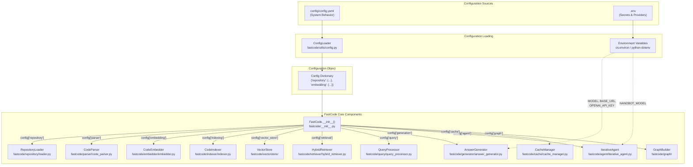
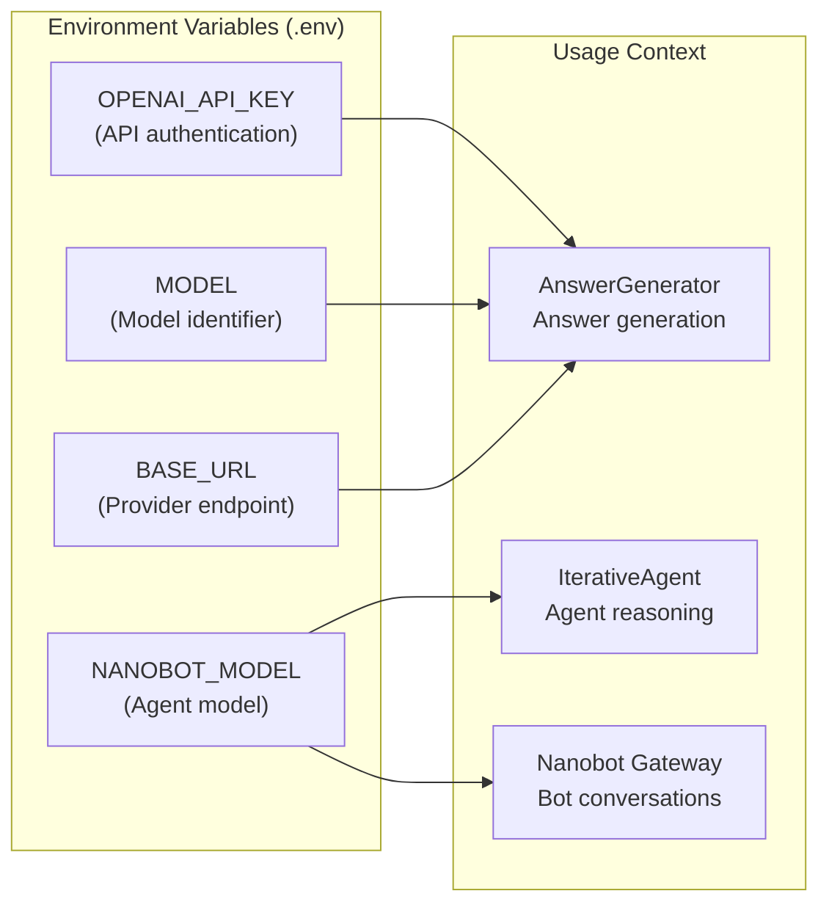
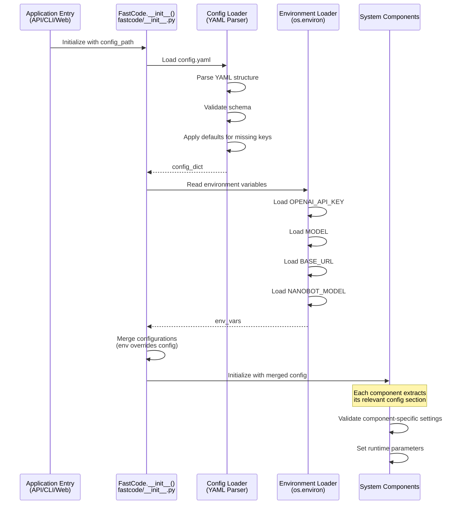

<!-- source: DeepWiki mcp.deepwiki.com · repo HKUDS/FastCode · page 8 Configuration · fetched 2026-11-09 -->

# Configuration

<details>
<summary>Relevant source files</summary>

The following files were used as context for generating this wiki page:

- [config/config.yaml](config/config.yaml)
- [fastcode/embedder.py](fastcode/embedder.py)

</details>


## Purpose and Scope

This page describes the FastCode configuration system, including configuration file structure, environment variables, configuration loading, and how settings affect system behavior. For detailed reference of each configuration category, see the child pages ([8.1](#8.1) through [8.11](#8.11)).

For LLM provider setup and API key configuration, see [Environment Configuration](#2.2). For deployment-specific configuration, see [Docker Deployment](#7.1) and [Docker Compose Setup](#7.2).

---

## Configuration System Overview

FastCode uses a dual-configuration approach combining a YAML configuration file for system behavior and environment variables for runtime secrets and provider settings.

**Configuration Sources:**

| Source | Purpose | Location | Scope |
|--------|---------|----------|-------|
| `config.yaml` | System behavior, algorithm parameters, feature flags | `config/config.yaml` | All system components |
| `.env` | API keys, model selection, provider URLs | `.env` (project root) | LLM providers and external services |

**Configuration Architecture:**



Sources: [config/config.yaml:1-207](), [env.example:1-18]()

---

## Configuration File Structure

The `config.yaml` file is organized into 11 logical sections, each controlling a specific subsystem:

```mermaid
graph TB
    ConfigRoot["config.yaml<br/>Root Configuration"]
    
    ConfigRoot --> RepoRoot["repo_root: ./repos<br/>(Optional base path)"]
    
    ConfigRoot --> RepositoryConfig["repository:<br/>Repository Settings"]
    ConfigRoot --> ParserConfig["parser:<br/>Parser Settings"]
    ConfigRoot --> EmbeddingConfig["embedding:<br/>Embedding Settings"]
    ConfigRoot --> IndexingConfig["indexing:<br/>Indexing Settings"]
    ConfigRoot --> VectorStoreConfig["vector_store:<br/>Vector Store Settings"]
    ConfigRoot --> RetrievalConfig["retrieval:<br/>Retrieval Settings"]
    ConfigRoot --> QueryConfig["query:<br/>Query Processing"]
    ConfigRoot --> GenerationConfig["generation:<br/>Answer Generation"]
    ConfigRoot --> GraphConfig["graph:<br/>Graph Building"]
    ConfigRoot --> AgentConfig["agent:<br/>Agent Settings"]
    ConfigRoot --> CacheConfig["cache:<br/>Caching"]
    ConfigRoot --> EvaluationConfig["evaluation:<br/>Evaluation Mode"]
    ConfigRoot --> LoggingConfig["logging:<br/>Logging"]
    
    RepositoryConfig -->|"Configures"| RepoLoaderClass["RepositoryLoader"]
    ParserConfig -->|"Configures"| CodeParserClass["CodeParser"]
    EmbeddingConfig -->|"Configures"| CodeEmbedderClass["CodeEmbedder"]
    IndexingConfig -->|"Configures"| CodeIndexerClass["CodeIndexer"]
    VectorStoreConfig -->|"Configures"| VectorStoreClass["VectorStore<br/>(FAISS/ChromaDB/Qdrant)"]
    RetrievalConfig -->|"Configures"| HybridRetrieverClass["HybridRetriever"]
    QueryConfig -->|"Configures"| QueryProcessorClass["QueryProcessor"]
    GenerationConfig -->|"Configures"| AnswerGeneratorClass["AnswerGenerator"]
    GraphConfig -->|"Configures"| GraphBuilderClass["GraphBuilder"]
    AgentConfig -->|"Configures"| IterativeAgentClass["IterativeAgent"]
    CacheConfig -->|"Configures"| CacheManagerClass["CacheManager"]
```



Sources: [config/config.yaml:1-207]()

---

## Configuration Categories

### Overview Table

| Category | Lines | Purpose | Key Settings |
|----------|-------|---------|--------------|
| **repository** | [9-48]() | Repository loading, file filtering | `clone_depth`, `max_file_size_mb`, `ignore_patterns`, `supported_extensions` |
| **parser** | [51-56]() | AST parsing behavior | `extract_docstrings`, `extract_comments`, `extract_imports`, `compute_complexity` |
| **embedding** | [59-66]() | Semantic embedding generation | `model`, `device`, `batch_size`, `max_seq_length` |
| **indexing** | [69-80]() | Multi-level code indexing | `levels`, `include_imports`, `include_class_context`, `generate_repo_overview` |
| **vector_store** | [83-96]() | Vector database configuration | `type`, `distance_metric`, `index_type`, `persist_directory` |
| **retrieval** | [99-120]() | Hybrid search and retrieval | `semantic_weight`, `keyword_weight`, `graph_weight`, `enable_agency_mode` |
| **query** | [123-141]() | Query processing and enhancement | `expand_query`, `llm_enhancement_mode`, `history_summary_rounds` |
| **generation** | [144-161]() | LLM answer generation | `provider`, `temperature`, `max_tokens`, `max_context_tokens` |
| **graph** | [163-167]() | Code graph construction | `build_call_graph`, `build_dependency_graph`, `build_inheritance_graph` |
| **agent** | [170-180]() | Iterative agent behavior | `max_iterations`, `confidence_threshold`, `max_total_lines` |
| **cache** | [183-191]() | Caching system | `backend`, `ttl`, `dialogue_ttl`, `cache_directory` |
| **evaluation** | [194-199]() | Benchmark/evaluation mode | `in_memory_index`, `disable_cache`, `force_reindex` |
| **logging** | [202-206]() | Logging configuration | `level`, `format`, `file` |

Sources: [config/config.yaml:1-207]()

---

## Environment Variables

Environment variables provide runtime configuration for API keys, model selection, and provider endpoints. These are typically stored in a `.env` file in the project root.

**Environment Variable Structure:**



**Standard Environment Variables:**

| Variable | Purpose | Example Values |
|----------|---------|----------------|
| `OPENAI_API_KEY` | API authentication key | OpenAI key, `"ollama"` for local |
| `MODEL` | LLM model identifier | `gpt-4`, `google/gemini-3-flash-preview`, `qwen3-coder-30b_fastcode` |
| `BASE_URL` | Provider API endpoint | `https://openrouter.ai/api/v1`, `http://localhost:11434/v1` |
| `NANOBOT_MODEL` | Agent/bot model | `minimax/minimax-m2.1` |

**Provider Configuration Examples:**

```yaml
# OpenAI
OPENAI_API_KEY=sk-...
MODEL=gpt-4
BASE_URL=https://api.openai.com/v1

# OpenRouter (Gemini)
OPENAI_API_KEY=sk-or-v1-...
MODEL=google/gemini-3-flash-preview
BASE_URL=https://openrouter.ai/api/v1

# Local Ollama
OPENAI_API_KEY=ollama
MODEL=qwen3-coder-30b_fastcode
BASE_URL=http://localhost:11434/v1
```

Sources: [env.example:1-18]()

---

## Configuration Loading Process

FastCode loads configuration through a multi-stage process that merges defaults, file configuration, and environment overrides.

**Configuration Loading Sequence:**



**Configuration Priority:**

1. **Environment Variables** (highest priority) - Override all other settings
2. **config.yaml** - Explicit configuration values
3. **Component Defaults** (lowest priority) - Hardcoded fallback values

Sources: [config/config.yaml:1-207](), [env.example:1-18]()

---

## Configuration to Component Mapping

The following diagram maps each configuration section to the specific FastCode components it configures:

**Component Configuration Dependencies:**

```mermaid
graph TB
    subgraph "Configuration Sections"
        RepoCfg["repository<br/>Lines 9-48"]
        ParserCfg["parser<br/>Lines 51-56"]
        EmbedCfg["embedding<br/>Lines 59-66"]
        IndexCfg["indexing<br/>Lines 69-80"]
        VectorCfg["vector_store<br/>Lines 83-96"]
        RetrievalCfg["retrieval<br/>Lines 99-120"]
        QueryCfg["query<br/>Lines 123-141"]
        GenCfg["generation<br/>Lines 144-161"]
        GraphCfg["graph<br/>Lines 163-167"]
        AgentCfg["agent<br/>Lines 170-180"]
        CacheCfg["cache<br/>Lines 183-191"]
    end
    
    subgraph "Code Components"
        RL["RepositoryLoader<br/>fastcode/repository/loader.py"]
        CP["CodeParser<br/>fastcode/parser/code_parser.py"]
        CE["CodeEmbedder<br/>fastcode/embedder/embedder.py"]
        CI["CodeIndexer<br/>fastcode/indexer/indexer.py"]
        VS["VectorStore<br/>fastcode/vectorstore/"]
        HR["HybridRetriever<br/>fastcode/retriever/hybrid_retriever.py"]
        QP["QueryProcessor<br/>fastcode/query/query_processor.py"]
        AG["AnswerGenerator<br/>fastcode/generator/answer_generator.py"]
        GB["GraphBuilder<br/>fastcode/graph/"]
        IA["IterativeAgent<br/>fastcode/agent/iterative_agent.py"]
        CM["CacheManager<br/>fastcode/cache/cache_manager.py"]
        RS["RepositorySelector<br/>fastcode/repository/selector.py"]
    end
    
    RepoCfg -->|"clone_depth<br/>max_file_size_mb<br/>ignore_patterns<br/>supported_extensions"| RL
    
    ParserCfg -->|"extract_docstrings<br/>extract_comments<br/>extract_imports<br/>compute_complexity"| CP
    
    EmbedCfg -->|"model<br/>device<br/>batch_size<br/>max_seq_length"| CE
    
    IndexCfg -->|"levels<br/>include_imports<br/>include_class_context<br/>generate_repo_overview"| CI
    
    VectorCfg -->|"type<br/>distance_metric<br/>index_type<br/>persist_directory"| VS
    
    RetrievalCfg -->|"semantic_weight<br/>keyword_weight<br/>graph_weight<br/>enable_agency_mode"| HR
    RetrievalCfg -->|"enable_two_stage_retrieval<br/>repo_selection_method<br/>top_repos_to_search"| RS
    
    QueryCfg -->|"expand_query<br/>llm_enhancement_mode<br/>history_summary_rounds"| QP
    
    GenCfg -->|"temperature<br/>max_tokens<br/>max_context_tokens"| AG
    
    GraphCfg -->|"build_call_graph<br/>build_dependency_graph<br/>build_inheritance_graph"| GB
    
    AgentCfg -->|"max_iterations<br/>confidence_threshold<br/>max_total_lines"| IA
    
    CacheCfg -->|"backend<br/>ttl<br/>dialogue_ttl<br/>cache_directory"| CM
```



Sources: [config/config.yaml:1-207]()

---

## Key Configuration Patterns

### Multi-Level Settings

Many configuration sections use hierarchical organization for related settings:

```yaml
# Example: Agent iterative configuration
agent:
  iterative:
    max_iterations: 4
    confidence_threshold: 95
    min_confidence_gain: 5
    max_total_lines: 12000
```

**Access Pattern:** Components access nested settings via dictionary keys:
```python
max_iter = config['agent']['iterative']['max_iterations']
```

### Weight-Based Configuration

Retrieval system uses weight-based configuration for hybrid search:

```yaml
retrieval:
  semantic_weight: 0.5    # Semantic similarity weight
  keyword_weight: 0.5     # BM25 keyword weight
  graph_weight: 1.0       # Graph traversal weight
```

These weights control the contribution of each retrieval strategy in the final ranking.

### Mode-Based Configuration

Several features use mode enums for behavior control:

```yaml
query:
  llm_enhancement_mode: "adaptive"  # "adaptive", "always", "off"

retrieval:
  repo_selection_method: "llm"      # "llm", "embedding"
```

### Feature Flags

Boolean flags enable/disable entire subsystems:

```yaml
retrieval:
  enable_agency_mode: true           # Enable iterative agent
  enable_two_stage_retrieval: true   # Enable repo selection

generation:
  enable_multi_turn: true            # Enable dialogue history

cache:
  enabled: true                      # Enable caching system
```

Sources: [config/config.yaml:99-191]()

---

## Configuration Validation

FastCode performs configuration validation at multiple stages:

**Validation Points:**

1. **YAML Syntax Validation** - During file parsing
2. **Schema Validation** - Check for required keys and valid types
3. **Range Validation** - Ensure numeric values are within acceptable ranges
4. **Dependency Validation** - Verify dependent settings are compatible

**Common Validation Rules:**

| Setting | Validation Rule | Example |
|---------|----------------|---------|
| Weights | Must sum to reasonable total | `semantic_weight + keyword_weight > 0` |
| Thresholds | Must be in valid range | `0 <= confidence_threshold <= 100` |
| File Paths | Must be valid directory paths | `persist_directory` must be writable |
| Enums | Must be from allowed values | `provider` ∈ {`"openai"`, `"anthropic"`, `"local"`} |
| Device | Must be available | `device="cuda"` requires CUDA support |

**Handling Invalid Configuration:**

- Invalid values typically fall back to safe defaults
- Critical errors (e.g., missing API key) raise exceptions
- Warnings are logged for deprecated settings

Sources: [config/config.yaml:1-207]()

---

## Default Configuration Values

If `config.yaml` is missing or incomplete, FastCode uses sensible defaults for most settings:

**Key Defaults:**

| Category | Setting | Default Value | Rationale |
|----------|---------|---------------|-----------|
| Repository | `max_file_size_mb` | 5 | Avoid loading very large files |
| Parser | `extract_docstrings` | `true` | Documentation is valuable |
| Embedding | `device` | `"cpu"` | Universal compatibility |
| Embedding | `batch_size` | 32 | Balance speed and memory |
| Vector Store | `type` | `"faiss"` | Fast and lightweight |
| Retrieval | `semantic_weight` | 0.5 | Balanced hybrid search |
| Retrieval | `enable_agency_mode` | `false` | Conservative default |
| Generation | `temperature` | 0.4 | Consistent but not deterministic |
| Agent | `max_iterations` | 4 | Prevent runaway loops |
| Cache | `enabled` | `true` | Performance optimization |

Sources: [config/config.yaml:1-207]()

---

## Dynamic Configuration

Some configuration values can be overridden at runtime through API calls or CLI arguments:

**Runtime Override Mechanisms:**

| Interface | Override Method | Example |
|-----------|----------------|---------|
| REST API | Query parameters | `?semantic_weight=0.7&enable_agency=true` |
| CLI | Command-line flags | `--temperature 0.2 --max-tokens 5000` |
| Web UI | Form inputs | Repository-specific settings per session |

**Scope of Runtime Overrides:**

- **Query-level**: Temperature, max_tokens, filters
- **Session-level**: Multi-turn dialogue settings
- **Repository-level**: Ignore patterns, file size limits

Runtime overrides do not modify the `config.yaml` file; they apply only to the current request or session.

Sources: [config/config.yaml:1-207]()

---

## Configuration Best Practices

**Development vs Production:**

- **Development**: Enable verbose logging, disable caching for testing
  ```yaml
  logging:
    level: "DEBUG"
  cache:
    enabled: false
  ```

- **Production**: Enable caching, use efficient defaults
  ```yaml
  logging:
    level: "INFO"
  cache:
    enabled: true
    backend: "redis"
  ```

**Performance Tuning:**

- Use `device: "cuda"` if GPU available for embedding
- Increase `batch_size` for faster indexing on high-memory systems
- Adjust `max_context_tokens` based on model limits
- Enable `enable_agency_mode` for accuracy-critical applications

**Cost Optimization:**

- Use `llm_enhancement_mode: "adaptive"` instead of `"always"`
- Set reasonable `max_iterations` limits for agent
- Configure appropriate cache TTLs to reduce redundant API calls

**Multi-Repository Setup:**

- Enable `enable_two_stage_retrieval: true`
- Use `repo_selection_method: "llm"` for better accuracy
- Set appropriate `top_repos_to_search` and `min_repo_similarity`

Sources: [config/config.yaml:1-207]()

---

## Configuration Reference Links

For detailed documentation of each configuration category, see:

- [Repository Configuration](#8.1) - File handling and repository loading
- [Parser Configuration](#8.2) - AST parsing and code extraction
- [Embedding Configuration](#8.3) - Semantic embedding generation
- [Indexing Configuration](#8.4) - Multi-level code indexing
- [Vector Store Configuration](#8.5) - Vector database settings
- [Retrieval Configuration](#8.6) - Hybrid search and retrieval
- [Query Configuration](#8.7) - Query processing and enhancement
- [Generation Configuration](#8.8) - LLM answer generation
- [Agent Configuration](#8.9) - Iterative agent behavior
- [Cache Configuration](#8.10) - Caching system
- [Graph Configuration](#8.11) - Code graph construction

For a complete alphabetical reference of all settings, see [Configuration Reference](#12.1).

Sources: [config/config.yaml:1-207]()

---

