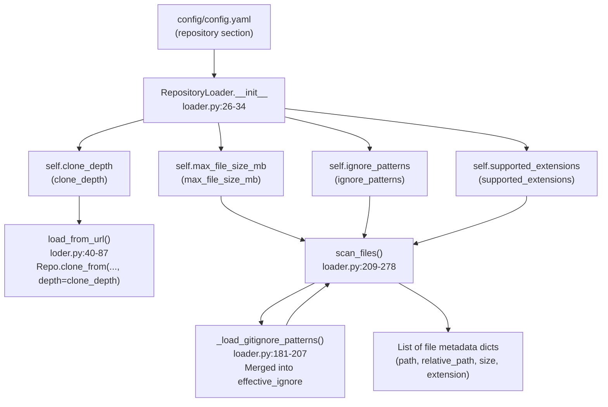
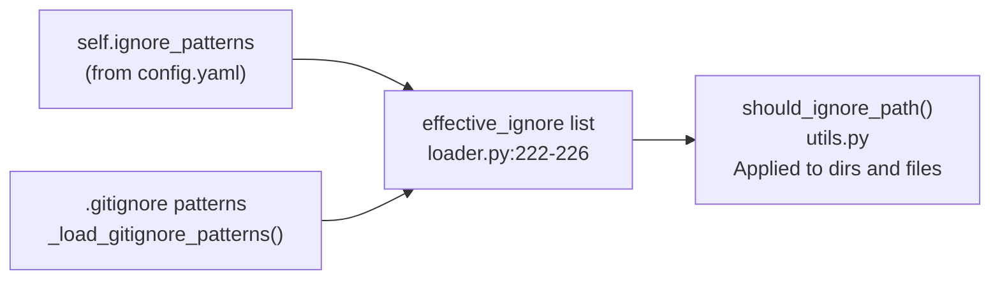
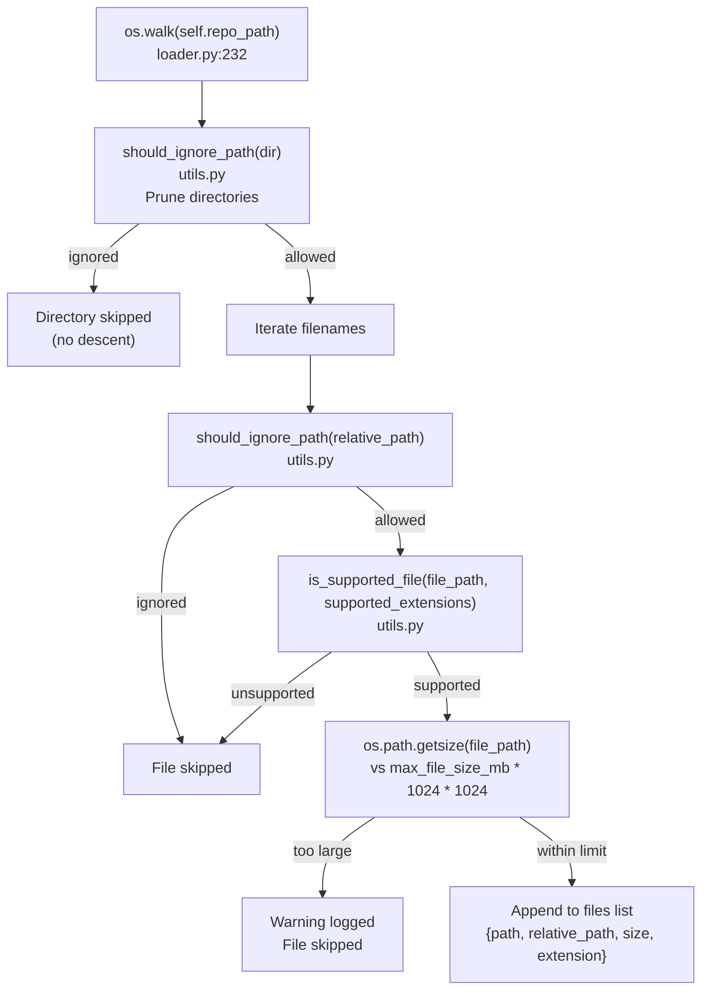
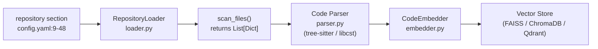

<!-- source: DeepWiki mcp.deepwiki.com · repo HKUDS/FastCode · page 8.1 Repository Configuration · fetched 2026-11-09 -->

# Repository Configuration

<details>
<summary>Relevant source files</summary>

The following files were used as context for generating this wiki page:

- [config/config.yaml](config/config.yaml)
- [fastcode/embedder.py](fastcode/embedder.py)
- [fastcode/loader.py](fastcode/loader.py)

</details>


This page documents the `repository` section of `config/config.yaml` and the top-level `repo_root` key, explaining how each setting controls the behavior of the `RepositoryLoader` class in `fastcode/loader.py`. These settings govern how repositories are acquired (cloned or extracted), which files are admitted into the index, and where cloned repositories are stored on disk.

For documentation on how the loader actually fetches and reads repositories, see the Repository Loader page ([4.1](#4.1)). For adding support for additional file extensions via the parser, see Adding Language Support ([10.4](#10.4)).

---

## Configuration Location

All repository settings live under the `repository` key in `config/config.yaml`. The loader reads this block via `config.get("repository", {})` in the `RepositoryLoader.__init__` constructor.

[config/config.yaml:3-48]()

[fastcode/loader.py:26-34]()

---

## Settings Reference

| Key | Type | Default | Description |
|-----|------|---------|-------------|
| `repo_root` | string | `./repos` | Top-level directory where cloned repositories are stored on disk |
| `repository.clone_depth` | integer | `1` | Git shallow clone depth; `0` means full clone |
| `repository.max_file_size_mb` | float | `5` | Files larger than this are skipped during scanning |
| `repository.ignore_patterns` | list of strings | *(see below)* | Glob/path patterns that cause files or directories to be excluded |
| `repository.supported_extensions` | list of strings | *(see below)* | Only files with these extensions are admitted into the index |

### Default `ignore_patterns`

[config/config.yaml:12-20]()

```
*.pyc
__pycache__
node_modules
.git
*.min.js
*.bundle.js
dist/*
build/*
*.lock
```

### Default `supported_extensions`

[config/config.yaml:22-48]()

```
.py .js .ts .jsx .tsx .java .go .cpp .c .h .rs .rb .php .cs .swift .kt .pyx
.toml .md .txt .yaml .rst .json .html .css .xml
```

---

## How Settings Are Applied

**Repository Configuration → RepositoryLoader**



Sources: [fastcode/loader.py:26-34](), [fastcode/loader.py:40-87](), [fastcode/loader.py:181-278]()

---

## `repo_root`

[config/config.yaml:3-6]()

```yaml
repo_root: ./repos
```

This top-level key sets the default storage directory for repositories cloned from a Git URL. In `load_from_url()`, if no explicit `target_dir` argument is passed, the loader falls back to `"./repos"` as the target directory.

[fastcode/loader.py:57-63]()

The final clone path becomes `<repo_root>/<repo_name>`. If a directory already exists at that path, it is deleted and re-cloned.

---

## `clone_depth`

[config/config.yaml:10]()

```yaml
repository:
  clone_depth: 1
```

Controls the `--depth` argument passed to `git clone` when loading a repository from a URL. A depth of `1` fetches only the most recent commit history, which significantly reduces download size and time for large repositories.

Setting `clone_depth` to `0` performs a full (non-shallow) clone:

[fastcode/loader.py:71-80]()

| Value | Behavior |
|-------|----------|
| `1` (default) | Shallow clone — fastest; no commit history |
| `> 1` | Shallow clone with N commits of history |
| `0` | Full clone — all history fetched |

This setting has no effect when loading from a local path (`load_from_path`) or a ZIP archive (`load_from_zip`).

---

## `max_file_size_mb`

[config/config.yaml:11]()

```yaml
repository:
  max_file_size_mb: 5
```

During `scan_files()`, the loader calls `os.path.getsize()` on each candidate file. Files exceeding `max_file_size_mb * 1024 * 1024` bytes are skipped with a warning log message and are never passed to the parser or embedder.

[fastcode/loader.py:229-259]()

This prevents extremely large generated files (e.g., vendored bundles, large data files) from consuming excessive memory or embedding compute.

---

## `ignore_patterns`

[config/config.yaml:12-20]()

```yaml
repository:
  ignore_patterns:
    - "*.pyc"
    - "__pycache__"
    - "node_modules"
    - ".git"
    - "*.min.js"
    - "*.bundle.js"
    - "dist/*"
    - "build/*"
    - "*.lock"
```

These patterns are checked against both **directory names** and **file relative paths** via `should_ignore_path()` from `fastcode/utils.py`. Directories matching a pattern are pruned from the `os.walk` traversal entirely, preventing descent into them.

Additionally, `_load_gitignore_patterns()` reads `.gitignore` from the repository root and merges those patterns into the effective ignore list at scan time:

[fastcode/loader.py:181-207]()

[fastcode/loader.py:222-243]()

**Effective ignore set at runtime:**



Sources: [fastcode/loader.py:181-243]()

---

## `supported_extensions`

[config/config.yaml:22-48]()

```yaml
repository:
  supported_extensions:
    - .py
    - .js
    - .ts
    - .jsx
    - .tsx
    - .java
    - .go
    - .cpp
    - .c
    - .h
    - .rs
    - .rb
    - .php
    - .cs
    - .swift
    - .kt
    - .pyx
    - .toml
    - .md
    - .txt
    - .yaml
    - .rst
    - .json
    - .html
    - .css
    - .xml
```

Only files whose extension appears in this list are returned by `scan_files()`. The check is performed by `is_supported_file()` from `fastcode/utils.py`:

[fastcode/loader.py:245-248]()

Files with unsupported extensions are silently skipped — no warning is logged. This list acts as an allowlist, meaning any extension not present here is excluded regardless of content.

To add a new language, append its file extension to this list. See [10.4](#10.4) for the full procedure including parser grammar requirements.

---

## File Scanning Decision Flow

**`scan_files()` filter pipeline:**



Sources: [fastcode/loader.py:209-278]()

---

## Interaction with the Indexing Pipeline

The file list produced by `scan_files()` is the entry point for the full ingestion pipeline. Only files that pass all four filters (ignore pattern, extension, size) are parsed, embedded, and stored in the vector store.



For configuration of how parsed elements are indexed, see Indexing Configuration ([8.4](#8.4)). For embedding settings, see Embedding Configuration ([8.3](#8.3)).

Sources: [config/config.yaml:8-48](), [fastcode/loader.py:1-350]()

---

